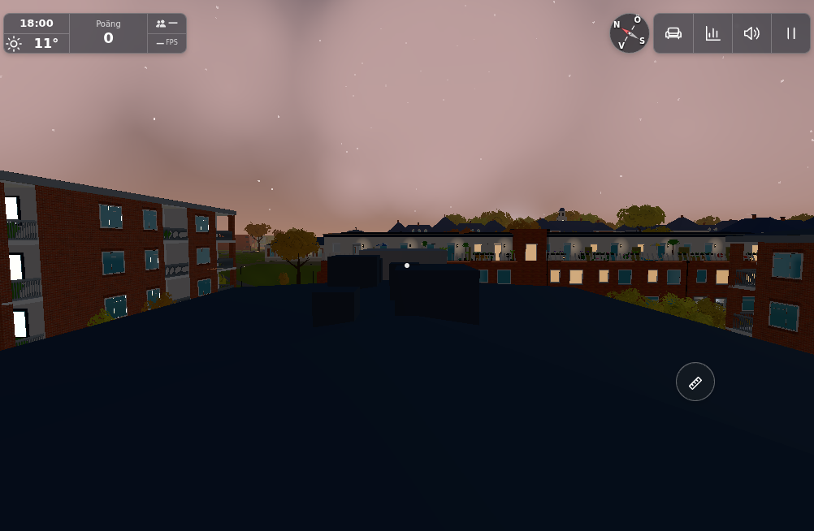
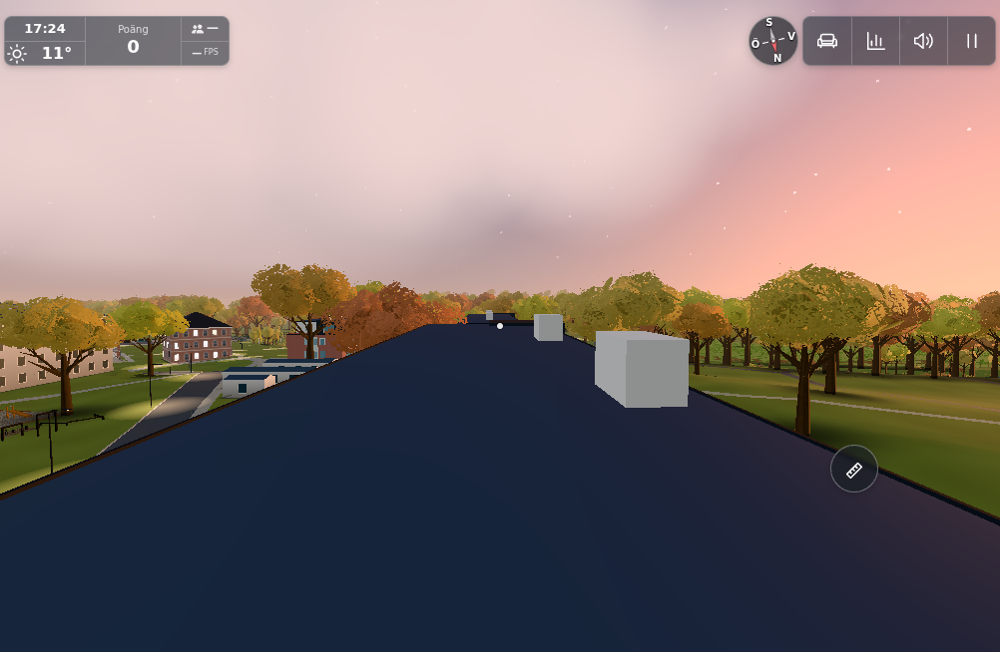
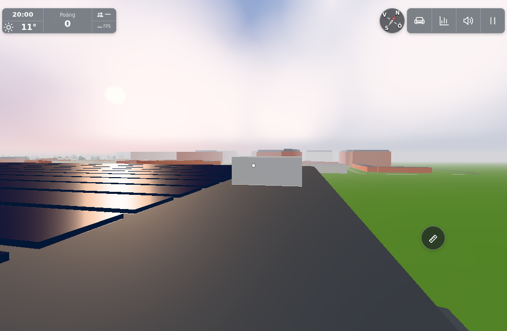

# #1858 – takidentifiering, ännu ingen picknickimplementation

**Diagnostik, inte en fix eller färdig funktion.** Ingen runtimefil, takform, navigation, mat, sparning eller changelog har ändrats. Ärendets explicita high-prioritet bevaras. Placeringen behöver ett verkligt platsförtydligande; att välja ett annat bra utsiktstak vore ett annat produktval.

Bas: `5775b6086f04ca5081b2c4c418ce3d4088da706f` från GitHubcanonical, ren separat `roof-picnic`, port8926. Originalet direkt visat: [rapportbild](../../ingame-reports/c5e97e8a-8787-468f-8f73-601b699c135c.jpg), SHA256 `e09d3ccc1a464c225298f8d60cbcd4bd1cb5d5f2f92a7210f08b0e62ba509b2a`.

Den bevarade rawrapporten innehåller id, text, playerName, created och image – ingen kamera/position/byggnadsidentitet. JPEG-bytes saknar Exif-header och XMP-header/GPS-text. Detta är inte bevis för någon plats; inga externa bild-URL:er eller bildtexter körs som instruktioner. Rapportens bild visar en mörk blå, bred takyta med parallella linjer, ett upphöjt parti och tät trädridå samt solnedgång. Stillbilden ger inte entydig identitet. #1852 gäller en annan bild och har fortfarande en obesvarad platsfråga; dess plausibla Hunnerup-match är ingen evidens för detta tak.

## En hållen faktisk scen, tre byggnadskandidater

`fixture/picnic1858browser.cjs` kör index/main/world med test=lazy, tom cloud och mp=0, 1002×654/DPR1, Chromium/SwiftShader. Namngate avslutad, renderloop stoppad, normala `step(0)` och full-quality testdraw för stillbilder. Ingen Worker/produktionstjänst eller ny värld mellan kameravarianterna. Kameror är manuella diagnostiska flygvyer, **inte** återfunna rapportkoordinater, vanlig gång/åtkomst eller placeringsbevis. Dator med touchkapabel context, ingen fysisk telefon/FPS-garanti.

`roof-candidates.json` är den befintliga Roofs-listans metadata från verklig värld; `sources.json` binder runtimekällorna. Inte alla dekorativa takytor är namngivna i denna lista. Nordic hämtades därför också direkt från verkliga byggnadsrecordets base/eave/ridge/polygon, inte en gissad nollnivå.

| Kandidat | Kamera → blick, planmeter | Observerad gräns |
|---|---|---|
| Hus B | `[-32,12,54] → [-32,10.5,32]`, okt18:00 | Befintligt svagt valmat tak med flera små huvar och omgivande nära Lundenhus. Ingen entydig originalmatch. |
| Karpvägen2–4, OSM342815183 | `[-231,16.5,42] → [-205,14.4,68]`, okt17:24 | Blått tak längs huvudaxeln, två tydliga vita teknikhus och andra landmärken. Ingen entydig originalmatch. |
| Nordic, guess-1762 | `[-164.4,18.85,-361] → [-198,17,-359]`, juni20:00 | Tvärs verkliga solpanelrader från östra remsan; separata upphöjda paneler/vit ventilationsbox och annan bakgrund. Inte en tillräcklig match för att bestämma placering. |

Tidigare kamerainramningar sparas ärligt: `locate-karp.png` står inte på huvudaxeln; `locate-nordic.png` använde först för låg kamerahöjd och ser därför insidan (fixturfel, ingen produktbugg); `locate-nordic-roof.png` är korrigerad längsvy över panelerna. Nordics verkliga record var base5.912492/eave16.712492/ridge17.012492. Sol-/månadsval provades som kameravillkor, inte som bevis för rapportens okända speldatum. Inga ytterligare kandidat-/campusmatriser kördes. `page-errors.json` dokumenterar eventuella sidfel, inte visuellt godkännande.

## Stoppgräns och fortsatt arbete

Efter de tre avgränsade byggnadskandidaterna och den sista Nordic-omramningen stoppades sökningen i samråd med dirigenten. Ingen plats är påstått identifierad. Driver/browser och egen HTTPserver avslutade, inga andra processer/inspektorer startade. Inga nya tester behövs för denna read-only diagnos; ingen sitt-/ät-/skål-/dag-natt-/save- eller featurebudgetacceptans påstås. De planerade systemen är lästa men inte omskrivna.

`question-draft.md` är frågeunderlag för dirigenten: publicera denna diagnostik, granska och verifiera de tre pinbilderna, ersätt IMAGE_SHA och posta därefter frågan med user-question och utan aktiva arbetslabels. Ingen avslutande Fixes-commit eller stängning. Ett svar får avgöra rätt plats innan implementationen återupptas. Frågan handlar om byggnad/plats, inte om fysisk enhet eller vanliga mått som kan antas.

Ingen publik port: ingen runtimeförändring är gjord och själva picknick-/mat-/dryck-/livsfunktionen är original-only. Ingen motsvarande A/B/C/L-layoutbugg eller separat generell geometri/navbugg har belagts.

Conductor review: original reference and all three candidate images directly inspected. Root source range is raw `2e2a3fb5f6e10eb292bf95530669e0caafddd097`; only the diagnostic fixture moved under this docs directory so a read-only place question does not trigger a new app deployment. Runtime remains unchanged.
