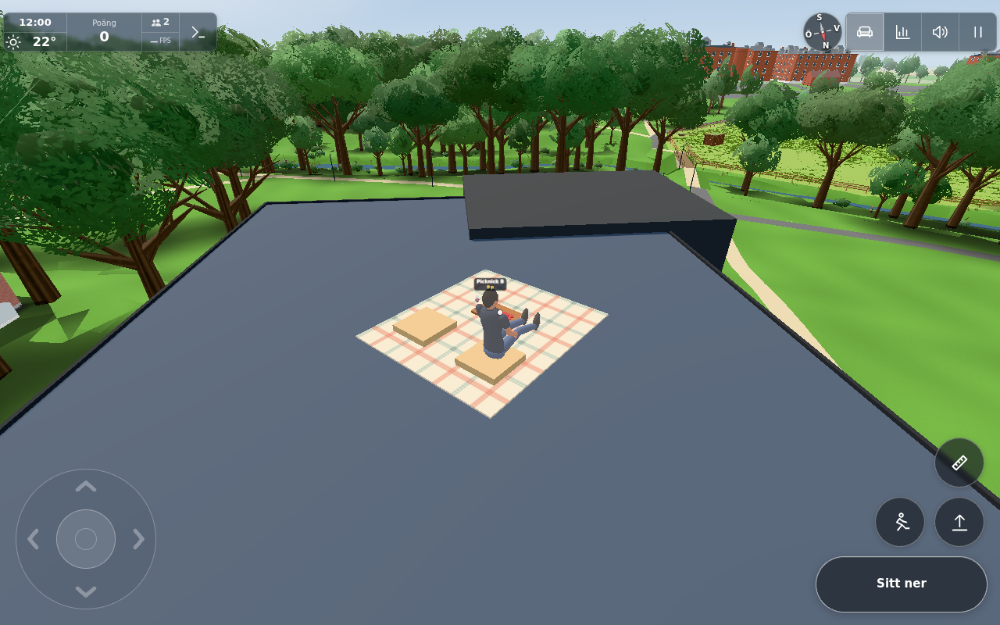
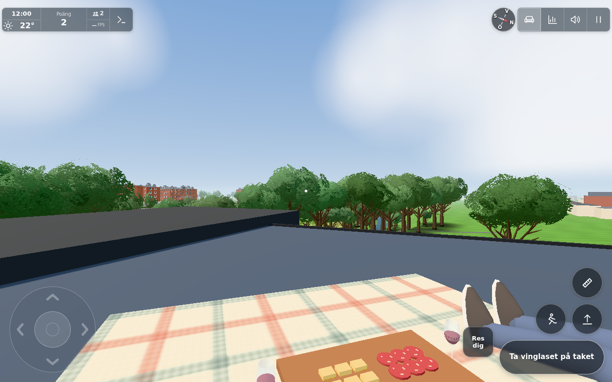
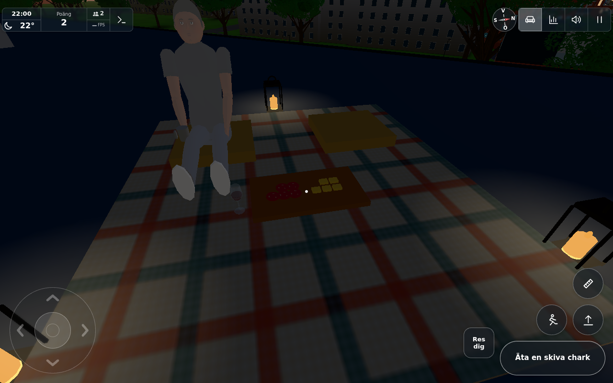

# Roof picnic — #1858

Base: `a500ab760f4f1aaa3f055b0d091a5853ab4c5968`. Final files and image hashes are in `manifest.json`. User assumption: comment6629838666 approves provisional Karpvägen8, movable later. `ROOF_PICNIC` centrally owns anchor/yaw/look. Actual mapped record342815182 is Karpvägen6–8; the8 end remains an inference. No house, roof, collision or access geometry changed.

Three sufficient risk groups, reassessed after10minutes; no broader sweep:

1. **Actual roof/contact/view and bounded rendering.** One real full app at localhost8945, mapped roof `bld-342815182`, walk height13.1039017774. Four blanket corners sample this same upper height; margins4.01–6.00m are to the outer footprint (not the upper inset boundary). The upper cap is existing height+.01; blanket bottom embeds that1cm, top+.035 clears it. Downward rays at both seats hit actual `west-karpRoof` at13.11390209 (visible cap). Two seats and return position remain on this same roof. Existing installations remain. Component1950triangles, no new Light/shadow map; two existing Glass models additional. Cloth128px/glow64px procedural textures, finite geometry,130m decoration distance gate. Existing jetpack/Spiderman access is unchanged; no end-to-end street ascent or device performance claim.
2. **Native actions, finite stock and existing contracts.** Touch taps on actual #action sit, take Glass, drink(.45→.30), eat one cheese and chark through actual Life/Runner (remaining[5,5]); native #stand-btn returns to supported roof13.1039. Desktop pointer-lock gesture fixture then actual keyboardE selects the same Rest target. Fixture aims camera and controls simulation; this is not an unassisted phone session. Actual Keep snapshot records stable anchor-independent glass keys, wine.30/.45 and Life extra[5,5]. Node tests use real Glass/Rest/ActionSet/Runner and a minimal Life adapter: empty/partial wine restore/home, finite depletion/restore, cancellation, reach and held guards. No full-app reload claimed. Per-player finite food is deliberate existing Life semantics, no shared food authority. Real Ghosts connects both clients to our local Worker8946: A is actual world, B is a small real Rest/Glass/Ghosts fixture at matching height, not another full-world scene. Both peers see pose3 and held categorycup. Native Atoast reachesB; Btoast reachesA and existing Aautoanswer returns `b:true` toB. No protocol/Worker logic changed. `browser-proof.json` records this, with no product page errors.
3. **Actual day/night result.** `day.png` shows placement/contact/peer. `seated-river-diagonal.png` shows ordinary seated river-park view around preserved endbox. Final look[-185,206.543] replaced the initially obstructed straight look; existing held app's two look positions were updated to exactly the final config, no world rebuild. `night-serving.png` shows serving and three warm lantern pools at22:00, daylight.108; actual frozen Day model updated then normal step/render. Full quality/shadows enabled. Camera/time/pause are fixture controlled, not retouched images. Root directly reviewed all three final views. Initial straight seated/night overview drafts excluded.

Checks: `node --experimental-default-type=module --test tools/roofpicnic1858test.mjs` 3/3; `node --test cloudflare/deploypaths.test.mjs`1/1; JS syntax for new module/main; diff whitespace. See `node-tests.txt`, `deploypaths.txt`. Static ES modules: no application build step. config/heldcategory paths trigger Worker deployment as well as Pages; conductor must await both real deployments.

Original-only gameplay/food, so no public downstream port. No new meal/reward/stat system, roofs, service integration, dependencies or external assets. Existing wine statistic and ordinary bite events remain. Parent conductor publishes image URLs embedded on issue before closing; this Refs handoff neither pushes nor closes.

