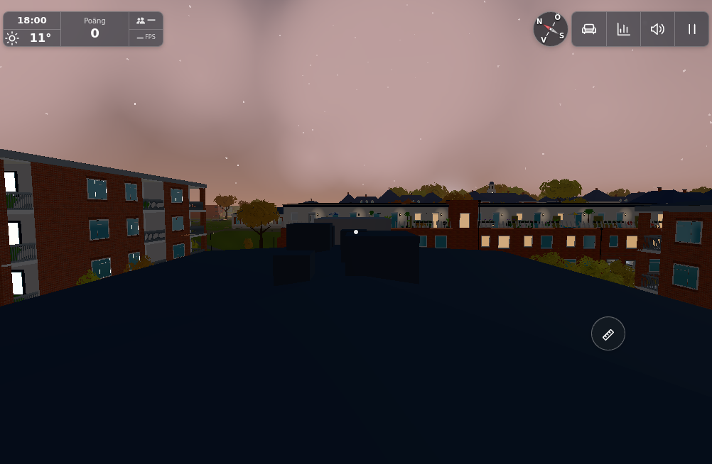
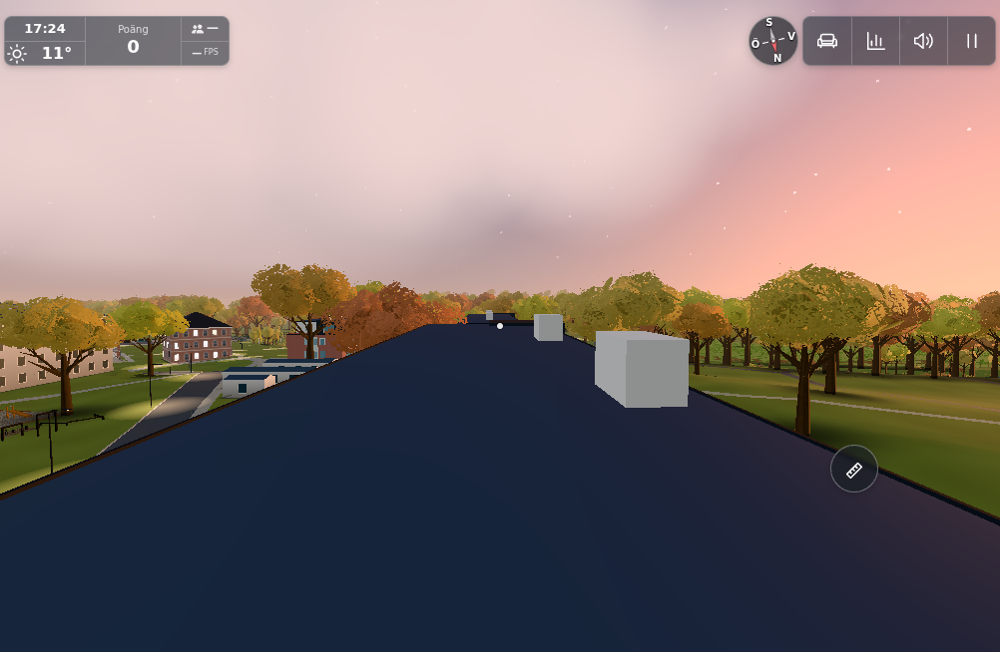
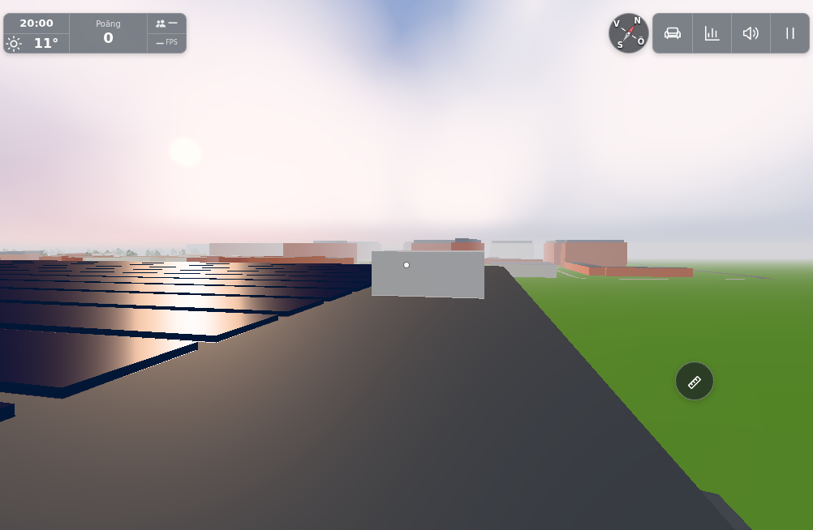

<!-- orchestra-question: olw-win10-gpt6-20261103 #1858 -->
Jag har jämfört bilden med befintliga tak och byggnadsdata men kan inte identifiera rätt tak säkert. Rapporten innehåller inga kamerakoordinater. Jag har därför ännu inte placerat picknicken eller ändrat något tak.

**Vilken byggnad gäller taket på originalbilden? Ange gärna byggnadens namn eller markera den i en kart-/områdesbild. Om du inte vet namnet: från vilken plats tog du dig upp på taket?**

Här är tre diagnostiska jämförelsevyer från den faktiska scenen, utan någon ändring. De är inte påstådda matchningar eller färdiga efterbilder:

Jag vill kunna placera filten, sittplatserna, maten och lyktorna på just det tak du menar, med säker marginal och kontakt mot det befintliga taket. Prioriteten ligger kvar på high. Ärendet hålls öppet i väntan på platsförtydligandet; övriga startbara originalärenden fortsätter under tiden.

[Diagnostikens källa, kameror och begränsningar](https://github.com/solwation/lunden-3d-apartment/blob/IMAGE_SHA/docs/verification/1858/README.md).
