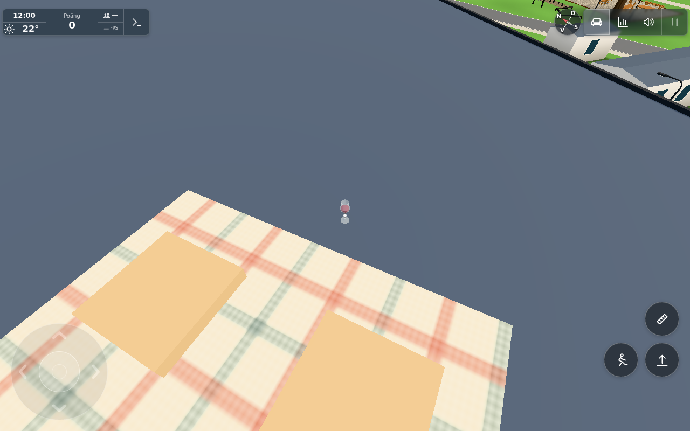
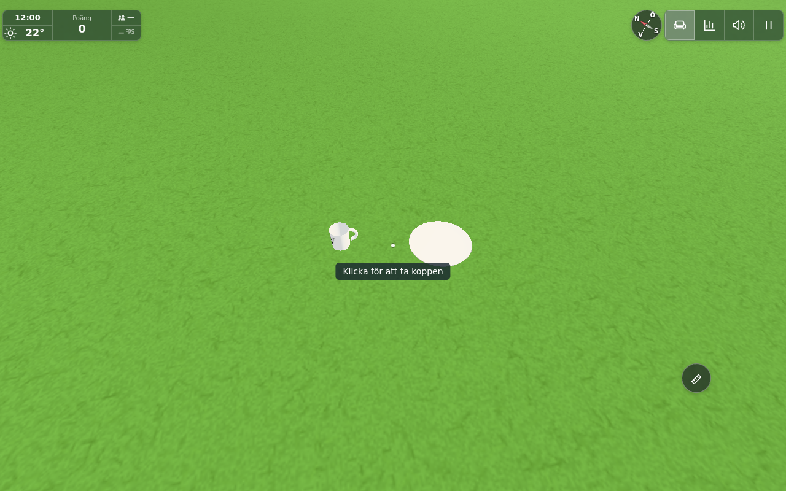

# Ground and roof placement — #1862

Base `6d584a3d1e9769e2742ddcc9bcda54ac4631111c`. Exact delivered source and image hashes: [manifest](manifest.json). Original report: `docs/ingame-reports/a7da3715-0b3d-421c-8230-3b7027abd791.jpg`.

Ordinary held objects now select actual opaque upward-facing ground/roof triangles throughout existing WALK, without the apartment's outdoor y=0 plane or a forward fallback when looking into air. The support must agree with existing walking support, remain dry, be within full 3D reach and clear the existing collision segments. Grid snapping resamples actual contact and revalidates it. Existing registered roofs retain their own slope eligibility; unregistered ground uses WALK.maxSlope. Indoors, authored tops, stacking, containers, yaw and special-item rules retain their original paths. The cat retains its dedicated outdoor behaviour. No buildings, terrain, roofs or navigation dimensions change.

LifeItem's outdoor floor guard now resolves existing outdoor walking support (with the same small coating tolerance), so a valid below-zero placement is accepted. Indoor floor protection is unchanged. Existing Keep/Life formats are unchanged; no inventory or multiplayer authority is introduced. This is original-only held-object gameplay, not a public port.

## Three risk groups and results

1. **Actual support and invalid targets.** One real full app, own source server8950, cloud disabled. Karpvägen8: blanket support13.13890178 and bare actual `west-karpRoof` cap13.11390209; glass model bottom uses existing1mm lift. Distant dry valley ground near[-180,170], outside OUTDOOR: mug target[-180,-3.03054151,169.2], actual Life plate target[-179.6,-3.02909114,169.3]. Home floor[4.3,0,3.6] and counter[5.25,.93,2.6] still selected. Looking into air produces no place target. Actual mapped river predicate at[-180,-9,207] rejects submerged support (water−7.21218); no in-water player session is claimed. Component cases cover hidden/missing support, long reach, walls/first opaque obstruction, water/region rejection, snapping off edges, steep ground and registered sloped roofs.
2. **Native input and serialization.** Native touch #action placed and retook the real picnic Glass; real pointer-lock gesture followed by native keyboardE placed/took an ordinary Cup without outdoorPlace, and placed a real Life plate below0. Plate acquisition from its kitchen store used the fixture's existing Items.move(ignoreShut), not a native cupboard interaction. NativeE also placed the mug back on the home floor. Actual Keep saved model position/quaternion/wine; Life saved the plate's world position/yaw. Existing `loadWorld` partial restore of things/cups/life restored mug[-180,-3.031,169.2], glass[-155.5,13.115,112.9], and the actual Life plate world place. This is production serializer/loader evidence, not a full reload or network test. See [browser proof](browser-proof.json).
3. **Result views and local cost.** [Roof](https://raw.githubusercontent.com/solwation/lunden-3d-apartment/2eaf0273ce3228c8322a17a14f72869abea00b42/docs/verification/1862/roof-placed.png) shows the relocated glass on the actual cap beside the blanket; [valley](https://raw.githubusercontent.com/solwation/lunden-3d-apartment/2eaf0273ce3228c8322a17a14f72869abea00b42/docs/verification/1862/valley-placed.png) shows mug and plate contacting the distant sloping lawn. Full quality/shadows, fixture camera/route/time control, no image edits. No render geometry/material/light/texture added. Static mesh references and their bounds are collected lazily once, without replacing authored tight terrain bounds; local distance/ray boxes discard candidates. Identical aim reuses positive support while revalidating reach/dry/segments/normal/transform/geometry/visibility. Controlled changed-aim step samples were18–23ms; first lazy lookup including world initialization168.7ms, later unchanged-aim full-world step8.1ms. These include unrelated app work under Chromium/SwiftShader and are not device FPS guarantees. No broad profile or phone matrix.

The desktop terrain's physical query master is deliberately hidden while its identical split render meshes have raycast disabled (`terraincells.js`). Only that named master, with a visible render split, gets a narrow visibility exception. No generic hidden-surface permission exists.

The held app was reused across the focused fix: final visibility and positive-cache prototype methods were loaded from the revised module, and Life.floorY was set to the exact final config-based resolver. Existing split terrain tight boxes were restored after an early diagnostic constructor recomputed them; final constructor preserves them. Final additional registered-roof slope/cache-draw-range guards are covered by the component run and leave the pictured flat support unchanged. No second full-world bootstrap was needed after this source refinement. Early bootstrap syntax/fixture-shape mistakes were corrected; final product page-error list is empty. No native-device, full-flight, service-sync or whole-world matrix claim.

Checks: [component tests](node-tests.txt)6/6; [deployment paths](deploypaths.txt)1/1; JS syntax and diff whitespace pass. Static ES modules, no application build step. Verification was reconsidered around10minutes and limited to the remaining Life-below0, home and serializer checks, then stopped. Own browser/server stopped. `src/config.js` affects Worker deploy paths: conductor awaits actual Pages and Worker deployments, publishes embedded permanent image URLs, then closes.

## Published result

Source/image commit `58c182c645f5699ae804d8c8b24b3f0b6f088daa` is on main. [Pages41835879004](https://github.com/solwation/lunden-3d-apartment/actions/runs/41835879004) and [Worker41835878968](https://github.com/solwation/lunden-3d-apartment/actions/runs/41835878968) succeeded, including the actual Wrangler deploy step. Live version `58c182c`, content `711ec3c33d91`; published groundplacement/main/config files match the tested source after only the declared cachequery normalization. Source/image manifest matched at integration. Both final images were directly inspected and their permanent bytes verified before [embedded completion6631551226](https://github.com/solwation/lunden-3d-apartment/issues/1862#issuecomment-6631551226), before closure. No functional reruns across the unchanged cherry-pick. Approximate phases: source/implementation8min, held-app focused checks and corrections12min (reviewed near10), docs/review/publication4min. No public port: held-object gameplay only, no building/navigation fix.
