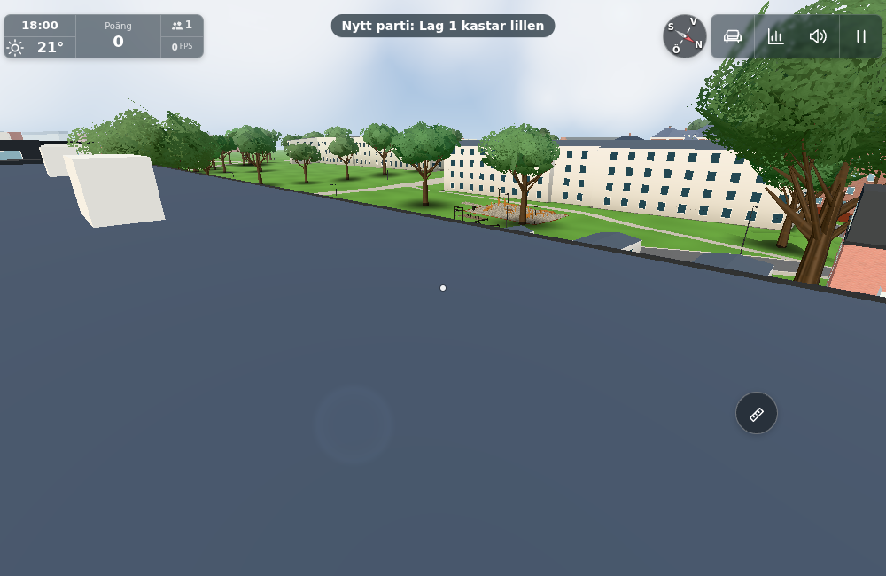
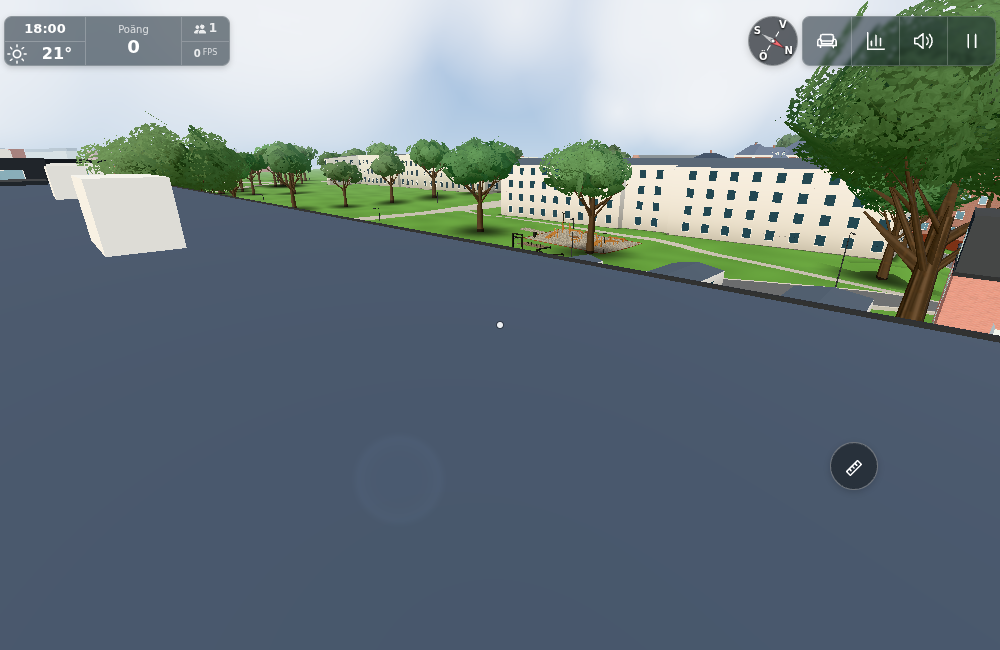
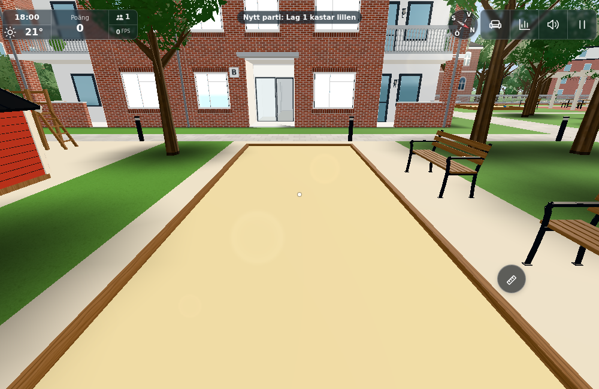

# #1863 — unsolicited boule notices

Base `6d584a3d1e9769e2742ddcc9bcda54ac4631111c`; tested runtime checkpoint
`74343eba65f99015b106ae9d67979e32a9d0bce6`. Only `src/bouleclient.js` changes
runtime behavior. Main's real `world.boule.onEvent → stats.badge` callback, server,
protocol, rules, physics, score, replay and geometry remain unchanged.

The room correctly broadcasts authoritative state to all clients. The bug was that
`receive` forwarded every new snapshot's rules message to HUD, including a welcome,
without checking existing `participated && near` interest. Reconnecting reset `q` and
could repeat the same verdict. The fix filters only verdict notifications, remembers
the last **shown** revision across reconnect, and retains explicit pending-request
rejection/timeout feedback even after walking away. State/replay always update.

## Three checks

- **Regression:** `regression-before.txt` has the two new silent-observer cases failing
  on baseline; `regression.txt` has **21/21 passing** client, true Worker/Room and
  existing boule rules/physics tests. Covers uninterested welcome and new state, near
  nonparticipant, near participant, walking away, duplicate ACK/reconnect, own reject
  and timeout/resync, plus existing turn ownership, all seven objects, final score,
  persistence and deterministic replay. Command:
  `node --experimental-default-type=module --test tools/bouleclienttest.mjs cloudflare/boule.test.mjs tools/bouletest.mjs`.
- **Actual local Worker:** `tools/boulenoticeworker.mjs ws://localhost:8952` uses real
  WebSockets, the existing `cloudflare/dev.mjs` and production BouleClient. `worker.json`
  records quiet initial welcome/background updates/near nonparticipant, preserved
  participant ACK, silent identical reconnect and silent distant former participant.
  Both clients end at revision 7 with equal rules. The first fixture used 260ms
  between resets and hit the existing 400ms rate guard; corrected to the configured
  interval plus 100ms, then passed. No server change was needed.
- **One held actual app:** `tools/boulenoticebrowser.cjs` and bounded recovery helper
  reuse one index/main/world, Chromium 1208/SwiftShader, 1000×650/DPR1, test=lazy with
  full-quality still draws, and one lightweight genuine local Worker peer. Only the
  before phase substitutes the exact baseline production BouleClient module from
  `6d584a3d`; the actual new net/handlers are restored for after phases. This is a
  receive-path A/B in the same current world, not two complete app builds. The event
  observer forwards through the real production HUD badge function. `browser.json`
  and `recovery.json` show the unsolicited old verdict on the distant roof, **zero new
  boule events** across two fixed remote resets while state reaches q18, and the
  preserved participant's real reset ACK/HUD at q19. Ordinary player-join notices
  remain allowed. Before/after roof cameras match. Images were directly inspected.

The report image is only a contemporaneous picnic view with no visible boule message;
it does not establish an environment defect or a precise camera to reproduce. The
result roof views establish distance from the court, not picnic rendering/placement.

## Fixture limits, scope and delivery

`browser-driver.txt`, `browser-error.txt` and `fixture-error.png` preserve the initial
fixture waiting for connection while the start overlay was still open. Corrected the
order and resumed the same held Page via the owned local Node inspector, with no new
world bootstrap. Only affected pictures were retaken after noticing the 2.6s badge
expired during an rAF wait; timer polling captures the actual short-lived badge. The
recovery observer was reset to avoid stacked diagnostic callbacks. The original driver
CLI remains failed; the separate recovered HUD checks/images passed. Its empty recovery
errors list is not a full startup/console audit. No full match/native-input replay,
physical-phone, campus sweep or FPS claim; those unchanged baseline contracts are
covered by the existing targeted tests and #1854 evidence, not reasserted by these images.

No mesh/material/light/network message type or persistent participation model was added.
No architecture changes, so A/B/C/L equivalents do not apply. Public transfer is **not
applicable**: this is original-only gameplay/network-notice behavior, excluded publicly.
Changelog id 1439 was selected at conductor integration, preserving #1862’s existing1438.
`sources.json` binds the runtime, fixture inputs, raw results and final image bytes.
All owned browser/inspector/Worker8952/HTTP8951 processes were stopped before handoff.
The conductor owns integration, pinned embedded images, actual triggered Pages/Worker
status and closure; this worker neither pushes nor closes.

2026-11-04 UTC: scoped diagnosis/checkpoint completed by 13:00; renderer-free checks
passed before the shared browser wait; browser resource acquired about 13:07 and the
single-app recovered HUD evidence completed about 13:13. Verification was reassessed
at the ten-minute point: reused green checks and finished only the missing HUD proof.

Conductor integration retained the prior placement change (#1862) in main/config: only its GroundPlacement wiring/outdoor Life support constants differ from this fixture baseline; BOULE config, event-to-HUD callback and all tested boule/Worker inputs remain exact. Every other recorded source/image hash matches. Source-bound green checks are reused across this unrelated rebase; no routine functional rerun. All three result images were directly reviewed by the conductor.

## Conductor publication

Source/images `a40a5504f1abde2a5479b75cb2ad3513e349916f`; [Pages41837263967](https://github.com/solwation/lunden-3d-apartment/actions/runs/41837263967) succeeded. Live version `a40a550`, content `f1a0cc0ff437`; bouleclient/main/config/groundplacement byte-match the integrated source after only declared cachequery normalization, preserving #1862. No new Worker path changed, so its prior actual deployment remains applicable. All three final images were directly inspected and pinned image bytes verified before [embedded completion6631775761](https://github.com/solwation/lunden-3d-apartment/issues/1863#issuecomment-6631775761), before resolving push. Tests and actual Worker/HUD evidence were reused across unrelated placement integration under the source scope above.
