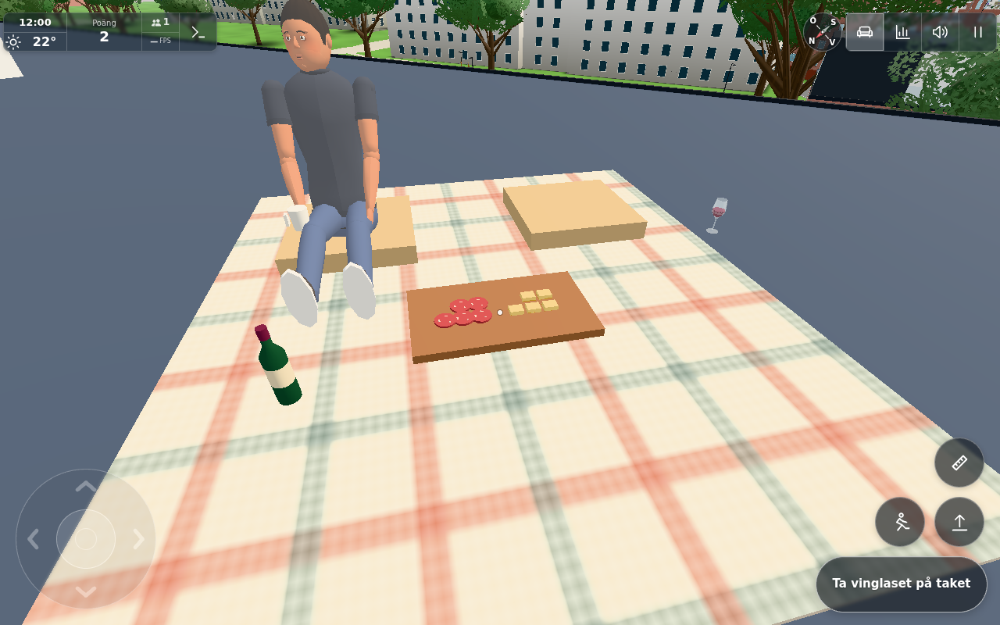

# Shared finite roof picnic — #1864

Base `ca5fc7035548b94175b7a0a6de7dc7b82d60db0b`. Server stage `d07d8e0aeeae8b01fdd53ecff370b690c6dadd42` must be integrated/deployed before the following client commit. No push/closure by this worker. Exact source/image hashes: [manifest](manifest.json).

One fixed canonical record in the existing PlayerRoom owns two112.5ml wine glasses, one750ml bottle (reasonable model assumption), six cheese and six charcuterie portions, their movable object poses/owners, and two seat claims. The same central anchor/yaw/look and sampled roof geometry remain. Atomic revision-checked transactions take/put/sip/pour/bite/sit/stand persist before ACK/broadcast. Only fixed operations/indices, bounded WALK coordinates/quaternion, actor reach and a rate gate are accepted. Private32hex session keys and64 bounded replay receipts support recovery; keys never enter welcome/broadcast/screenshots. An active second connection cannot rebind the same key. Leave retains a two-minute recovery lease; expiration returns items to their last safe world pose without replenishment. Discrete orphan refresh is at most once per half-lease while needed, no per-frame network/storage stream.

No local replacement inventory exists. Capability plus acknowledged get are required before shared mutation. Old/private Keep objects and picnic-rest records are excluded; the old Life extra cannot restore quantities. Only these three items are fenced from private bottle imports/exports, private dish racks, local shattering/points and local home resets. Existing ordinary items retain those paths. F/back requests a confirmed return to the site home within reach; normal placement uses #1862. Existing Glass/Bottle pour, sip, held-proxy and toast, Rest and Life Runner remain the actual interaction paths. Bite/wine events happen after successful ACK once, with no new rewards.

## Three sufficient risk groups

1. **Protocol, races, persistence and compatibility.** [Server-stage tests](server-stage-tests.txt)8/8 include real Worker/PlayerRoom capability/dispatch, two-player stale races, take/seat exclusivity, finite sip/pour conservation, malformed commands/coordinates/poses, actor range, rate/monotonic/replay, storage-failure rollback, late welcome/hibernation, lease expiry and double-active reconnect denial. Existing fish/nut room checks and deployment import paths pass. [Combined scoped checks](final-tests.txt)12/12 cover the same server plus real Glass/Runner adapter and retained geometry tests. Final narrow ownership/private-hand restoration protection is additionally covered by [client-final-fences](client-final-fences.txt)1/1: no duplicate sip event, canonical ownership waits safely behind a private restored hand and resumes when free. Legacy food tests now explicitly model acknowledged shared requests and ignored local extras; they no longer assert obsolete per-player stock. Syntax/diff checks pass. No application build step (static ES modules).
2. **One actual app and a small actual peer.** Own app8953 and local Worker8954, no public mutation. Native A touch sits/takes/drinks/toasts/pours/eats/puts down; B uses native clicks on small fixture buttons wired to actual Ghosts/PicnicClient/Glass/Rest/Life Runner. Both claimed seats and real peer pose3/cup were observed. Two sips change112.5/112.5/750→75/75/750 on both peers. Native held-bottle “hälla vin i” refills the glass through existing Glass.pourFrom; both converge to112.5/75/712.5 (900ml total after75ml drunk). Native A toast reached B through the unchanged existing toast path. B's cheese Runner and A's charcuterie Runner converge to[5,5]. A fresh-identity latejoin sees the consumed quantities and then-current home poses; a later B reconnect changes socket ID yet recovers its75ml glass and seat without replenishment. Finally A native touch drop moves glass0 to actual bare roof cap[-154.1,13.11490209,114.2], exactly the same canonical pose on B. [Public-only browser proof](browser-proof.json) records these values and no product page errors. B is a renderer-free production peer on a controlled same-height roof fixture, not a second full world or physical phone. Real DO hibernation/storage failure are tested in the server harness, not by restarting the in-memory local dev server.
3. **Actual result and bounded visual cost.** [shared-serving.png](shared-serving.png) shows the finite refill bottle, remaining food, seated peer with existing held proxy, and glass relocated onto the actual roof. Frozen12:00, clear June, full quality/shadows; fixture camera and arrival, no image edits. Added bottle only: three meshes,240 triangles, three plain materials, no new light/shadow/texture asset. Unchanged blanket/seat/river-view/contact/lantern day-night evidence is reused from [#1858](../1858/picnic/README.md); no extra evening/roof/phone matrix. Existing held rendering conventions remain.

Verification was reconsidered near10minutes and limited to the remaining pour/food/latejoin/reconnect/drop/view. Browser turn released to the clock worker immediately afterward. All own browser/app/Worker processes stopped. No broad performance or hardware guarantee.

## Source phases and limits

The same held full app was reused. An early peer fixture inherited A's same-origin session key and was correctly denied; it was replaced with its own identity. Per-key request-sequence persistence and bounded orphan refresh were loaded into A's existing production prototype; later thin-peer reloads loaded that final source normally. The final private-hand ownership reconciliation guard is component-tested and does not change the observed already-owned/held branch or image. No second full-world bootstrap or unclaimed final-source reload is asserted. No private key is recorded in the public proof.

No generic inventory, private dish authority, new score/farm, public downstream port, roof geometry, time protocol or broad network rewrite. Time/lantern geometry is unchanged and does not depend on #1865. Picnic's dedicated Ghosts hook composes a prior hook and leaves onWelcome/onTime intact.

Conductor next: integrate/publish server stage first and await actual Worker deployment; then client commit and actual Pages+Worker deployments (heldcategory also triggers Worker). Review and embed the image using a permanent commit-pinned public URL before closing. Changelog ID is provisional until final integration.

## Published integration

Root integrated server `d07d8e0a` as `e3c07d170ca177054adb8ffddfcb652168672137` on the current original main. Its actual [Worker deploy41842643608](https://github.com/solwation/lunden-3d-apartment/actions/runs/41842643608), including the Wrangler action, succeeded before the client push. Client `aaabd461` became `43fc31b49ba33e13a82311d682a38dcf16228f94`; all manifest source/image SHA256 inputs match exactly. The only merge conflict was the provisional changelog ID: picnic1440 preserves concurrent boule1439. No changed input justified rerunning the green scoped checks.

Client [Pages41843016749](https://github.com/solwation/lunden-3d-apartment/actions/runs/41843016749) and actual [Worker41843018427](https://github.com/solwation/lunden-3d-apartment/actions/runs/41843018427) succeeded. Published version43fc31b/contentc1227191da3b was checked, with11 live modules byte-matched after removing only stamp import queries, including unchanged placement and boule modules. Root directly inspected the result image and verified its permanent raw URL/SHA256 before embedding it in [issue comment6632553932](https://github.com/solwation/lunden-3d-apartment/issues/1864#issuecomment-6632553932), before closure. Original-only gameplay/Cloudflare state has no public port. No production shared stock was consumed for verification.
