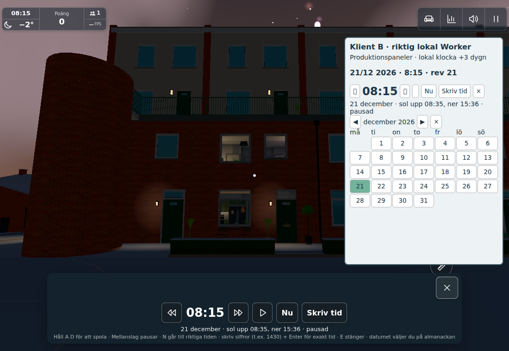
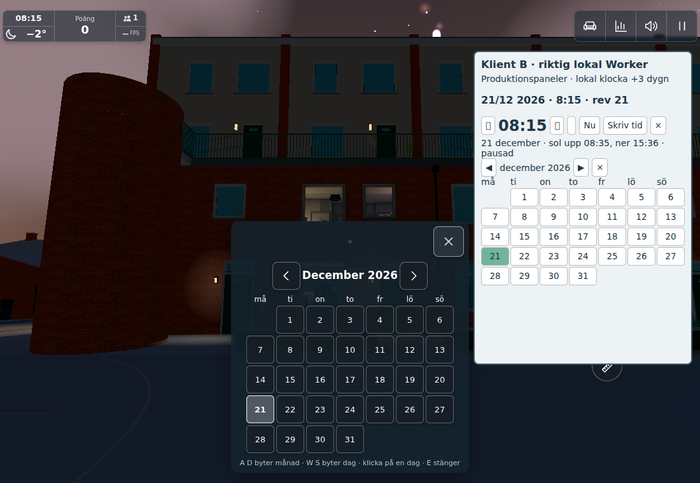

# #1865 — persistent authoritative world clock

Base `c3ad66733d71aaef7b02d4eb7b4eec8d4797f5e3`. The old client-wall-clock offsets and
empty-room reset are superseded **only for time**. `world-time-v2` is one DO.storage
record `{v,q,stamp,at,p,s}`, saved before accepted publication. Its calendar stamp is
UTC-serialized **world civil fields**, not a visitor-local epoch. Initial/explicit Nu
uses server Europe/Stockholm; thereafter the game calendar runs continuously from
server reference + real elapsed (including through empty room/hibernation). This is
not a promise to reinterpret an edited game calendar at civil DST transitions.

Existing connected visitors retain the same clock controls/rights. New versioned
commands have bounded fields/range/rate/revisions; old arbitrary client offsets cannot
write canonical time. No binding, per-frame send, clock-tick write or new role. Normal
entry/restart receives the server clock without changing it. Explicit clock/calendar,
day/night cheats and spool start/stop use one TimeSync path; local time URL fixtures
(including newyear) stay local. Shared spool uses real elapsed rather than capped dt;
local previews retain existing behavior. Open clock/calendar keep the connection;
explicit time edits count as activity. One pending control waits for its ACK, then
300ms before the next enters Ghosts' 5Hz queue, avoiding compressed delivery/rate loss.

## Three risk groups

1. **Deterministic model/persistence:** `server-initial.txt` + `model-client.txt` cover
   server reference through empty room/restore, paused and spooled timelines, server Nu,
   bounded range/rate/replay and equal world fields in UTC/Los Angeles/Tokyo. The existing
   PlayerRoom suite passed 73/74 initially: its sole changed expectation allowed only
   football storage. The explicit inventory now also allows only `world-time-v2` (no
   chat history); the affected chat/time tests pass 2/2 in `players-corrected.txt`.
   Final save failure (`storage-final.txt`) returns **old q/state only to sender**, no
   success/new revision/broadcast. Same q can succeed after storage recovers.
   `client-final.txt`: **6/6** final TimeSync tests include authoritative fields,
   disabled/older Worker, no receive echo, coalescing, ACK/transport timing and the same
   UI client releasing pending on storage refusal and retrying unchanged q. Unchanged
   green tests were reused, not rerun as a larger matrix.
2. **Actual local Worker:** `tools/worldtimeworker.mjs ws://localhost:8956` uses two
   production TimeSync clients over real local HTTP/WebSockets. `network.json` records
   no welcome writes; explicit paused calendar, reconnect, late-join elapsed spool,
   running through empty room and server-selected Nu. Four control sends, maximum
   66 bytes. This phase predates final ACK/idle/error guards; the final live UI and narrow
   tests below cover those changed boundaries. Restore/hibernation is additionally
   exercised through actual PlayerRoom + its existing fake-runtime storage harness.
3. **One actual world + small UI peer:** final `browser.json`/`browser-driver.txt`,
   Chromium 1208/SwiftShader, 1100×760/DPR1, test=lazy logic and full-quality still draws.
   Tokyo browser context; peer Date.now deliberately +3 days. The peer uses production
   TimeSync, ClockPanel, CalendarPanel and actual cloned panel DOM, with a renderer-free
   Day/physical calendar collaborator; it is not another world or a second full DayCycle.
   Native clock input, pause, peer month/day clicks, native terminal day/night commands,
   native held spool/release, Nu, reconnect and ordinary restart all passed. Both end
   paused **08:15, 21 December 2026, q21**, including after restart with no new write.
   Active-spool comparison allows one sampling interval (0.5 game hour at 1.5h/s);
   release/paused time matches again. Thirteen accepted edits, fourteen control sends
   including the early rejected timing probe; peer reload counters are accounted for
   separately. No receive/per-frame clock stream. No observed page errors.

## Honest fixture phases and limits

The initial browser CLI is failed, not a green run: its quick pause exposed the
ACK/transport timing boundary. During diagnosis the stationary UI/peer also expired;
open-panel interest/activity was fixed in production and normal `p` heartbeats added
only to the small peer fixture. The same held Page was reused throughout. Final
TimeSync methods, Day.update and the exact Ghosts.time excerpt were loaded into that
instance; keepConnected retained its existing closure plus the two new panel clauses.
The peer was reloaded in its **own realm** (a temporary cross-realm prototype replacement
incorrectly mixed the simulated clock); no second full world was bootstrapped.
`worldtimerecover.cjs` resumes only the remaining phase. The production reading guard
required closing the clock before opening the terminal; fixture corrected. Only the
pictures were retaken for the peer's missing doy/sun-info collaborator and overlapping
open panels. Root's final save-refusal branches were checked narrowly after the UI pass;
they do not alter the pictured valid-control path.

No physical phone, full weather/season matrix, unrelated world/game sweep or production
deployment is claimed. Existing Day consumers/architecture are not rebuilt; A/B/C/L
geometry checks do not apply. Original-only shared gameplay/service behavior: **no
public port**. Provisional changelog 1440 is for root to renumber last. All owned
browser/HTTP8955/Worker8956 processes stopped, ports released before handoff.

## Ordered deployment and integration

**Server first:** `8cac7daf` plus `118236be`. Runtime is independent of intervening
client commits; take the server-test-only prerequisites from `e2cc361d` too
(`cloudflare/worldtime.test.mjs` added save-failure test and players.test.mjs keylist).
Equivalent self-contained server selection is the final base-to-tip diff of exactly
`.github/workflows/cloud.yml`, `src/worldtime.js`, `cloudflare/roomtime.js`,
`cloudflare/players.js`, `cloudflare/worldtime.test.mjs`, `cloudflare/players.test.mjs`.
No client runtime is required to deploy it. New clients require a v2 welcome; old time
offsets deliberately cannot modify the persisted timeline. Other room protocols remain.

**Then clients:** remaining e2cc361d files, `8e20d675`, `114c7961`, `ca38234d`,
`0823bfc8`, `8e94224b`, `389f9deb` and final tools/docs/images. Root owns actual Worker
then Pages verification, pinned image publication and closure; worker has not pushed.

Picnic integration changes raw hashes of PlayerRoom/main and may change players.test's
explicit storage inventory, cloud.yml paths and config. Preserve both welcome/listener
chains, each protocol/ready field and both picnic interest and clock/calendar interest.
Time code hashes can stay unchanged; config's **DAY.minutes=1440 / DAY.spool=1.5** are the
only time-rate inputs. Reuse green evidence when those time-owned boundaries/inputs are
unchanged; inspect affected hunks rather than replaying the world. `sources.json` binds
exact source phases, hashes, rates, raw evidence and final image bytes.

2026-11-04 UTC: model/server checkpoint by 13:34, client/model checks by 13:37–46;
shared-browser wait, one app acquired about 13:47. Concrete ACK/idle/elapsed corrections
and remaining same-app UI completed about 14:04; save-refusal review branch and corrected
panel images by 14:08. At the verification review point, kept only these missing concrete
proofs and reused all unaffected green checks; no broader matrix was added.
