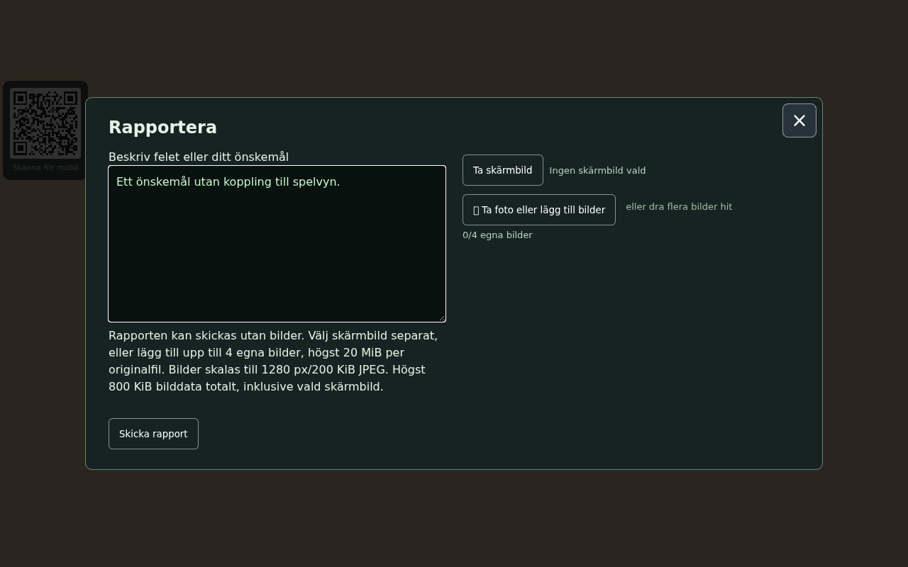
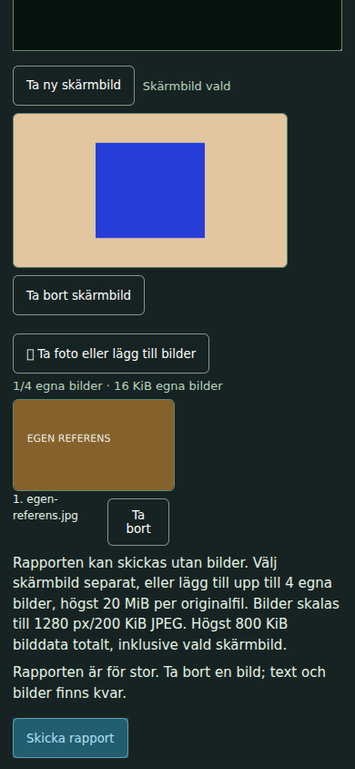

# Optional screenshot in reports — #1866

Base `7d763777aa94a29b8658d531145480da57fafa5f`. Source/image hashes are in [manifest](manifest.json). No automatic capture at open/send: plain text is the default. Explicit **Ta skärmbild** uses existing ReportCapture, shows a separate preview, and permits replacement/removal. Own photos and their limits remain independent. Failed optional capture leaves text-only available; legacy `/rapport` is text-only and leaves the dialog choices alone.

Three sufficient risk groups:

1. **Payload, frozen identity and existing contracts:** [19/19](contract-tests.txt) targeted Node cases include the existing Worker report/photo contracts plus optional report snapshots. New report UUID is keyed by text, selected image IDs and actual screenshot/photo bytes. Unchanged retry preserves exact payload/UUID/author. Capture failure and total-byte gate preserve draft. A final narrow [4/4](final-payload-tests.txt) rerun covers preserving newer screenshot/photo bytes even when their IDs stay the same while an older PUT completes. The Worker, reportauthor, ReportCapture, endpoints and import protocol are unchanged.
2. **Actual dialog and capture route:** [25/25 browser checks](browser.json), no product page errors. Actual index DOM/CSS and the exact main.js AdminReports binding/render-complete hook, small actual Three renderer320×180, manual local-only authenticated session and intercepted localhost8958 PUTs. Native desktop Enter/button/file picker and touch taps verify default zero captures/image fields; explicit actual rendered JPEG preview; own photo; unchanged retries despite changed current scene; replacement/new UUID; removal without screenshot bytes; failed capture followed by photo/text-only send; legacy chat text-only. The decoded replacement is the actual blue scene, valid bounded JPEG, without preserveDrawingBuffer. No apartment bootstrap, physical-device, external authentication/import or production report is claimed. No local Worker was needed; server semantics are covered by the existing Node contract tests.
3. **Reviewed result views:** [Desktop default](desktop-text-only.png) shows no screenshot selected and text-only send. [Touch selected](touch-selected.png) shows the optional preview/replacement/removal, separate own-photo preview and send control at a natural scrolled dialog position. Previews are explicitly labelled fixture component/reference content here, not an apartment image. No image edits. No new runtime asset, dependency, light or rendering workload except an explicitly requested existing capture. Browser/server were stopped immediately after these checks; no broad matrix was added.

After browser verification, only the same-ID/new-bytes completion-cleanup guard changed; final Node payload cases cover it. The observed native paths clear unchanged IDs/bytes and remain source-equivalent. The older multi-photo/admin/capture harnesses were adapted to choose a screenshot explicitly and to expect capture-failure text-only; syntax-reviewed, not rerun with external credentials. The new fixture verifies the production binding/route without those inputs.

Original-only authenticated report service, no public downstream port. Own server8957 and browser stopped; no8958 Worker or public report created. No Worker code/import change, so Pages is the affected deployment. Conductor integrates, chooses final changelog ID, publishes/reviews permanent embedded image URLs, then closes. No push/Fixes by worker.

