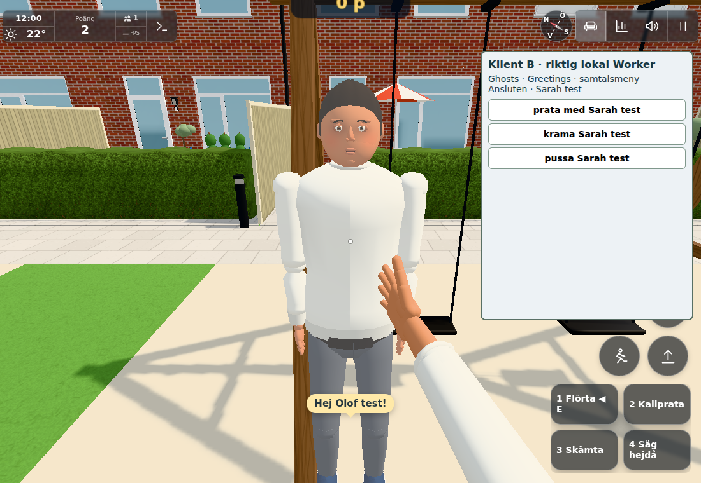
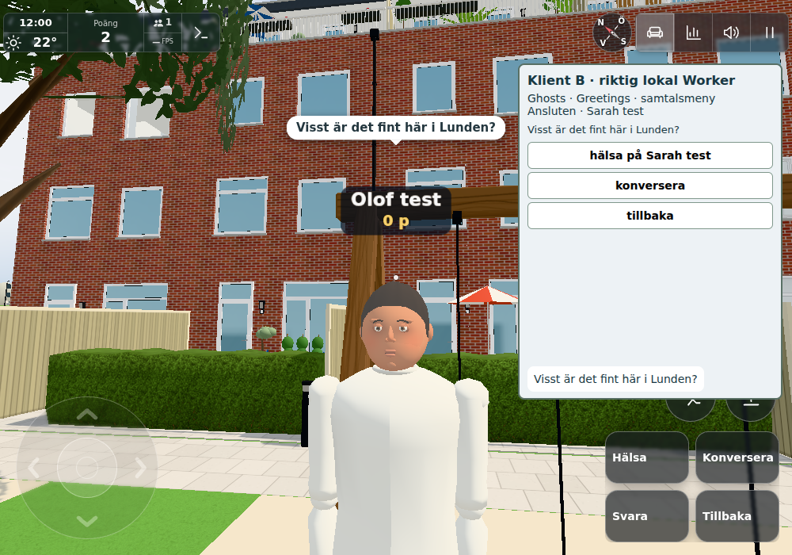

# #1867 — Prata / Konversera / Svara

Base `9b1a19291dedafa02ca9ccc9038a0b8c181009af`; server `c9101c6b`, client
`65170499`, final ACK cooldown correction `3ae91b37`. Fixed friendly Swedish IDs only:
no free text, AI/external speech service, new rights, persistent history or conversation
points. Existing Greetings.say/sayMine supplies the same voice/mute/mouth/text path.
Prata contains unchanged Hälsa and Konversera's four choices; current directed context
adds Svara. Backspace/Tillbaka return, lost/changed target resets the page. Existing
hug/kiss and current main focus/reach/wall/weapon rules remain in place.

## Three scoped checks

- `regression.txt`: **14/14** initial client/server/wire/deploypaths/hug/kiss checks.
  Covers exact menu/back/target state, known IDs, wrong-person/replaced/expired/consumed
  reply, replay, unarmed 3D range, attachment hibernation, legacy greeting, no score,
  no optimistic line, bounded receipt storage and 5s timeout for silent rejection.
  `client-final.txt`: **5/5**, rerunning only the changed client group after root's
  ACK-timing review. Own accepted receipt anchors the next full 3s cooldown; received
  messages do not send another command. Server rate is a separately reviewed 3s guard.
- Actual local Worker8960 with **two production Ghosts + Conversation + Greetings
  clients**: real accepted prompt/reply, correct sender/target/ref, one-use Svara,
  ordinary greeting, matching Web Speech language/pitch/rate against the existing
  greeting baseline. Mute kept actual over-avatar text while speech-call count stayed
  **5→5**. Server sends known text IDs to nearby clients, but only the directed recipient
  gets reply state. No production test traffic. Component tests supply negative
  expiry/replay cases; no additional world matrix was run.
- `browser.json`/`browser-driver.txt`: **one actual index/main/world**, plus a small
  renderer-free Three scene using real Ghosts/Greetings/Conversation for the second
  client. Native E/digits with genuine browser pointerlock, Backspace through both
  levels, then native touch/back/Svara passed. This is a touch-capable emulated browser,
  not physical-phone evidence or desktop-resource performance. Web Speech calls are
  captured, not a human listening test. Renderer/menus/avatars in the main view are real.

The ordinary touch band scrolls: the fifth Tillbaka row is reachable in that band
(native touch back passed), while the first picture shows all four conversation options.
Final image receipt `f225619b:4`, actual focused ghost, current reply rows, camera and
`.theirs` **visibility=visible**/projection are saved in `image-state.json`; root directly
reviewed both final pictures. No image editing or moved text/DOM overlays were used.

## Fixture corrections, sources and delivery

The initial CLI is failed, not a green run. Its touch-capable profile displays Börja,
so the held Page used that real start control, then actual browser pointerlock for keys.
A literal 1.05/1.1 assertion failed on Web Speech float32 values; the corrected check
compares with that same existing greeting's actual properties (`fixture-corrections.json`).
Native mode reentry reconnects, so the fixture waits for the new current Ghost/state and
uses a fresh prompt, never the old identity/context. During held diagnosis the ordinary
idle policy required a small real position update before reconnect. No second world.

Only the affected second picture was recaptured: touch viewport transition had left
an undrawn view, and body-aim projected the greeting anchor above the screen (y≈−160px).
The corrected normal camera aims at the actual ghost head, then ordinary greet.update /
renderer.render projects the fresh real line visibly (y≈176px). Earlier checks were
reused; negative world/pose/season/phone sweeps were not added. Final ACK-only correction
is component-verified and does not change the already observed valid speech/menu path.

**Server already staged first** as `dfc293e71114766b43f206b8ca28a09d6f2fcefc`:
[Worker41848572870](https://github.com/solwation/lunden-3d-apartment/actions/runs/41848572870),
actual Wrangler success2026-11-04T14:33:31UTC (conductor verified). Client requires
welcome.conversation.v1; welcome/listener hooks preserve other domains. The only config
addition after server staging is client pendingMs5000; wire/server used values unchanged.
Root integrates remaining client/docs commits, verifies actual triggered Pages/Worker,
publishes pinned image bytes before closure and chooses the final changelog id (local1442).
No worker push/closure. Owned browser/HTTP8959/Worker8960 stopped and ports released.
Original-only social gameplay/service: **public port not applicable**; A/B/C/L geometry
checks do not apply. `sources.json` binds source phases, exact hashes and final image bytes.
