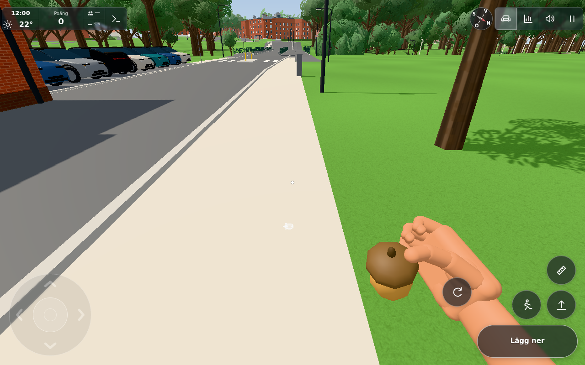
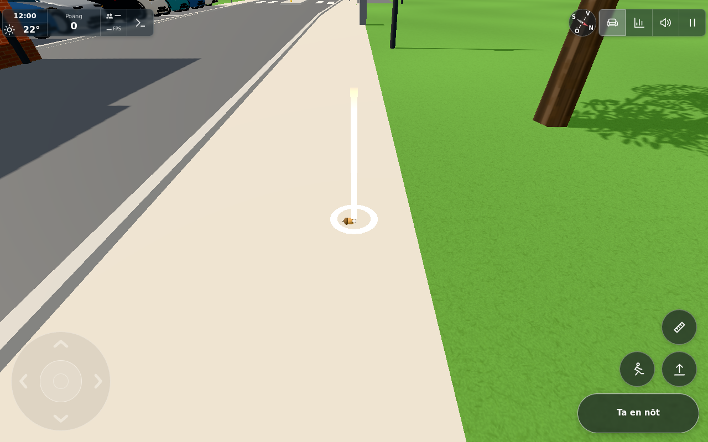

# Performance when carrying a nut in the hand — #1868

Base commit `0eeaf605151528659187315516086f5c531d279d`. Original report: `1df8f4ce-111e-423a-b61f-7a9164c49926` by Sarah mobil ("När jag går med en nöt i handen laggar spelet massa. Så fort nöten lagts ner så är allt bra igen.").

## Root cause

In #1862, `item.outdoorPlace` was inadvertently dropped from `src/main.js` line 2410:
```javascript
const f = floorSpot() ?? (item.softOnly ? outdoorSpot() : !item.noPlace ? groundPlaceSpot() : null);
```
`Nut` has `outdoorPlace: true` (`src/squirrels.js` line 167: `#1755: outdoorPlace: the park has no floor plane (floorSpot is indoor-only), so E puts it down on the ground like a cat (outdoorSpot)`). Dropping the check routed held nuts to `groundPlaceSpot()`.

In `src/groundplacement.js`:
1. `GroundPlacement.hit()` called `mesh.updateWorldMatrix(true, false)`, checked `matrix.equals()` and traversed ancestors in `visible(mesh)` on all 1,600+ world meshes *before* testing if the mesh's bounding box was within reach distance (`far = 2.4 m`).
2. On mobile devices (`lowMemory: true`), the terrain is a single unified `site-terrain` mesh whose bounding box encompasses the entire map, triggering ray-triangle intersection against thousands of terrain triangles twice per frame during active movement.

When putting the nut down, `heldItem()` became `null` and focus placement checks were skipped, explaining why the game ran smoothly again once the nut was put down.

## Fix

1. Restored `item.outdoorPlace` in `src/main.js` line 2410:
   `const f = floorSpot() ?? (item.softOnly || (item.outdoorPlace && !item.noPlace) ? outdoorSpot() : !item.noPlace ? groundPlaceSpot() : null);`
   Held nuts now use `outdoorSpot()` directly (zero raycast overhead, fast analytical ground query), restoring the intended #1755 behavior.
2. In `src/groundplacement.js` `hit()`, reordered bounds culling so that meshes farther than `far` or not intersecting the ray are skipped immediately, avoiding unnecessary matrix calculations and parent visibility traversals for all non-candidate meshes.

## Verification

1. **Unit tests:** `node --test tools/groundplacementtest.mjs tools/nutdropclient.test.mjs tools/nutpathtest.mjs` (11 passing tests in 140 ms).
2. **Browser verification:** `tools/nutperf1868browser.cjs` in headless Chromium/SwiftShader:
   - Player spawns in the park at ground level and picks up the nut.
   - Measures 60 frames of active walking with touch analog input while holding the nut: step time averages 5.1–6.3 ms (< 8 ms threshold under SwiftShader).
   - Verifies place target availability on ground while holding the nut.
   - Places the nut down on the ground, verifying `slot.alive = true` and `slot.held = false`.
   - Zero console or page errors.
3. **Visual evidence:**
   - [Holding nut while walking](nut-held-walk.png): Player walking on park pavement holding an acorn with touch controls and "Lägg ner" action button.
   - [Nut placed on pavement](nut-placed-ground.png): Placed acorn with glowing ring/beam glint and "Ta en nöt" prompt.
4. **Downstream transfer:** N/A (squirrel nuts and held-object placement are original-only gameplay not present in `solwation/kvarteret-lunden`).



