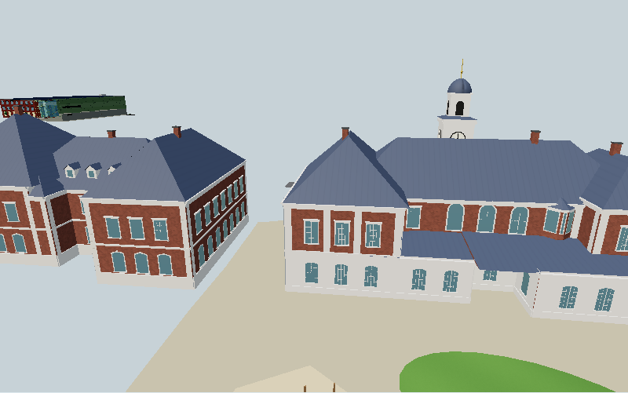
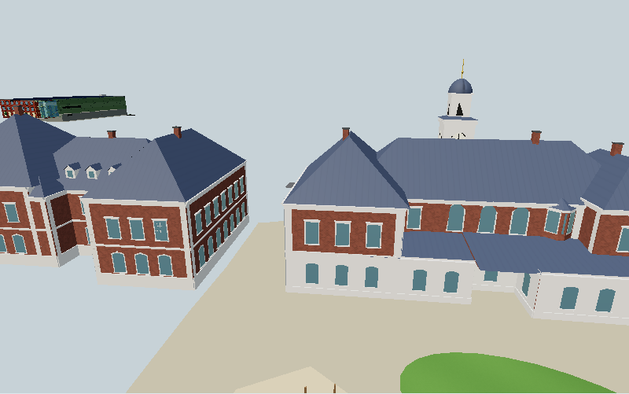
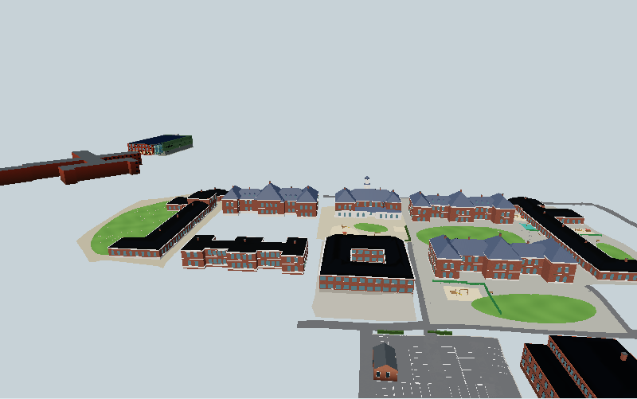

# Real-area WebGPU/meshlet prototype — #1872

2026-11-05. Production source baseline: `b01c076c0e607cf2dbd8b5977cdf33b921d22f89`.
Candidate: npm Three.js 0.187.0, release commit
`7e89746a687bb88271253698fa108b1dd59825d0`.
[Released pipeline](https://github.com/mrdoob/three.js/blob/7e89746a687bb88271253698fa108b1dd59825d0/examples/jsm/pipelines/MeshletDrawingPipeline.js).

## Decision: keep this as an experiment

The feature is real and the prototype renders our actual buildings through GPU
meshlets. This experiment does **not** establish a worthwhile production upgrade.
The far view takes longer on this Intel GPU, requested GPU buffers triple, and
automatic simplification removes visible window/trim detail. The full renderer,
interior shaders and mirror migration is therefore not undertaken. Production
remains r170/WebGL, with the separately verified edge-construction backport (#1871).
This closes the prototype investigation with a no-go decision, not a completed
application-wide WebGPU port. There is no player-facing change or changelog entry.

## What actually runs

`tools/meshlet1872/` is a separate local developer page, excluded from published
Pages by `tools/stamp.sh`. It imports pinned r187 without changing the application's
import map. It calls the real `buildSurroundings`, including its terrain setup,
then isolates `east-backdrop`. June/noon, fixed 800×500 renderer, DPR 1, fixed
hemisphere/sun, no shadows/fog/interiors/game loop. It preserves the builder's
merged meshes and native frustum culling. Full-world DetailCuller/LOD scheduling
is **not** exercised; no comparison to full-app FPS is claimed.

Three independently selectable paths share cameras, lights, source and resolution:

- Original geometry with ordinary r187 WebGPU node materials.
- Adapted geometry with ordinary r187 WebGPU drawing.
- The adapted geometry with `MeshletDrawingPipeline`, default 1-pixel LOD error.

The material bridge explicitly carries vertex colour through TSL. Eligible
DoubleSide geometry becomes two FrontSide surfaces with opposite winding/normals.
It preserves normalized attribute values, never modifies the source and rejects
released CPU data. The selected builder's one custom grass shader is translated
for frozen summer values; unknown custom GLSL is an error, not silently discarded.
Polygon offset and transparency are retained, so those materials use regular drawing.
This bridge is intentionally scoped to the fixture, not a general shader converter.

Of 87,721 input triangles (including clock instances), only 144 qualify for native
meshlets without adaptation. The bridge makes 62,355 source triangles eligible
(71.1%), before duplicating their double-sided surfaces. Source geometry arrays
use 9,563,676 bytes; adapted geometry arrays use 17,917,080 bytes (+87.3%). These
are unique attribute/index ArrayBuffers, not heap/VRAM totals. The fixture retains
both versions for comparison; production phone memory-release hooks are not installed.

## Hardware measurements

Native Windows headless Chrome 156.0.8078.80, WebGPU adapter `intel / gen-9`,
`isFallbackAdapter: false`. Browser-reported device/model strings are empty; no
exact Intel model is inferred. Two rounds per view, order original/adapted/meshlet
then reversed; 35 warm frames and 30 measured frames per mode/round. GPU query
times include render plus meshlet compute, separately available in
[result.json](result.json), along with all raw samples. Standard drawing has no
compute: an old query-pool value is deliberately excluded after mode switching.
Timing includes neither full application simulation nor presentation latency/FPS.

| View | Original GPU ms, rounds 1 / 2 | Adapted GPU ms | Meshlet GPU ms | Original CPU submission ms | Meshlet CPU submission ms |
| --- | ---: | ---: | ---: | ---: | ---: |
| Campus | 1.835 / 3.801 | 1.966 / 3.146 | 2.556 / 2.949 | 0.7 / 0.5 | 0.9 / 0.8 |
| Gym | 1.966 / 1.966 | 1.704 / 1.704 | 2.163 / 2.163 | 0.4 / 0.4 | 0.6 / 0.6 |
| Far | 4.063 / 4.129 | 4.522 / 4.522 | 4.653 / 4.784 | 0.5 / 1.1 | 0.8 / 0.7 |

Values are per-round medians, not paired simultaneous measurements. Campus varies
enough to reverse the result: do not average that into a claimed speedup. Gym and
far are consistently slower with meshlets here. This does not prove other hardware
or larger/differently authored scenes cannot benefit.

| View | Original submitted triangles | Meshlet regular fallback | GPU-selected meshlet padded triangles | Combined submitted upper bound |
| --- | ---: | ---: | ---: | ---: |
| Campus | 75,938 | 25,367 | 19,072 | 44,439 |
| Gym | 4,676 | 3,599 | 640 | 4,239 |
| Far | 87,722 | 25,367 | 42,112 | 67,479 |

The renderer's r187 `info.render` excludes indirect meshlet draws. The last column
adds its regular fallback triangles to the pipeline's asynchronous counter (64
triangles per surviving cluster, including degenerate padding). These are submitted
primitives, **not** exact nondegenerate/visible-pixel counts, and not the entire scene's
nominal triangle count. The counters were read after sufficient frames to refresh.
LOD disabled still culls clusters: its counters are not full input geometry either.

Separate fresh renderers in the campus view requested 8,329,136 bytes of GPU
buffers for original drawing versus 25,936,376 for meshlets after warm-up (3.11×).
This includes tracked GPUBuffer allocations only, excluding textures and driver
allocations. The three-mode comparison's 44 MB cumulative cache is **not** used
as the independent meshlet footprint. Cold compile+first draw was ~406 ms original
and ~1,306 ms fresh meshlet, in different loads with browser caches already present.
Building the full surroundings before isolating this subset took ~7.3 s; that is
not meshlet-preparation time and was common to the experiment.

## Visual and functional checks

- Eight component checks: unchanged source, triangle duplication, normalized
  colours, reversed normals, matching front/back ray hits, rejection of released
  attributes and rejection of unknown shader hooks.
- Three cameras × three modes × two rounds, plus meshlets with LOD disabled.
  Adapted vs original mean RGB-channel difference is 0–0.00441 on a 0–255 scale
  (0–60 changed pixels). This is near parity, **not** bit-exact rasterization.
  Default meshlets change 364–4,616 pixels, including window/trim losses. Disabling
  LOD reduces but does not eliminate differences in campus/far views.
- Forced r187 WebGPU-renderer's WebGL backend draws the adapted scene with the
  meshlet pipeline selected: 126,365 regular triangles, no compute. No page/GPU
  errors. This verifies this fixture's fallback, not the existing full-app GLSL.

Campus original:


Campus adapted, regular drawing:



Campus meshlets, default LOD:



Far meshlets:



WebGL fallback:


## Reproduce and limits

Serve the repository root with `python3 -m http.server 8171 --bind 127.0.0.1`.
Open `/tools/meshlet1872/` in a WebGPU-capable browser. `?webgl` forces fallback;
`?mode=meshlet` starts fresh in meshlet mode. For the automated checks:

```sh
PLAYWRIGHT_MODULE=/path/to/playwright \
THREE_187_DIR=/path/to/extracted/three-0.187.0 \
CDP_URL=http://127.0.0.1:9227 \
tools/browsertest.sh node tools/meshlet1872/verify.cjs \
  http://127.0.0.1:8171 /tmp/meshlet-results
```

The optional local Three directory serves the exact npm package in place of CDN
downloads. CDP attaches to a separately owned test browser; use a dedicated profile.
Without CDP the runner launches Chromium. It requires WebGPU/timestamp support and
records adapter fallback status. Linux SwiftShader in this environment failed even
an isolated r187 cube with “Instance dropped in popErrorScope”; no software timing
is included in the table. Source fingerprints: [source-sha256.json](source-sha256.json).

Not implemented or verified: full-world lighting, seasonal changes, GLSL lamp
washes/AO/foliage/door deformation, Reflector mirrors, custom interaction shaders,
shadow warm-up, production low-memory release, mobile hardware or touch behaviour.
In particular, adapting after `lowmemory.js` has released normals/UV/colour would
be invalid; this prototype rejects that state. Existing `lampwash.js`, `ao.js`,
`plantwind.js`, `reflections.js` and `interactionoutline.js` need deliberate ports
before a full-app renderer replacement. A no-go at this stage avoids claiming those
unperformed migration acceptance checks as green.

Public downstream assessed at `ee98fc2d0c2d0d0e0b9886453f723a446ef2faca`:
it also pins Three 0.170.0 and uses WebGLRenderer. This investigation produced no
runtime performance improvement to transfer, so no public renderer change or
prototype dependency is introduced. The separate positive EdgesGeometry result
is already transferred and verified in public #254. Original timing is not claimed
as evidence of downstream performance.
