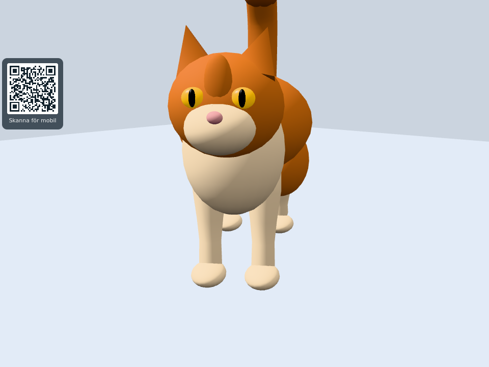
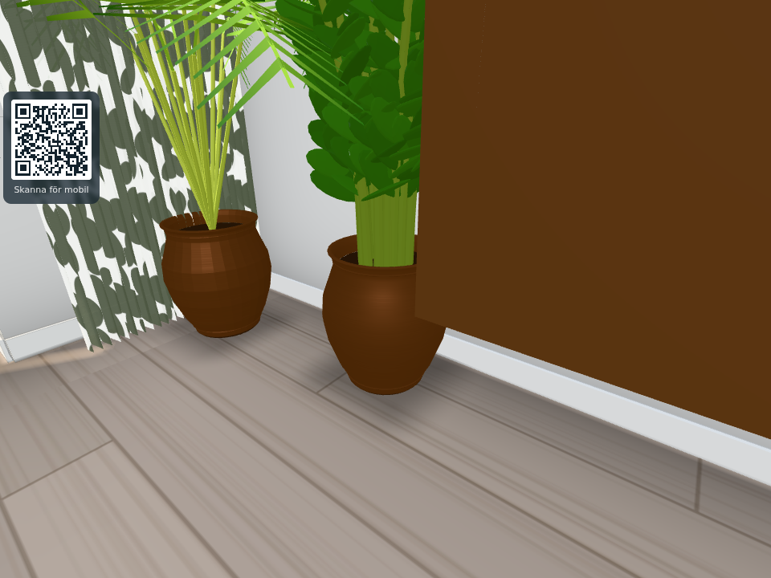
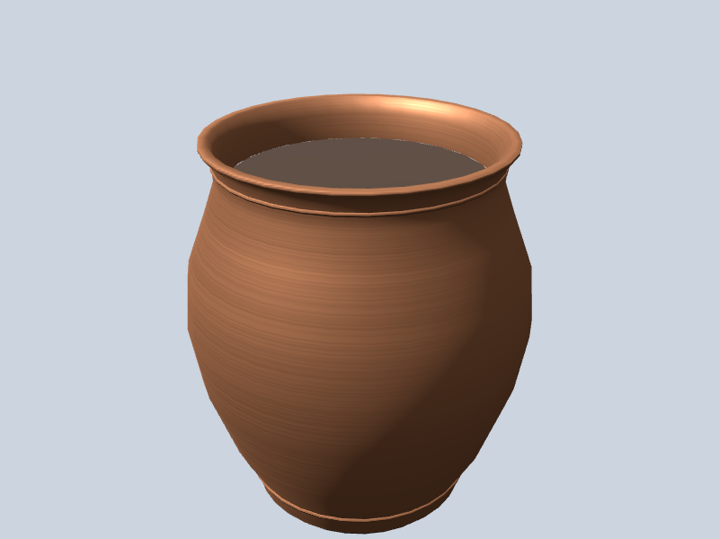

# Normal directions before phone byte packing (#1875)

Base: `92d2888c` (Three.js r170). Only `src/lowmemory.js` changes runtime behavior:
each nonzero Float32 normal is normalized before conversion to normalized Int8×4.
Zero vectors remain zero, shared attributes stay shared, and dynamic/keepCpu,
skinned, morph-target and already-uploaded exclusions remain unchanged.
The byte budget stays **4 bytes per vertex**, with the fourth byte zero.
Positions, UVs, indices and the number of draw submissions are not changed by the conversion.

## Scoped checks

1. `tools/normalpackingtest.mjs` plus existing `tools/lowmemcanarytest.mjs`: **6/6 pass**.
   The actual `copperPot(FURNITURE.find(type === 'zzplant').pot)` contains a shortest
   nonzero normal of **0.02398820545** in r170. Its maximum direction error changes
   from **8.046897° to 0.325924°**, retaining **528 vertices / 2,112 normal bytes**.
   Very small/large scaled vectors, exact axes, zeros, source immutability, shared
   attributes, unrelated payload identities and all existing exclusions are checked.
   The before test fails on signed-byte wraparound; the browser records the actual
   pot profile's before error. [Before](native-before.txt), [after](native-after.txt).
2. Full application loads in normal and `lowmem` profiles, Chromium/SwiftShader,
   960×720, DPR1, pinned quality3, June2/13:00/clear, frozen game clock, seeded RNG.
   The fixture observes actual normals immediately before the production upload hook;
   the renderer draws normally, with no `test`/lazy drawing mode. Retained source
   arrays are fixture-only and released before screenshots. Positions/UV/index
   identities are checked around every packing call. There are no page errors.
3. Matched timing of exact before/after `packNormals` functions on actual eligible
   scene arrays, with new attribute/output wrappers on every pass, alternating order
   and two warmups. This measures the one-time CPU packing stage, not whole startup,
   FPS or performance on a physical phone. Intel Core i7-10700 under WSL, Chromium 156.0.8078.4:
   median **134.4 → 161.2 ms**, median paired increase **26.8 ms** for 5,260,497 normals
   (9 pairs). This cost occurs once, not on every frame. Raw pairs are in `after-lowmem.json`.

## Actual scope

The initial lowmem build has **3,925 unique eligible normal arrays / 5,260,497 vertices**.
Of these, **2,647 normals in 104 arrays** differ from unit length by more than 0.0001;
**25,169 zero normals in 41 arrays** are retained as zero, not repaired into a guessed direction.
The complete per-array inventory is in [before-lowmem.json](before-lowmem.json).
Affected named models include stored bottles, `billiard-table` (216 normals), the
outdoor cats (388 normals), and a New Year flute. Other rows have only generic mesh
names; the inventory does not invent an identity for them.

The current full-app copper pots are already normalized by later geometry transforms/
merging. The source-profile failure does **not** establish a visible current pot bug.
Their close full-app images below are retained as a qualitative control. Animated
foliage may differ between captures; they are not a pixel-exact timing benchmark.
The correction applies at the common packer, including equivalent generic public models.
There are no building dimensions, openings or A/B/C/L layout changes.

## Images

The Kanel images inspect the **actual built and packed near puppet from the full app**,
reparented without cloning freed attributes into fixed lighting and a fixed standing pose.
They are a controlled model inspection, not a natural gameplay camera or a new production scene.
The before/after cat captures are **pixel-identical**, both 25 calls / 10,010 triangles. The
affected end rows are not visibly exposed in this view. Compared with the normal-profile
reference, both phone captures differ in 19,999 pixels by at most 3 channel levels, the same
ordinary signed-byte quantization in both revisions; [pixel comparison](cat-pixels.json).
The full-app pot controls vary by one draw /1,396 triangles between two *before* loads
(139/786,283 and 140/787,679); the after lowmem capture matches the latter 140/787,679.
Normal captures similarly show 153 versus 154 calls. These living-scene snapshots are
not used to claim a packing-induced draw-count change; the fixed inspection retains its exact count.

Before lowmem:


After lowmem:



Normal-profile reference:


Full-app copper-pot control, before/after lowmem:


Full-app normal-profile control, before/after:




## Isolated real producer

The actual `copperPot` source can be rendered before later scene transforms/merging
normalize its normals. `tools/normalpackingpot.cjs` renders that real producer with
its production material and production packer, in fixed inspection lighting. This
is **not** the current merged pot from the full application. Both render 4 calls / 1,752
triangles and 2,112 normal bytes. The subtle inner-wall shading changes in 8,081 pixels
(at most 16 channel levels); no shape, position or material changes.




## Reproduction and limitations

Use the repository's normal bare-`three` resolver for the pinned r170 package:

```sh
node --import /path/to/three-register.mjs --test tools/normalpackingtest.mjs tools/lowmemcanarytest.mjs
```

Save `git show 92d2888c:src/lowmemory.js` outside the checkout as the before input.
Serve this checkout locally, set `PLAYWRIGHT_MODULE`, `THREE_DIR` and `LOWMEM_BEFORE`, then:

```sh
tools/browsertest.sh node tools/normalpackingbrowser.cjs http://localhost:8975 docs/verification/1875 before
tools/browsertest.sh node tools/normalpackingbrowser.cjs http://localhost:8975 docs/verification/1875 after
tools/browsertest.sh node tools/normalpackingpot.cjs http://localhost:8975 docs/verification/1875
```

Initial before pot controls were captured before the cat inspection was added;
`before --cat-only` added only the missing lowmem cat view. No production source was
changed between these baseline checks. JSON binds each run to the exact lowmemory
source SHA256 and browser version. The final harness hash is recorded on the after runs.
A local server exited before the first attempt; that connection-refused attempt supplied
no evidence. The shared browser lock was respected. This WSL environment had no
available systemd user scope, so the wrapper disclosed that its memory ceiling could
not be installed; the five-minute process timeout remained active.

Verification was reassessed after roughly 10 minutes including shared-lock waiting:
only the small producer render was added for the remaining precision illustration;
no additional search for a visible scene change was performed. The player changelog
records improved lighting precision on mobile; it does not claim a visible improvement
in these selected current scene views.

No physical iPhone/Android or native-GPU performance is claimed. The general packer
correction is relevant to the public project; personal models, gameplay and service
integrations are excluded from that separate transfer.
