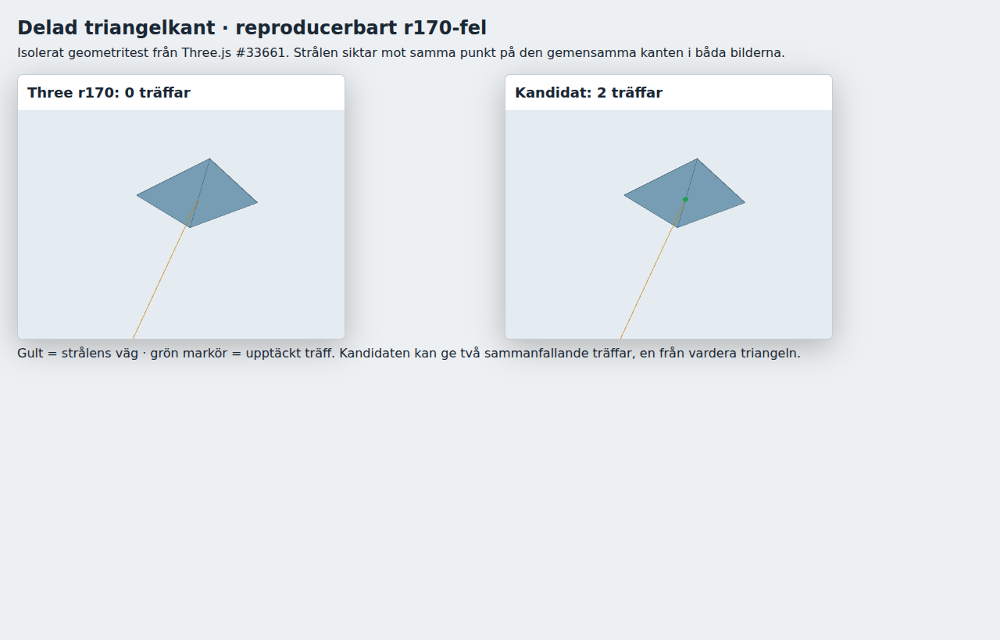
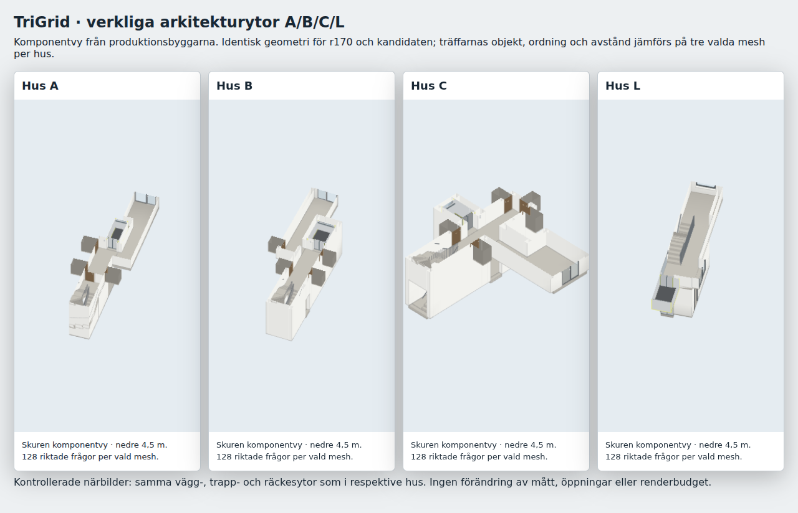

# TriGrid watertight intersection experiment (#1876)

Decision: **keep the existing r170 production path**. The isolated upstream candidate
fixes a reproduced shared-edge miss. Ordinary hits retain object identity, material,
visit order and normal, with point/distance differences below 1e-10 metres. Warm CPU
queries improved in this run, but the cold-query samples did not establish the required
absence of a relevant local regression. This is a completed experiment, not a pending
renderer upgrade or a claim that the candidate is generally slower.

No production module, global `Ray.prototype`, house geometry, scene budget or player
behavior changes. There is consequently no changelog entry. `architectureedges.js`
retains its separate signed winding probe: coincident hits along a shared edge can
contribute twice there, so this experiment does not authorize applying the candidate
to that classification. The public project has no `TriGrid`; no implementation is
applicable downstream. In particular, gameplay consumers are not ported.

## Source and checks

The fixture in `tools/fixtures/watertight-raytriangle.mjs` extracts only
`Ray.intersectTriangle` from [Three.js PR #33661](https://github.com/mrdoob/three.js/pull/33661),
[merge bd942afdb3aae7fdcecf33ea34191fb43be56cc4](https://github.com/mrdoob/three.js/blob/bd942afdb3aae7fdcecf33ea34191fb43be56cc4/src/math/Ray.js).
Its full MIT notice is retained. The only adaptation is an explicit `ray` argument in
place of `this`. The test driver substitutes that call in an independently imported
copy of the **current production TriGrid source**, without patching any prototype.

1. [Component output](component.txt): the upstream diagonal seam misses both triangles
   in r170 and hits both with the candidate; exact shared vertices, front/double sides,
   reversed rays, zero direction, degenerate/coplanar triangles, finite short/backwards
   segments and a zero-length segment at the surface are covered. 3,000 seeded actual
   TriGrid queries on transformed indexed/material-grouped geometry preserve ordinary
   FrontSide/BackSide/DoubleSide results and order within 1e-10 m. BackSide deliberately
   preserves the current TriGrid semantics rather than changing another behavior.
2. [Native browser measurements](browser.json): actual `CoreHouse` A/B/C and `Core` L
   builders, three selected meshes per house, 128 interior-directed queries per mesh
   (1,536 comparisons). Eleven meshes have at least 200 triangles, matching the large
   static consumer case; L's 24-triangle third mesh is an additional small control,
   not evidence about the production large-mesh dispatch threshold. No differences
   beyond the stated numerical tolerance and no browser exceptions.
3. Inspected rendered evidence below: the isolated synthetic seam before/after and
   actual A/B/C/L source geometry in labelled cutaway component views. These are not
   full-apartment or gameplay screenshots; they make the tested surfaces and seam
   result visible without claiming a player-visible change.

## Measurement method and decision limits

Intel Core i7-10700, WSL/Linux, Chromium 156.0.8078.4, Three r170. A shared browser lock
serialized expensive tests. Both implementations receive the same mesh, ray, finite
segment and material. Five warm-up sweeps precede 31 balanced paired samples, alternating
which implementation runs first. Each warm sample averages 32 sweeps of the same
128 queries. Cold samples clear the fine-cell cache before each 128-query sweep,
so **cold includes lazy refinement**, while construction is timed separately.
Output allocation, traversal and hit creation remain in the measured real `hits` call.

Warm median changes range from about -1.5% to -15%. However, C's second mesh cold
median/p95 changed 1.0/1.8 → 1.1/2.7 ms, and its unchanged-constructor p95 changed
1.3 → 2.0 ms. These observations cannot separate kernel cost, allocation/collection,
timer granularity or host scheduling. They are not proof of a kernel regression, and
we do not assert that the difference is merely noise. The conservative go/no-go
criterion is therefore unmet; production remains unchanged. No second timing sweep
was run to search for a favorable result.

These are CPU component-query measurements, not frame rate, physical Surface/iPhone,
Safari, GPU rendering or whole-apartment start-time measurements. Shared-edge coincident
hits can intentionally change the number of returned boundary hits; ordinary interior
hits retain their order. The underlying ray/triangle numerical issue remains in r170.
A future adoption can reuse this experiment if an actual consumer bug or stronger local
evidence warrants it; no dependent task or automatic upgrade is introduced.

All table values are milliseconds, `median / p95`; each pair is r170 → candidate.

### Grid construction

| House / mesh | Triangles | r170 | Candidate |
| --- | ---: | ---: | ---: |
| A / 0 | 5496 | 0.9000 / 1.6000 | 0.9000 / 1.2000 |
| A / 1 | 2648 | 0.5000 / 0.6000 | 0.5000 / 0.6000 |
| A / 2 | 832 | 0.3000 / 0.5000 | 0.3000 / 0.4000 |
| B / 0 | 4544 | 0.8000 / 0.9000 | 0.8000 / 1.0000 |
| B / 1 | 3686 | 0.6000 / 0.7000 | 0.7000 / 0.8000 |
| B / 2 | 960 | 0.2000 / 0.3000 | 0.2000 / 0.3000 |
| C / 0 | 7244 | 1.2000 / 1.4000 | 1.2000 / 1.3000 |
| C / 1 | 6466 | 1.1000 / 1.3000 | 1.1000 / 2.0000 |
| C / 2 | 1216 | 0.2000 / 0.3000 | 0.2000 / 0.3000 |
| L / 0 | 4960 | 0.8000 / 1.1000 | 0.8000 / 1.3000 |
| L / 1 | 704 | 0.2000 / 0.3000 | 0.2000 / 0.3000 |
| L / 2 | 24 | 0.0000 / 0.1000 | 0.0000 / 0.1000 |

### Cold 128-query sweep (includes fine-cell refinement)

| House / mesh | Triangles | r170 | Candidate |
| --- | ---: | ---: | ---: |
| A / 0 | 5496 | 1.0000 / 1.9000 | 1.0000 / 1.5000 |
| A / 1 | 2648 | 0.5000 / 0.6000 | 0.5000 / 0.9000 |
| A / 2 | 832 | 0.4000 / 0.5000 | 0.4000 / 0.5000 |
| B / 0 | 4544 | 0.9000 / 1.1000 | 0.9000 / 1.0000 |
| B / 1 | 3686 | 0.7000 / 0.8000 | 0.7000 / 0.8000 |
| B / 2 | 960 | 0.4000 / 0.5000 | 0.4000 / 0.5000 |
| C / 0 | 7244 | 1.1000 / 1.2000 | 1.1000 / 1.3000 |
| C / 1 | 6466 | 1.0000 / 1.8000 | 1.1000 / 2.7000 |
| C / 2 | 1216 | 0.4000 / 0.5000 | 0.4000 / 0.5000 |
| L / 0 | 4960 | 1.1000 / 2.1000 | 1.0000 / 1.6000 |
| L / 1 | 704 | 0.4000 / 0.8000 | 0.4000 / 0.7000 |
| L / 2 | 24 | 0.0000 / 0.1000 | 0.0000 / 0.1000 |

### Warm 128-query sweep

| House / mesh | Triangles | r170 | Candidate |
| --- | ---: | ---: | ---: |
| A / 0 | 5496 | 0.5219 / 0.5531 | 0.4438 / 0.4875 |
| A / 1 | 2648 | 0.1344 / 0.1812 | 0.1312 / 0.1844 |
| A / 2 | 832 | 0.3531 / 0.4000 | 0.3406 / 0.3719 |
| B / 0 | 4544 | 0.4750 / 0.5094 | 0.4219 / 0.4594 |
| B / 1 | 3686 | 0.1719 / 0.2188 | 0.1656 / 0.2031 |
| B / 2 | 960 | 0.3406 / 0.3781 | 0.3250 / 0.3563 |
| C / 0 | 7244 | 0.5125 / 0.5219 | 0.4625 / 0.5063 |
| C / 1 | 6466 | 0.2094 / 0.2531 | 0.2062 / 0.2500 |
| C / 2 | 1216 | 0.3500 / 0.3812 | 0.3375 / 0.3625 |
| L / 0 | 4960 | 0.5875 / 0.8813 | 0.5719 / 0.8875 |
| L / 1 | 704 | 0.3875 / 0.5156 | 0.3687 / 0.4375 |
| L / 2 | 24 | 0.0438 / 0.0500 | 0.0406 / 0.0625 |

## Images





The first image is the explicitly synthetic upstream seam, not a newly observed house
hole. The second uses unchanged production geometry, clipped above the lowest floor
plus 4.5 m for inspection. A/C/L are not inferred from B: every builder has its own
128-query samples for each selected mesh. Bounds, openings, glass and dimensions remain
those of each source variant.

## Reproduction and evidence provenance

```sh
THREE_DIR=/path/to/three-0.170.0 node tools/watertighttest.mjs
python3 -m http.server 8976
PLAYWRIGHT_MODULE=/path/to/playwright THREE_DIR=/path/to/three-0.170.0 \
  tools/browsertest.sh node tools/watertightbrowser.cjs http://localhost:8976 docs/verification/1876
```

`browser.json` retains all 31 samples, environment and source SHA256 hashes.
[The exact measured runner](measured-harness.cjs) is an archived byte-for-byte copy
matching its recorded `tools/watertightbrowser.cjs` SHA256; it is evidence, not a second
maintained test entry point. The final driver only adds an image-only mode and corrects
card CSS/camera framing. Its unchanged timing callback is skipped with
`TRIANGLE_IMAGES_ONLY=1`; [captures.json](captures.json) records that final capture and
source hashes separately. The clipped preliminary image was replaced; timings were
not rerun. Runtime source hashes in both records must agree. Source base: `92d2888c`.
The supplied component log was generated by the delivered Node test. Both runs exited
0, and owned browsers/server were stopped before handoff.
