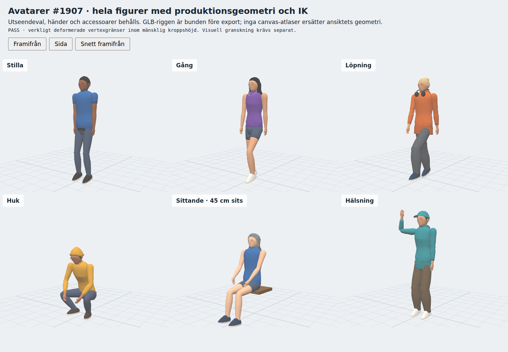
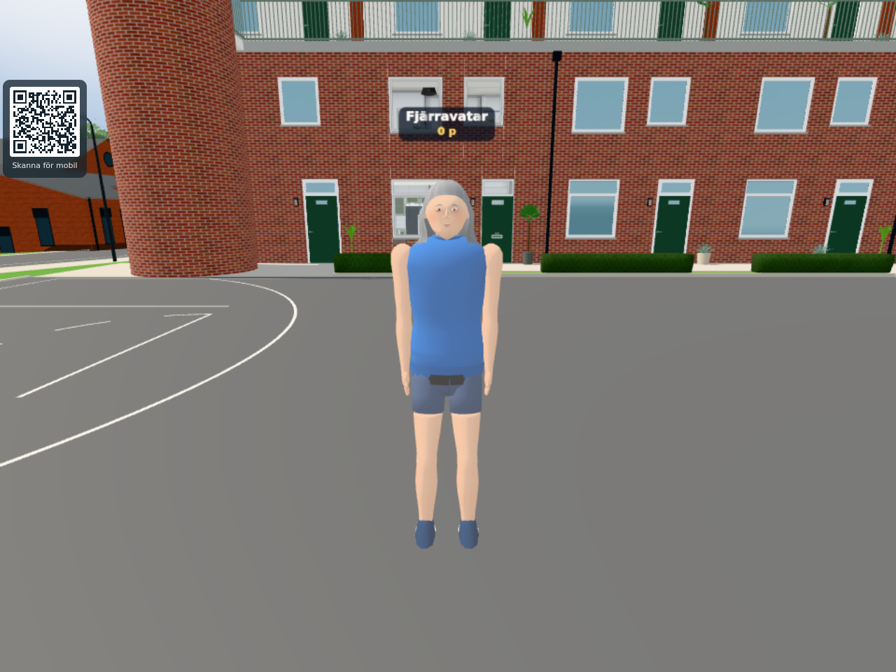

# More natural player figures (#1916)

Baseline: `2f03ba02187419796185822e411901002cdb552f`. The matching source
hashes for the candidate and baseline are recorded in `world.json` and
`component.json`. Final review only centralized the remaining artistic constants;
`geometry-equivalence.json` records the final source hashes and byte-for-byte
identity of every attribute in the six gallery/four facial-hair recipes and the
regenerated GLB. The reviewed images and measured geometry therefore still apply.
This is a visible geometry/appearance change to the actual
per-look Avatar recipe, not a GLB format migration.

The arms and legs now have continuous elliptical surfaces with blended weights
across the existing shoulder/elbow/wrist and hip/knee/ankle bones. The old joint
balls and overlapping capped tubes are gone. Muscle/calf taper and soft garment
compression are built once into the shared variant; the frame still updates the
same 15 bones with the established IK. The cheek/jaw/chin is one continuous
surface, with recessed almond eyes and a lid surround, a less projecting nose,
and lips that sit on the face. Clothing has restrained modeled folds, continuous
seam normals and the existing palette; short/long/bun hair gets directional
surface variation. These are artistic guesses, centralized in AVATAR_SURFACE.

All existing look options, height/build scaling, accessories, talking/pout
attributes, suit tagging, pump, pose authority and the 30 m remote pose gate remain.
The shared three-box gameplay head collider is unchanged. The first-person hand
is independent and is not changed here.

## Bounded checks

1. Reused the six actual production Avatar/IK poses and matched front/side/quarter
   cameras of `verify-avatar-rigged.html`, plus meeting-distance views. The images
   were opened and reviewed, including bare and sleeved elbows, bare and trousered
   knees, seated/crouched poses and the raised arm. The gain is the connected
   silhouette and facial transitions; this remains a lightweight stylized figure.
2. `node --test tools/riggedavatartest.mjs tools/avatarcustomizertest.mjs
   tools/avatarbodytest.mjs tools/gympumptest.mjs`: **49/49 pass**. This covers the
   real exported GLB and all six clips, inverse bind identity, private palettes,
   appearance codes/options, child/adult body/head-box scaling, pump and
   loaded/procedural pose parity. The new regression specifically checks real
   adjacent-bone weights across all four elbows/knees in bent poses. The actual
   main/World capture additionally uses a Worker-delivered remote Ghost, own
   mirror, production customizer (opened/closed) and OlofDriver in the car.
   The existing mouth driver also passes with four draws for four facial-hair
   variants: peak 0.93, ten open/shut transitions, closed by 1932 ms; normal and
   maximum-open views were reviewed. Only the fixture CDN URLs were redirected
   to cached Three r170.
3. A preimplementation budget allowed one draw, the same 15 bones/no new textures,
   and <=10% additional runtime triangles/geometry bytes. Runtime metrics include
   shader-hidden optional accessories. The neutral GLB is recorded separately;
   it is not substituted for every look's runtime cost. Timing uses matched
   warmed intervals in the actual main/World remote view. The game scheduler is
   stopped after startup, with fixed camera/quality/time and local cached Three
   r170. Thirty measured render/finish samples follow ten warm draws in a bounded
   640×480 canvas (480×360 actual buffer at game pixel ratio 0.75). Normal
   screenshots use a 1280×960 browser viewport, browser DPR 1, game pixel ratio 0.75
   and 70-degree FOV.
   This deliberately limits SwiftShader verification cost. It is not live frame
   pacing, native GPU timing, mobile-device performance or an FPS improvement.

No external assets/licenses, extra draw, light, texture, shader branch or per-frame
geometry/material construction is introduced. The neutral GLB was regenerated
from the same source and retains its six standalone clips.

Personal characters/gameplay are original-only, so there is no downstream port.
Publication, pinned issue images and the actual Pages result belong to the
integration owner.

## Measured costs

The runtime budget passes for all six looks. Bytes below are retained vertex
attributes for one geometry, not total GPU/process memory. Existing variants
continue sharing their immutable buffers and owning their palette.

| Look | Triangles before → after | Attribute bytes before → after | Draws |
| --- | ---: | ---: | ---: |
| Idle | 10,790 → 11,456 | 3,366,480 → 3,574,272 | 1 → 1 |
| Walk | 11,518 → 12,184 | 3,593,616 → 3,801,408 | 1 → 1 |
| Run | 11,390 → 12,024 | 3,553,680 → 3,751,488 | 1 → 1 |
| Crouch | 12,066 → 12,700 | 3,764,592 → 3,962,400 | 1 → 1 |
| Sit, 45 cm | 15,710 → 16,376 | 4,901,520 → 5,109,312 | 1 → 1 |
| Wave | 10,990 → 11,624 | 3,428,880 → 3,626,688 | 1 → 1 |

Runtime increases are 4.2–6.2%, within the 10% limit fixed before implementation.
The separate neutral asset is 5,150→5,816 triangles and 1,813,152→2,044,944 raw
file bytes (+12.8% raw bytes). This is one existing model request, with no new texture
request; the increased neutral size is not presented as a performance gain.
Cold startup/build latency and network transfer time were not benchmarked.

The actual main/World view submits 420→420 calls and 909,887→910,553 triangles
(+666, about 0.073% for that view), with 135→135 programs and 95→95 textures.
Its remote Avatar is 11,558→12,224 triangles and 3,606,096→3,813,888 attribute bytes.
The actual driver uses the same retained Avatar mesh; all four wrist/ankle IK
contacts match their targets within 1.3e-15 m before and after. Driver geometry is
11,174→11,808 triangles. The screenshots show the actual car and its existing
lighting; the body/face art is easier to judge in the unobstructed component views.

| Warm actual World interval | Median before → after (ms) | p95 before → after (ms) |
| --- | ---: | ---: |
| Avatar update, per figure | 0.010 → 0.010 | 0.020 → 0.015 |
| Renderer submission + gl.finish | 728.5 → 54.6 | 5,393.6 → 5,495.3 |

The render measurements are extremely noisy on this shared software-renderer
host, despite matched inputs and warm draws. They do not demonstrate a speedup
or predict a hardware frame rate. The unchanged draw/program/texture/bone counts,
bounded additional geometry, and unchanged per-frame pose code are the reliable
budget evidence. The p95 increase is 1.9%, below the local 15% guard; its precision
is limited by only 30 samples and multi-second outliers. One initial 80-draw run
at full viewport was deliberately interrupted for verification cost; its partial
images are private and are not counted as passing timing evidence.

## Reviewed result images

[Whole front](avatar-front.png), [side](avatar-side.png),
[quarter](avatar-quarter.png) and [meeting distance](avatar-meeting.png).

[Actual hall mirror](world-mirror.png), [actual driver](world-driver.png),
[talking mouth closed](mouth-closed.png) and [open](mouth-open.png).
Before-images are retained only until the integration owner pins them in the
issue comment and performs the required image retention step.

Reproduce with the existing HTTP server, cached dependencies, and
`tools/browsertest.sh node tools/avatarrealism-component.cjs BASE OUT` plus
`tools/browsertest.sh node tools/avatarrealismtest.cjs BASE OUT 2f03ba02`.
The latter owns and stops its local Worker on 8202; browser work uses the shared
lock. Neither command is a physical-device or deployment check.
