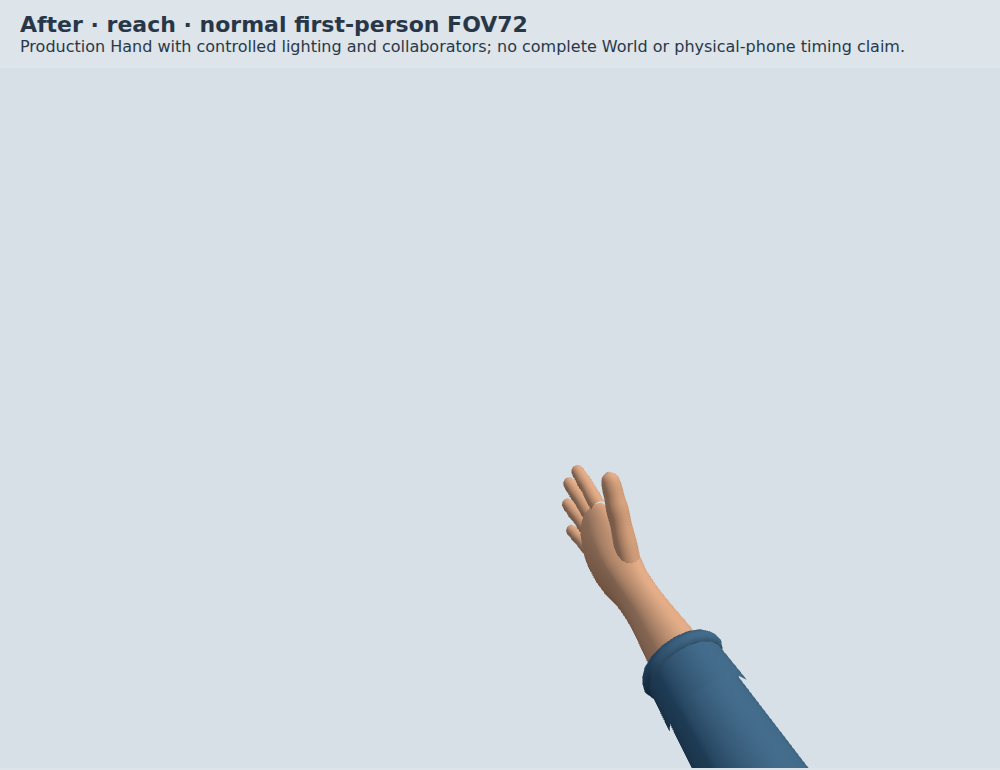
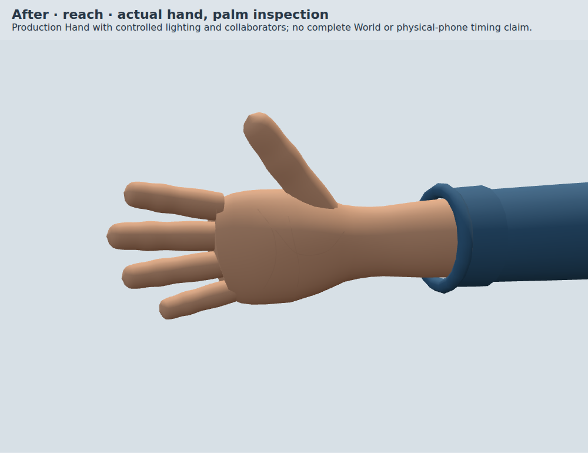
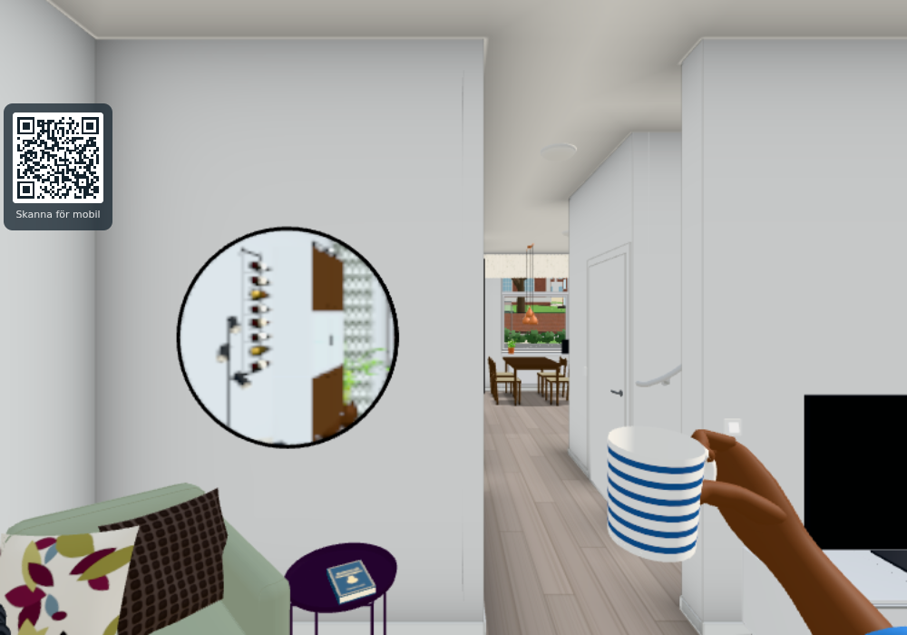

# More natural first-person hands (#1917)

Baseline: `2f03ba02187419796185822e411901002cdb552f`. The final served Hand
SHA-256 is `a4ab8914a060f7fb0f76184e18674fe1ad4f4876133830897722c359c271ab75`.
The paired [before](baseline.json) and [after](after/results.json) records identify
the actually served source, browser, poses and camera positions. Their `head`
field is the checkout base before committing the candidate; the served source
hash is authoritative. Final density constants are centralized without changing
any geometry: [eight actual states](geometry-equivalence.json) have byte-identical
hand/morph/arm/cuff/accessory buffers and matching poses/counts against the earlier
published `fef5ad53`. Its Hand differs from the prior contact/World checks' source
only by a corrected explanatory sleeve comment; `checks.json` records the chain.
Unrelated Avatar configuration does not change the Hand inputs.

Each finger now has a continuous indexed surface along its original phalanx
centreline, with rounded tips and fitted dorsal nails. A shaped palm/wrist,
fitted thumb base, knuckle contours and shallow palm creases replace the old
flat block and overlapping capsule joints. Artistic assumptions are centralized
in `HAND_SURFACE`. The result is still a lightweight stylized hand: the improvement
is its silhouette and transitions, not photorealistic skin or a new animation rig.

The existing relaxed/grip/spread/web channels, contact anchors, pose provider
priority and mirrored left hand remain. The thumb ring follows the same fitted
thumb root. Bare forearms use their own cached taper and white vertex colours
with the shared skin material; clothed arms retain their sleeve material.
Suit gloves switch off skin vertex colours to retain their uniform finish.
No texture, light, bone, mixer or per-frame geometry build is introduced.
The three shallow crease surfaces are projected once and cached across poses.

## Three scoped checks

1. Matched actual Hand consumer: eight states (reach, grip, palm, two-hand hug,
   web glove, wet skin, bare forearm, accessories), each at normal FOV 72 plus
   palm/back inspection cameras. All 24 paired records pass finite geometry,
   matching morph counts, shared left/right geometry, finite hand/camera transforms,
   identical transforms,
   morph channels and inspection cameras. Normal views and whole palm/back
   views were opened and reviewed against the baseline. All states retain their
   draw count and submit fewer triangles. Three warm 100-frame intervals follow
   25 warm draws, with `Hand.update`, renderer submission and synchronous finish.
2. Actual contact/provider contracts: `onehandgriptest.cjs --render` passes
   33 contract checks plus all 15 native rendered item states (Cup, fish finger,
   bottle, glass, scoop × rest/use/moved camera). Existing contact errors remain
   below 1e-10 m; model matrices, parent, contents and action state stay intact.
   [Provider comparison](pose-contract/result.json) passes actual Hand wall,
   swing and held-item priority, including both hands and complete transform/
   morph equality with the baseline. This is not a Player collision/physics test.
   The existing ring/wrist script exits successfully for 36 cases, but its visual
   coverage is limited: one palm image is blank and is explicitly **not** counted
   as passing visual evidence. See the independent fixture finding below.
3. Actual main/World with an owned local Worker: the real game frame draws the
   reaching hand, then a real cupboard Cup held by the same Hand. Both images
   were opened and reviewed. The fixture moves to open living-room space,
   updates matrices and refreshes detail culling after its artificial teleport,
   before the real frame. It asserts actual hand/Cup render callbacks, rather
   than treating local `visible=true` as proof of rendering. Quality 1, June/noon,
   FOV 72, browser 1000×700/DPR 1, game pixel ratio .75 (750×525 buffer).
   [Result and source hashes](world/result.json), zero page errors. No World
   timing or before/after World-wide performance conclusion is claimed.

The first version of this new component fixture used an empty palm prop without
an explicit grip. Its bounding-box fallback produced NaN transforms and a blank
palm image; geometry-only finiteness was inadequate. The fixture now provides a
valid explicit grip and rejects non-finite hand/camera poses. Both complete paired
captures were repeated, and the corrected normal/whole palm images were opened.
The earlier faulty component result is not counted as passing evidence.

The extra existing `webhandstest.cjs` run **fails** with exit 1 after 20 preceding
checks because its roof stub lacks `overhead`, which the unchanged real Player
calls. Its JSON's zero recorded failures is not a pass. This independent existing
fixture defect is [#1932](https://github.com/solwation/lunden-3d-apartment/issues/1932).
The focused actual Hand provider comparison above covers the changed consumer's
pose contracts without claiming that the broken full Player fixture completed.

The old ring script only checks selected ring codes/mesh presence, and accepts a
blank palm screenshot. [#1933](https://github.com/solwation/lunden-3d-apartment/issues/1933)
tracks the camera/visibility assertion gap. The retained hug/accessory views show
the relevant hands; the blank palm image is not result evidence. No unrelated
Player or existing fixture implementation was changed for this art issue.

## Bounded costs

The preimplementation budget was no extra ordinary draws, textures/lights or
per-frame construction, with unchanged or lower submitted geometry/morph storage.
These counts include the actual existing arm/cuff and optional accessory draws.

| Actual state | Calls before → after | Triangles before → after |
| --- | ---: | ---: |
| Reach/grip/palm/web | 3 → 3 | 5,108 → 4,980 |
| Two-hand hug | 6 → 6 | 10,216 → 9,960 |
| Wet | 4 → 4 | 6,900 → 6,772 |
| Bare forearm | 2 → 2 | 4,856 → 4,728 |
| Ring/watch/bracelet | 8 → 8 | 5,448 → 5,320 |

One hand's vertex count is 14,484→2,543. Retained indexed hand/morph attribute
bytes are 1,390,464→301,860. The fixture's camera-owned distinct raw geometry
arrays total 1,456,776→377,412 bytes without accessories; add 5,256 bytes of
cached crease source geometry that is not part of the camera traversal, giving
382,668 bytes after. These include the retained alternate bare-arm geometry.
Accessories add the same 45,216 bytes. These are scoped typed-array counts, not
total process, heap or GPU memory; there is no new hand asset download.

| Warm actual Hand interval, three rounds | Before | After |
| --- | ---: | ---: |
| Update/render/finish median | .2–.3 ms | .2–.3 ms |
| Update/render/finish p95 | .3–.4 ms | .3–.5 ms |
| Animation-frame median | 16.7 ms | 16.7 ms |
| Animation-frame p95 | 16.7 ms | 16.8 ms |

Controlled 1000×700/DPR 1 component, Chromium 156.0.8078.4, SwiftShader software
renderer. The approximately 60 Hz interval is synchronized and is not a native
GPU/phone FPS measurement. No general speedup or full-scene memory saving is claimed.

Synchronous Hand construction is measured separately: first constructor
36.4→49.7 ms; five warmed constructors median 10.5→13.8 ms, maximum 19.6→22.1 ms.
Main constructs one Hand, not one per remote player or frame. This bounded extra
one-time CPU work is disclosed; it excludes renderer upload and complete startup.
The projected crease cache avoids repeating ray projection for every morph/new
Hand. Cold startup and network transfer were not benchmarked.

## Reviewed images and reproduction

[Valid palm pose](after/palm-normal.png), [whole palm](after/palm-detail.png),
[Back](after/reach-back.png), [two-hand hug](after/hug-normal.png),
[wet](after/wet-normal.png), [bare arm](after/bare-detail.png),
[suit](after/web-normal.png), [accessories](after/accessories-normal.png),
[actual World reach](world/reach.png), [native Cup](grips/cup-rest.png).

Run `python3 tools/hand-realism-server.py --three /installed/node_modules/three`
with cached Three r170, then use `tools/browsertest.sh node` with
`tools/capture-hand-realism.cjs BASE OUT before|after`,
`tools/handposecontract.cjs BASE OUT` and `tools/handworldcapture.cjs BASE OUT`.
The server's `/__before/` serves the committed baseline; the original measured
server served that exact baseline Hand with unchanged relevant Hand dependencies.
The World driver owns/stops its Worker on 8202; all browser work uses the shared
lock. Existing contact driver: `tools/onehandgriptest.cjs BASE OUT --render`.

Personal gameplay hands are original-only; no public downstream port applies.
Published at `37a9991d4ba18fa3334b8aa982a08a06a77d9fbc`. Actual
[Pages](https://github.com/solwation/lunden-3d-apartment/actions/runs/43185001238) and
[Worker](https://github.com/solwation/lunden-3d-apartment/actions/runs/43185001183)
deployments passed. The corrected [completion comment](https://github.com/solwation/lunden-3d-apartment/issues/1917#issuecomment-6818776803)
embeds nine pinned images; all returned HTTP 200 with image content types before
closure. Before-images are removed from the current tree in the closing commit;
that docs-only commit triggers no new deploy. Result images follow 30-day retention.
