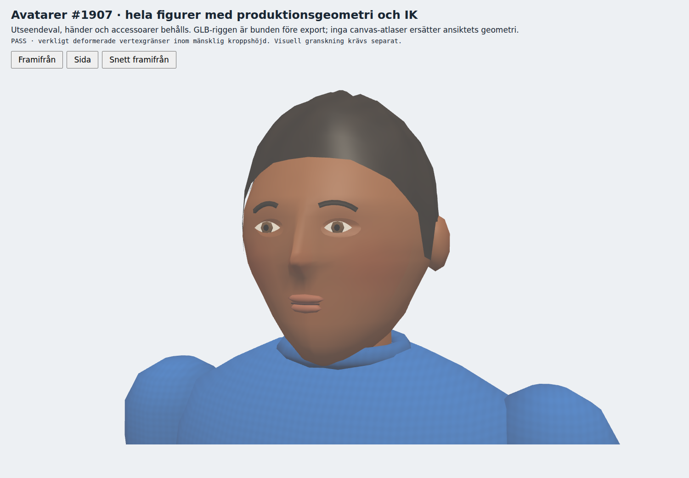
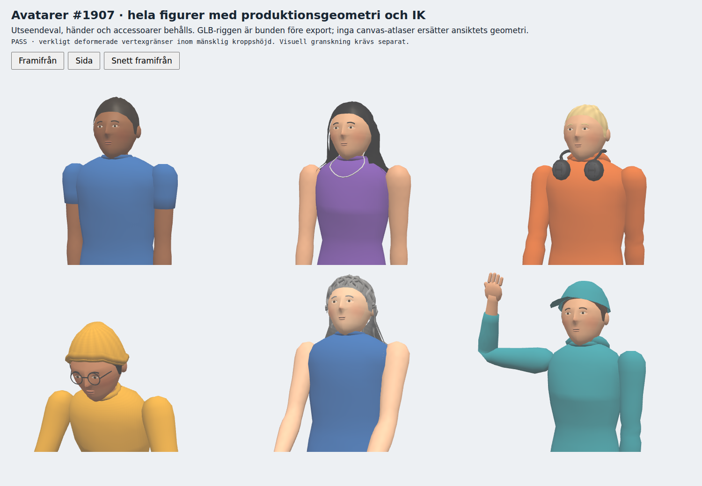

# Avatar surface realism (#1995)

## Selected approach and fixed budget (before implementation)

Baseline: `b9973faab2f376983f37707390855ee8fc09612e` (resolved full source revision is recorded in result JSON).
Read #1916 and inspected its current production meeting render. Connected limbs
are retained; flat Lambert lighting still makes skin, hair, eyes and cloth read
as painted pieces with the same finish. The selected coherent improvement is a
single Standard-material surface model: skin's broad restrained highlights,
glossier eyes, directional hair variation, matte woven garments and metal
accessories, all retaining the player's exact palette. This addresses material
response in the requested GTA 6 / RDR2 visual direction, not AAA character
anatomy, texture scanning, facial animation or photorealistic equivalence.

Fixed resource budget: one draw and 15 bones per avatar; unchanged triangles,
no new textures/requests/lights/passes, no per-frame construction or pose/network
changes. At most 2% extra retained vertex bytes for one shared byte-sized surface
region. One material program replaces the former Lambert program. Standard
lighting can cost more fragment work; bounded warmed rendering is measured on
the available software renderer, with no hardware FPS/mobile performance claim.
The production consumer replaces loaded GLB geometry and material from the live
recipe; no rig/clip/shape changes require re-exporting the neutral inspection GLB.

Checks fixed before work:
1. Existing rig/customization/body regressions preserve private colours, look
   round trips, child/adult scale, IK, accessories and late-load model identity.
2. One own browser run captures matched near/meeting/whole views of six production
   looks and the actual main/World consumer. Skin/hair/fabric/eye distinction and
   silhouettes are visually inspected, with shader errors treated as failures.
3. Same-input actual geometry/material/texture/draw counts and warmed component
   render intervals, plus source hashes, bound the change. Software timings are
   disclosed without a GPU speed claim. Reassess verification at ten minutes.

Topics: graphics, performance, local development and verification. No house
geometry; no public port because personal characters/gameplay are original-only.
Integration/publication owner: root conductor, session olw-win10-codex-20261116.

## Bounded anatomical revision (before geometry implementation)

The first reviewed material-only near/meeting images were too subtle for the
requested realism improvement. They are a useful tested checkpoint, not accepted
completion. Revised scope: one coherent orbital/nasal sculpt. Replace the
teardrop nose and two separate alar spheres with one continuous nasal bridge/tip/
wing profile, and fit slim eyelid surrounds back onto the actual head-front
profile rather than a uniform flat outer ring. Reduce the excessive socket tint.
Existing nose/eye face tags and pivots keep customization and mask behaviour;
rig/pose/network/head-collider code remains unchanged. No shoulder/body revision.
Revised fixed budget: at most baseline triangles, one draw/15 bones, <=2% extra
runtime attribute bytes, no new textures/lights/passes/per-frame work. The material
run's World mirror/driver checks passed; rerun only affected geometry/rig proof
and matched component/consumer imagery, without a new full-World timing sweep.

The final correction integrates the nasal projection into the head's own vertex
grid: 18×24 ring surface replaces the previous 13×24 head plus separate nasal
pieces. No overlaid nasal patch or closed-base seam remains. A shared normalized
byte `noseBlend` carries the local nose-control falloff and mask flattening;
with the region byte, both fit the existing <=2% attribute budget. Eyelid skin
normals blend into the same analytic cheek/orbit, rather than a projecting dark
bag. Existing eye/head/jaw sliders remain independent. The consumer always uses
the live recipe, so the neutral GLB rig/clip payload is unchanged.

## Final reviewed result and checks

The final head is one continuous nasal/orbital/cheek skin: the separate bridge
and two alar blobs are gone, thin eyelid surrounds meet the cheek, and the
excessively dark socket tint is reduced. The same palette is rendered through
one Standard material with distinct skin/eye/hair/cloth finishes. This is a
coherent face/surface realism improvement in the requested visual direction. It
remains a stylized lightweight figure; the original lips, shoulder silhouette,
hair outlines and animations remain. No GTA 6/RDR2 production-quality equivalence
is claimed.

23/23 affected rig/body tests pass, including the posterior invariant and one connected head/nose surface,
local nose-control data, actual loaded rig and existing IK/proportions. The
unchanged look encoding/palette contract retains its prior 25/25 pass. The final
script captures front/side/quarter, matched near/meeting, and combined actual
minimum/maximum eye/nose/head/jaw uniforms. Images were opened and reviewed by
worker and root. Actual main/World opens the newly integrated #1994 customizer;
its private renderer compiles and copies a nonempty 220×310 face preview with no
page/shader errors. This is a real consumer of the final loaded-rig Avatar.
[Raw source-bound results](result.json), [checks and run corrections](checks.txt).

| Look | Triangles before → after | Retained attributes before → after (bytes) |
| --- | ---: | ---: |
| Idle | 11,456 → 11,444 | 3,574,272 → 3,639,192 |
| Walk | 12,184 → 12,172 | 3,801,408 → 3,870,696 |
| Run | 12,024 → 12,012 | 3,751,488 → 3,819,816 |
| Crouch | 12,700 → 12,688 | 3,962,400 → 4,034,784 |
| Sit | 16,376 → 16,364 | 5,109,312 → 5,203,752 |
| Wave | 11,624 → 11,612 | 3,626,688 → 3,692,616 |

All six looks keep one submitted avatar draw, 15 bones, six shared skeleton
textures and three existing program variants in the gallery. Attribute memory
increases 1.816–1.848%, within the fixed 2% budget; triangle count decreases by 12
per look. The two new shared byte attributes (`region`, `noseBlend`) require no
per-avatar duplicated detail maps. No texture request/light/pass is added, and
pose/network code is unchanged. The GLB remains byte-identical at 2,044,944 bytes;
production replaces its geometry/material from the live recipe. Its standalone
neutral inspection surface does not show this new sculpt, a deliberate limitation
of not re-exporting an unused consumer surface.

Warmed component render+gl.finish at 320×256, ten warm draws then 26 samples:
median 0.2→0.2 ms, p95 0.4→0.3 ms. These tiny, quantized SwiftShader intervals on a
shared saturated host establish neither a speedup nor hardware/mobile FPS or
shader cost parity. Standard adds fragment work despite unchanged draw/texture
counts. No full-World timing sweep was repeated. Cold load and physical phones
were not benchmarked.

## Reviewed images

[Near before](https://github.com/solwation/lunden-3d-apartment/blob/e236824ebdefd2d24bd7ca47e74bf55eaf17474d/docs/verification/1995/before/avatar-near.png?raw=true), [near after](avatar-near.png),
[meeting before](https://github.com/solwation/lunden-3d-apartment/blob/e236824ebdefd2d24bd7ca47e74bf55eaf17474d/docs/verification/1995/before/avatar-meeting.png?raw=true), [meeting after](avatar-meeting.png).
[Whole front](avatar-front.png), [side](avatar-side.png), [quarter](avatar-quarter.png),
[minimum options](avatar-extreme-min.png), [maximum options](avatar-extreme-max.png),
[actual new customizer face preview](customizer-near.png).

Reproduce with the normal HTTP server and cached Three r170:
`tools/browsertest.sh node tools/avatarfinishbrowser.cjs BASE OUT b9973faab2f376983f37707390855ee8fc09612e`.
`--geometry-correction --preview-only` reuses the unchanged baseline in OUT and
captures only corrected component views and the affected new customizer consumer.
The harness owns/stops Worker 8796 and the browser.

No downstream transfer: personal characters/gameplay remain original-only.
Publishing and pinned image comments belong to the root integration owner.

## Final suit/nose regression correction

A final shader review found that nose-size/width controls could deform the suit
mask after its nasal projection had been flattened. The minimal correction gates
local nose controls with `(1.0 - uSuit)`. One bounded 384×384 production component
check renders both actual nose-size/width limits, with no World bootstrap. Bare
limits produce different pixel hashes (the false-green guard); masked limits are
pixel-identical, with one draw/11,444 triangles and GL error0 for all four renders.
Both [minimum](suit-min.png) and [maximum](suit-max.png) result images were opened
and inspected. [Raw final-branch proof](suit.json).

The other reviewed pictures all use `uSuit=0`, where the new multiplier is exactly1.
Their geometry/shading/resource counts are unchanged; no broad art/browser rerun
was needed. [Exact pre-/post-correction source hash mapping and equivalence](final-source.json)
keeps these images bound to the final source without silently rewriting their
original measured hashes. The existing geometry/rig evidence is unchanged.

## Final posterior regression correction

Root review found that the initial continuous-head implementation also applied
`noseRise(x,y)` to rear central vertices at nasal heights, and gave those vertices
nose-control weights. Both geometry rise and `noseBlend` are now gated to the
frontal head (head-local z>0). Rear head skin keeps its authored elliptical shape
and cannot respond to nose size/width or mask flattening. No further morphology
is introduced.

The meaningful new posterior regression checks actual rear vertices against the
authored ellipse and requires zero nasal control/contact influence. Existing
rig/body tests plus this regression pass **23/23**. A six-look attribute comparison
against `e55baee2` proves every nonposterior position, normal and attribute
component is exactly unchanged;42 wrongly influenced rear vertices per look
become0. [Source-bound comparison](posterior-equivalence.json). Triangle/attribute
counts and all recorded resource costs stay unchanged.

Front/near/meeting/extreme/customizer imagery remains valid through exact front
equivalence (rear skin is hidden by the existing hair in those views). Side and
quarter images were refreshed and inspected because their head outline can expose
rear triangles. [Final-source side/quarter capture record](posterior-views.json).
The corrected rear bounding box also shifts the suit's derived front-atlas
threshold, so its two tiny images and pixel-invariance proof were refreshed once
on final source. Bare nose limits still change pixels; masked limits remain
pixel-identical. No World bootstrap or broad art/performance sweep was repeated.
[Final source mapping](final-source.json) separates reused and refreshed evidence.

## Root integration

Rebased onto `d15cc0c6`. Only unrelated vehicle/visited-flat LOD settings changed in config.js; avatar settings and implementation remain source-equivalent to the final reviewed checkpoint. Source-bound green behaviour evidence was reused without a routine browser rerun. Root reviewed the complete patch and all final views.
