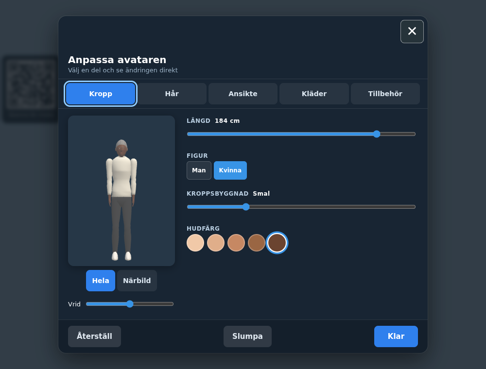

# Versioned mirror preview — #1998

The lazy preview import now carries the stamped `BUILD` query; `dev` retains its plain module URL. `stamp.sh` already versions its static dependency on `avatar.js`. No appearance, geometry, storage or editor interaction changed. Public downstream has no avatars or this preview: not applicable.

Checks executed 2026-11-16:

1. Two actual `tools/stamp.sh OUT VERSION` packages, `preview1998a` and `preview1998b`, pass changelog/package generation. The stamped customizer imports its matching version module; the lazy expression carries BUILD; each preview's static Avatar dependency carries the matching stamp. [Build A](stamp-a.txt), [build B](stamp-b.txt). Both have the same application CONTENT because only the supplied deployment version differs.
2. One bounded Chromium/SwiftShader run opens the actual customizer and AvatarPreview from each package on the same origin/context while the served deployment switches A→B. All eight checks pass: actual preview and Avatar requests carry the corresponding version, actual production pixels are nonempty, neither deployment requests an unversioned preview and no page/resource/shader errors occur. [Log](browser.txt), [raw request list and source hashes](browser.json).

The component fixture reuses packaged index markup/styles with bootstrap/inline scripts removed, and opens the real exported customizer. World is never constructed. The screenshot shows the second package's actual editor/preview and was opened and inspected. Cached Three files answer the CDN route. Although the fixture server supplies long-lived JS cache headers, Playwright routing disables HTTP caching: **this proves module URL/version selection, not a measured stale-cache hit**. The version-specific URLs establish the requested module-selection contract. Physical devices were not tested. The wrapper reports that this host lacks systemd memory scoping.

Reproduce by stamping two packages, serving them in turn on one origin, retaining the real customizer markup and import map, then calling `setupAvatarCustomizer({getLook:()=>avatarLook('version-proof')})` and `openAvatarCustomizer()` from each stamped customizer. Inspect the browser requests for `avatarpreview.js?v=<BUILD>` and `avatar.js?v=<BUILD>`. No new permanent regression suite is introduced for this two-line correction.
