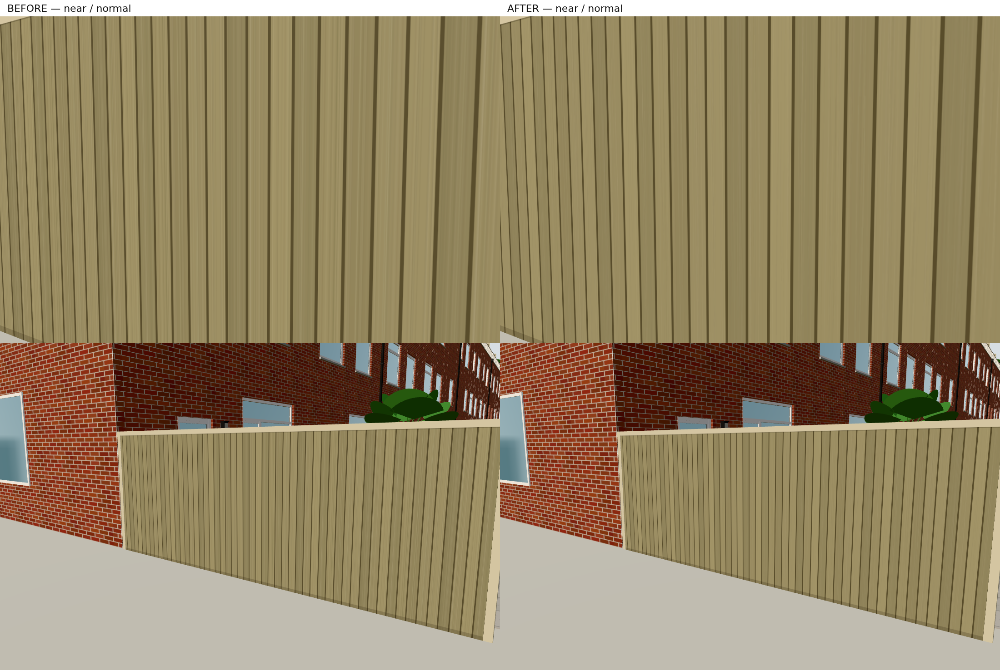
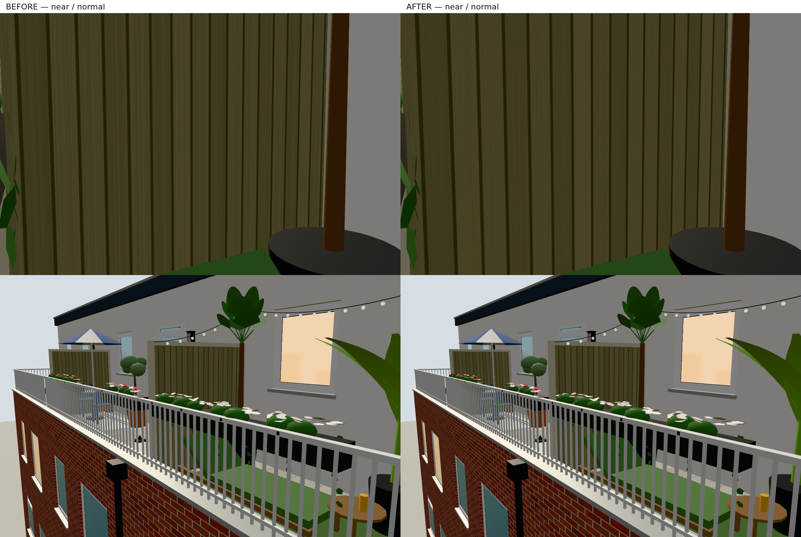

# Painted screen-wall surface — #2075

Source `c01298f0b73dd41e992e8cf45ed9430f11b10dcd` compared with `6e1576aa078b70730e73bb4ffb805dc32e1b3959`. Exact product/test SHA-256 values are in [source.json](source.json); [browser.json](browser.json) contains geometry hashes, camera positions, collision/occluder rectangles, terrace data and per-view render counts.

The actual `World.M.fence` material is exposed only by the test's route; production `buildExterior` receives it and builds the real ground-floor and roof-terrace screen batches from the production plan. This does not build the full World. A fixed sun and hemisphere light, NeutralToneMapping, MSAA, DPR1, SwiftShader and 1100×720 frames apply equally before and after. No illustrative replacement wall or material is used.

Each panel preserves the complete native 1100×720 frame without stretching or cropping. Both sheets were opened and inspected. Painted boards have quieter curved fibres and a small joint edge response; the cream frame stays plain. Roof near views include the existing plants/parasol; these were not changed. Lighting and board tint assumptions remain the established #1786 palette, not a measured repaint.

Checks (three scoped groups):

1. `node --test tools/screenwallsurfacetest.mjs`: **3/3 PASS** — deterministic four-pixel joint registration with smooth shoulders and continuous repeat boundaries, bounded fibre paths, shared scalar texture and constant frame/post sampling (both wall orientations, including elevated walls).
2. Syntax checks for all four changed product modules plus the browser runner, `git diff --check`, exact source comparison of `screenwall.js` from `/** Box x0` onward against the baseline: **PASS**. Thus part dimensions, normals, UVs and indices remain byte-preserved. No house layout is changed; Hus A/B/C have no consumers of this screen-wall builder.
3. `PLAYWRIGHT_MODULE=/path/to/playwright tools/browsertest.sh node tools/screenwallsurface2075browser.cjs http://localhost:8193`: **PASS**, one own browser run. All exterior mesh positions/normals/UVs/indices share the before/after hash `cb19c060580dabff37bf033c6c37827a9dce4af6ad345c6a09175c5e315cbe7b`; fence batch 684 triangles. Occluder rectangles and terrace data are identical. All four views have identical draw/triangle counts: ground near 36/58,834, ground normal 106/108,261, roof near 41/88,786, roof normal 50/90,142. Zero page/console errors; wrapper peak 1,768 MiB of 4 GiB.

The existing colour texture remains 256×512. One additional cached linear RGBA8 texture (256×512) serves bump red and roughness green: **524,288 base bytes; 699,052 bytes including all mip levels**. Fixture resident texture count 9→10. Maximum joint shading depth ≈0.595 mm; board roughness ≈.844–.856, joint .96, frame .85 (8-bit quantized). Geometry, draw calls, passes, lights and per-frame uploads do not increase; standard-material fragment sampling increases. No FPS, device, winter or full-world performance claim is made. Existing seasonal behavior is untouched. Public neutral transfer is tracked by kvarteret-lunden #297.

Reproduce with the existing ignored Three 0.170.0 dependency available under `node_modules/three`, an HTTP server for this checkout on the stated port, and the repository browser wrapper. The browser runner obtains the original baseline modules from Git and appends its private `M` export in memory; production sources expose no test API.

## Publicering

Kod/bilder `a95e1719379f73593c0b6e7ffeb8bfd3d9626484`; faktiska run-ID [44271371292, 44271371269] success på exakt revision. Alla bilder HTTP200 och inbäddade före stängning: https://github.com/solwation/lunden-3d-apartment/issues/2075#issuecomment-6973834283. Slutkvittot är enbart dokumentation; originalets sökvägsfilter utlöser ingen ny apppublicering.
