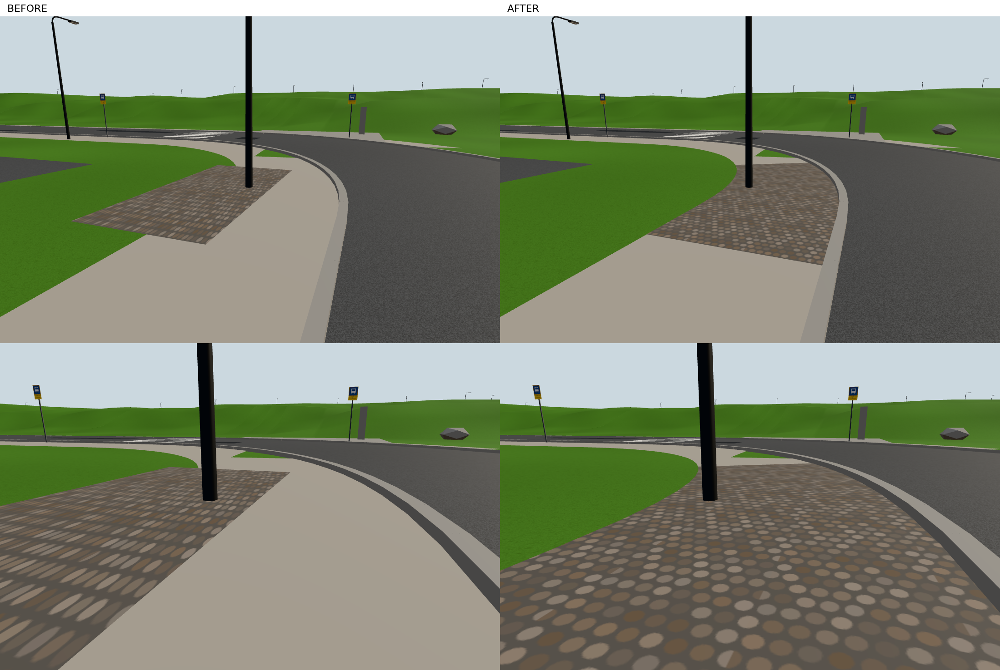
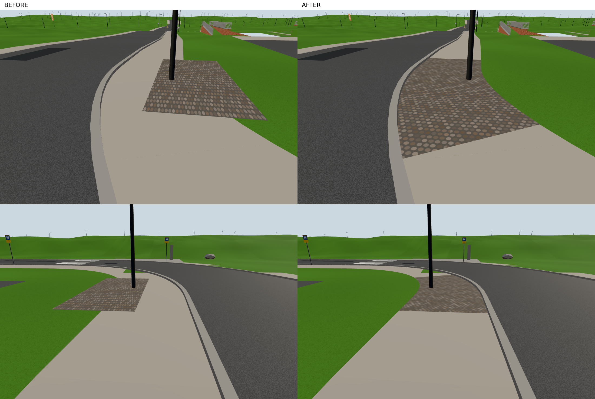

# Stenläggningen vid gatuhörnet — #2077

Produktkälla `ef00ab80b5b4aff3e7c85e6df43fec58557f77f8`, jämförd med `eb0e4265c1478661ce01cd666812687bf23a04d2`.
[Käll-/referenshashar och exakt kostnad](source.json), [browserdata](browser.json), [bevarandekontroller](preservation.json).

## Rapport och underlag

Den granskade rapporten pekar ut en friliggande stenrektangel vid gatuhörnet. Dess befintliga bild har SHA-256 `2eacdf8012d30cc94972131cbf508089029cb0317f4943216cb577e2191d0386`. Historiken visar att #128 (`05533521`) lade rektangeln x17,2–19,5 / z−17,5–−12,5; den har inte följt med den senare böjda trottoaren.

De tre fotona i #128 har öppnats: `gatan-tegelmur-trad-trafikljus.jpg`, `korsning-skola-hemso-flaggor.jpg` och `sidogatan-tegelhus-plattak-byggplats.jpg` under docs/foton. Korsningsfotot visar en ansluten stensatt hörnyta i den hårdgjorda beläggningen. Det stödjer en ansluten yta, inte de gamla rektangelmåtten. Den nya korta sektorns ankare/utbredning och 0,8 m texturperiod är uttryckliga visuella antaganden. Ingen inmätt exakt kontur eller byggspecifikation påstås. Tillfälliga byggbarriärer modelleras inte från bilden.

## Egna matchade resultatbilder

Båda arken har öppnats och granskats: den friliggande rektangeln i gräset är ersatt av en sammanhängande del av den befintliga trottoaren, med kanter som följer gräsgräns och kantsten. Varje panel bevarar hela den nativa 1100×720-bilden i skala 1×1 utan beskärning eller ändrade proportioner. Samma kameror/ljus används före och efter. Normal-/anslutningsvyerna har ögonhöjd 1,65 m över den lokala gatan; närvyn är uttryckligen en låg detaljvy 0,75 m.

Fixturen återanvänder faktisk `surroundingsParts` fram till dess befintliga yield 0,15 (terräng, väg, trottoarer) och faktisk `buildStreet`. Den visar det berörda gatuhörnet med riktiga kantstenar och lampor, utan att bygga hela World eller hus-/träd-/bakgrundspassen. En fast sol och hemisphere, MSAA, NeutralToneMapping, DPR1, Chromium/SwiftShader. Inlinefavicon från början. Detta är en avgränsad produktionskomponent, inte en fullständig scenrekonstruktion av rapportens regn/bakgrund.

## Tre kontrollgrupper

1. `node --test tools/cobbledcorner2077test.mjs`: **3/3 PASS**. Samma båda samplekanter som trottoaren, uppåtvända trianglar och ingen vägöverlappning; varje stentriangels plan exakt en befintlig trottoartriangel; deterministisk höjdföljning på sluttning och metriska UV. Ytan ligger 12 mm över vägunderlaget, alltså 4 mm över den befintliga trottoarens 8 mm.
2. Exakt källbevarande: config är identisk när endast det egna `cobbles`-blocket återställs. Färgcanvasreceptet är identiskt förutom repeatinställningen. Hela övriga street-koden och `roads.js`, `surroundings.js`, `pathlamps.js`, `roadlamps.js`, `groundglow.js`, `streetsigns.js` är oförändrade. Syntax och `git diff --check` **PASS**. Gångstödet ändras inte. Detta är en enda fristående gatdetalj; ingen motsvarande yta ändras i A/B/C/L:s husbyggare.
3. En egen `tools/cobbledcorner2077browser.cjs` via browserwrapper: **PASS**. Fyra matchade faktiska konsumentvyer, noll sid-/konsolfel, peak 2028 MiB av 4 GiB. Alla övriga emitterade mesh-/instansattribut har identisk hash `39302fb35842f35760d4369ac31f02f12a179a6b10e5a24ac1b99d14704df0ed`. Samma 31 markfrågesampel runt hörnet. Stenytans höjdfel mot faktiskt vägunderlag+12 mm är högst `1.04e-10`m.

| Vy | Ritanrop före → efter | Trianglar före → efter |
|---|---:|---:|
| normal | 14 → 14 | 136051 → 136066 |
| near | 14 → 14 | 136051 → 136066 |
| northJoin | 25 → 25 | 178120 → 178135 |
| southJoin | 14 → 14 | 136051 → 136066 |

Stenytan går **2→17 trianglar**, rå geometri **140→1632 byte** (+1492). Den avgränsade komponenten har samma 34 meshobjekt, **308482→308497** instansräknade trianglar och **14718476→14719968** råa geometriattribut-/indexbyte. Siffrorna är inte totalminne eller FPS.

Befintlig 128×128 färgcanvas och material behålls: **65536 RGBA8-basbyte / 87380 byte med alla mippar**, oförändrad texturresurskostnad. Färgpalett och stengenerator är kvar. De nya UV-värdena följer X/Z-meter och lika 1,25 repeat per meter, vilket tar bort rektangelns tidigare utdragning. 8 stenar per 0,8 m ruta ger ungefär 10 cm radavstånd, ett visuellt antagande. Inga extra draw, material, texturer, pass, ljus eller arbete per bildruta.

Begränsningar: ingen fullWorld-, fysisk telefon-, FPS- eller navigeringskörning. Befintliga väg-/gång-/kant-/lampusystem är bytebevarade och komponentens markfrågor lika, men inga nya verkliga mått har verifierats. Befintlig säsongskod och gatdetaljens vinterbeteende ändras inte. Neutral publik överföring är separat #299.

Återskapa med lokal Three 0.170.0, HTTP-server 8203 och `PLAYWRIGHT_MODULE=/path/to/playwright tools/browsertest.sh node tools/cobbledcorner2077browser.cjs http://localhost:8203 docs/verification/2077`. Basmodulerna kommer från Git; inga råa före-bilder behålls.
