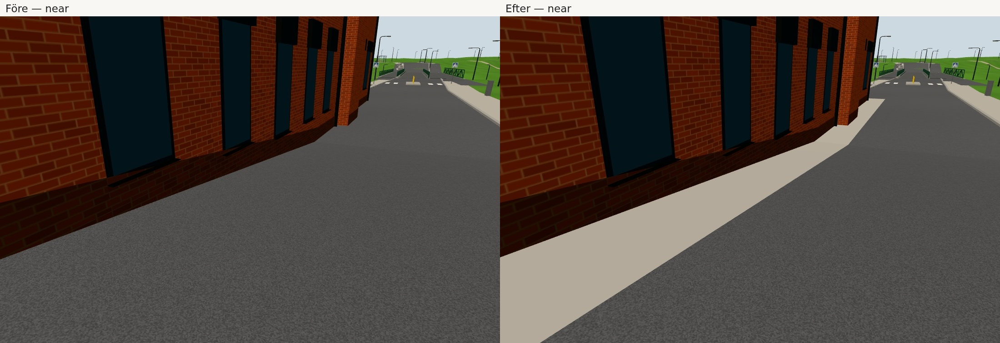
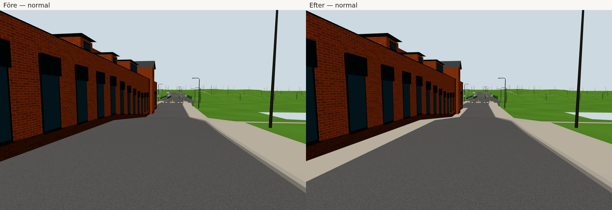
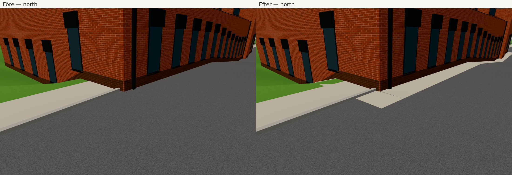
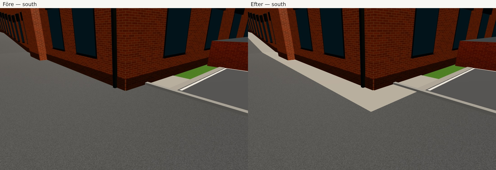
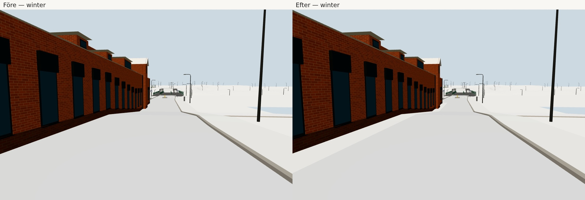

# Realgymnasiet 20 facade pavement — #2078

Baseline: `eb0e4265c1478661ce01cd666812687bf23a04d2`. Exact product/fixture hashes are in [browser.json](browser.json) and [checks.json](checks.json); the containing commit binds these documents and images. The reviewed report image is `docs/ingame-reports/e607ce37-16be-4319-b642-543e92d20d9e.jpg`, SHA256 `03f03f11354619406fe351777711346d9c188ad7523f2cca2b781873ed6199d4`. It shows source `130681301`, Realgymnasiet 20, drawn by `src/realgym20.js`. Existing photo `docs/foton/skolbyggnad-real-nr20-hepcat-bakom.jpg` also shows its narrow facade pavement.

The new 1.1 m strip follows the unchanged west polygon edge (28.4,19.19)→(28,58.28). Two 1.1 m-long gable returns extend 3 m inward to the existing pavement. **These dimensions and the 0.028 m lift are guesses, not surveyed.** Existing `pathStrip` uses production `roadGround=max(groundY,renderedTerrainY)` and its subdivision. Only Sankt Lars asphalt is deliberately overlaid locally, where old pavement lies behind the building; `vehicleTrim` excludes other vehicle ways. No house/road relocation, raised curb, new collision obstacle, entrance leaf or surrounding property change.

## Three scoped check groups

1. [Node result](node.txt): 3/3 tests check dense strip continuity, both returns and contact with existing pavement, finite local geometry/heights, actual `farWalls`/`surfaceY`/`slopeAt` walking support and clear centreline. Initial fixture corrections fixed the `slopeAt` import name, avoided exact Float32 boundary rays and replaced an arbitrary 1000-vertex limit with a bounded 3000-vertex allowance; no product changes for these corrections.
2. Existing `pathaudit --json` before/after byte-identical; exact old config bytes and five unchanged house/backdrop/walking/street/bridge modules confirmed in checks.json. Generic pathaudit does **not** enumerate `facadeWalks`; its unchanged result checks side effects. The targeted new-strip audit permits only the intended local asphalt overlay. Only source 130681301 receives a new record; inventory of Hus A/B/C/L and HepCat finds no corresponding data change. There is no operable Realgymnasiet 20 entrance leaf to relocate in this model; both returns stay outside its footprint.
3. Final Chrome/SwiftShader component run uses actual `surroundingsParts` through its first yield **after 0.46**, when west/east/north backdrops are attached, plus production `buildStreet`. Fixture asserts `east-backdrop.userData.buildings` contains source 130681301 before capture. No apartment/World bootstrap, full south backdrop, own Hus L/A/B/C rendering, gameplay, weather renderer or avatar is loaded. All 77 actual wall/ground/slope route samples match before/after. Five matched cameras/light, 1100×720, DPR1, MSAA, NeutralToneMapping, inline favicon; zero console/page errors.

Earlier browser fixture attempts are rejected: first selected a later asphalt/older paving batch; second used a whole-slanted-wall AABB and falsely reported a wall collision; third passed numeric checks but stopped at yield 0.46 **before** houses attached. Image inspection caught the absent house. The final fixture fixes all three and replaces every earlier image/JSON. Only final native-aspect pairs remain. Product code stayed unchanged throughout these fixture corrections. Final wrapper peak: **666 MiB / 4 GiB**. No broader regression rerun.

## Actual cost and limits

Paving attributes grow 988704→1044768 bytes: **+56064 B**, 1752 vertices/**584 triangles**, approximately 54.75 KiB each for retained CPU attributes and GPU upload (driver/transient allocations excluded). Three temporary strips merge into existing paving. No extra mesh/material/draw/light/texture/texture bytes or pass. There are 75 actual component meshes before/after; every non-paving geometry hash is exact. Road geometry and all old config source are exact.

| View | Draws before→after | Triangles before→after | Resident textures |
|---|---:|---:|---:|
| near | 38→38 | 239505→240089 | 13→13 |
| normal | 39→39 | 235947→236531 | 14→14 |
| north | 35→35 | 251209→251793 | 14→14 |
| south | 25→25 | 280955→281539 | 14→14 |
| winter | 39→39 | 235947→236531 | 14→14 |

Summer/winter retain existing registered paving colours. The house and pavement are visible in every final pair. Near/normal show continuous narrow pavement instead of asphalt against the plinth. North/south show returns meeting existing paving; small 2 cm transitions to old 0.008 m paving remain. Existing road-edge curbs and house geometry stay unchanged. This is no claim of measured curb construction, full-player traversal or mobile/device performance. All five images inspected without cropping/scaling their 1100×720 cells; each 2200×756 sheet adds only a 36 px label row.

## Inspected final images

Public adaptation is tracked separately as solwation/kvarteret-lunden#300. Transfer only neutral source-identity/config/geometry consumers, with own public checks/images; never original photos/report image/full config/history. Owned server, Chrome processes and wrapper lock stopped after verification.

## Integration review

Root inspected final normal/north pairs and reviewed the worker’s five inspected native pairs and three green groups. Product roads/surroundings bytes exactly equal tested48f2f0bc. Config adds only the named facadeWalks block to accepted main; every prior byte and changelog row retained. Unrelated2077 cobbled-corner change remains. Its separate material geometry does not affect the new pavement fixture. Source-bound results reused without duplicate browser or broad tests.
