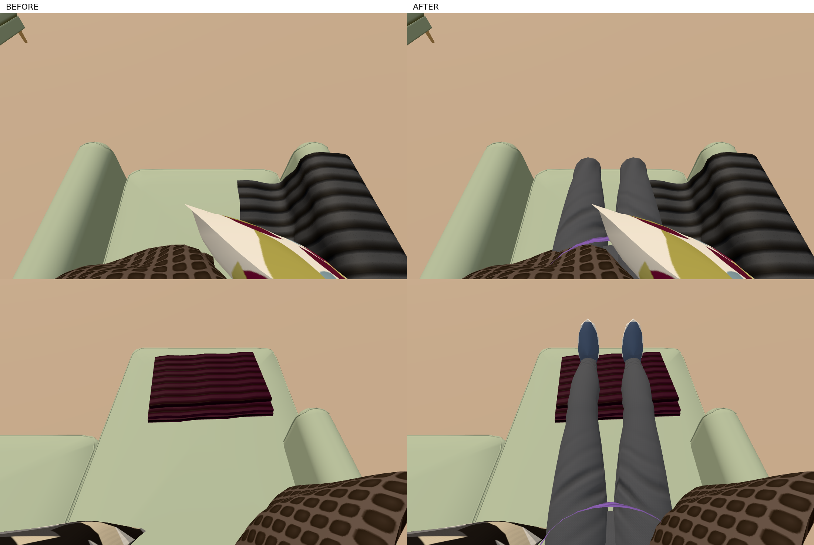
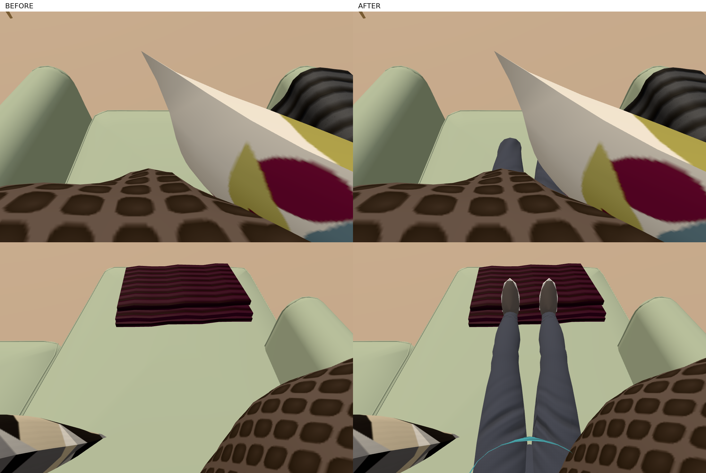
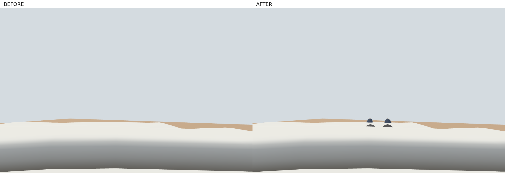
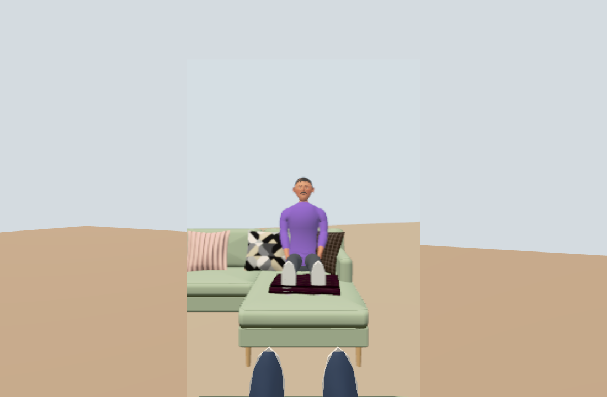
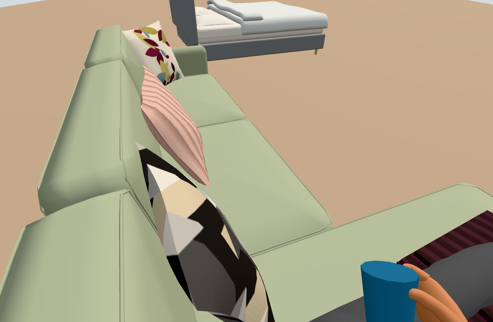

# Own body while resting — #2080

Product source `810cef8dd2ff4ba64a21135f9016dc58b81f7b03`, compared with
`dd0bf970d75d3806080792e34880938046243ac2`. [Source hashes and preservation](source.json),
[actual browser measurements](browser.json), [specific waist-hem diagnosis](hem-edge.json).

The fixture constructs the actual `armchair`, `sofa` and `bed` production furniture,
`restTarget` / `Rest`, `Ghosts` / the selected `Avatar`, `Hand` and the production
shared reflector. It evaluates the verbatim current main.js state callback and render
hook. It does not construct World or use a camera overlay/replacement body. Both phases
use the same 1100×720 frame, DPR1, MSAA, NeutralToneMapping, fixed sun/hemi and
Chromium/SwiftShader. Every comparison panel retains its complete native frame without
stretching/cropping. All five result sheets/views below were opened and inspected.

The own view shows the actual lower body with the selected proportions, trousers and
shoes. Avatar arms are masked in this view; existing first-person Hand/held-object
views continue to own arms and hands. Head, hair, neck accessories and surfaces within
a body-only **30cm** inner near plane are masked. This display clipping distance is a
*guess*, not a measured anatomical dimension. Camera eye, camera near plane, look limits,
seat/bed anchors and pose geometry are unchanged. The body is ordinary opaque PBR,
depth-tested and depth-writing. Existing cushions cover part of the lap; the bed's
existing duvet covers almost all of the lying body, leaving the toe tips visible.
The extended chaise pose visibly differs from the ordinary bent-knee chair pose.

The thin purple/turquoise curve over the lap is the existing lower shirt hem, not a
new clipping-plane section. Root requested this specific follow-up. Actual skinned
triangles 558/561 at bind-Y 0.875–0.888m (hip bind-Y 0.9m) project onto the curve at
NDC-Y −0.713…−0.693 and lie **0.635–0.649m** from the eye along view depth, beyond
the 30cm mask. They belong to the original torso/top surface and follow its hip anchor;
[hem-edge.json](hem-edge.json) retains the exact positions. No geometry was altered to
hide the authored hem.

Checks (three bounded groups):

1. `node --test tools/avatarselfviewtest.mjs tools/avatarbodytest.mjs`: **15/15 PASS**.
   Settled ordinary rest gating, entry/exit and gym exclusion; real transformed seat
   anchors and sit/chaise/lie pose codes at 120/180cm with independent gaze; shader
   composition/default full appearance, existing attribute use and chosen-height body
   contracts.
2. Syntax checks of the four changed product modules and runner plus `git diff --check`:
   **PASS**. Exact baseline preservation of config, Rest, remote-pose, furniture, Hand,
   reflections, keep/resume and PlayerRoom sources. Avatar.js is byte-identical outside
   its import/install lines; complete Ghost.animate/remote class tail is unchanged.
   The browser's production state callback is byte-identical before/after. No network
   field, storage format, furniture, collision, camera limit or gameplay change.
3. `PLAYWRIGHT_MODULE=/home/olof/github-dashboard/node_modules/playwright tools/browsertest.sh node tools/avatarselfview2080browser.cjs http://localhost:8206 docs/verification/2080`:
   **PASS**, final source-bound own browser run, six matched views (including a turned
   chaise gaze), **20/20** lifecycle/view controls and zero page/console/shader errors.
   Checks cover unarmed solid body, fixed world anchor, full mirror and mask restoration,
   actual shared-reflector draw, camera Hand/proxy ownership, entry, pause/resume, gym
   exclusion, complete reaction body, controlled renderer exception/finally, standing,
   single self avatar and a fresh fixture reload with no stale body. Final wrapper peak
   **808MiB of 4GiB**. Earlier iterations corrected reproduced near-plane/sleeve-mask
   defects and a short-look budget assertion; an interrupted server was restarted.
   One additional 610MiB bounded geometric probe answered root's specific hem question.

Normal-pass costs in the matched fixture:

| View | Before calls / triangles | After calls / triangles |
|---|---:|---:|
| Adult armchair |24 /11,066|25 /27,378|
| Adult chaise |27 /10,614|28 /26,926|
| Lying bed |10 /6,306|11 /22,618|
| Short armchair |23 /10,478|24 /26,466|
| Short chaise |24 /9,398|25 /25,386|
| Adult turned chaise |43 /20,658|44 /36,970|

Thus **one already existing skinned-body draw**, submitting 16,312 triangles for this
adult look and 15,988 for the short look, with unchanged geometry/attribute counts.
The adult's existing attribute arrays total 5,236,152 bytes; no second body or new
geometry/attribute allocation is introduced. The fixture first uploads the existing
**8×8 RGBA32F bone texture, 1,024 bytes, no mips** (resident textures+1), and first draws
one existing avatar program (fixture programs 3→4). Desktop warm-up/mirrors can already
have uploaded these resources; no zero-upload first-seat promise is made. The new mask
adds one vec2 uniform/varying to the same avatar program. Posing and existing bone-texture
updates now run while our resting body is drawn. A previously existing mirror pass also
renders its complete self avatar; no new reflection target/pass, light or image map.

This is bounded production-component evidence, not a full-world/physical-device/FPS
claim. The reload check covers a fresh fixture; full-game resume/UI/network replication
were not rerun, and their production sources/formats are unchanged. Gym/reaction checks
exercise visibility ownership, not every apparatus/reaction camera trajectory. No house
layout is affected. No public transfer applies: this issue uses private characters,
private furnishings and gameplay/avatar view paths excluded from the public project.

Reproduce with the ignored Three 0.170.0 dependency available under `node_modules/three`,
an HTTP server for this checkout on 8206 and the repository browser wrapper. Baseline
modules are obtained from Git only inside the browser runner. The fixture has an inline
favicon and no production cloud writes.
