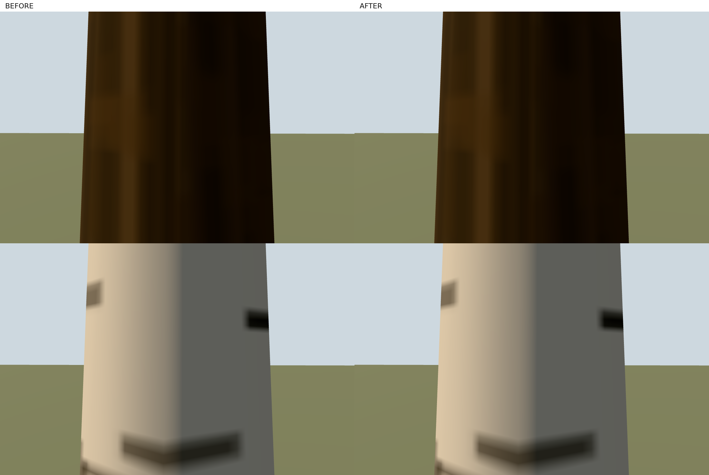
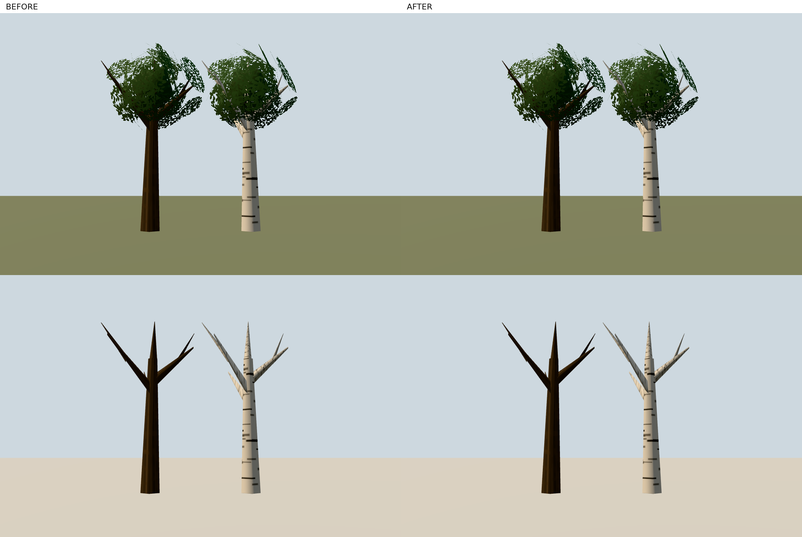
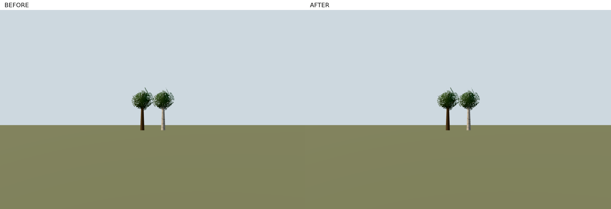

# Bark and birch surface shading — #2081

Product source `63275360aca19b98dc217110346ccc36c7f2f1b4`, baseline
`451e12ea1e82a220fc9934052c226cbfb6c1e71e`. [Source hashes/preservation](source.json)
and [actual browser measurements](browser.json).

The bounded scene uses the real `barkMaterial`, `lodBarkMaterial`, `trunkGeometry`
(near/far), leaf materials/geometries, `InstanceLod`, `registerTrees` and `applySeason`.
The specimen instancing is controlled: two trunk kinds with scale(2,5.5,2), one crown
per tree. These are representative material consumers, not a full World/site placement
survey. The fixture's simple floor turns white for winter context; actual seasonal
crown visibility/matrices come from production `applySeason`. Fixed sun/hemi,
NeutralToneMapping, MSAA, DPR1, Chromium/SwiftShader, 1100×720 apply equally before/after.
Each comparison panel retains its complete native frame without cropping/stretching.
All three sheets were opened and inspected.

The result is intentionally quiet: a shallow light response on the original bark
furrows and subtle matte variation on white birch. It becomes difficult to distinguish
in the normal/LOD frames. The dark birch lenticels keep their painted appearance; they
do not become deep holes. The existing low-sided silhouette/branches are unchanged.
No colour canvas, RNG stream, instance position/colour, UV, season or LOD was redesigned.
All new pattern/strength values are visual guesses, not measured bark dimensions.

Three scoped check groups:

1. `node --test tools/barksurfacetest.mjs tools/lodtest.mjs`: **11/11 PASS**. Deterministic
   packed data, original-seed furrow registration, inverse height/roughness correlation,
   bounded relief/finish, smooth repeat boundary, birch marks that affect roughness
   without correlated height pits, map caching/UV/mips/native-vertex classification,
   original 46/14-triangle trunks, existing dither/complement/packing/season contracts.
2. Syntax for the three product modules and runner, plus `git diff --check`: **PASS**.
   Full foliage.js is byte-identical outside the new import and material wrapper;
   config.js is byte-identical outside the named `BARK_SURFACE` block. Therefore the
   complete old colour RNG/drawing, UVs, trunk/lobe geometry and far material survive.
   Seasons, LOD, surroundings, courtyard, southbackdrop and siteinstancebatch sources
   are byte-preserved. Site instance compaction admits these unchanged native-vertex
   materials; new maps add no shader callback/displacement or new material identity
   splitting. No broad app/build gate is needed for this static ES-module change.
3. `PLAYWRIGHT_MODULE=/home/olof/github-dashboard/node_modules/playwright tools/browsertest.sh node tools/barksurface2081browser.cjs http://localhost:8210 docs/verification/2081`:
   **PASS**, one own run with five matched views and all result images. Zero
   page/console/shader errors; wrapper peak **697MiB of 4GiB**. Before/after hashes of
   all four geometries match; both colour canvases match byte-for-byte. All views
   preserve draw/triangle counts, instance matrices/colours, near/far counts and crown
   season state. Shared bump/roughness textures are reused by normal and LOD bark;
   all far-trunk and depth maps remain absent. No browser rerun was needed.

| View | Calls before=after | Triangles before=after |
|---|---:|---:|
| Bark near |2|48|
| Birch near |2|48|
| Normal summer |4|214|
| LOD transition |6|314|
| Winter |3|94|

Geometry hash: `985c730deebb70dc4a50cd973b28a2d65a67b6119a4c9e49008e753d068637fc`.
Colour RGBA hashes:

- Bark: `675a7f62587982113fd8a404a43531aa1059d52daa7f0c75a007284b369b9dc4`.
- Birch: `d6c95b7d7a2202078285ad4b9b806de67dab2d8d88ec98f50261856bac7864a3`.

Each new cached linear RGBA8 texture is 64×128: **32,768 base bytes /43,692 bytes
including all mips**, total **65,536 /87,384 bytes** for two kinds. The same texture
serves bump red and roughness green; repeat(1,2) matches the unchanged colour map.
Rows are explicitly reversed before DataTexture upload, with flipY=false, to match
CanvasTexture's flipY=true orientation. Resident normal-view texture count 3→5.
Texture versions remain 1 after the run; no new per-frame uploads. Fragment sampling
increases; geometry, draw calls, lights, passes and shadow depth inputs do not.

Quantized bark height range .3608–.6549 times bumpScale .004 gives about **1.176mm**
shading span; roughness .902–.988. Birch height .4510–.5490 times .0015 gives **.147mm**;
roughness .839–.914. These are bump-shading ranges, not physical displacement. The far
trunk material stays untextured; ordinary mip filtering quiets the near map at range.
The existing dither fades near and far geometry/shadows through their original range.
No additional shader callback or moving normal is introduced.

This checks actual component consumers and production season/LOD helpers, not the full
site, phone/device performance, FPS, every tree placement or a full shadow-rendering
sweep. Shadow depth code/material inputs and all vertex positions are preserved. The
southern distant woodland has its own plain cylinder material and is unchanged. No
house geometry is affected; shared site trunks near A/B/C/L inherit the material through
the existing consumer. Neutral public applicability is tracked separately in
[kvarteret-lunden#302](https://github.com/solwation/kvarteret-lunden/issues/302).

Reproduce with Three 0.170.0 at the ignored node_modules/three link, an HTTP server for
this checkout on 8210, and the repository browser wrapper. Baseline modules are routed
from Git only in the test; the fixture uses an inline favicon and no personal resources.

## Integration review

Root read the helper/consumer diff and all green groups, and opened all three final sheets. Product config/foliage/helper bytes exactly match tested63275360/aa74e307. No conflicts or unrelated source changes. The very subtle near-only effect and almost unchanged context/LOD views are accepted as documented, not advertised as a larger change. Source-bound results reused without another browser or broad gate.

## Publicering

Kod/bilder `957303341e153cc4bae3993a1e773f07a79dcd17`; faktiska run-ID [44280956587, 44280956549] success på exakt revision. Alla bilder HTTP200 och inbäddade före stängning: https://github.com/solwation/lunden-3d-apartment/issues/2081#issuecomment-6975196320. Slutkvittot är enbart dokumentation; originalets sökvägsfilter utlöser ingen ny apppublicering.
