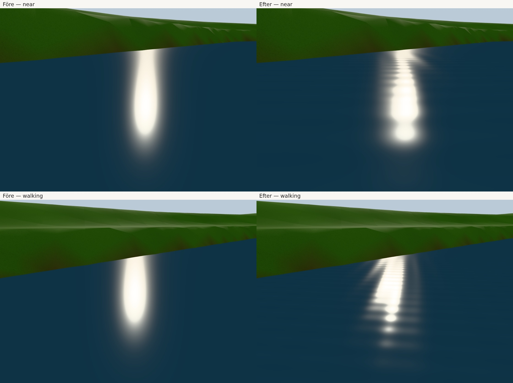
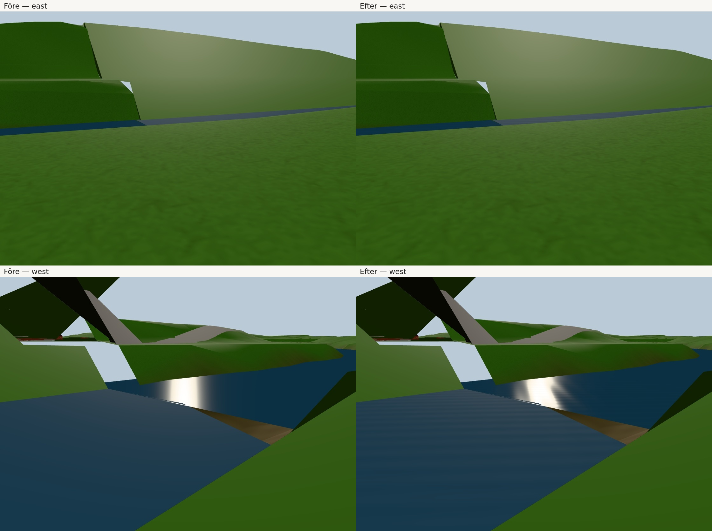
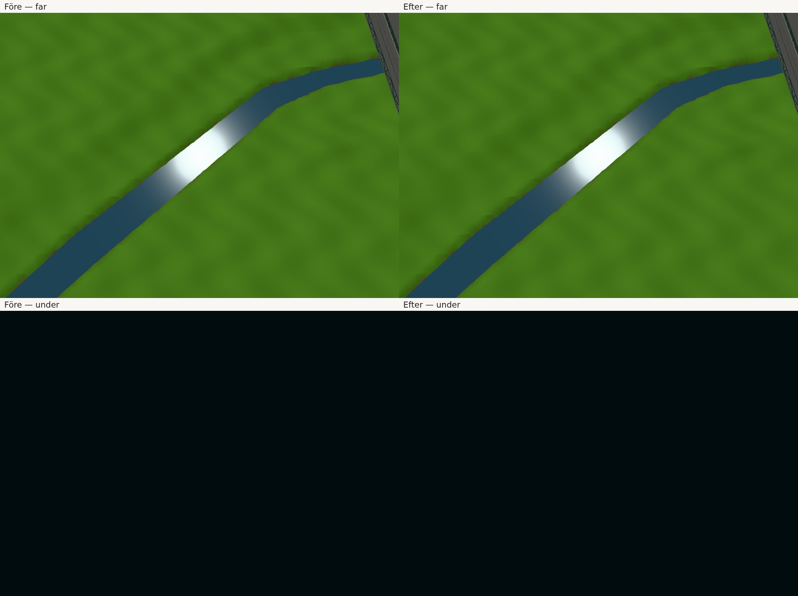

# Stationary river lighting detail — original #2082

Baseline: 451e12ea1e82a220fc9934052c226cbfb6c1e71e. [browser.json](browser.json) binds exact rendered source/fixture hashes; [checks.json](checks.json) binds unchanged source, injected shader source sizes and inspected images. Only source-bound final images/JSON are retained.

## Scope and complete water inventory

- Actual buildRiverBridges: bridges-water contains the existing local water ribbon, its eastern extension to the terrain boundary and appended downstream path.
- Actual buildEdgeBackdrop: both EDGE_BACKDROP.rivers courses are emitted by riverContinuationParts into edge-land alongside land, fields, paths and other water/ditches. No new batch. The hook masks only the existing linear water colour at either exact continued-water level (tolerance 0.002 m for Float32 values).
- Final emitted mask: 1824 water vertices affected, 48141 dry/nonmatching vertices unaffected, 63 other water-coloured vertices excluded because their level differs. Both courses remain covered. Colourless winter edge-land uses the exact previous native shader/cache key, so all-white snow behaviour is unchanged.

RIVER_SURFACE values are artistic guesses: principal periods approximately 0.67/0.44 m, two curved phases with slope gains 0.035/0.02, maximum summed slope 0.055 (about 3.15° on a flat upward face). No displacement/wave height. Smooth camera-distance fade 12–45 m and fragment-footprint fade 0.035–0.12 m avoid distant shimmer. World-XZ phases match across independently tessellated water ends.

**The detail is stationary.** No time uniform, extra frame/update callback or renderer loop exists. Existing drift and fish-ring motion stays byte-identical. Local roughness/metalness 0.15/0.2 and continued edge-land 1/0 are deliberately preserved; the old visible mattness difference is not normalised. Colours, opacity1, transparent=false, depthWrite, DoubleSide, cast/receive settings and every geometry/UV buffer remain exact.

## Three scoped groups

1. [Node results](node.txt): 10/10 pass. New deterministic/finite/bounded normal/fade/cache/native-winter/shader contracts plus existing riverfall/shoreline/submerged-bank/bridge/ramp and sourced-continuation contracts. Initial test-only corrections removed a DOM-dependent grass read from Node (actual emitted mask is instead verified in the browser), corrected an overly high lower-bound expectation for two nearly perpendicular directions and scoped the no-sampler assertion to the injected shader text.
2. Node syntax checks for changed source, HTML-extracted module and runner; exact old config after removing only RIVER_SURFACE, exact consumer bytes after reversing only material wrappers/imports, and twelve unchanged terrain/swim/player/main/world/drift/fish modules. [Preservation hashes and source-size counters](checks.json). No npm build exists for this original static app.
3. Actual buildRiverBridges + full buildEdgeBackdrop + actual surroundings terrain through its first yield0.05. Nine production meshes, including the hidden unchunked terrain and its visible cells; no World/bootstrap/avatar/weather/drift/fish service instantiation. Matched Chromium/SwiftShader, 1120×800, DPR1, MSAA, NeutralToneMapping. One diagnostic directional daylight position per matched camera exposes the small normal variation without changing product lights. Inline favicon, no console/page/shader errors.

The first browser attempt was stopped before rendering after an async hash appeared in a non-async traverse callback; fixture changed to a regular loop and was syntax checked. Negative GLSL level constants were also parenthesised before the first rendering run. That run then exposed an overly strict same-program-count assertion: native water had shared a program with colourless edge winter. The winter hook was made exactly native, and the counter now reports the real extra separately cached winter program rather than forcing a material redesign. Final rerun passes. These earlier attempts/images are not retained as accepted evidence.

## Actual geometry, continuity and time

All nine mesh attribute/index hashes, bounds, cast/receive settings and native materials are exact. Summed per-mesh attribute/index bytes: **13855962 before and after** (this raw sum includes hidden terrain and is not a claim of unique driver allocation). New mesh/geometry/texture/buffer bytes: **0**. River water/shore/ground queries along the whole existing path match exactly.

At each actual overlap, downward rays hit both local and edge water. Their existing independent-tessellation height difference is approximately 0.000055 m; XZ coordinates and computed ripple slopes match exactly. A verification-only 1×1 normal-output render of the actual Standard shader at each overlap gives identical RGBA8 normal pixels for local and edge batches: upstream [128,127,255,255], downstream [127,127,255,255]. These are quantised GPU probes, not full-precision normal measurements. Temporary diagnostic materials/target are disposed and excluded from product frame counters.

The far view is pixel-identical. Colourless edge winter is pixel-identical. Near output repeats pixel-identically after other views, season transitions, debug probes and approximately 758 ms: no implicit animation or per-frame texture upload. Existing undersurface remains opaque, uniformly dark and pixel-identical under above-water daylight; the fixture omits the app's underwater tint/wash and is an opacity check, not a bright underwater portrait.

## GPU and fragment cost

No maps/samplers/new texture fetches, added vertex attributes, new uniforms, lights, pass, extra draw or animation upload. One vec4 world-position/mask varying adds interpolation, plus a world-position vertex transform. Edge vertices also classify colour/height. Active fragments add **2 sin + 2 cos**, **2 fwidth** (four derivative evaluations), **2 smoothsteps**, one camera-distance calculation, small vector arithmetic and one normal normalization. Full ripple trigonometry is inside the active mask/fade branch; actual GPU predication/compiler behaviour is not timed.

Injected pre-chunk shader source increases: main +100 vertex/+703 fragment bytes; edge +370/+703; colourless edge winter +0/+0. Source bytes are **not** GPU binary bytes. Programs are 6→6 in the ordinary views and **6→7 after the winter variant** because old native sharing changed. WebGL exposes no exact shader binary/cache allocation; this driver cost is unknown and explicitly excluded from the exact zero new map/attribute-byte claim. No FPS, mobile throughput or globally free rendering claim. Final wrapper peak: **560 MiB of 4 GiB**.

| View | Draws before→after | Triangles | Textures before→after | Programs before→after |
|---|---:|---:|---:|---:|
| near | 8→8 | 132708 | 2→2 | 6→6 |
| walking | 6→6 | 125196 | 2→2 | 6→6 |
| far | 8→8 | 132708 | 2→2 | 6→6 |
| under | 6→6 | 125196 | 2→2 | 6→6 |
| east | 4→4 | 87257 | 2→2 | 6→6 |
| west | 8→8 | 132708 | 2→2 | 6→6 |
| winter | 2→2 | 20224 | 2→2 | 6→7 |

## Inspected final image pairs

Each sheet is 2240×1672: two native 1120×800 cells per row, two rows with 36px labels. No crop or squeezed aspect. All three final sheets opened and inspected. Close/walking glints show the normal pattern; the two join views retain the older terrain/context and mattness; the far/opaque-underside pair is intentionally unchanged. No further retake after these checks passed.

Component limits: not the complete World/weather/fog/underwater-wash/animation scene, physical flow simulation or device benchmark. Shader still uses the older Standard lighting and opaque two-sided water. Existing geometry/context irregularities seen at remote joins are unchanged and outside this material task. All own server/Chrome processes and wrapper locks stopped after verification. Neutral public adaptation remains separate #303, after accepted source publication.

## Integrationsgranskning

Dirigenten har granskat helper, de två materialhookarna, alla tre slutliga bildark och källbundet grönt underlag utan rutinomkörning. Produkt/fixture/test matchar överlämningen exakt; accepterad config behåller bark- och solblock och får endast RIVER_SURFACE. Delad grafiktekniktext rekonstruerad som tidigare accepterade bytes plus denna namngivna bilaga. Changelog tilldelad nästa unika id1613; äldre rader bevarade.

## Publicering

Kod/bilder `c02d687594fd8c00ad1088f401c5ebd30d7222c2`; faktiska run-ID [44282734445, 44282734450] success på exakt revision. Alla bilder HTTP200 och inbäddade före stängning: https://github.com/solwation/lunden-3d-apartment/issues/2082#issuecomment-6975447586. Slutkvittot är enbart dokumentation; originalets sökvägsfilter utlöser ingen ny apppublicering.
