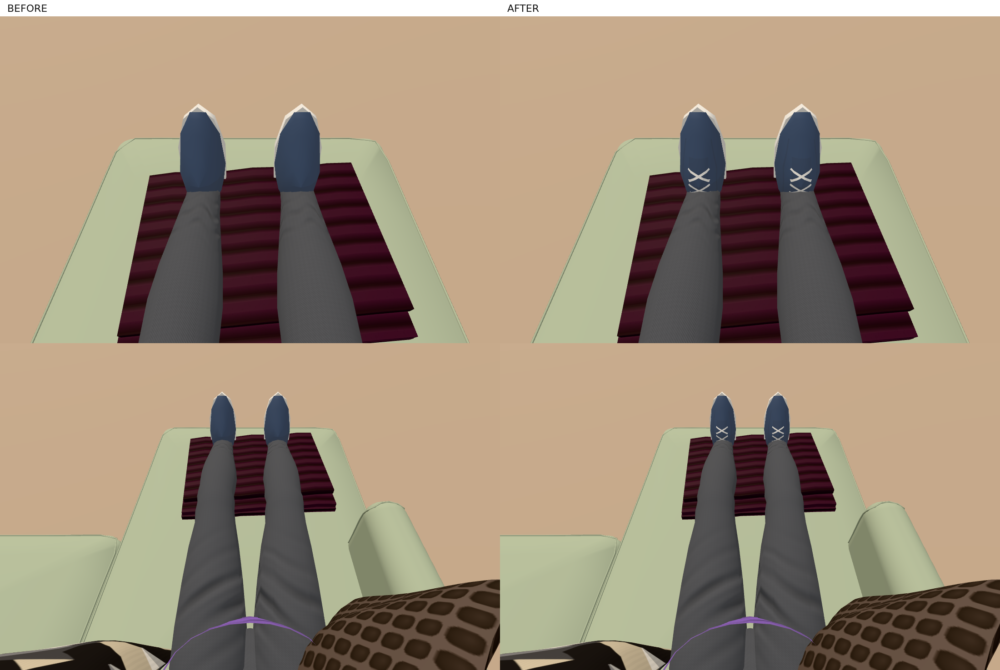
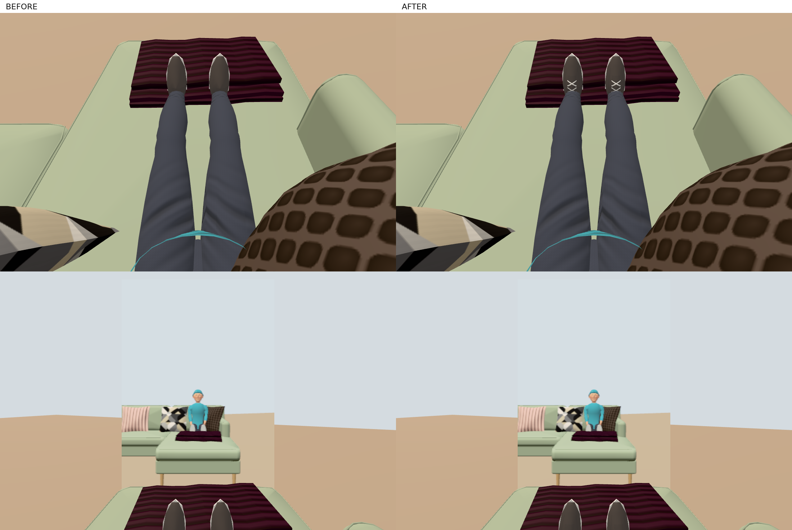

# Trainer lacing and upper details — #2084

Product commit `bef0187d4823c789c571fa0f9b31edc210fbd639`, compared with accepted
baseline `a366067a79ab90a67abc5a66b3db205f67788506`. [Exact inverse/source and final
capture hashes](source.json), [native old-attribute/palette/rig measurements](native.json),
[production browser measurements and fixture hashes](browser.json).

The existing shoes gain three crossed lace pairs, a narrow tongue and subtle panel
edges. Laces use the existing ivory sole colour; tongue/panels retain the chosen shoe
colour with mild tone multiplication. Every original colour/vertex/normal/skin-weight
byte is retained. These are generic visual guesses, not a named or measured shoe model.
Normal adult and short-look chaise views show clear lacing without a macro-only claim;
the existing trouser hems cover the lowest part of the lacing. Tongue/panel edges remain
quiet, especially in the normal view. Both final sheets were opened and inspected.





Each comparison panel keeps its complete native 1100×720 frame, DPR1; no cropping or
stretching. A 36px header is added only to the sheet. Standalone native after captures
are also retained. Final captures and their SHA256 hashes are bound in `source.json`.
The detail camera is explicitly a closer diagnostic viewpoint above the same posed
feet, not the player's normal seated eye. The lower adult and upper short panels use
unchanged production Rest eye, limits and heading. The mirror tests the complete body
and mask lifecycle; shoe detail is too small/sole-facing there to judge the lacing.

The fixture reuses actual `sofa`, `Rest/restTarget`, `Ghosts`, selected `Avatar`, `Hand`,
production shared reflector and verbatim main.js state/render hooks. It shares the
established #2080 furniture environment, fixed sun/hemi, NeutralToneMapping, MSAA and
Chromium/SwiftShader. No World build, external service or production cloud write.

Three bounded check groups:

1. New native checks verify finite/deterministic details, registration to the **actual
   upper triangles** and its old XYZ bounds, exact original attributes (including all
   colours and soles) after removing only the inserted detail block, valid foot-only
   skin weights, old sole colour, chosen shoe palette, one mesh/material, unchanged
   walking/running and actual `applyRestPose` bone matrices. Adult and alternate short
   geometry recipes are compared. Named inverse reconstruction restores all avatar.js
   and config.js bytes to baseline; all prior 1612 changelog rows remain, plus only 1614.
2. `node --test tools/avatartrainerstest.mjs tools/avatarbodytest.mjs tools/avatarselfviewtest.mjs`:
   **18/18 PASS**. After improving the native pose check to call actual `applyRestPose`,
   the three changed native cases passed again; the 15 unchanged body/selfview cases
   retain their green result. Product syntax, runner syntax, exact inverse and
   `git diff --check` pass. No original npm build exists or is claimed.
3. Own actual-consumer browser with matched close/normal adult chaise, short avatar and
   actual production reflector. Every view preserves foot positions, body root/yaw,
   Rest camera/pose/look, body material, bone texture, normal draw ownership and masks.
   All 20 existing lifecycle controls pass: full mirror/save/restore, Hand/held proxy,
   entry/exit/pause/gym/reaction, controlled-renderer-exception finally and single self
   body. Zero page/console/shader errors and zero external requests. The first run
   passed these checks but its detail camera faced the soles. Only that camera's Z
   sign was corrected for the final second run (already started before root requested
   a near-only recapture); product bytes never changed between runs. Final peak 744MiB
   under 4GiB; first 797MiB. No further browser or appearance polish was run.

| Actual view | Calls before/after | Triangles before/after | Textures/programs before/after |
| --- | ---: | ---: | --- |
| Close posed feet |16/16|21146/21538|5/5 textures,4/4 programs|
| Adult normal chaise |28/28|26926/27318|5/5 textures,4/4 programs|
| 120cm normal chaise |25/25|25386/25778|5/5 textures,4/4 programs|

Per avatar: **392 added triangles, 1176 unindexed vertices**, still one SkinnedMesh,
one Standard material and one draw. Adult fixture 16312→16704 triangles (+2.40%);
short fixture 15988→16380 (+2.45%). Exact facet clipping costs more triangles than the
initial <200 goal, accepted to keep laces/tongue edges registered without sunken chords.
The helper builds only when the existing shared variant geometry is built; no per-frame
geometry/material work or new callback, light, map, render pass, wire/storage field.
Existing skinning still processes the added vertices; GPU/driver frame time is not zero
and is not measured here.

Attribute allocation delta is **125832 bytes**: position 14112, normal 14112, region 1176,
bare 4704, noseBlend 1176, skinIndex 9408, skinWeight 18816, rifleSkull/rifleNose/rifleJaw
1176 each, mouth 4704, pucker 1176, facePart 4704, faceAnchor 14112, armPump 18816,
suitRole 1176 and colour 14112. No new attribute **kind**. Of this, 111720 non-colour
bytes belong to the shared cached variant; each avatar has 14112 extra own colour bytes.
Driver/object overhead and build-time temporary polygons are additional. Adult total
arrays 5236152→5361984 bytes; short browser 5132148→5257980. The native short case has
an explicitly different hoodie/wide-trouser recipe; its exact rows are in `native.json`.

Both old hemispheres and soles keep identical source geometry and order, including the
original sole's bottom/contact points. Small detail lifts are clamped at the old upper
maximum; everything remains within its original bounds. All new parts use the same
footL/footR bone and original SHIN offset. Native shade handling now reads the existing
base shade for region 5; all original upper shades are 1, proved by byte comparisons.
No shader changes; #2080 self-view, head/arm mask and 30cm body-only near clip are exact.
Rest, furniture, remote pose, reflections, main hooks, Hand, original rig/IK and full
walkGait/Avatar.update source tail are unchanged. Houses A/B/C/L have no geometry impact.

Limits: isolated real production-component evidence, no full-world/UI/networked remote
client, physical-device/FPS or all-clothing-variant sweep. Shared Avatar geometry serves
mirror and remote consumers, but live remote replication was not rerun. No private
avatar/furniture code may be transferred to the public project; this issue is
**original-only**. Root owns integration, actual deployment and revision-pinned image
comment before issue closure.

Reproduce with Three 0.170.0 under ignored node_modules, a local server on 8216 and:

```
node --test tools/avatartrainerstest.mjs tools/avatarbodytest.mjs tools/avatarselfviewtest.mjs
python3 tools/avatartrainers2084preservation.py
PLAYWRIGHT_MODULE=/path/to/playwright tools/browsertest.sh node tools/avatartrainers2084browser.cjs http://localhost:8216 docs/verification/2084
```

## Integrationsgranskning

Dirigenten har granskat helper, avatar-/configdiff, källbevarande och båda slutliga bildark. Snörningen går att läsa i normal vuxen/kort divanvy; inget ytterligare utseendeomtag behövs. Hela testade produkt/fixture/testkälla är byteidentisk vid integration. Redan publicerad löv-RGB och äldre README-/configbytes bevaras; ändringsloggen får nästa unika id1615 (arbetarens1614 var preliminärt). Källbundet grönt underlag återanvänds utan rutinomkörning.
