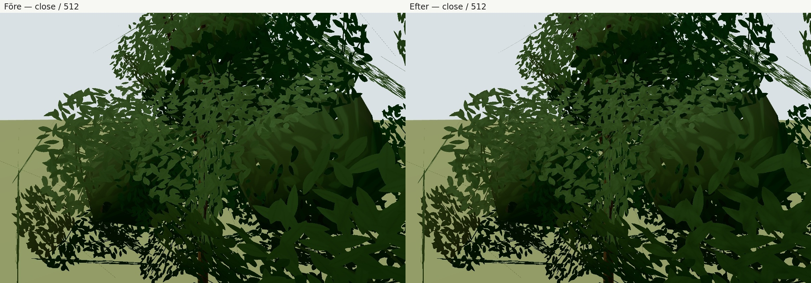
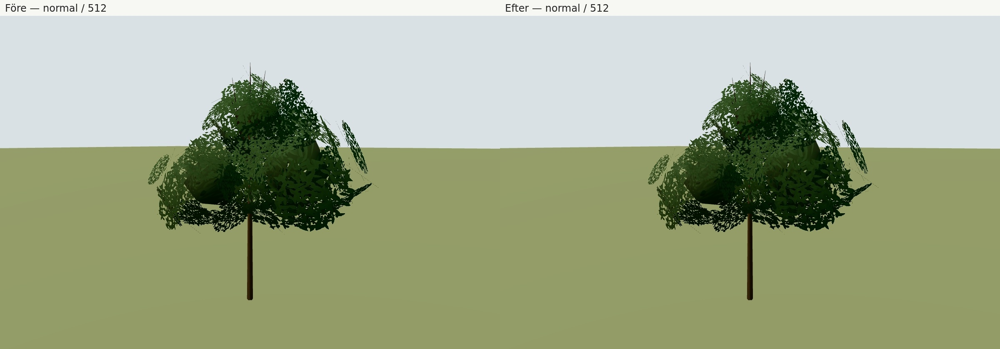
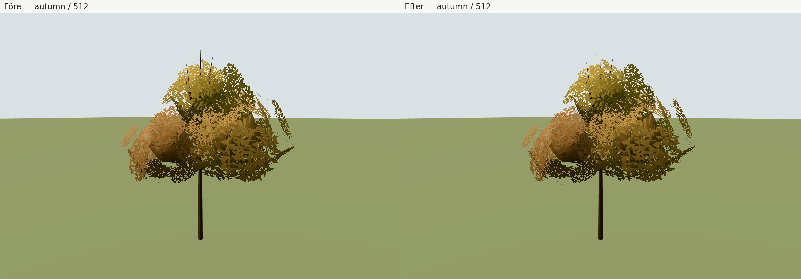
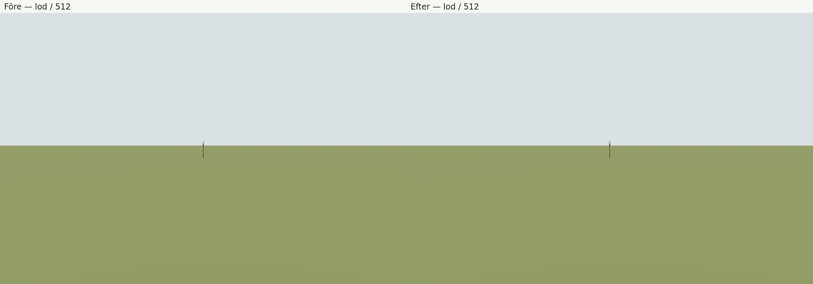
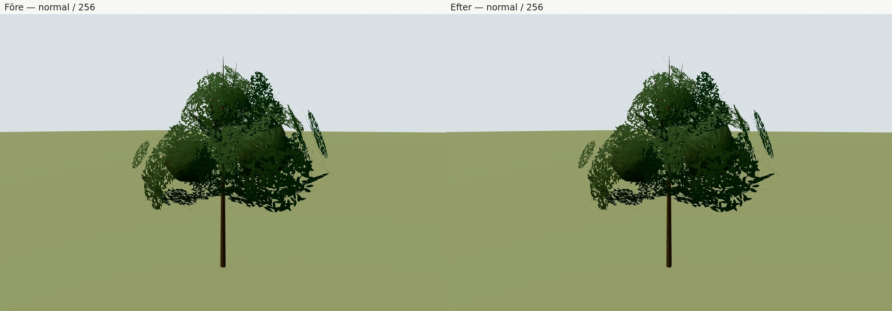

# #2085 — leaf atlas RGB

Baseline `a366067a79ab90a67abc5a66b3db205f67788506`. Before substitutes only that revision's
`src/foliage.js`; after uses the working source. Actual production `leafAtlasParts`,
`leafMaterial`, `lobeGeometry`, depth/LOD materials, `InstanceLod`, `registerTrees` and
`applySeason` run in both phases. [browser.json](browser.json) binds all product and fixture
SHA-256 hashes to the results. Images are this issue's own native1200×800captures, paired
without resizing or cropping into2400×838sheets with a38px label strip.

## Result and scope

A small helper gives each existing pointed leaf a soft local tone gradient and two or
three pairs of quiet curved side veins. Core leaves have a gentler gradient and no side
veins; the destination-out core holes use the original path. The existing main midrib,
twigs, cards, silhouettes and colours supplied by seasons remain. Detail strengths and
placement are artistic assumptions, not measurements or a species identification.

Tone variation is assessable but **subtle in the ordinary near view** at about5.5m.
Individual side veins are mainly visible close up. Distant LOD deliberately has no strong
new pattern. This does not correct the existing card/core shapes or claim photorealism.
No further foliage redesign or contrast increase was made to make the comparison louder.

The first scoped browser check rejected a one-canvas `source-atop` approach: actual Canvas
rasterization changed some alpha bytes. The final helper mirrors every original draw call
into a temporary RGB canvas while preserving the original canvas as the alpha authority.
One extra whole-atlas readback combines detailed RGB with that exact alpha before the
unchanged vertical flip and transparent-edge guard. No per-leaf pixel readback occurs.
This is shared tree/shrub atlas code, so house A/B/C/L geometry is not a separate consumer.
The neutral public transfer is tracked separately in `solwation/kvarteret-lunden#305`.

## Three check groups

1. `node --test tools/leafrgbtest.mjs tools/lodtest.mjs tools/seasoncrowntest.mjs`:
   **13/13pass**, plus syntax checks on both product modules. Tint/vein bounds and source
   reconstruction preserve the entire old foliage source outside the context/tint hooks.
   Config, LOD, seasons and bark source are byte-identical to baseline. Native tests cover
   LOD packing/dither/culling and exact all-month crown matrices/colours and winter hiding.
2. Full actual atlas checks in Chromium at **both512and256**: three fresh cached module
   generations per phase are deterministic; every final alpha byte is equal to baseline,
   including core holes. All transparent pixels retain RGB196/204/176. Counts are122,555
   and28,377transparent pixels respectively. All8,961seed679RNGvalues and their order match;
   all15generator steps/yield boundaries match. Reference2×2alpha mip-chain hashes match;
   these are CPU reference hashes, not GPU mip readbacks. Existing texture/filter/mipmap/
   colour-space/aniso settings and cache are unchanged; RGB intentionally differs.
3. One scoped actual-consumer browser comparison, corrected only after the alpha failure.
   Close, ordinary near, autumn, bare winter and distant LOD are exercised at both atlas
   profiles. Every tree/shrub/far geometry attribute/index hash, material/shader/depth-map
   contract, trunk geometry hash, instance matrix/colour hash, LOD state and render budget
   matches baseline. All five retained image sheets were opened and inspected. No full-app
   world traversal, physical phone/FPS measurement, or unrelated old browser suite was run.

```sh
python3 -m http.server 8217
PLAYWRIGHT_MODULE=/path/to/playwright tools/browsertest.sh \
  node tools/leafrgb2085browser.cjs http://localhost:8217 docs/verification/2085
```

Inline favicon; zero external requests, JavaScript or shader errors. Wrapper peak487MiB
under4GiB. Own server/browser stopped and wrapper lock released. The256profile explicitly
forces the production low-memory atlas/geometry choices; its1200×800viewport is not a claim
of a physical phone capture. Seed679instrumentation only records returned random values
in both phases; it adds no random calls. Readback instrumentation observes3→6whole-atlas
reads for three generations (one→two per atlas), before bark construction.

## Exact GPU/geometry and startup cost

| Resource | Before | After | Difference |
| --- | ---: | ---: | ---: |
| Shared atlas RGBA8 base512² |1,048,576B|1,048,576B|0|
| Including full mip chain512² |1,398,100B|1,398,100B|0|
| Shared atlas RGBA8 base256² |262,144B|262,144B|0|
| Including full mip chain256² |349,524B|349,524B|0|
| Tree/shrub/far triangles512profile |60/48/36|60/48/36|0|
| Tree/shrub/far attribute bytes512 |7,920/6,336/4,752|7,920/6,336/4,752|0|
| Tree/shrub/far triangles256profile |56/40/30|56/40/30|0|
| Tree/shrub/far attribute bytes256 |7,392/5,280/3,960|7,392/5,280/3,960|0|
| Whole-atlas CPU readbacks/generation |1|2|+1|
| Added temporary RGBA storage512/256 |0|2,097,152/524,288B|same|

The extra temporary storage is the colour canvas plus the extra ImageData, excluding
browser-internal overhead and small context/gradient/argument objects. The canvas is
released to1×1before final flip; garbage collection controls the ImageData lifetime.
The unchanged old canvas/readback/output buffer are not counted as new memory.

Three generations' measured active CPU (sum of generator `.next()` durations, excluding
its animation-frame waits) were512: **67.1/39.0/33.7→79.2/106.4/112.5ms**, and256:
**40.5/35.3/33.2→97.5/104.9/104.1ms**. Medians39.0→106.4ms and35.3→104.1ms show an
approximately67–69ms one-time increase here. Largest after yield block was14.9ms/15.2ms
at512/256. These noisy headless measurements are not a hardware guarantee or a newly
invented startup threshold. Existing yields and caching remain; no per-frame work is added.

The fixture includes ground/trunk and three crown instances:512summer/autumn3calls,
228triangles; winter2calls/48triangles; far LOD3calls/156triangles. At256the corresponding
triangles are216/48/138. Every view has3textures (leaf plus existing bark pair), atlas
version1; all before/after counts match. No added geometry, draw, light, pass, shader or
texture sampling, or per-frame texture upload.

## Inspected comparison sheets







## Integrationsgranskning

Dirigenten har granskat alla fem egna bildark, helper, foliagediff och källbundet grönt underlag. Vanlig närvy godtas som diskret toning; enskilda sidonerver främst nära, ingen extra förstärkning. Hela produkt-/fixture-/testkällan matchar överlämningen exakt och föregående config är byteidentisk. Engångskostnaden för två CPU-ytor och readback redovisas; ingen ny GPU-/framekostnad. Ingen rutinomkörning.

## Publicering

Kod/bilder `a2b5b1939ced3e0bca8ecf042c32d7783f34067d`; faktiska run-ID [44287040812] success på exakt revision. Alla bilder HTTP200 och inbäddade före stängning: https://github.com/solwation/lunden-3d-apartment/issues/2085#issuecomment-6976054131. Slutkvittot är enbart dokumentation; originalets sökvägsfilter utlöser ingen ny apppublicering.
