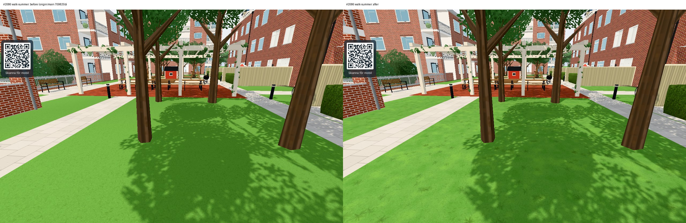
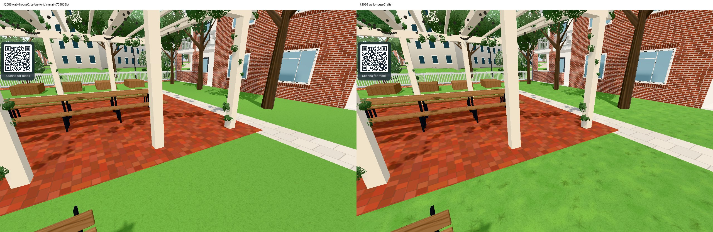
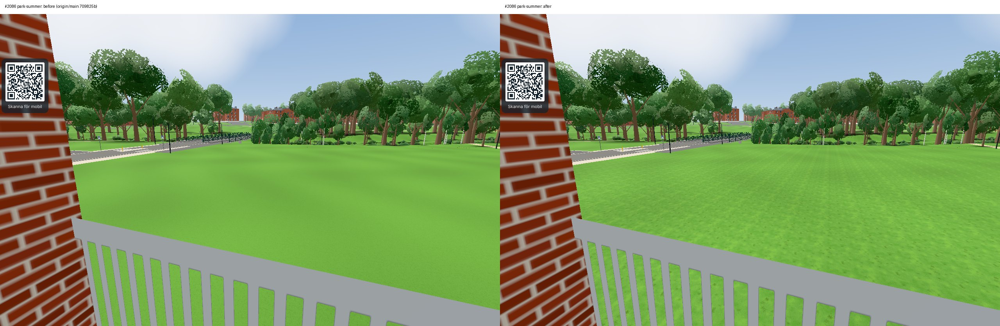
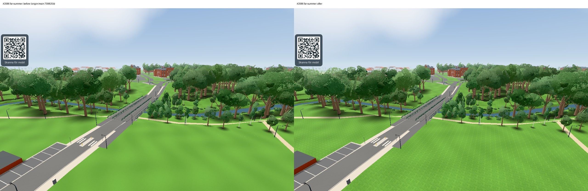
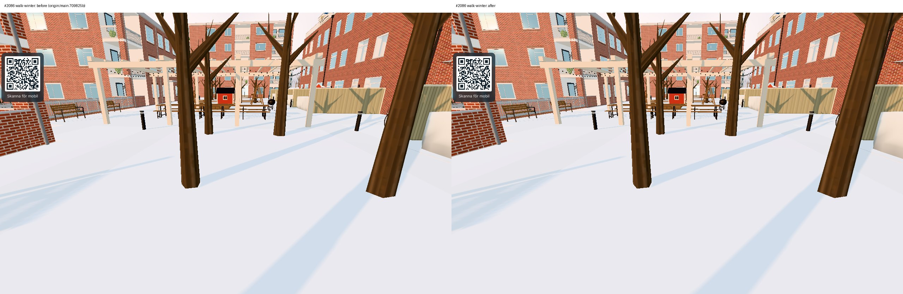

# #2086 — patchy lawn tone and tussocks

Baseline `709825b` (origin/main). Before serves only that revision's `src/grass.js`; after uses the working source
(`src/grass.js`, new `src/grassdetail.js`, `GRASS.detailPatches`/`tufts` in `src/config.js`). Sheets are native
1280×800 game captures, paired without scaling (2560×836, 36 px label strip).

## Result

After the unchanged blade layer (seed 688, same stroke order), the detail map gets 22 loose tussocks (seed 2086,
copied across both seams) and soft drier/lusher blotches from two value-noise lattices that wrap at the tile edge
(8 and 17 cells per 1.6 m tile). A per-channel linear gain restores the old map's linear mean, so
`grassMeanColor()` and the flat far ground are unchanged. Strengths are artistic *guesses*.

In ordinary walk view (courtyard between A/B, yard south of C) the lawns now show visible mottling and small
tufts instead of an even carpet. A first tuning with larger blotches (5 cells per tile) was rejected after
inspection: in the park and far views the 1.6 m tile repeat became a visible checker. The final scale keeps a
faint fine regularity at 10–20 m; breaking the repeat at metre scale would need the shader patches (out of scope).
Winter is unchanged by design (the map is removed under snow).

## Checks

1. `node --test tools/grassdetailtest.mjs`: 4/4 pass — field wraps exactly at both edges, smooth steps; patched map
   deterministic, linear mean within 0.1 %, seam step no rougher than the interior, block spread > 4× the plain layer;
   tufts deterministic with their own seed; still one CanvasTexture, blade loop and seed unchanged.
2. Actual consumers in Chromium (`tools/grass2086browser.cjs`, SwiftShader), views walk-summer, walk-winter,
   park-summer, walk-houseC, far-summer: no page errors ([before.json](before.json), [after.json](after.json)).
   - `grassMeanColor()` linear rgb: before 0.09319/0.23944/0.04383, after 0.09319/0.23944/0.04383.
   - Seam mean |Δ| x/y 23.7/23.2 vs interior 24.3/25.1 (before 25.1/23.2 vs 23.9/24.3).
   - Three fresh module generations: identical hash; texture 256×256, RepeatWrapping, repeat 0.625 unchanged.
   - Draw calls/textures per view equal within run-to-run noise of animated scene content (±1–2 calls, also seen
     between two baseline runs); no new texture, material, light, geometry or per-frame work.
   - Generation ~9–15 ms → ~23–47 ms headless (one time, startup).

## Sheets (before left, after right)

Houses: A/B courtyard and C yard checked in the browser; Hus L and all other lawns share the same map and material
(world.js, surroundings.js, streetlife.js, sitebackdrop.js), no house-specific geometry is involved.
