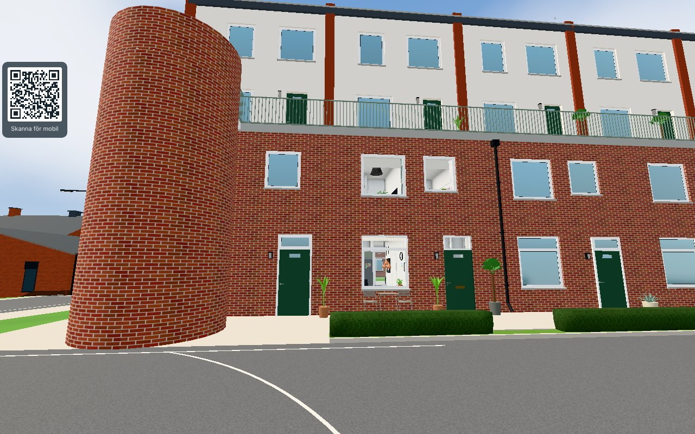
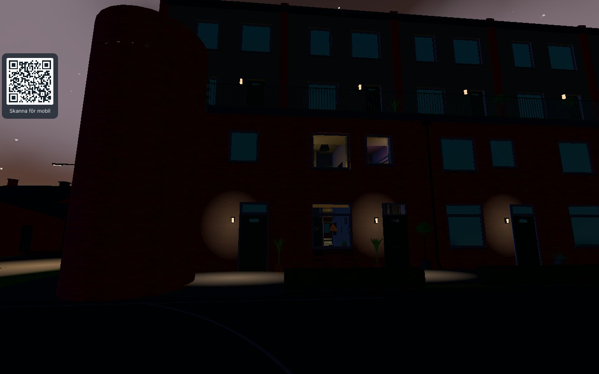
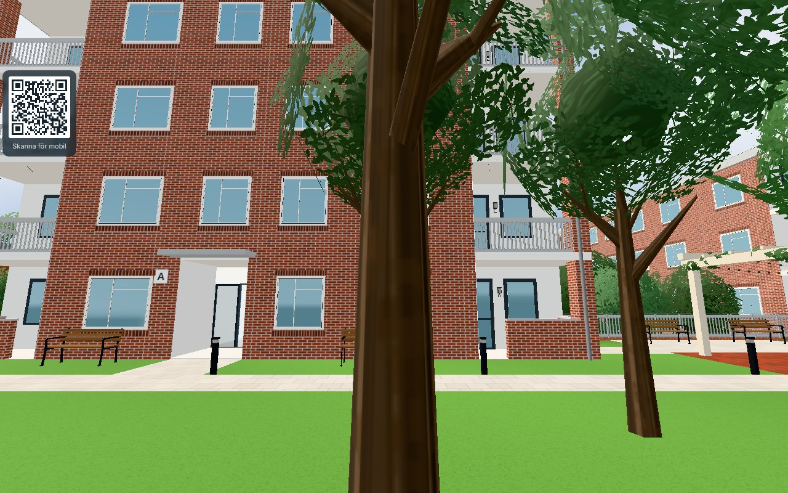
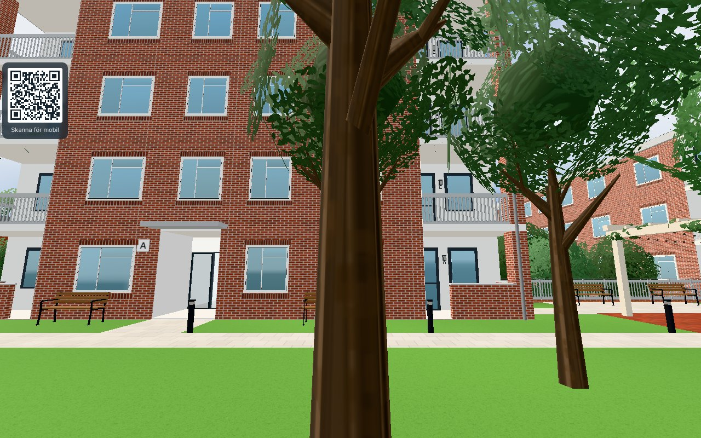
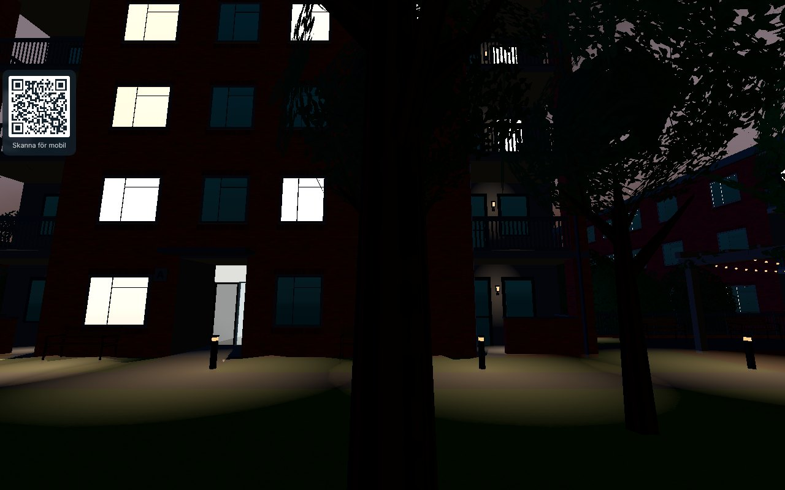
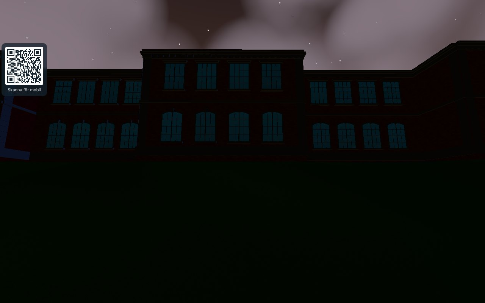

# #2087 — lugn himmelsreflex i fasadglas

Bas `709825b08105a1e499470dae31b6e1b1cd8ec153` (origin/main). "Före" serverar basens versioner av de ändrade modulerna
(`config.js`, `exterior.js`, `neighborglass.js`, `sitebackdrop.js`, `southbackdrop.js`,
`surroundings.js`); "efter" kör arbetskopian. Riktiga appen i gångvy (`?test`, juni, klart väder,
fryst klocka), samma kamera före/efter, kl 12 (dag) och 22.5 (natt). Bilderna är native 1280×800
(`kit.shot`), sparade som JPEG utan beskärning. Skript: `tools/glasspanes2087browser.cjs`,
rådata: [browser.json](browser.json).

## Resultat

Varje ogenomskinlig glasruta får en fast, lugn variation i ljushet/ton (hash av rutans mittpunkt)
och en mjuk vertikal gradient (överkanten ljusare, som när himlen speglas där), inbakad en gång i en
vertexfärg före sammanslagningen (`src/glasspanes.js`, `GLASS_PANES` i `config.js`, *guess*).
Det närliggande glaset (`neighborGlass()`) behåller sin befintliga envMap-reflex och clearcoat; de
enkla bakgrundsglasen (väst/öst/nord, syd) får dessutom en svag himmelston i överkanten. Ingen spegel:
reflexintensiteten är oförändrad.

| Vy | Före | Efter |
|---|---|---|
| Hus L gatusida, dag |  |  |
| Hus L gatusida, natt |  |  |
| Granne Hus A från gården, dag |  |  |
| Granne Hus A, natt |  |  |
| Skolan över gatan (88457612), dag |  |  |
| Skolan, natt |  |  |

Dag: rutorna skiftar lite i blått/grått och är ljusare upptill (pixeldiff mot före: Hus A max 18,
skolan max 15 av 255 på glaset). Natt: glaset är mörkt som förut (diff ≤ 3); L1007:s upplysta,
genomsiktliga fönster och grannarnas tända rutor (emissive) är oförändrade.

## Kontroller

- `node --test tools/glasspanestest.mjs`: determinism, begränsat spann, en färg per ruta (även i
  sammanslagna batcher, per triangel), oförändrade positioner/antal, alla konsumenter färgar före merge.
- Browser (båda faserna): samma antal meshar (5017), samma vertexantal och oindexerade glasbatcher
  (neighborGlass 816, EntryGlass 468, LitGlass 96, west-glass 1248, west-karpGlass 1968, east-glass
  10788, east-schoolGlass 13794, north-glass 5112, south-glass 16602, siteNeighborGlass 7470), samma
  antal glasrutor (Hus L 146, ABC 597), inga meshar med vertexColors utan färgattribut. Draws/texturer
  per vy lika (±1 draw / ±2,7k trianglar från animerade objekt utanför glaset, i båda riktningarna);
  program efter ≤ före.
- `tools/neighboropeningstest.html`: ALL PASS (öppningar, glasgränser, delad envMap, natt, L1007:s
  genomsiktliga entréglas och fönster, Hus A/B/C).
- `node --test tools/edgebackdroptest.mjs`: pass.
- `tools/depthprecisiontest.cjs` hittar nu sydglaset via namnet (`south-glass`) i stället för den
  gamla materialfärgen; ej körd här.

## Hus som kontrollerats

- **L**: grannenheternas gatu-/gårdsglas, entréglas och tända rutor varieras; L1007:s egna klara glas
  orörda (syns genomsiktligt i bilden).
- **A/B/C**: `siteNeighborGlass` (listade fönster, loggior, entréer) varieras; CoreHouse-entréernas
  avsiktligt genomsiktliga lobbyglas (`corehouse.js`, MeshBasicMaterial opacity 0.35) är orört.
- Skolan/campus och Karpvägen delar ABC-materialet och varieras; övriga bakgrundshus via sina
  befintliga glasbatcher.

## Kostnad och gränser

Ingen ny draw, textur, uniform, render target, cubemap eller per-frame-uppdatering. Nytt
färgattribut på ~42 500 glasvertexar (≈ 0,5 MB Float32, GPU; CPU-kopian frigörs där lowmemory gör det).
Byggtid ≈ 21 ms för 42 000 vertexar i Node (enkelt mätt). Kända förhandsfel: `lampWash`-shaderns
"redefinition" uppstår i båda faserna när `kit.shot` växlar kvalitet (`src/lampwash.js`), inte
orsakat av denna ändring. Efter bildtagningen refaktorerades `paneColor` till en matematiskt identisk
form (snabbare); config och färger är desamma. Ingen fysisk enhet testad.
