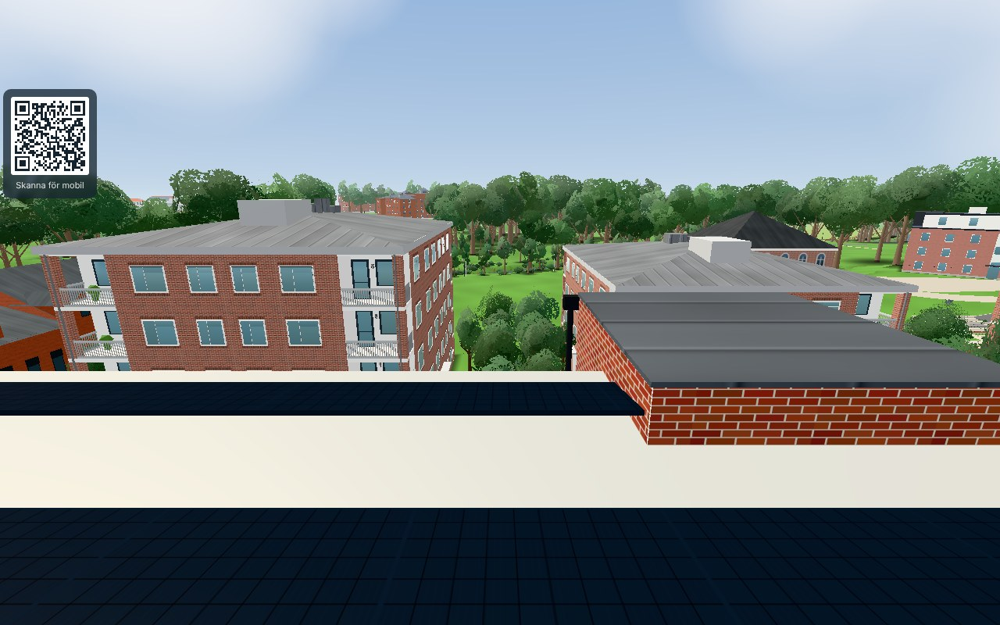
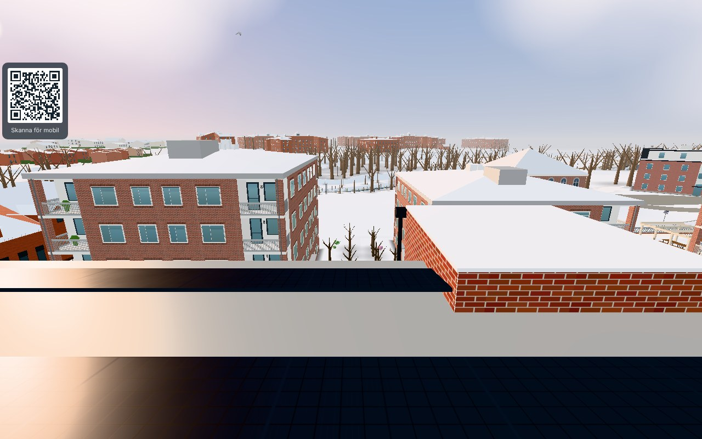
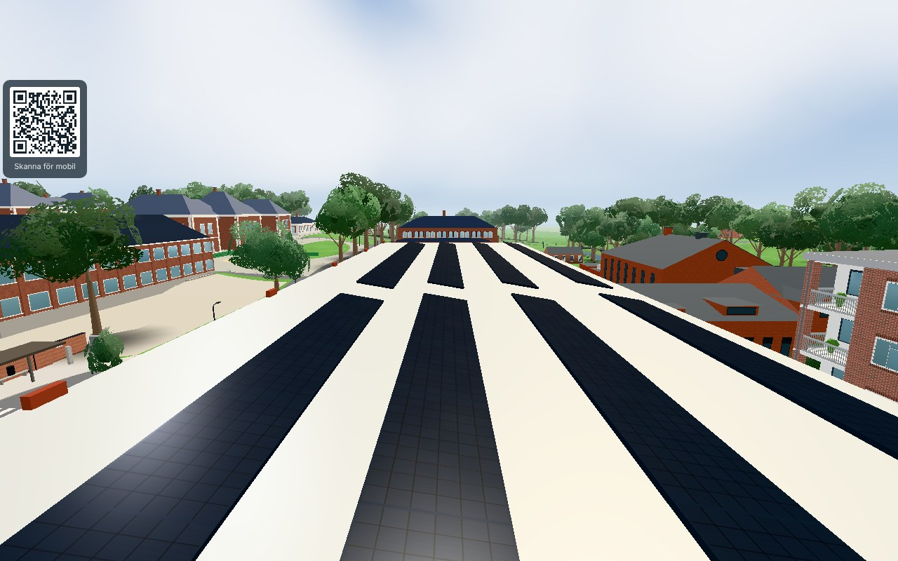
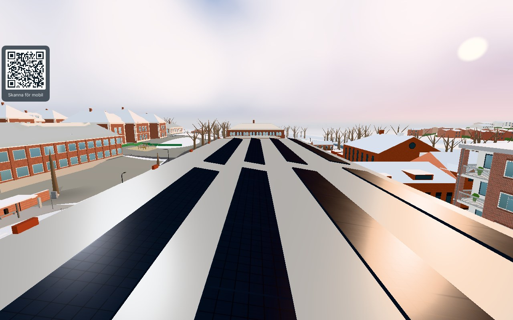
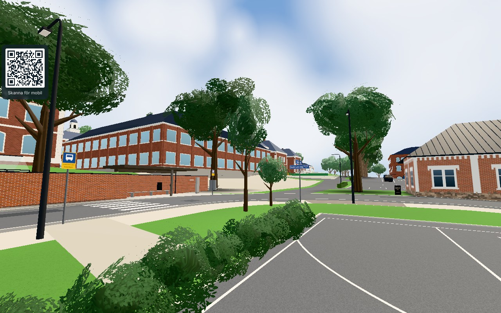
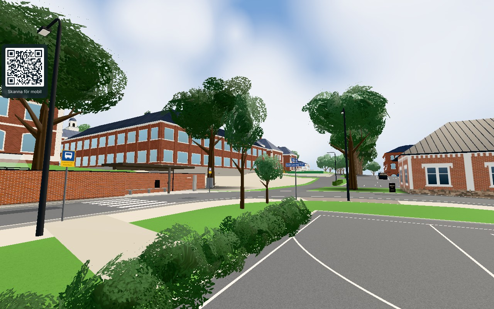
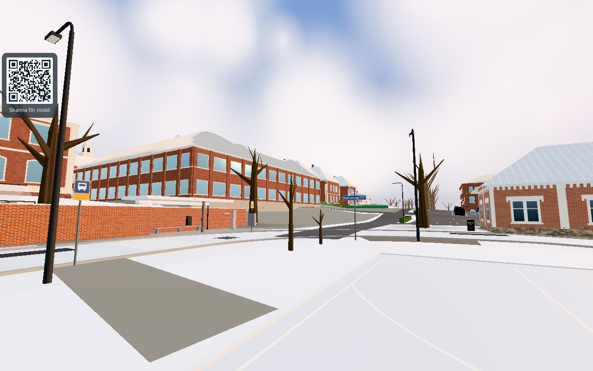

# #2088 — diskret falsstruktur och vädrad matthet på taken

Bas `3e33c99` (origin/main). "Före" serverar basens versioner av de ändrade modulerna (`config.js`,
`exterior.js`, `sitebackdrop.js`, `southbackdrop.js`, `surroundings.js`, `schoolfacade.js`); "efter" kör
arbetskopian. Riktiga appen (`?test`, klart väder, fryst klocka kl 13), samma kamera före/efter, juli
(sommar) och januari (vinter, `day.month`). Gångvy från gatan norr om Hus L mot skolan/campus, upphöjda
vyer från Hus L:s tak mot Hus A/B (söderut) och mot Hus C/B och de gamla husen. Native 1280×800 (`kit.shot`),
JPEG utan beskärning. Före-bilder i [before/](before/). Skript: `tools/roofsurface2088browser.cjs`, rådata:
[browser.json](browser.json).

## Resultat

En delad, liten (128 px) neutralgrå takkarta (`src/roofsurface.js`, `ROOF_SURFACE` i `config.js`, *guess*):
upphöjd fals per våd (mörk skuggkant, ljus läpp), svagt olika våder, låg­frekvent vädrad fläckighet och
svaga regnstrimmor. UV bakas en gång så att falsarna följer varje triangels egen fallriktning (platta
ytor: längs x, *guess*). Plåt 0,6 m c/c (skolan/campus, väst/öst/nord/syd-bakgrunden, HepCat, de gamla
husen), takpapp 1 m våder (Å-husen A/B/C, Hus L, Karpvägens platta tak). Materialfärgen delas med kartans
linjära medelvärde, så takens medelfärg och fjärrvyns mip-nivåer är oförändrade; skolans gamla 64 px
falskarta ersätts (färgen skalas till dess medelvärde, tonerna per byggnad behålls). Snö tar bort kartan
som förut (vintervyerna är pixelidentiska utanför animerade detaljer).

| Vy | Före | Efter |
|---|---|---|
| Hus A/B från Hus L:s tak, sommar |  |  |
| Hus A/B, vinter |  |  |
| Hus C/B och gamla husen, sommar |  |  |
| Hus C/B, vinter |  |  |
| Gångvy mot skolan, sommar |  |  |
| Gångvy, vinter |  |  |

Pixeldiff sommar: tak-A max 109 (1,6 % av pixlarna > 8), tak-C max 25, gata max 12 (skolans mörka tak på
avstånd: medelfärgen bevarad, strukturen knappt synlig). Vinter: max 0 utom tak-A (127 på < 0,01 %, en
animerad detalj).

## Kontroller

- `node --test tools/roofsurfacetest.mjs`: kartan deterministisk/begränsad/sömlös med mörk fals och ljus
  läpp, medelfärg bevarad; UV följer fallriktningen (båda vindningar), platt fallback, vertikala ytor,
  indexerad box, positioner/index orörda; snö tar bort/återställer kartan; alla konsumenter bakar UV före
  merge och skapar kartan före `registerSnow`; `buildingroofs.js`, `roofs.js`, `campusfacades.js`,
  `seasons.js`, `hepcat.js`, `karpfacade.js`, `pavilionroof.js`, `lod.js` och surroundings
  `hipRoof`/`roof`/`roofSpec`/`addSurroundingRoofWalk` oförändrade; övriga diffrader rör bara karta/UV.
- Browser (båda faserna, sommar och vinter): 5017 meshar; de 10 takbatcherna har samma vertexantal och
  positionshash före/efter; efter: alla har kartan på sommaren, ingen på vintern, `vertexColors` på
  skolans/sydbakgrundens tak av på vintern; draws/trianglar per vy lika (±1 draw från animerade objekt),
  texturer −1 (skolans karta ersatt), program oförändrade eller −1. Inga sidfel (känt shaderfel i
  `lampWash` finns i båda faserna och filtreras).

## Gränser

- Från marknivå syns nästan bara skolans/campus mörka tak på avstånd; där är förändringen mycket diskret.
- Hus L:s synliga takyta är den ljusa plåtavtäckningen (`capping`, hela takytan i `exterior.js`) som ligger
  över takboxen; den rörs inte här. Takpappen syns på loftets tak.
- HepCat-butikens ljusa falsade tak kommer från dess egen modell och är oförändrat.
