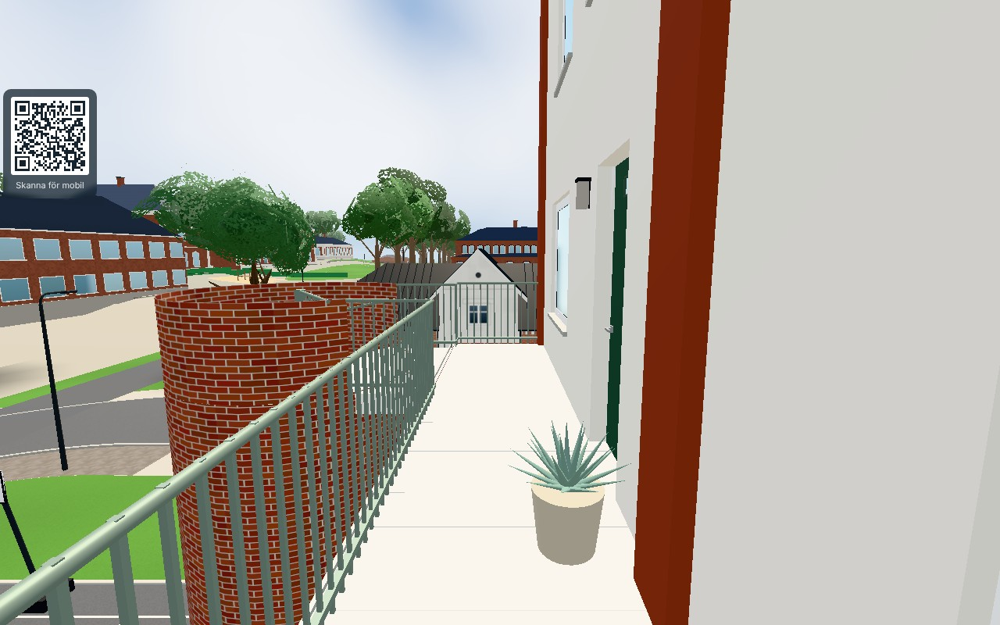
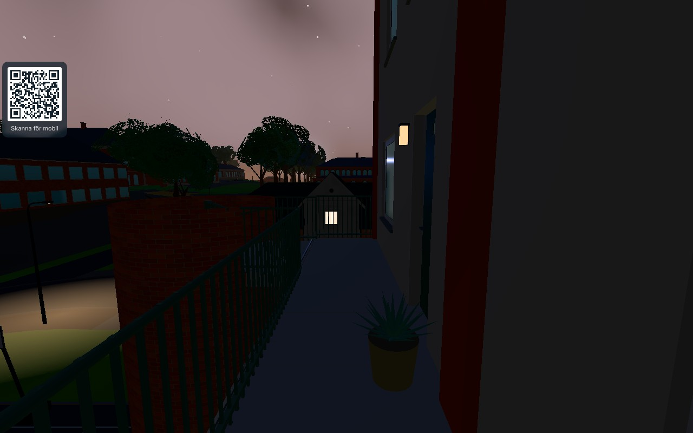
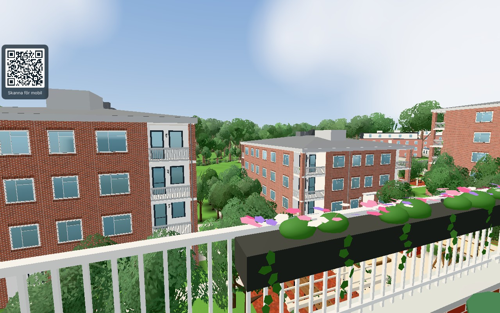
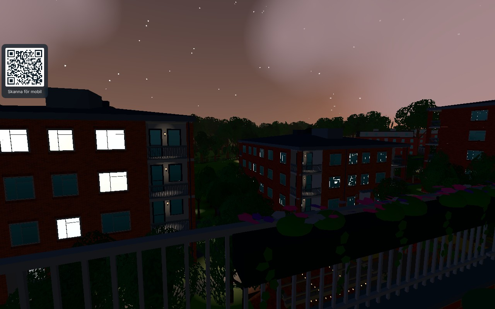
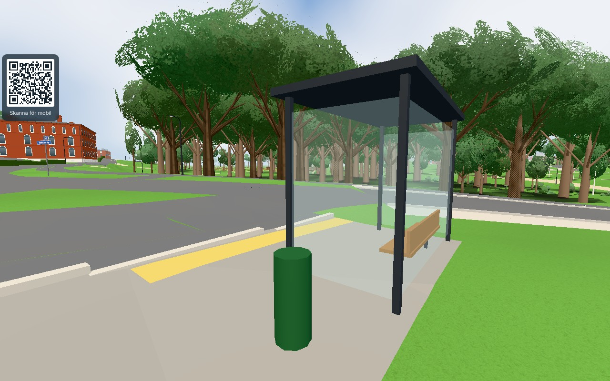
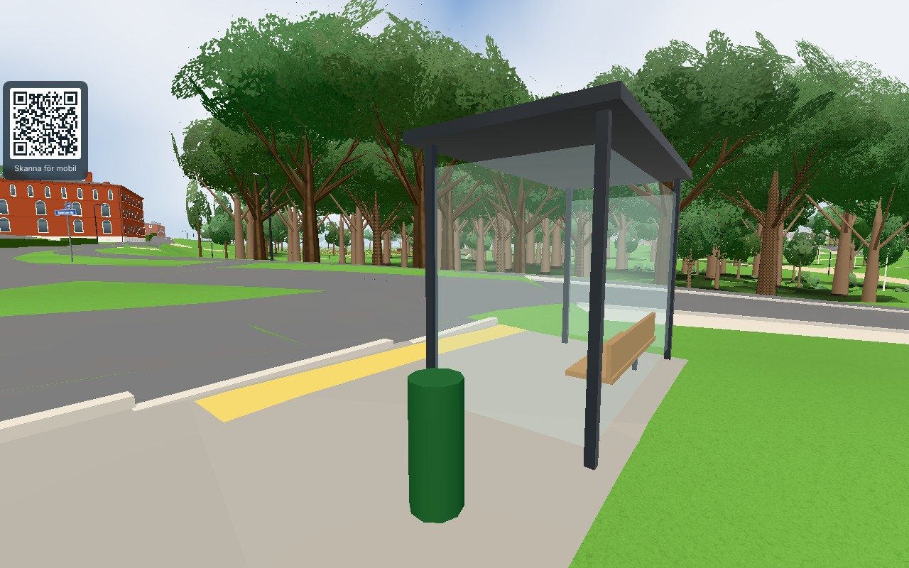
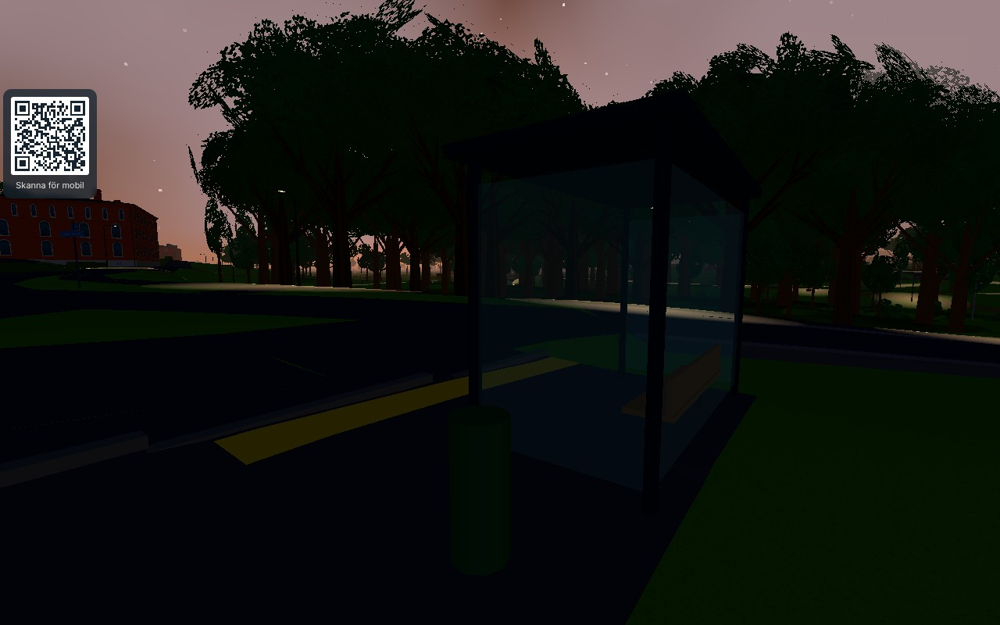
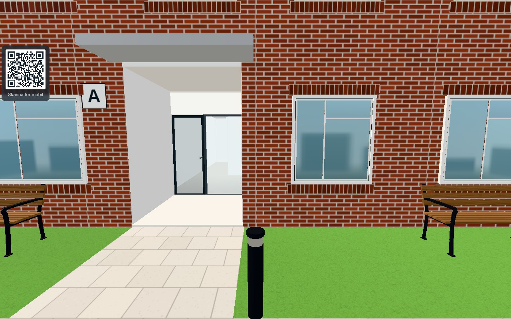
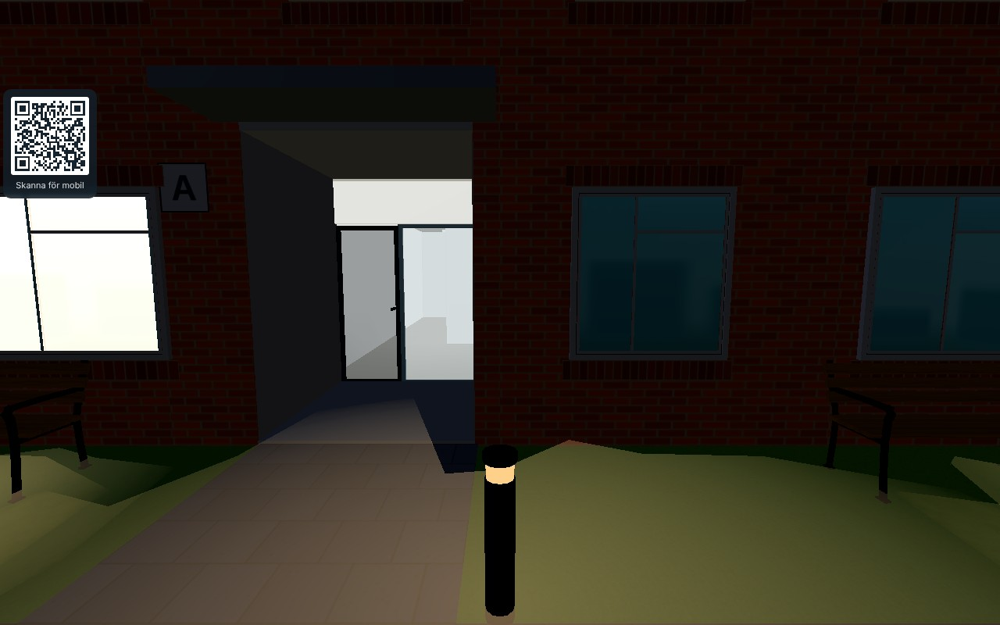

# #2089 — matt borstad metallyta på räcken

Bas `3e33c99` (origin/main). "Före" serverar basens versioner av de ändrade modulerna (`config.js`,
`exterior.js`, `surroundings.js`, `busstop.js`); "efter" kör arbetskopian. Riktiga appen i gångvy
(`?test`, juni, klart väder, fryst klocka), samma kamera före/efter, kl 12 (dag) och 22.2
(skymning). Bilderna är native 1280×800 (`kit.shot`), sparade som JPEG utan beskärning. Skript:
`tools/railmetal2089browser.cjs`, rådata: [browser.json](browser.json). Före-bilderna ligger i
`before/` och tas bort när ärendet stängs.

## Resultat

`src/railmetal.js` (`RAIL_METAL` i `config.js`, *guess*) lappar räckenas befintliga
MeshStandardMaterial i fragmentshadern: fina borstlinjer tvärs över profilen och en mjuk
pulverlacksmolnighet i roughness (±ljushet), båda utjämnade till sitt medelvärde när de blir mindre
än en pixel; roughness stiger med avståndet (inget glitter på tunna stänger) och ett diskret
kantljus tas från fragmentets omgivnings-/himmelsljus, så det slocknar i skymning och natt. Basen
är mattare (roughness 0.58 i stället för 0.45–0.6).

| Vy | Före | Efter |
|---|---|---|
| Hus L loftgång, nära räcket, dag |  |  |
| Hus L loftgång, skymning |  |  |
| Takterrass Hus L mot gården och ABC, dag |  |  |
| Takterrass, skymning |  |  |
| Busshållplatsen, dag |  |  |
| Busshållplatsen, skymning |  |  |
| Vanlig vy: Hus A:s entré från gården, dag |  |  |
| Vanlig vy, skymning |  |  |

Pixeldiff efter mot före (max av 255 / pixlar > 5): loftgång dag 36 / 17 182, skymning 8 / 25;
terrass dag 53 / 1 429, skymning 11 / 3; busshållplats dag 112 / 31 229 (takets ovansida och
skuggade framkant: från nästan svart till mattgrå stål), skymning 12 / 68; vanlig vy 0 / 0.
Handledaren visar nu svaga borstlinjer/molnighet och en bredare, lugnare högdager; bänkens trä och
den gröna papperskorgen i samma vertexfärgade batch är oförändrade (mättnadsmasken). Skymningen är
som förut: kantljuset följer omgivningsljuset och lyser inte själv.

## Kontroller

- `THREE_DIR=… node --test tools/railmetaltest.mjs`: lappen mot three 0.170:s riktiga
  standard/physical-källor (ordning efter color/roughness/lights, lampwash-ankaret kvar), vertex-
  shadern oförändrad utom en varying, `hasNativeVertexCompile` sann (detail.js-gallringen), en
  programnyckel, inga uniforms/tid/slump, alla konsumenter och samma antal geometripushar.
- Browser (båda faserna): samma antal meshar (5017); alla 23 räckesrelaterade meshar har identiska
  vertex-/indexantal, attribut och världsgränser före/efter (16 lappade efter). Draws/trianglar/
  texturer per vy lika (±1–2 draws från animerade objekt, åt båda hållen); program ±4 åt båda håll.
- Kända förhandsfel: `lampWash`-shaderns "redefinition" när `kit.shot` växlar kvalitet, 6 gånger i
  vardera fas (`src/lampwash.js`, se #2087), inte orsakat av denna ändring.
  `busstopplatformtest`/`busstoprestoretest` hittar inte paketet `three` i Node även på basen.

## Hus som kontrollerats

- **L**: loftgångens räcken + spiraltrappornas stålräcken (`loftRails`), takterrassernas vita räcken
  (`terraceRails`, per terrass/gavel som förut, telefonernas enda batch likaså).
- **A/B/C**: loggiornas spjälräcken (`loggiaRails`, alfatextur) samma lapp; garagelådans räcken,
  kopplingslister och parktrappornas ledstänger (`boxRails`, `boxSlats`). Hus A:s entré (vanlig vy)
  oförändrad. Trapphusens inomhusräcken (corehouse/stairs) och plåtavtäckningar ingår inte.
- Busshållplatsens stålstolpar/tak/skyltstolpar (`bus-stop-furniture`).

## Kostnad och gränser

Ingen ny draw, textur, uniform, ljus, render target eller per-frame-arbete; geometri, sammanslagning,
instansering och fjärr-LOD orörda. En extra programvariant per materialtyp (en gemensam nyckel),
~40 ALU-instruktioner per räckesfragment (två brusfunktioner, derivator). Ingen fysisk enhet testad.
