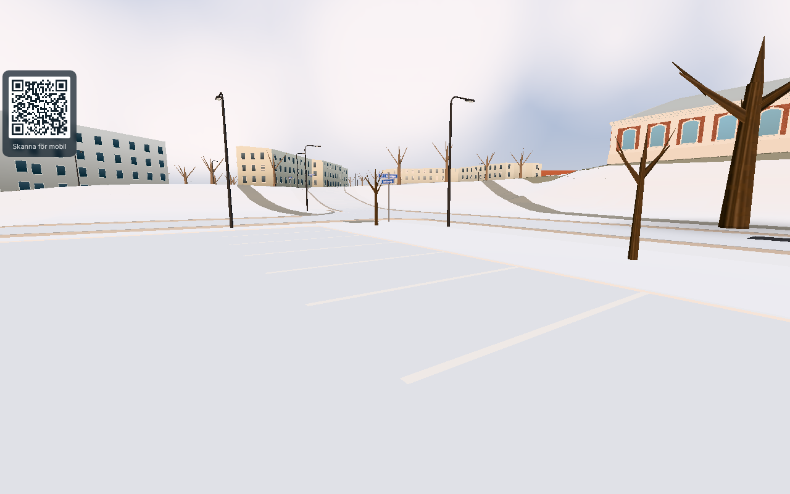
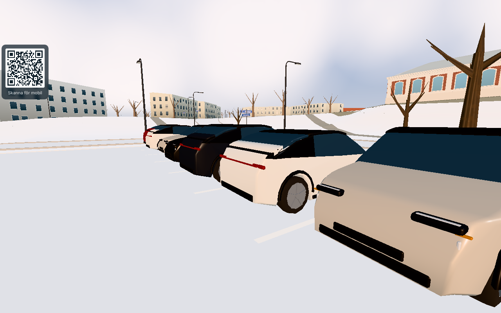
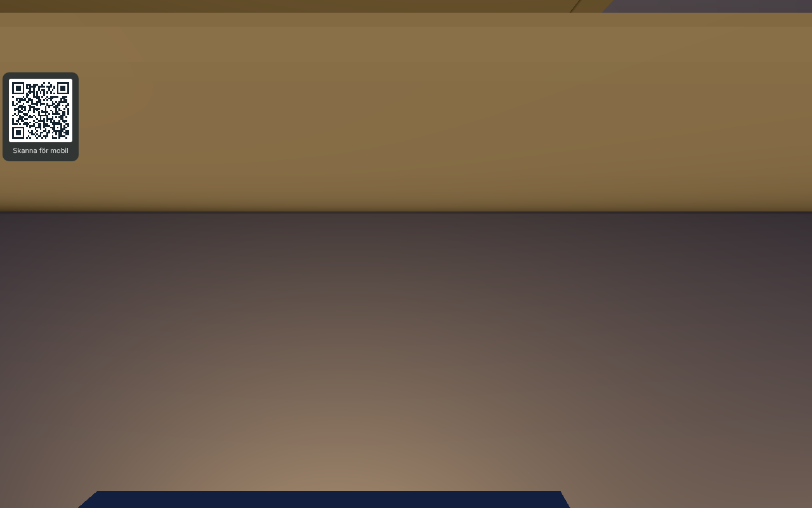

# #2090 – lampWash redefinition vid kvalitetsbyte

Orsak: `viewlod.js` `addCarLod` klonar de parkerade bilarnas material, ärver källans redan lamp-patchade
`onBeforeCompile` och lindar den i dither-tonen. Klonen finns inte i `LampWashes.patched` (WeakSet), så nästa
periodiska `patch()` (eller `WarmUp.prepare`) patchar den igen med samma suffix → `uLampData`/`uLampVis`
deklareras två gånger och `lampWash` får två kroppar. Programmet kompilerar inte och three ritar inget med det:
närbilarna syntes inte alls. Felet syns först när närbilarna ritas (t.ex. efter kvalitetsbyte/kamerahopp), inte av
kvalitetsbytet i sig.

Åtgärd: `src/lampwash.js` injicerar bara om skuggaren ännu inte innehåller `vec3 lampWash${sfx}(vec3`.

| Vy | Före | Efter |
|---|---|---|
| Närmaste parkerade bilar, dag |  |  |
| Tänt rum, natt (lamp-wash) |  |  |

- `node tools/lampwash2090test.mjs` (three 0.170.0 som `three`): 2/2 (före åtgärden: 1 fel, `uLampData declared once`).
- `THREE_DIR=… node tools/lampwash2090browser.cjs http://localhost:8290 docs/verification/2090`: före 3 redefinition-fel
  och 2 ogiltiga program (bilbatcher) efter bilvyn; efter 0 fel, 0 ogiltiga program. Rumsvyn pixelidentisk före/efter
  (lampans ljus oförändrat), samma 56 draw calls och 81 program. Rådata: [browser.json](browser.json).
