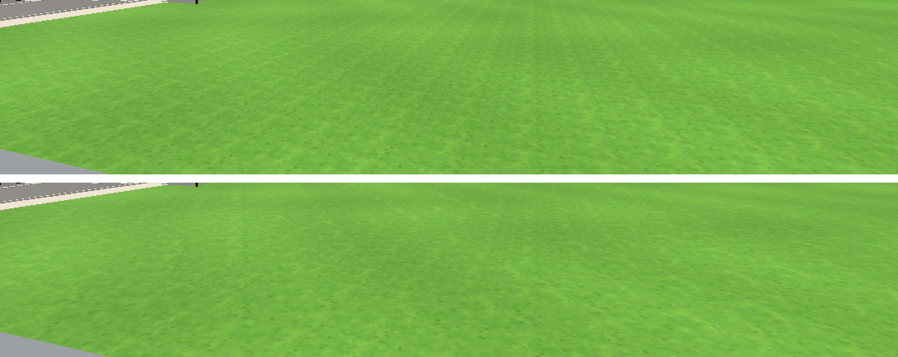
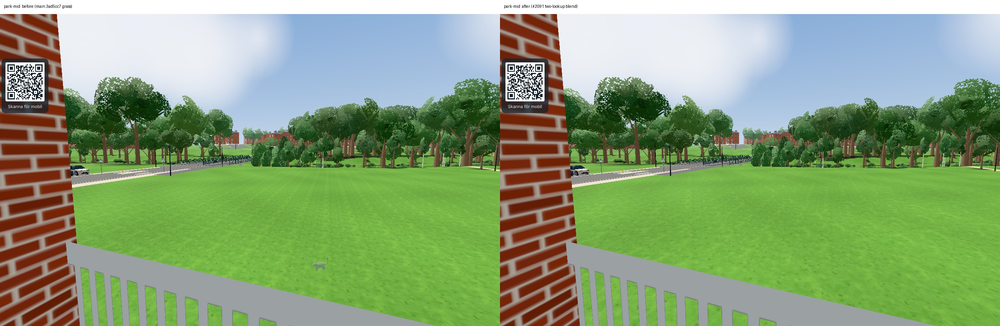
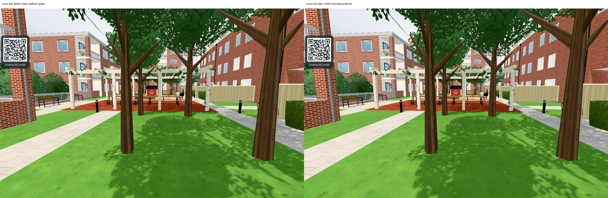
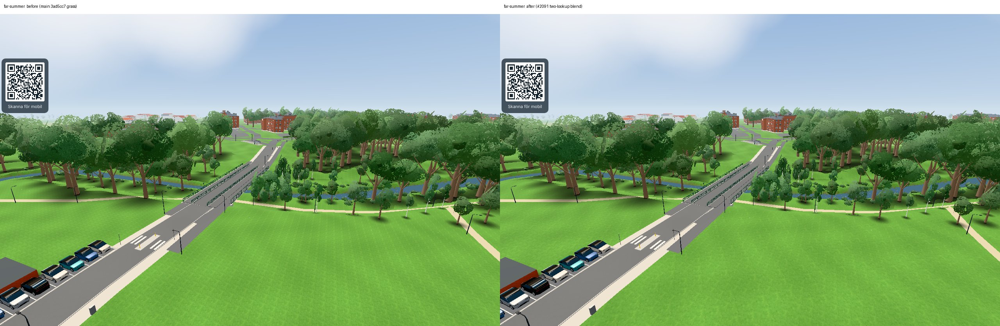
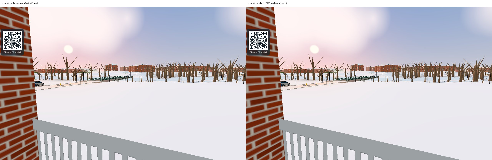

# #2091 — less grass tile repeat at 10–20 m

Baseline `cdc6caf` (main). Before serves only that revision's `src/grass.js`; after uses the working source
(`src/grass.js`, `grassBlendGLSL`/`grassBlendWeight`/`grassBlendUV` in `src/grassdetail.js`, `GRASS.detailBlend` in
`src/config.js`). Sheets are native 1280×800 game captures paired without scaling (2560×836, 36 px label strip).

## Result

The grass shader replaces three's `<map_fragment>`: it samples the shared 1.6 m detail map a second time, rotated
0.61 rad, scaled 1.37× and offset, and switches between the two lookups with soft world-space blobs (about 3–4 m,
`noiseScale` 0.85; half the ground each, ~57 % unblended so detail contrast stays). The aligned lattice that read as
fine stripes over the park at 10–20 m is broken up ([zoomed 10–20 m band, before above after](park-band-zoom.jpg)).
A first tuning with larger blobs (`noiseScale` 0.6) left longer stripe runs and was rejected after inspection.
In the courtyard close view the tussocks no longer sit on one grid; in the B regions they are 37 % larger.
Both lookups read the same map, so the mean colour and the far ground are unchanged; under snow the map is
removed and the block is compiled out (winter unchanged).

## Checks

1. `node --test tools/grassdetailtest.mjs`: 6/6 pass (4 from #2086 plus 2 new): blend weight averages 0.50, ~57 % of
   the ground unblended, soft switch (≤ 0.5 per 25 cm); GLSL is `#ifdef USE_MAP`-guarded with two lookups and the same
   constants; on a model ground (0.2 m blocks) the correlation with itself one tile further drops from 0.99 to 0.25,
   mean within 0.03 %, block contrast 98 % of before.
2. Actual consumers in Chromium (`tools/grass2091browser.cjs`, SwiftShader), views park-mid, court-mid, far-summer,
   park-winter: no page errors and no WebGL program/shader errors in the console; program diagnostics clean
   ([before.json](before.json), [after.json](after.json)).
   - `grassMeanColor()` linear rgb: before 0.09319/0.23944/0.04383, after the same.
   - Draw calls/textures equal within run-to-run noise (±1–2 calls from animated scene content); no new texture,
     geometry, material, light or program variant (cache key unchanged).
   - Cost: one extra anisotropic texture fetch of the same 256 px map plus ~15 ALU ops per grass fragment.

## Sheets (before left, after right)

Houses: A/B courtyard and the park checked in the browser; Hus C/L yards and all other lawns share the same material
(world.js, surroundings.js, streetlife.js, sitebackdrop.js), no house-specific geometry is involved.
Limit: the #1872 meshlet experiment's node translation (tools/meshlet1872/adapt.js) does not carry the blend.

Publicering: Pages/Worker success på `1c3c899`; före-bilder borttagna vid stängning och visas från den commiten.
