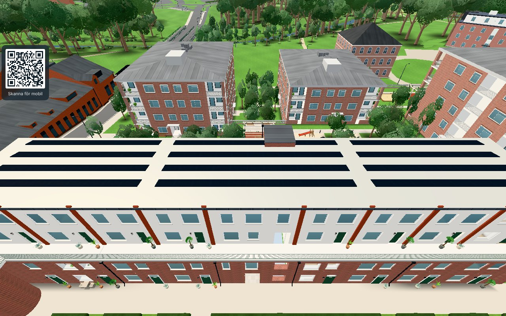
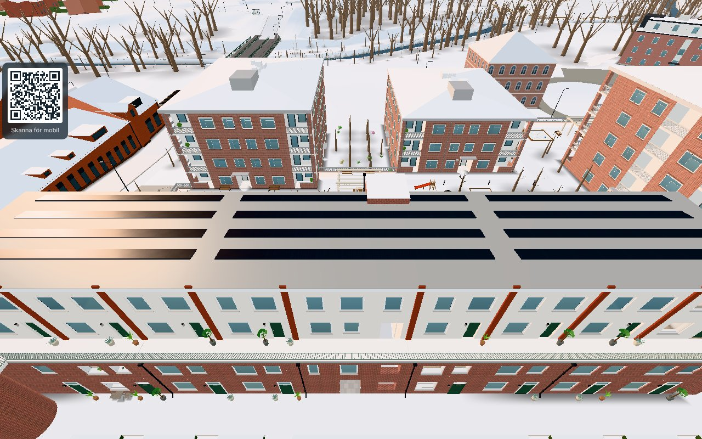
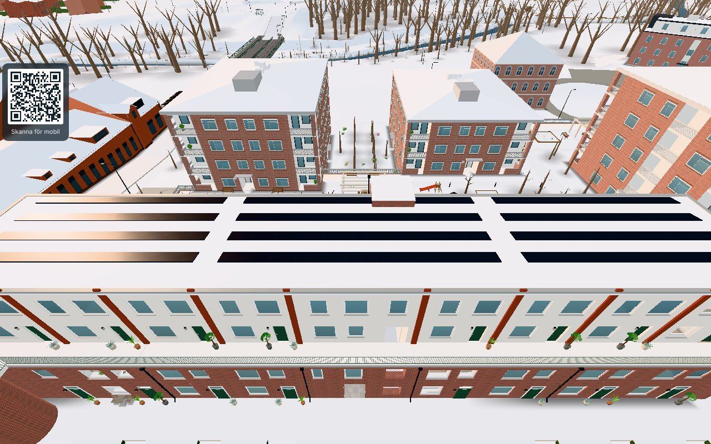
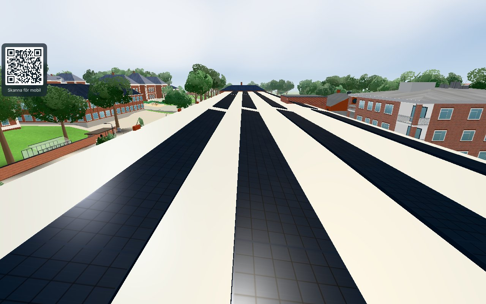
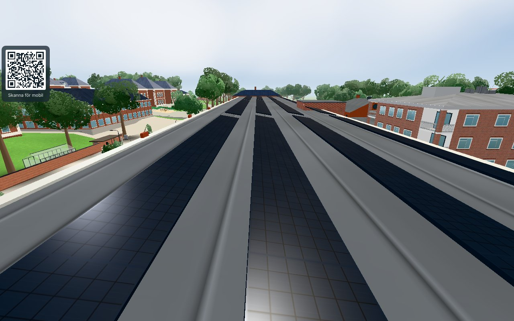
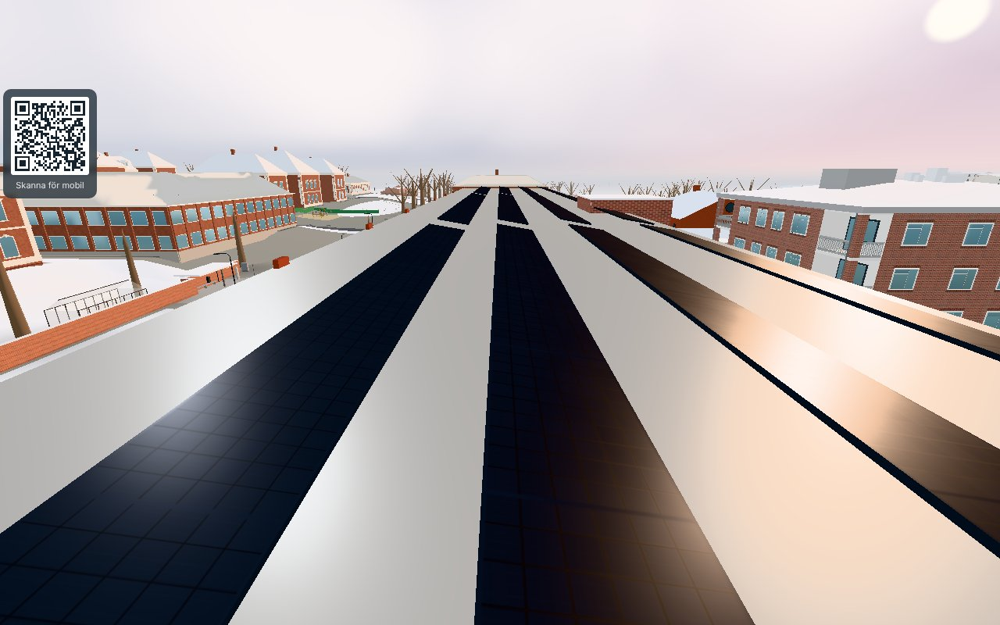
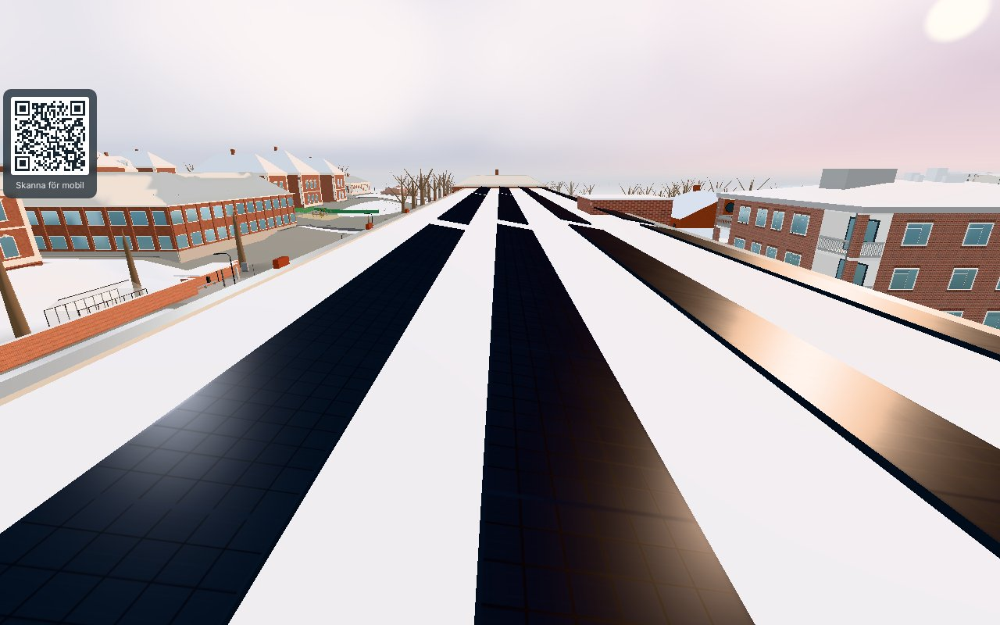

# #2093 – Hus L:s takavtäckning följer bara takkanten

**Diagnos.** `capping` i `src/exterior.js` (#110: "takkant i ljus plåt/vit list") byggdes som en enda 5 cm platta
över hela Hus L:s platta tak (x xw−0,13…xe+0,13, z loftD−0,13…zs+0,13), så takpappen från #2088 (`roofs[]`) syntes
aldrig och snön (`registerSnow` på takmaterialet) hamnade under plåten. Peab-underlaget i `docs/peab/` har ingen
taksektion eller detalj; #110:s flygbild visar ljus plåt längs takkanten, inte över ytan. Ingen avsikt att täcka taket.

**Ändring.** `rectRing` (exterior.js) ger fyra icke-överlappande lister längs takkanten: bredd
`VERTICAL.roof.cappingWidth` 0,3 m, nedvikt `cappingDrop` 0,1 m över uppbyggnadens kant (båda *guess*), topp som förut.
Takpappens låda, gånghöjden (`L-roof` = överkant avtäckning, 5 cm över pappen, *guess*), solpanelerna, takterrassens
copings och loftets tak är oförändrade. Samma material och batch: draw calls oförändrade (311/418/305/414), +36
trianglar, inga nya texturer.

**Hus A/B/C.** Valmade papptak i `surroundings.js` (`hipRoof`); ingen avtäckningsplatta över takytan, bara takboxen
från takplanen (#348, avsiktlig). Ej påverkade (syns oförändrade i bilderna ovanifrån).

| Vy | Före | Efter |
|---|---|---|
| Hus L ovanifrån, sommar |  |  |
| Hus L ovanifrån, vinter |  |  |
| På taket mot öster, sommar |  |  |
| På taket mot öster, vinter |  |  |

Körning: `THREE_DIR=… BASE_REV=9a35a62 VIEWS='{"tak-L":[-38,5.5,-90,-18,12.75],"tak-L-ovan":[-15,-9,180,-42,26]}'
node tools/roofsurface2088browser.cjs http://127.0.0.1:8293 <ut>` (1280×800, inga sidfel; `browser.json`).
Tester: `node --test tools/roofcapping2093test.mjs` (2/2, takpapp synlig på 93,3 % av ytan),
`node --test tools/roofsurfacetest.mjs` (4/4; dess proveniensvakt jämför nu #2088:s egen commit 0c5f4a5).
