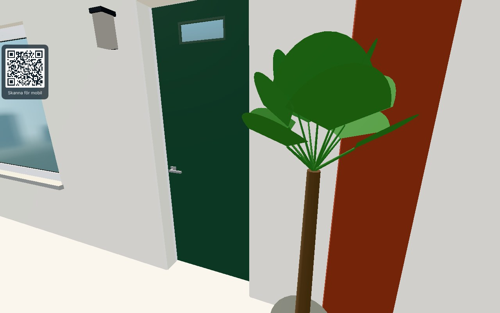
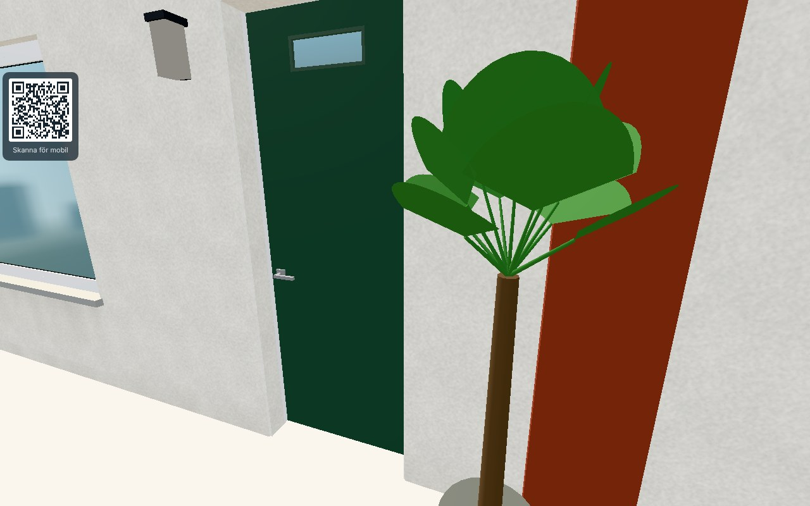
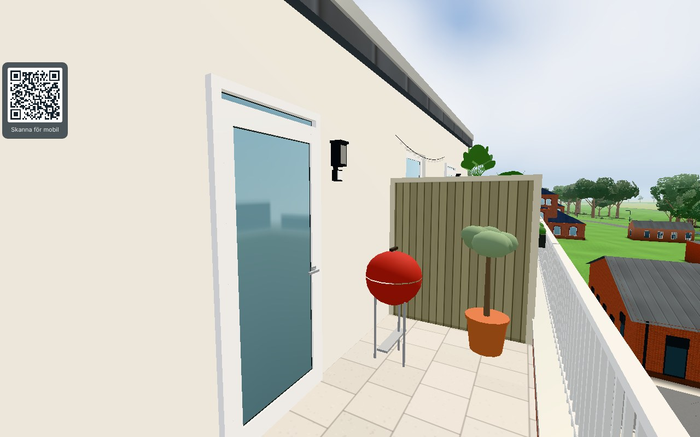
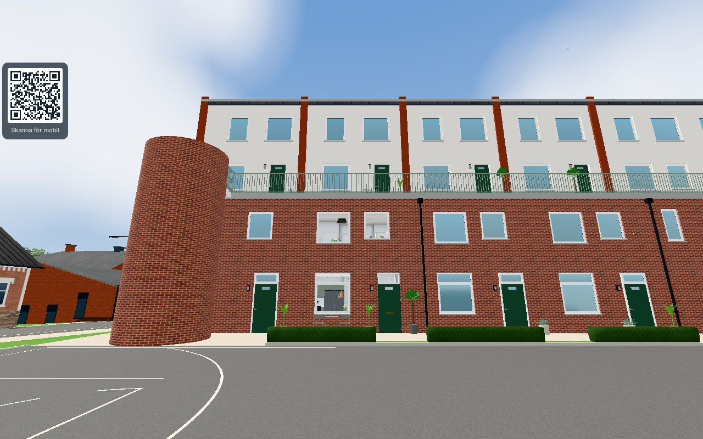
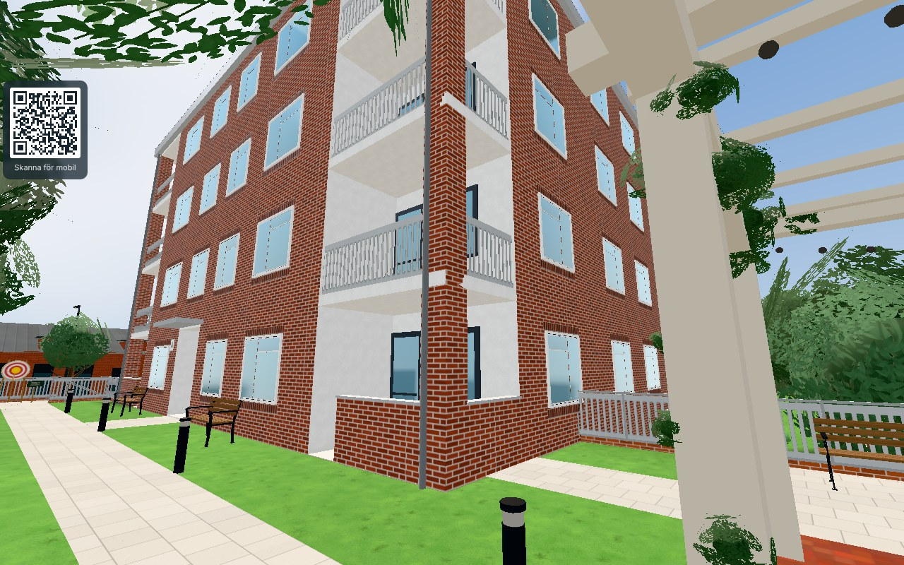
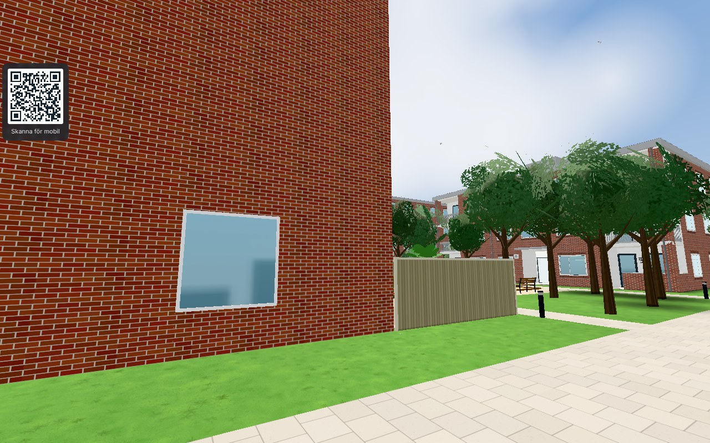

# #2095 — fin putsstruktur och svaga smutsstrimmor på putsfasaderna

Bas `80b8ba4` (origin/main). "Före" serverar basens versioner av de ändrade modulerna (`config.js`, `exterior.js`,
`surroundings.js`); "efter" kör arbetskopian. Riktiga appen (`?test`, juli, klart väder, fryst klocka kl 13), samma
kamera före/efter. Native 1280×800 (`kit.shot`), JPEG utan beskärning. Före-bilder i [before/](before/). Skript:
`tools/rendersurface2095browser.cjs`, rådata: [browser.json](browser.json).

## Resultat

En delad 128 px packad linjär karta över 0,5 m vägg (`src/rendersurface.js`, `RENDER_SURFACE` i `config.js`, *guess*):
fin sandkornighet och glesa små porer som bump (R) och svag råhetsvariation (G), plus en svag sRGB-gråkarta med samma
korn för albedo (norrfasaderna ligger i skugga och visar bara den). Färgen delas med albedokartans linjära medel och
råheten med kartans medel-G, så medeltonen står kvar. UV projiceras i världen per yta före merge; fönsterramar i samma
mesh (Å-husen) ligger på den neutrala texeln. Smuts: svaga vertexfärgade remsor 2–4 mm framför väggen i samma mesh
(inga nya draws) under varje putsad smygs fönsterbleck (Hus L) / loggiafönster (A/B/C), mörkast under bleckets ändar,
och ett svagt stänkband 0,3 m över loftgångens, terrassens och loggiornas golv. Placering och styrka är *guess*.

| Vy | Före | Efter |
|---|---|---|
| Hus L, loftgången nära (norrfasad i skugga): korn, strimma under blecket, stänkband |  |  |
| Hus L, takterrassen i sol: indragen gårdsvåning |  |  |
| Hus L från gatan (gatuavstånd) |  |  |
| Hus A, nordvästra loggiorna från gården |  |  |
| Hus C på avstånd |  |  |

Medelton i bild (RGB-medel över putsytan, före → efter): Hus L gata 181,8/183,4/182,3 → 181,5/183,5/182,0;
terrass 222,3/220,1/211,1 → 222,2/220,2/210,9; Hus A loggia 169,8/168,8/166,9 → 169,9/168,9/167,0 (alla < 0,2 %).
Meshens areaviktade vertexfärg (smutsen): Hus L 0,996, Å-husen 0,998.

## Kontroller

- `node --test tools/rendersurfacetest.mjs` (6/6): kartorna deterministiska, små, fina, sömlösa, neutral texel = medel;
  materialfärg × albedomedel = gamla färgen, råhetsmedel kvar; världs-UV per ytplan, positioner/index orörda; remsorna
  vänder utåt, ligger framför väggen, tonar ut helt nedåt/åt sidorna, är svaga; medeltonen för en vägg med fönster,
  strimma och stänkband ändras < 2 %; konsumenterna bakar UV före merge, inga remsor på tegel; `complement`, `quadZ/X/Y`,
  `boxGeo`, `quad`, `loggiaOpenings`, `glazing`, `cornerLoggias`, `aHouseParts` oförändrade.
- Browser (båda faserna): 5017 meshar; draws lika i alla fem vyer; putsmesharnas ursprungliga trianglar oförändrade
  (Hus L 918 + 4424 remstrianglar, Å-husen 14028 + 14424); +2 texturer (128 px), +1–2 program; inga sidfel.

## Hus som kontrollerats

- Hus L: all puts (`renders`: gatans våning 3–4 bakom loftgången, indragna gårdsvåningen, gavlarnas våning 4) — åtgärdat.
- Hus A, B, C (Å-husen): putsade loggia-/nischväggar och bjälklag (`loggias`, gemensam implementation) — åtgärdat; samma
  kod för alla tre. Deras trapphus (`corehouse.js`) har ingen putsfasad (inre lobby, vertexfärgat MeshBasic) — ej tillämpligt.

## Gränser

- Strimmorna är avsiktligt svaga; i skugga på norrsidan syns de först på nära håll.
- Karpvägens ljusa toppvåning, skolans/campus ljusa puts och södra bakgrundens puts ingår inte (inte A/B/C/L).
- Kostnad: +18,8k trianglar totalt (remsorna), +2 små texturer (2 × 64 KiB), ingen per-frame-kod, inga nya draws.

Publicering: Pages/Worker success på `8fed7ec`; före-bilder borttagna vid stängning och visas från den commiten.
