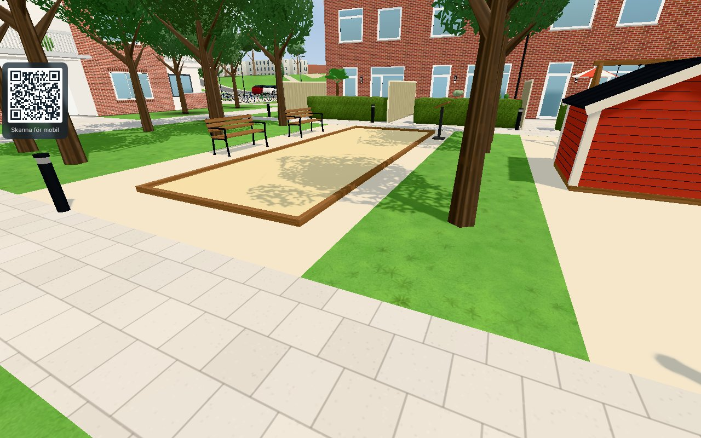
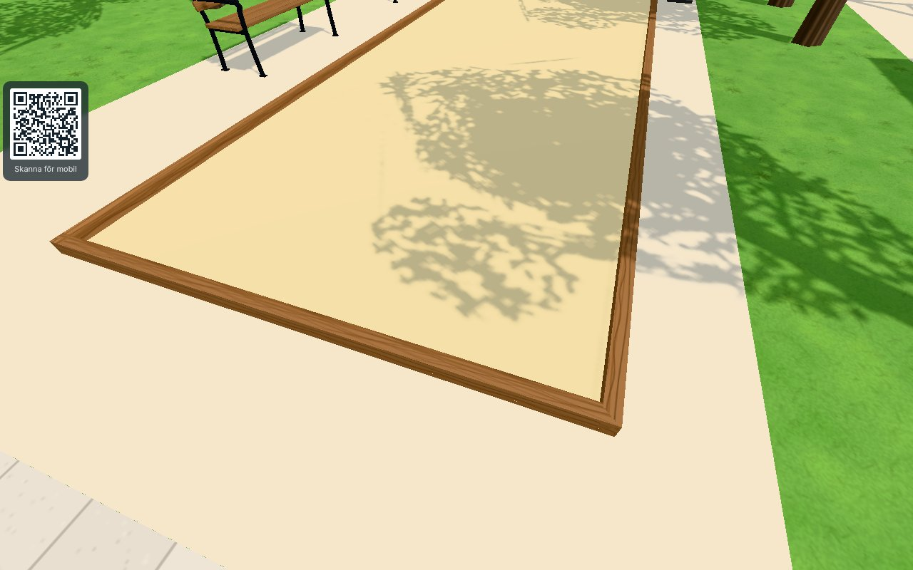
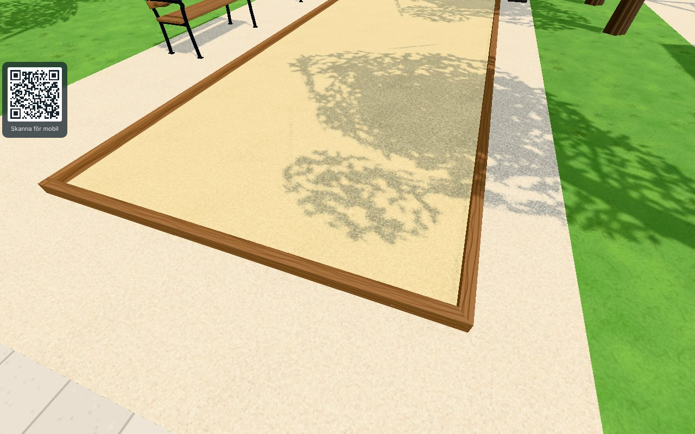
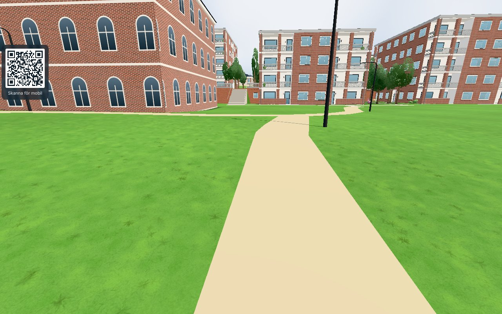
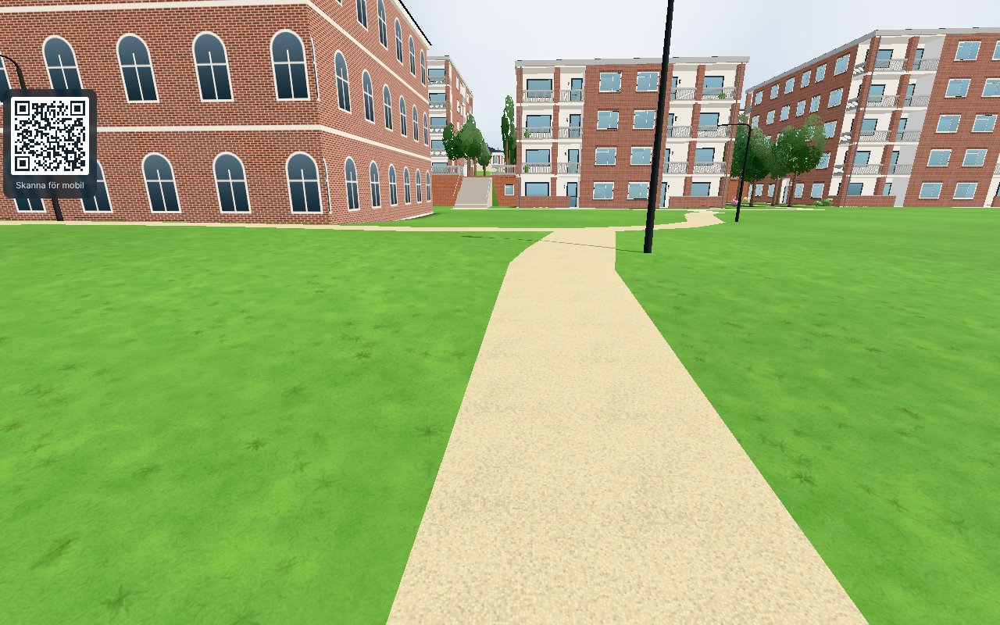
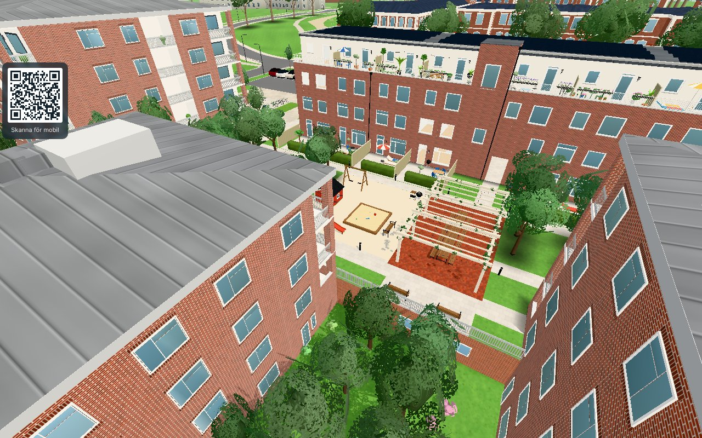
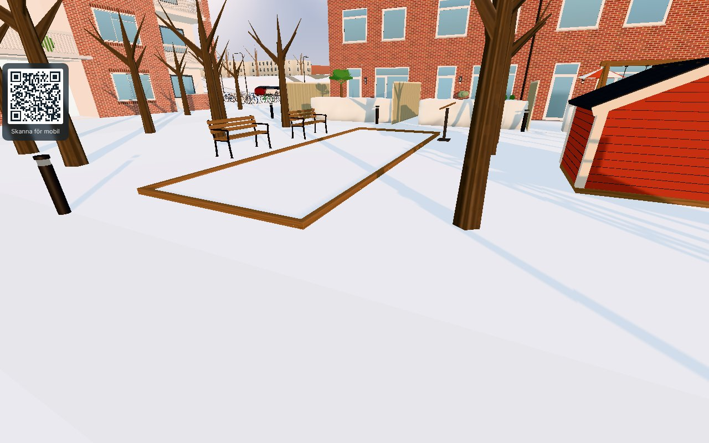

# #2096 – gravel surface: before/after

Shared deterministic gravel map (`src/gravelsurface.js`, `GRAVEL_SURFACE`) on the courtyard gravel, the boule court and the
park's gravel paths. Actual app (`?shot&at=…&month=…&time=13&freeze&weather=clear`), 1280×800 shots via `tools/testkit.cjs`,
SwiftShader. Before = `src/courtyard.js`/`src/riverpark.js` from 80b8ba4 served in place of the new ones
(`tools/gravel2096browser.cjs`, `BEFORE_DIR`).

| View | Before | After |
|---|---|---|
| Boule court + gravel strip, walk view |  |  |
| Boule court close |  |  |
| Park gravel path, walk view |  |  |
| Courtyard from above (far) |  |  |
| Winter (snow) |  |  |

Checks
- `node --test tools/gravelsurfacetest.mjs`: 3/3 – deterministic map, linear mean = 0.6 within 0.002 per channel, visible
  stone spread without clipping, roughness within 0.78–0.97, wrap seam no stronger than an inner step, colour ÷ mean keeps
  each surface's mean colour, shared textures, metre UVs leave positions untouched, snow drops map/relief/roughness and
  restores them, vertex tints only with the map. `node --test tools/bouletest.mjs`: 12/12.
- Browser (`before.json`/`after.json`): no page or shader errors; draw calls and triangles equal in the walk, close, park and
  winter views (245/99/413/243 calls). The far view differs by one call / ~3k triangles from a slightly different settled
  camera (see the images), not from the gravel batches, which keep their counts (courtyard gravel 6 triangles incl. the moved
  boule plate; park paths 2216).
- Cost: two 512² RGBA DataTextures (1 MiB each + mips), shared by the three batches; one-time ~0.1–0.2 s generation
  (measured under host load); no new draws, lights or per-frame work.

Limits: in snow months the boule court is now plain snow (the old sand mottle tinted it ~10 % darker). The far school-yard
backdrops and the outdoor gym's gravel keep their flat colours (not in this issue's scope).

Publicering: Pages/Worker success på `b0581f3`; före-bilder borttagna vid stängning och visas från den commiten; sida-vid-sida-ark `pair-*.jpg`.
