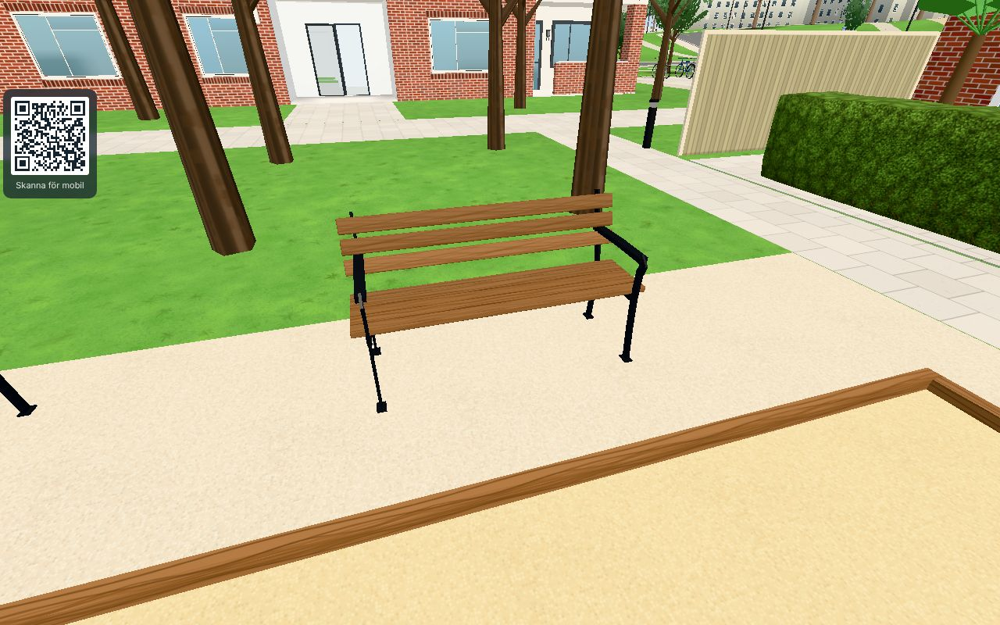
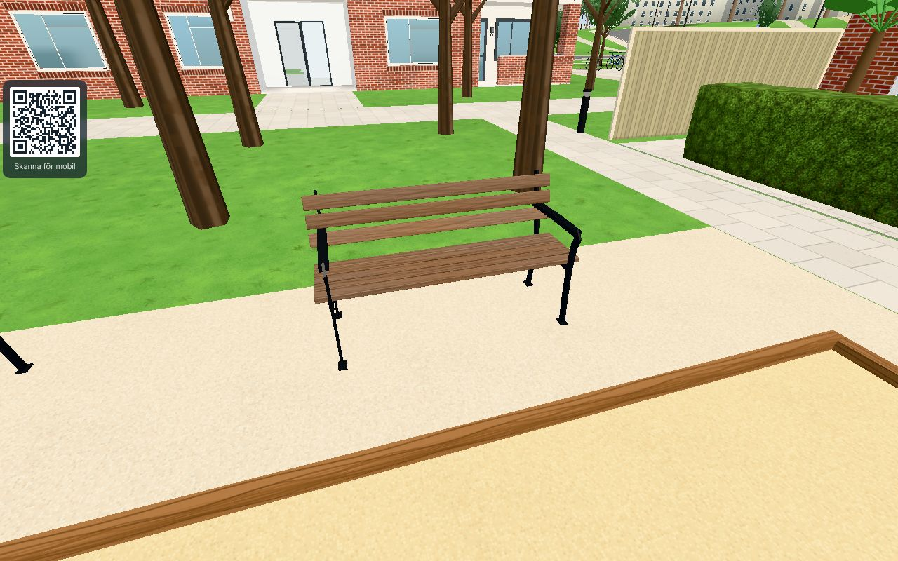
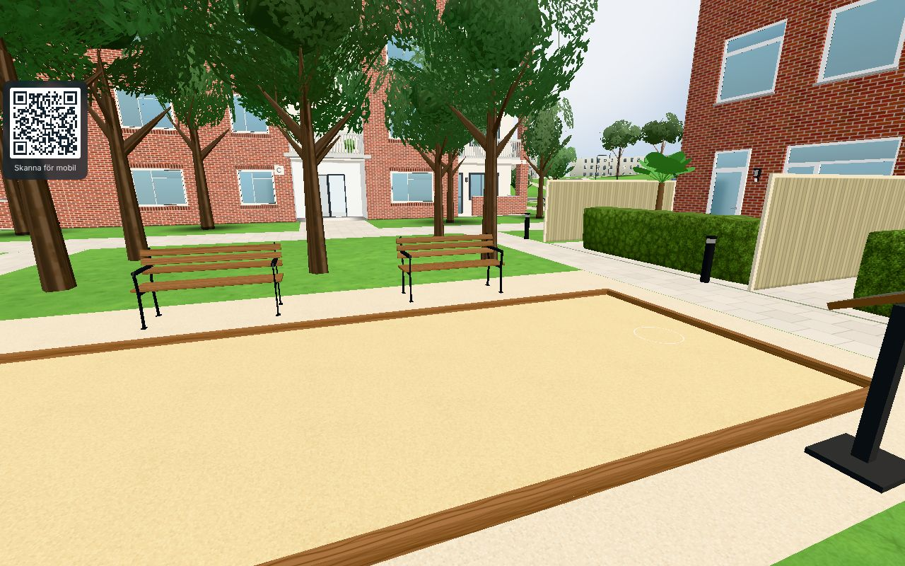
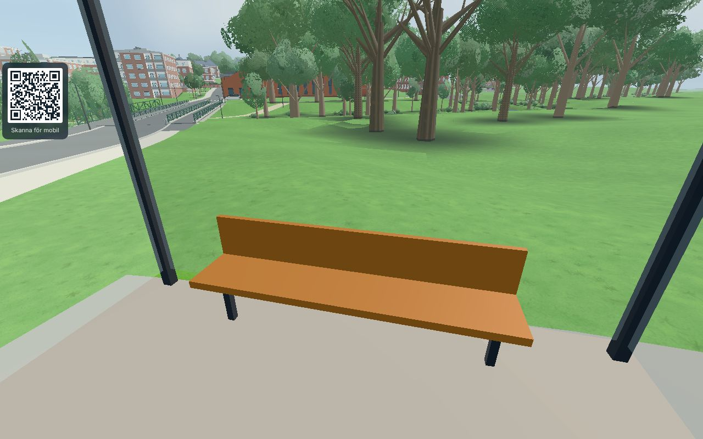
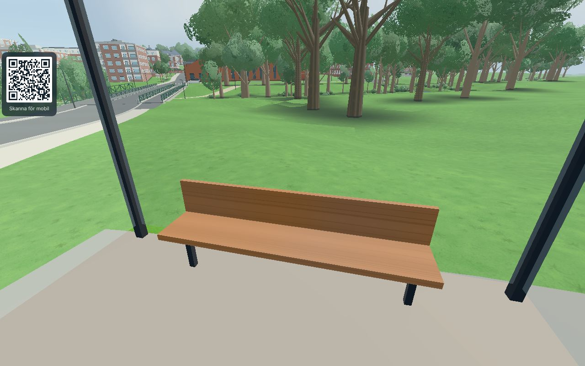
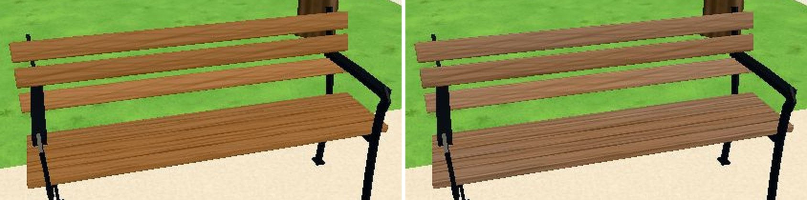
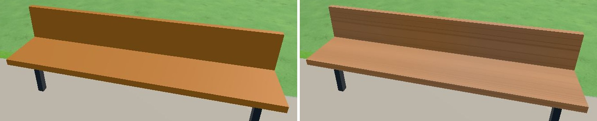

# #2098 — bänkar med trästruktur

Bas `34bd557` (origin/main). "Före" serverar basens versioner av de ändrade modulerna (`config.js`,
`courtyard.js`, `busstop.js`; `benchwood.js` används då inte); "efter" kör arbetskopian. Riktiga appen i
gångvy (`?test`, juni, klart väder, fryst klocka kl 12), samma kamera före/efter. Bilderna är native
1280×800 (`kit.shot`), sparade som JPEG utan beskärning; detaljbilderna är förstorade utsnitt (före |
efter) av samma bilder. Skript: `tools/benchwood2098browser.cjs`, rådata: [browser.json](browser.json).
Före-bilderna ligger i `before/` och tas bort när ärendet stängs.

## Resultat

`src/benchwood.js` (`BENCH_WOOD` i `config.js`, *guess*) märker varje bänkribba i dess egen ram (längs,
tvärs, tjocklek, halva bredd/tjocklek som 16-bitars vertexattribut) och lappar det befintliga materialet
i fragmentshadern: fina ådringslinjer längs ribban (lätt slingrande, olika per ribba), en svag
sval gråton och ljusare slitna långkanter, matt trä (roughness ≥ 0.86, metalness 0). Allt utan märkning
(gårdens övriga virke, busskurens stål och papperskorg) är oförändrat. Busskurens railMetal (#2089)
kedjas och körs före bänkens färgsteg, så dess mättnadsmask ser fortfarande träets originalfärg.

| Vy | Före | Efter |
|---|---|---|
| Parkbänk vid boulebanan, nära |  |  |
| Parkbänkarna på några meters håll |  |  |
| Busskurens bänk |  |  |

Detalj (före | efter):  

## Kontroller

- `THREE_DIR=… node --test tools/benchwoodtest.mjs` — 4/4: patchen mot three 0.170:s egna shaderkällor
  (efter railMetals färgsteg, före alphamap; vertexshaderns rader orörda, inga uniforms, statisk), kedjade
  programnycklar (`bench-wood-2098`, `rail-metal-2089|bench-wood-2098`) och fragment-only-granskningen för
  detail.js; märkningen ändrar inte position/normal; i den byggda gården och busskuren är exakt park- och
  pergolabänkarnas ribbor (5 × 8 + 2 × 6) och busskurens sits och rygg märkta, varje ribbas längdkoordinat har
  enhetsgradient längs dess längsta axel, vinkelrät mot tvärs/tjocklek; ådringslinjerna lutar < 3° från
  ribbans axel; två byggen ger identiska attribut.
- Webbläsare (swiftshader), före/efter: inga sid- eller shaderfel; draw calls, trianglar, texturer och program
  identiska i gårdsvyerna (138/562 874, 183/657 742). I busskursvyn gav efter-fasen 437 mot 436 draws (+1 228
  trianglar, +1 textur); samma skillnad syntes i en tidigare körning åt andra hållet i före-fasen (435 → 436),
  så det är strömmad laddning i bakgrunden, inte bänken (patchen lägger inte till mesh eller textur).
- Batcherna: samma vertexantal och gränser före/efter (gårdens virke 37 956, busskurens möbler 684); 12 byte
  per vertex mer (gården +455 kB, busskuren +8 kB).

## Hus/varianter

Gården (parkbänkarna och pergolornas bänkar) och södra busskuren. Skolgårdarnas lekbänkar ligger i
bakgrundens stora `access`-batch och hållplatsbänken vid skolmuren i växthusramens batch; de är
inte märkta (attributen skulle läggas på hela batcherna).

Publicering: Pages/Worker success på `c96d77e`; före-bilder borttagna vid stängning och visas från den commiten.
