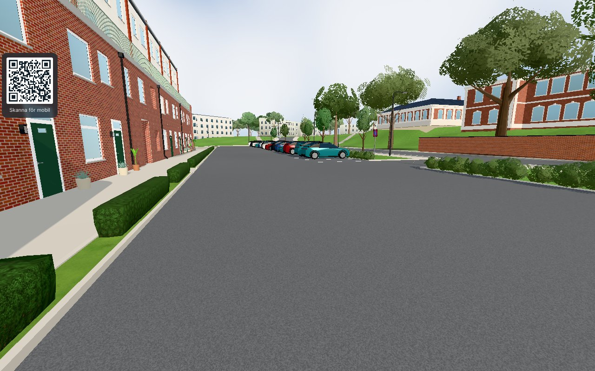
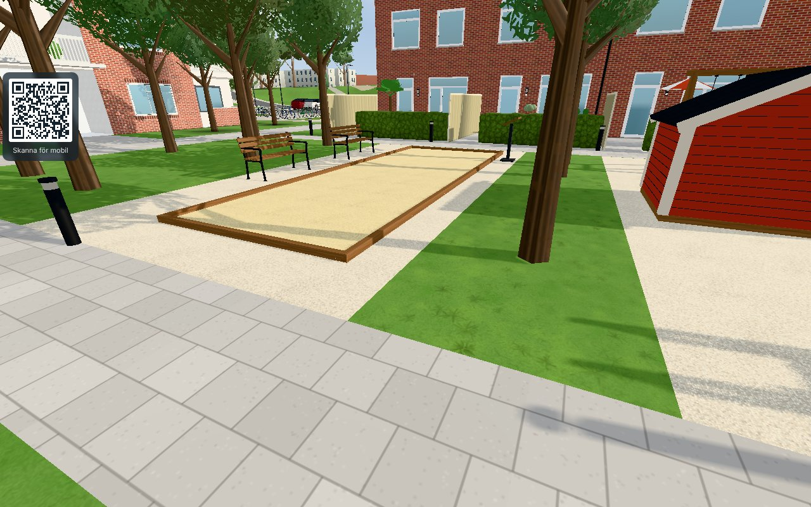
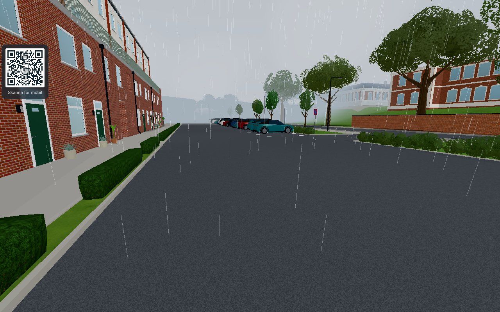
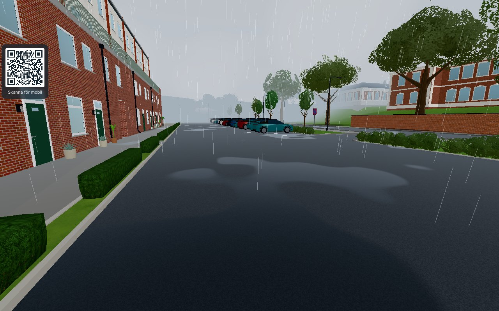
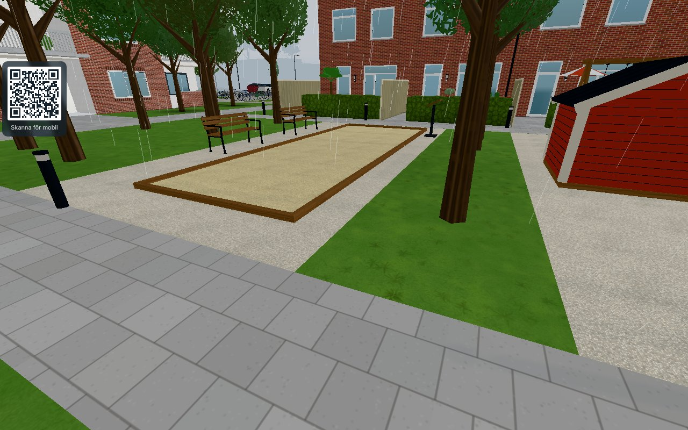
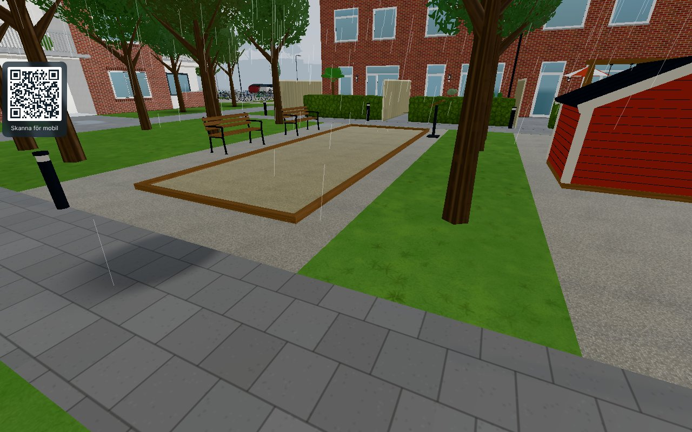
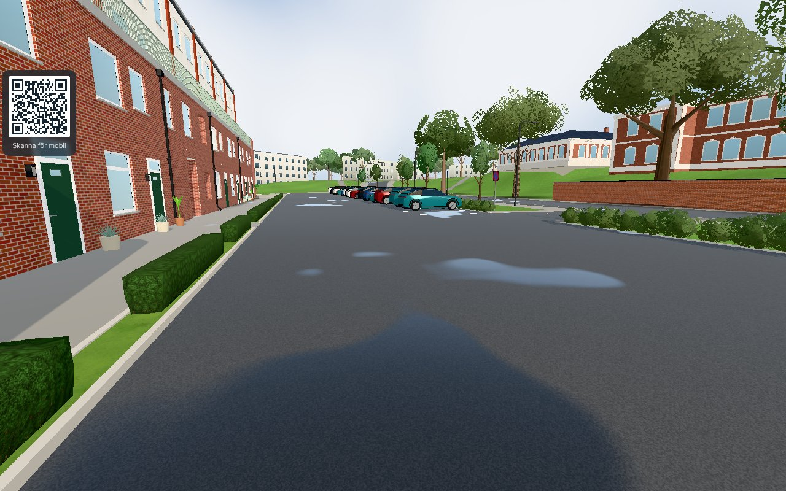
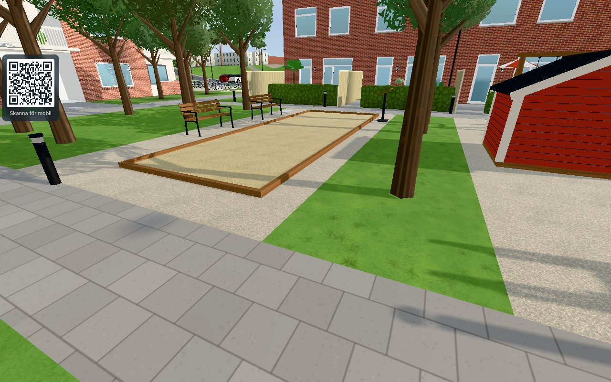
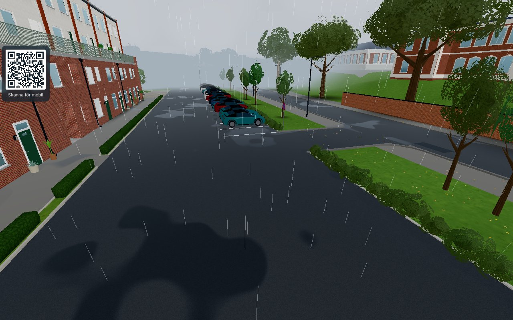
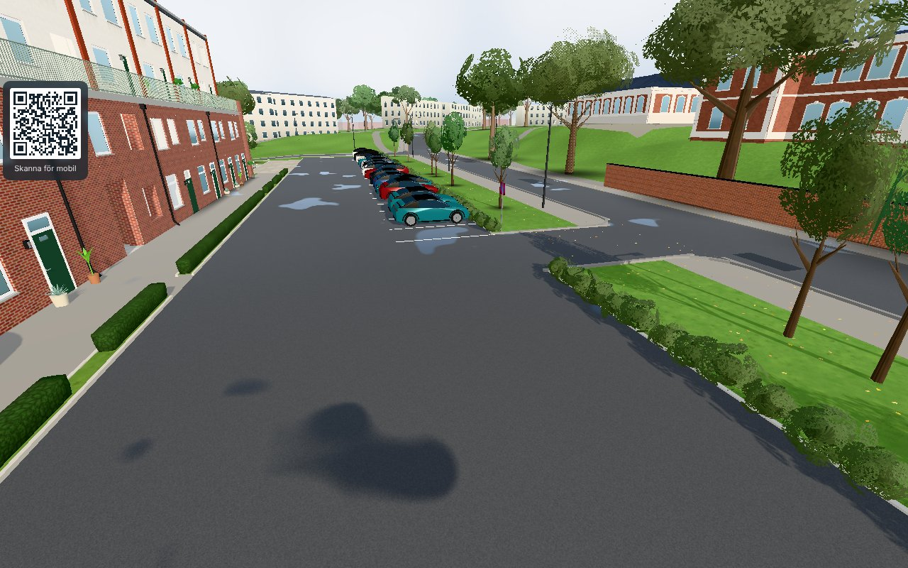

# #2099 – wet ground in and after rain: before/after

Shared wetness state and fragment patch (`src/wetground.js`, `WET_GROUND`) on the outdoor ground: site/park asphalt,
street kerbs, asphalt patches, zebra paint and cobbles, site pavements, courtyard paving and brick, the exposed patio,
every gravel surface and the backdrops' access surfaces. Actual app, 1280×800 shots via `tools/testkit.cjs` (quality 3),
SwiftShader: `?shot&at=…&year=2026&month=9&day=25&time=10.5&freeze` with `&weather=clear` (dry), `&weather=rain` (raining) or
nothing (after rain: the seeded shower of that morning, 07:47–09:32, strength 0.92; at 10:30 the sky is clear and the
history gives wet 0.51, puddles 0.80). Before = the ground modules from bc217d9 served in place of the new ones
(`tools/wetground2099browser.cjs`, `BEFORE_REV`).

| View | Before | After |
|---|---|---|
| Street, dry (pixel-identical) |  |  |
| Courtyard, dry |  |  |
| Street, raining |  |  |
| Courtyard, raining |  |  |
| Street, after rain (before = dry) |  |  |
| Courtyard, after rain (before = dry) |  |  |
| Street from 3.5 m, raining / after rain |  |  |

Checks
- `node --test tools/wetgroundtest.mjs`: 3/3 – rain soaks then fills puddles, drying is gradual and monotonic (dry again after
  2–10 h), faster in sun/warmth, snow does not wet and hail does; `GroundWetness` spins up from the history (damp with puddles
  2 h after a shower), dries step by step on the game clock, rewets in live rain, snow months and the puddle knob zero the
  uniform, a date jump re-integrates; `wetGround` chains the existing callback once, keeps the vertex shader native, gives
  unique keys per kind, survives a lampwash-style re-wrap without a second copy, and every change sits behind the
  `uGroundWet.x > 0` / `wetW > 0` / `wetP > 0` guards. Existing `asphaltsurfacetest`, `gravelsurfacetest`, `pavingsurfacetest`:
  12/12 together.
- Browser (`browser.json`): no page or shader errors in any phase. Dry before vs after: street and the street from 3.5 m
  pixel-identical (max 0); courtyard 252 of 1 024 000 pixels differ by ≤ 7 from a different settled state (246 vs 245 calls,
  same as in #2096's far view), not the ground. Draw calls, triangles and textures are equal before/after in every weather;
  programs +4…6 (the patched ground materials' wet variants, compiled at warm-up, no recompile when rain starts).
- Cost: no new draws, textures, lights or passes; one vec3 uniform written per frame, the sky colours are DayCycle's own
  objects. Per ground pixel while wet: a few ALU ops; with puddles two value-noise lookups + derivatives (puddles off at
  quality 0 and on phones). Dry: one uniform branch. Integration: ~120 `rainAt` steps once at start/after a jump, then O(1).

Limits: puddle placement is a world-noise *guess* (flat ground only), not measured low points or kerb lines. The existing sun
still casts faint shadows in rain; the wet gloss makes them a little more visible. The bus-shelter slabs share the kerbs'
material and get wet under the roof. The south/edge backdrops' far roads, the bridges' asphalt and the outdoor gym keep their
dry look (not in this issue's scope). Not measured on the Surface Pro.

Publicering: Pages/Worker success på `8c3e0ad`; före-bilder borttagna vid stängning och visas från den commiten.
