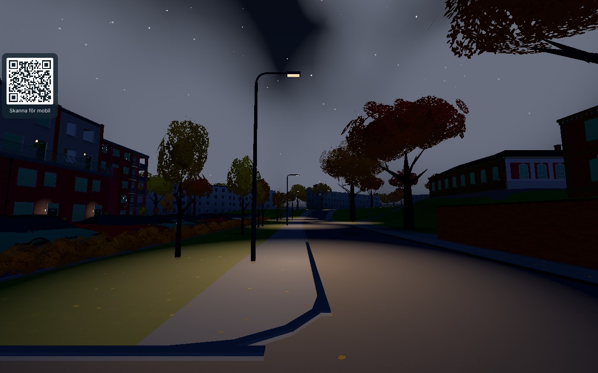
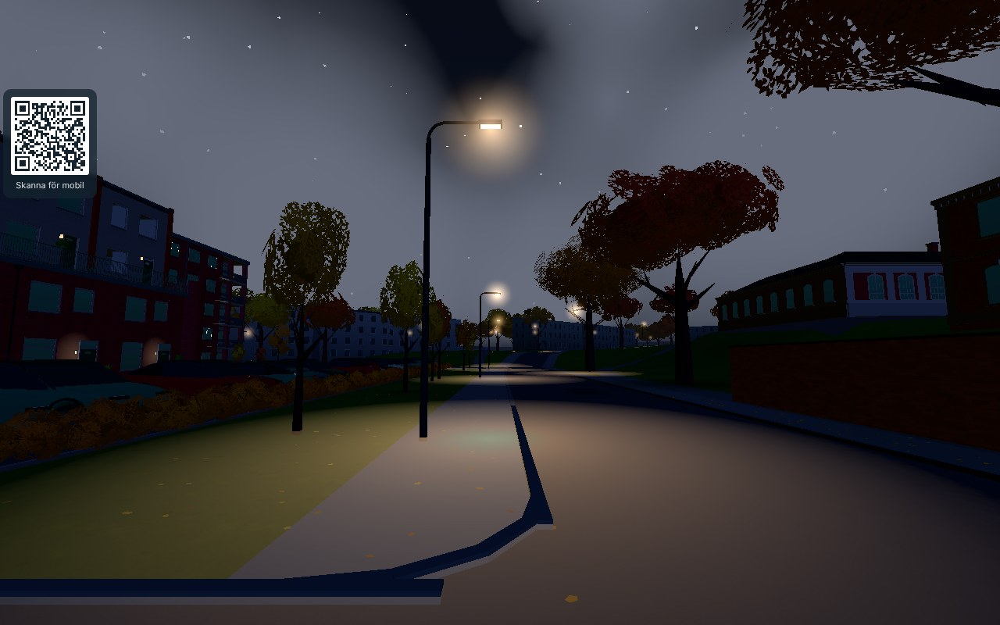
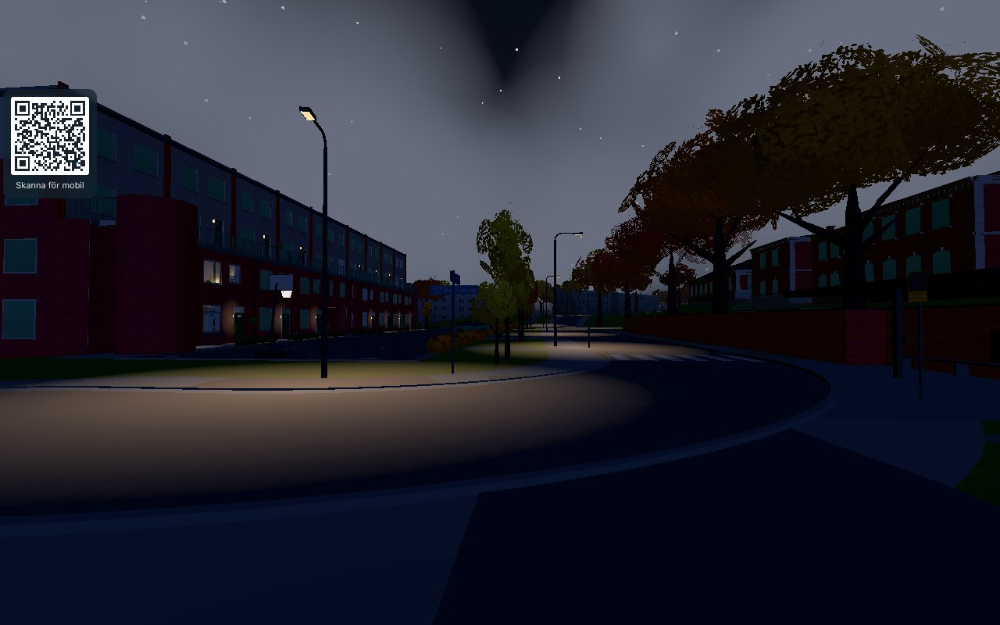
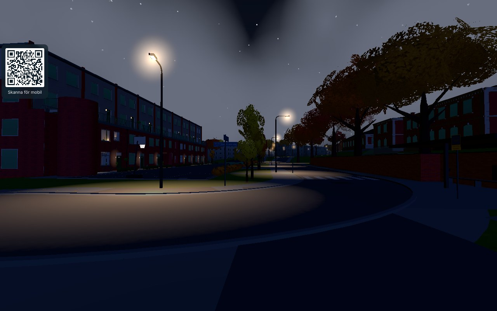
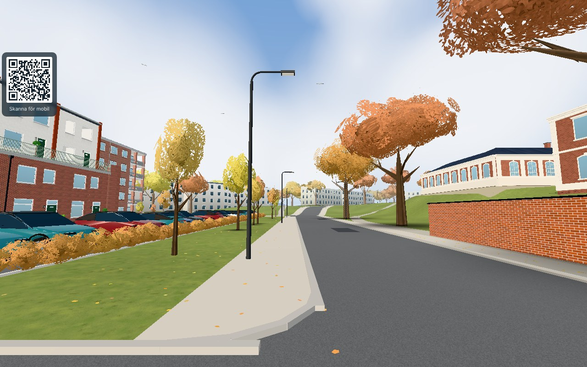

# #2104 Gatlyktor: gloria och ljuspöl

Street, path and road lamps at night: a soft warm halo round each head (`src/lamphalo.js`, one additive billboard mesh
`streetLampHalos`) and a brighter middle in the existing #434 ground pools right under the head (`poolCore`, a little
stronger on a wet street through #2099's shared wetness uniform). No light objects, no lamp-wash patch, no new pass.

Browser: `tools/lamphalo2104browser.cjs` (headless Chromium, SwiftShader, October 22:00 clear / 13:00, frozen weather);
"before" serves base `ef7dac5`'s `config.js`, `street.js` and `groundglow.js`. Node: `node --test tools/lamphalotest.mjs`
(4 pass) and `tools/lampwash2090test.mjs` (2 pass, #2090's idempotent wash unchanged).

| View | Before | After |
|---|---|---|
| Night, near (Sankt Lars väg, looking west) |  |  |
| Night, at a distance (round the corner) |  |  |
| Noon, same as near (halos hidden) |  |  |

Measured (`browser.json`): scene lights 9 → 9 in every view; night draw calls +1 (176 → 177 near, 358 → 359 far),
+384 triangles (192 quads), +1–2 programs (the halo and the pool core programs); textures unchanged (the shared groundglow
fall-off). Noon: 167 → 167 calls, identical triangles, halos and pools hidden (the remaining pixel difference is the
animated sky and wind sway, mean < 1/255). Zero page or shader errors in both phases.

Not checked in the browser: rain (the wet boost is a uniform read checked by the node test), the phone profile (the halo is
one draw of 192 quads at any quality), and the view from a balcony (the above-dimming is by eye in the shader).

Publicering: Pages/Worker success på `01e9dbd`; före-bilder borttagna vid stängning och visas från den commiten.
