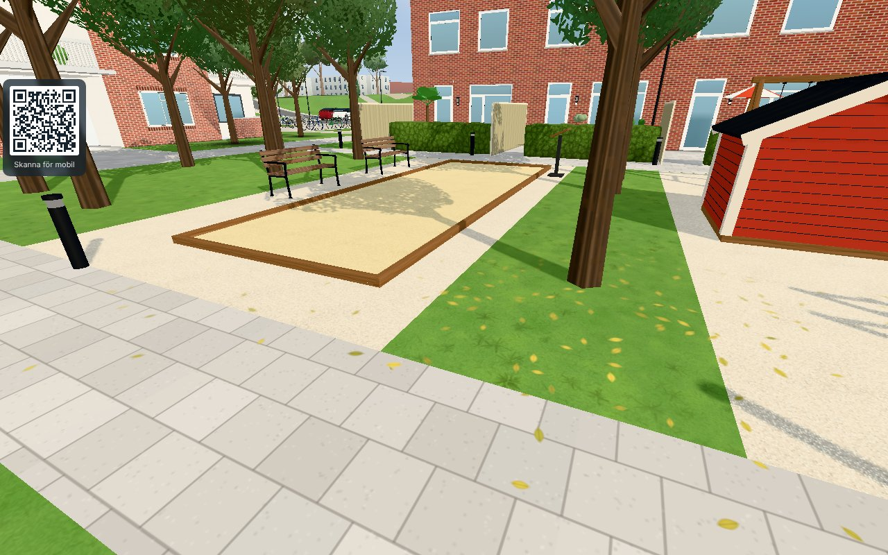
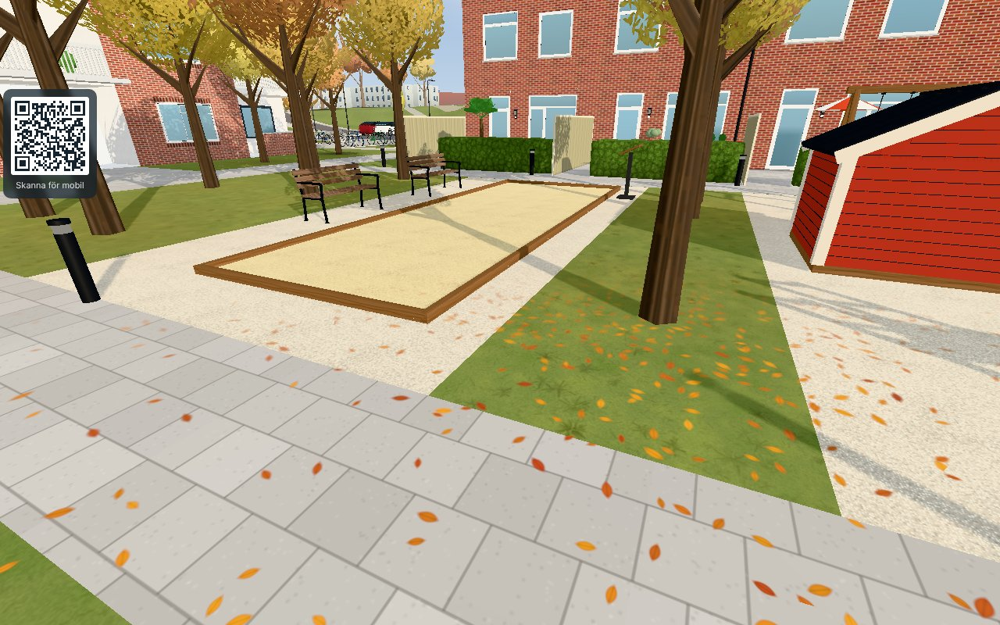
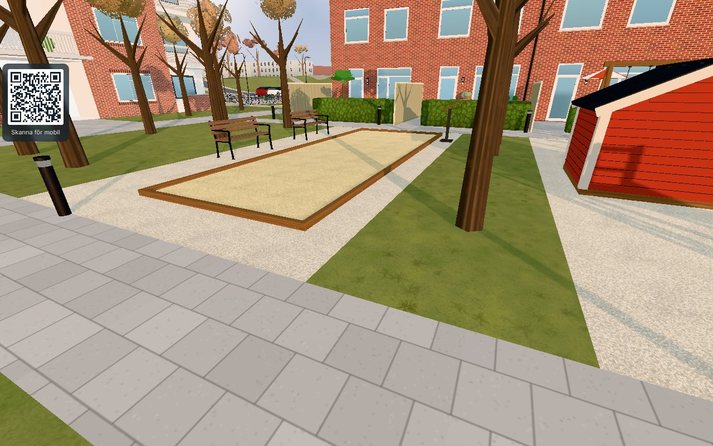
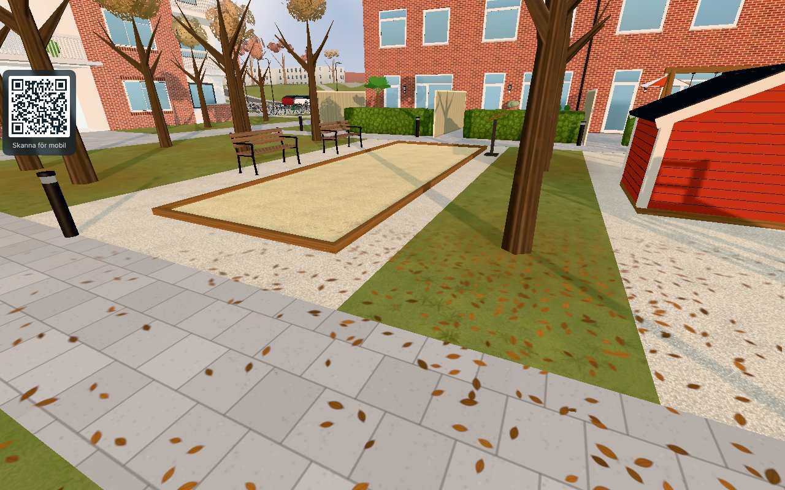
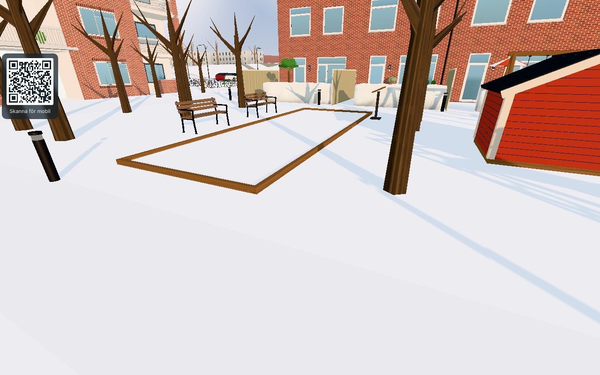
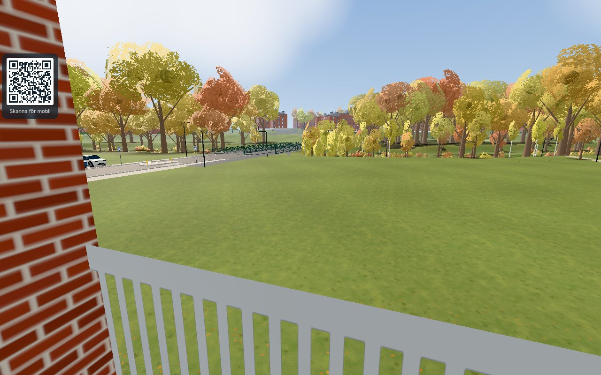
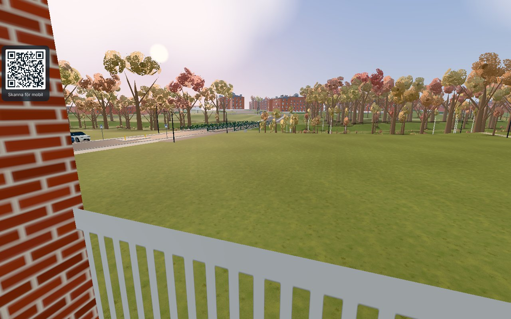
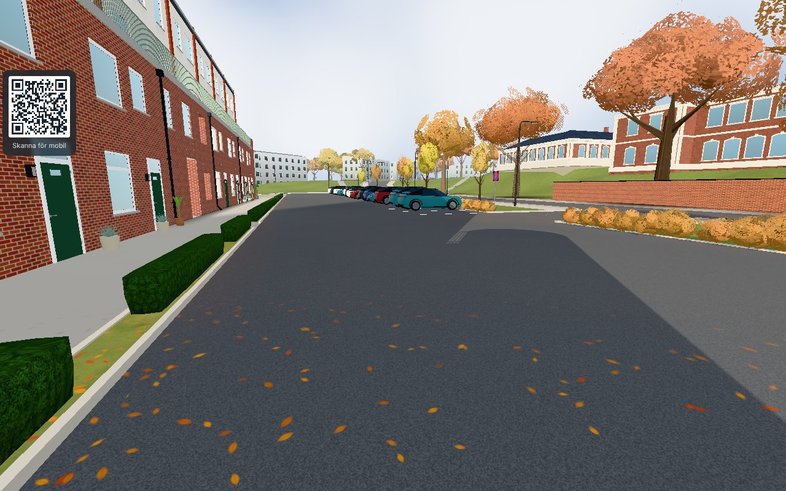
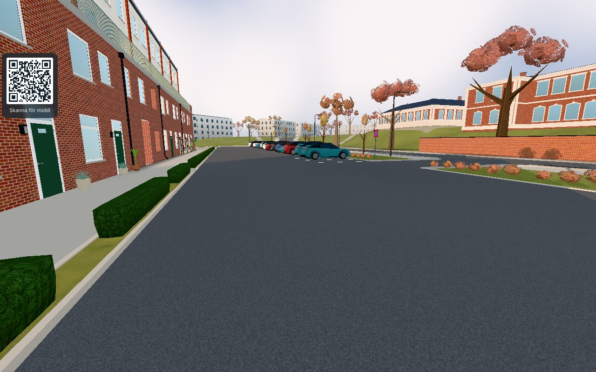

# #2105 – fallen autumn leaves on the ground: before/after

Shared litter state and fragment patch (`src/leaflitter.js`, `LEAF_LITTER`): small procedural leaves in two world-space grids
on the lawns (grass.js, masked off the river bed's mud) and every exposed ground surface that `wetGround` patches (asphalt,
paving, kerbs, gravel, road paint), driven by an R8 density map over WALK (sparse base, more under each site crown, a band
along the local roads' kerbs and the forecourt's outline) and the month (`litterAmount`: Sep 0.2, Oct 0.6, Nov 1; none in
summer, spring and the snow months). The street's instanced pavement leaves thin with the same amount. Actual app,
1280×800 shots via `tools/testkit.cjs` (quality 3, leaf shapes on), SwiftShader: `?shot&at=…&year=2026&month=10&day=20&time=13&freeze&weather=clear`,
month switched in the page with `applySeason` (`tools/leaflitter2105browser.cjs`). Before = `config`, `main`, `grass`,
`wetground` and `street` from fc589f2 served in place of the new ones (`BEFORE_REV`). The before images live under
`before/` until the issue closes.

| View | Before (November) | After |
|---|---|---|
| Courtyard, September | |  |
| Courtyard, October | |  |
| Courtyard, November |  |  |
| Courtyard, January (snow: no leaves) | |  |
| Park lawn, October | |  |
| Park lawn, November |  |  |
| Street (forecourt asphalt, verge), October | |  |
| Street, November |  |  |

Checks
- `node --test tools/leaflittertest.mjs`: 4/4 – amount per month (none Mar–Aug and in the snow months, even if an autumn share
  were configured for one; Sep < Oct < Nov ≤ 1; tones only in season); density map sparse on open ground, densest at a
  trunk and thinning to the crown edge, a band along both kerbs but not across the road, byte-identical on a second bake;
  `LeafLitter` writes the uniforms per month and bakes once (not out of season); the patch is chained outside the wet patch
  so its step runs before the wet darkening, vertex shader native, shared uniforms, unique cache keys per kind and for the
  masked river-bed lawn, patched once, every change behind `uLitter.x > 0`. `wetgroundtest` 3/3 (its cache-key check now
  allows the litter suffix), `grassdetailtest` 6/6.
- Browser (`before.json`, `after.json`): no page or shader errors before (base fc589f2, current main) or after. Draw calls and
  shader programs identical before/after in every view and month; one more texture (the 605×652 R8 density map, ~0.4 MB,
  baked in ~35 ms on the first autumn month). July and January: ground pixels identical (January max difference 0–1;
  July differs only in swaying crowns above the ground line). Changed pixels, September / October / November: courtyard
  1.1 / 6.2 / 7.9 %, park 0.13 / 0.72 / 0.88 %, street 0.5 / 2.3 / 1.9 %. September street triangles 5 600 fewer (the
  instanced pavement leaves thinned to 20 %).

Limits: placement is a *guess* (no survey of where leaves gather); leaves are flat albedo/roughness on the ground (no
relief, no wind drift, they do not move when walked through); the density map covers WALK only; under quality level 0 and
on phones only the mean tint is drawn (verified via the uniform: level 0 in the test profile sets the shape flag to 0,
the quality-3 shot sets it to 1).
