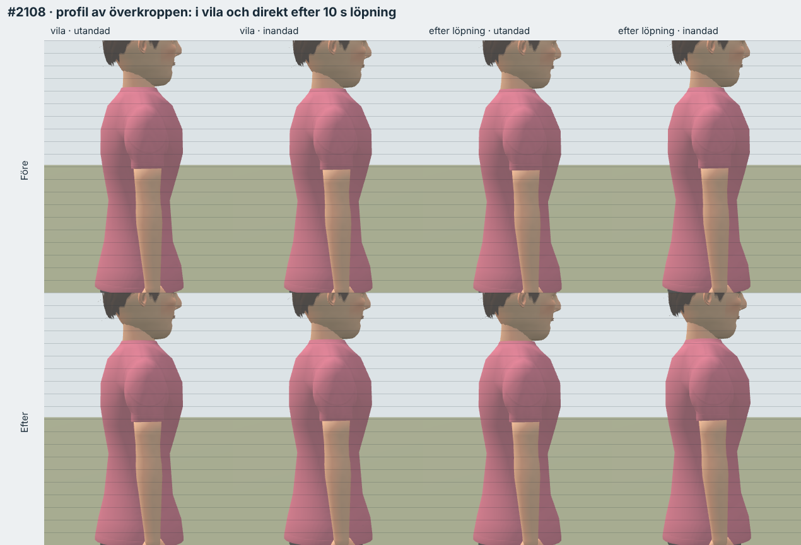
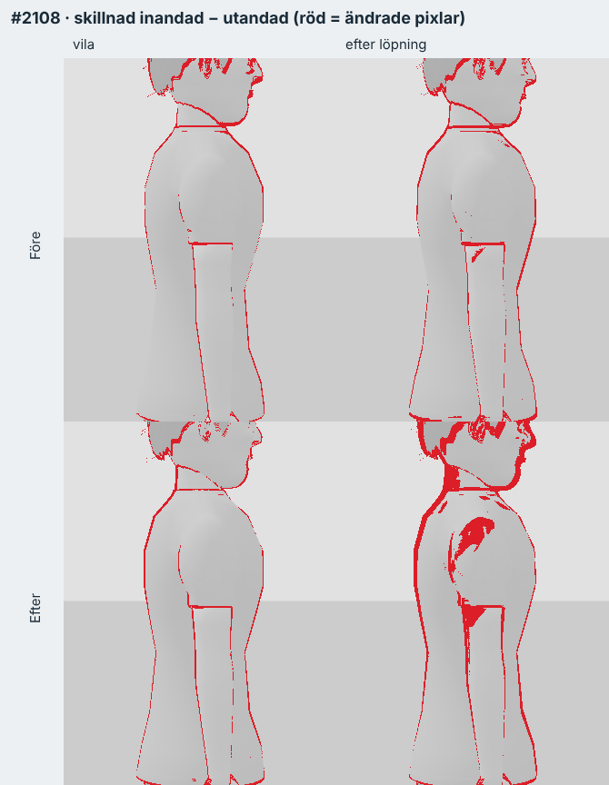

# #2108 — visible breathing

Baseline `33dc86f8`. Before serves that revision's whole source tree as `/before/` (via `git show`); after uses the working
source. Both run the real remote consumer in lockstep (`Ghosts`/`Ghost.push` at 5 Hz → `Ghost.draw` → `Ghost.animate`:
`Avatar.update`, `updateBreath`) with the same breath start (`newBreath(0)`) and #2035's idle off (only the breath differs
between two frames): stand 6 s, run 10 s straight at 4.5 m/s, stand 30 s. Each row is shot at its own breath's exhaled pause
and inhale peak, at rest (2–6 s) and right after the run (17–21 s). Images are native 1200 × 800 renders (four 300 × 400
columns, a profile of the upper body from the figure's left, before on top, after below) with a label strip and a 20 px grid.

## Result

`src/avatarchest.js` maps #2037's own breath (`phase`, and the new `drive` from `stepBreath`) to the chest and belly rising
forwards, both shoulder tops lifting and the upper body straightening slightly back with every inhale; the head keeps its
pitch. `stepBreath`'s new `pant` follows the effort and calms over a few seconds, so the breath is deeper and faster right after
running. No network field, bone, mesh, texture or draw call.

| window | breaths/min before → after | drive | chest / shoulder peak (m) | torso pitch range | head pitch range before = after |
|---|---|---|---|---|---|
| rest 0–6 s (6 s window) | 10 → 10 | 0 | 0.0025 / 0.0012 | 0 → 0.004 | 0.043 |
| running 8–16 s | 52.5 → 52.5 | 1 | 0.011 / 0.009 | 0 → 0.022 | 0.100 |
| just after 16–20 s | 15 → 30 | 0.46 | 0.011 / 0.009 | (gait settling) | 0.126 |
| after 20–26 s | 20 → 30 | 0.14 | 0.0057 / 0.0041 | 0 → 0.011 | 0.046 |
| late 38–46 s | 15 → 15 | 0.003 | 0.0026 / 0.0013 | 0 → 0.004 | 0.060 |

Inhaled − exhaled changed pixels (threshold 24/765): before 2354 (rest) / 3140 (after the run, the old free-running hip
lift and the settling gait); after 2490 / 6951. Zero page, console or shader errors in both phases. Full numbers:
[browser.json](browser.json).

## Checks

1. `node --test tools/avatarchesttest.mjs` — **7/7**: the wave (0 exhaled, 1 at #2037's exhale point, the resting pause,
   continuous across the wrap); at rest 14–16 breaths/min and a few mm, deterministic for the same start; after a 10 s run
   deeper (chest > 2.5×, shoulders > 3× rest) and faster at once, the drive calming monotonically and the depth back near
   rest after 25–30 s; a short dash now clearly speeds the breath (before, #2037's heat alone barely did); a long sprint's heat
   keeps it a little deeper for a minute; zero when gated (diving) or never stepped; the splice compiles into the avatar
   material with one vec3 uniform and the key chain `…-hand2106-seam2107-chest2108`; the real `Avatar.update` moves the uniform
   with the phase and straightens the torso while the head keeps its pitch.
   Unchanged: `avatarbreathtest` (7/7, #2037's rate, flush and puff contracts) and `avatarleantest` (7/7, #2109); the
   whole `tools/*avatar*|rigged|ghost|olof|idle|gait|motion*.mjs` set passes except four failures that fail identically on the
   baseline (#2002 hairstyle resources, #2012 hair triangles, #2063 globe, the rig source contract).
2. `THREE_DIR=… node tools/avatarchest2108browser.cjs http://127.0.0.1:8308 docs/verification/2108 33dc86f8` — the frames,
   difference image and table above.

## Cost and limits

One vec3 uniform and a guarded vertex snippet (three Gaussians on ~5 k vertices, skipped while the uniform is zero); no texture,
draw call, bone or network change; the head boxes and CPU raycasts keep the plain body (the box follows the head bone, which
moves under 1 cm with the lean). `Ghost.animate` 11–13 µs after vs 11–14 µs before standing (noise). The mirror preview (#1994)
and fixed-pose measurements do not step a breath and stay as before; far figures (#1966) do not pose. Limits: amplitudes and
timings are *guesses* by eye, not measured; the chest moves only on the body's front (no rib flare at the sides or back); hair
lying on the shoulders follows the same field, a figure with crossed arms (#2035) can push its chest up to about 1 cm into them.
