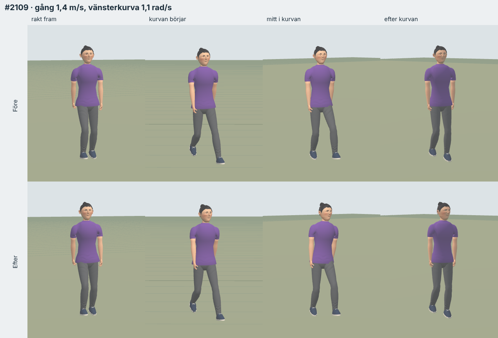
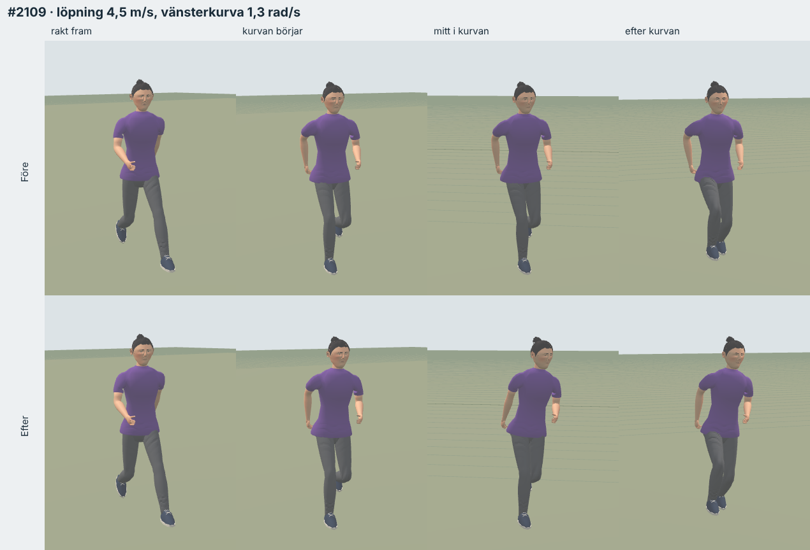

# #2109 — head leads into turns, torso follows, inward lean

Baseline `81bba3b2`. Before serves that revision's whole source tree as `/before/` (via `git show`); after uses the working
source. Both run the real remote consumer in lockstep (`Ghosts`/`Ghost.push` at 5 Hz → `Ghost.draw` → `Avatar.update` →
`transitionPose` → `poseOlof`) along one path: walk straight, a left curve walking (1.4 m/s, 1.1 rad/s), straight, run straight,
a left curve running (4.5 m/s, 1.3 rad/s), straight. Images are native 1200 × 800 renders (four 300 × 400 columns, before on top,
after below) with a label strip; camera ahead of and slightly beside the figure, following its heading.

## Result

`src/avatarlean.js` derives everything from the rendered body's yaw rate, ground speed and the gait's own hip bounce / sway
(no network field). The head turns quickly a little into the turn, the torso less and later (it follows), and in fast curves
the body leans slightly inwards: hips over the planted feet, pelvis, torso and a partly righted head. While running the head
pitches against the hip bounce and the shoulders tilt back against the side sway. All terms are bounded and decay to zero after
the turn; straight walking/running gives zero turn terms.

| | walk curve (mean, rad) | run curve (mean, rad) |
|---|---|---|
| head yaw vs body, before → after | 0.119 → 0.355 | 0.126 → 0.377 |
| torso yaw vs body | 0 → 0.099 | 0 → 0.092 |
| torso roll inwards | 0 → 0.055 (3°) | 0 → 0.140 (8°, the bound) |
| planted-foot slip per contact frame (m) | 0.00497 → 0.00497 | 0.01165 → 0.01165 |

Straight walking/running: head / torso yaw and roll within 0.004 rad of before; foot slip identical. (The "before" head yaw in a
curve is the existing body-lags-the-view effect of `Ghost.body`; the new lead comes on top.) Zero page / console errors in both
phases. Full numbers: [browser.json](browser.json).

## Checks

1. `node --test tools/avatarleantest.mjs` — **7/7**: zero turn terms when straight; left turn head leads, torso lags (later and
   less) and the body leans left, a right turn mirrors exactly; lean a share of atan(v·ω/g), small walking, larger running, never
   past `AVATAR_LEAN` bounds; decays after the turn, nothing when turning on the spot (#2004 owns that) or off the ground; a teleport
   / long gap is no turn; head pitch follows the bounce, counter-roll against the sway; the real `Avatar.update` on a curve turns
   the head bone ahead of the torso bone, `noLean` leaves the rig unchanged.
   Unchanged neighbours: `avatarmotiontest`, `avatargaittest`, `avatarfootiktest`, `avataridletest`, `avatargazetest`,
   `avatarswaytest` (35/35), `avatarcustomizertest` (25/25, mirror preview #1994), `avatarselfviewtest`, `avatarhittest`,
   `avatartalktest`, `avatarhandtest`.
2. `THREE_DIR=… node tools/avatarlean2109browser.cjs http://127.0.0.1:8309 docs/verification/2109 81bba3b2` — the frame strips
   and table above.

## Cost and limits

No mesh, texture, draw call, shader or network change; the head boxes (`rifleBoxPose`) are analytic and unchanged; the far figure
(#1966) does not pose. `stepLean` ≈ 0.14 µs per avatar and frame in node; `Ghost.animate` 16–24 µs after vs 16–38 µs before in
the browser (noise). Limits: values are *guesses* by eye, not measured; the stabilisation is rotational only (the head's
vertical bounce itself is not reduced, the 15-bone rig has no neck to absorb it); with a #2011 gaze target the lead adds to the
gaze's head share (bounded by both limits).

Publicering: Pages/Worker success på `c1309fa`; bild-URL:er HTTP 200 före stängning.
