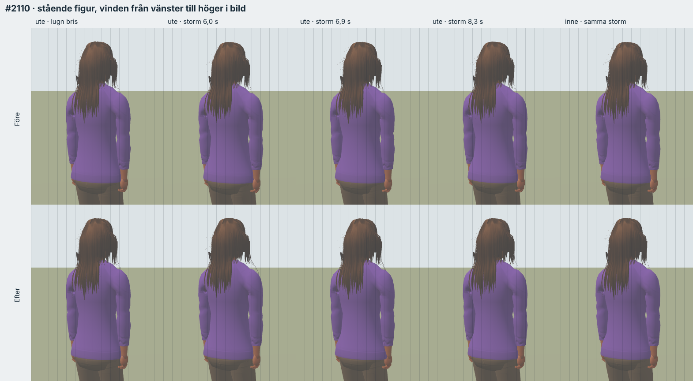
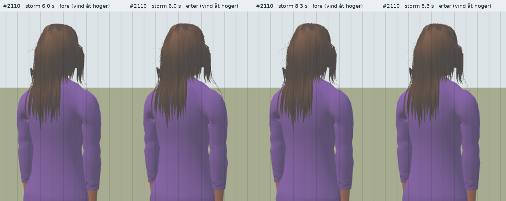
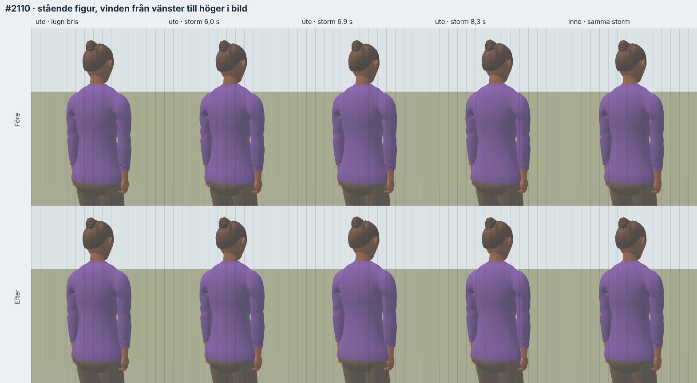

# #2110 — wind in the hair and hem outdoors

Baseline `25639322`. Before serves that revision's source tree as `/before/` (via `git show`); after uses the working source. Both
run the real remote consumer side by side (`Ghosts`/`Ghost.push` at 5 Hz → `Ghost.draw` → `Ghost.animate`: `updateWeather(wetEnv.outdoorAt)`,
`Avatar.update` → `updateSway`), each module with its own `siteWind` / `wetEnv`, a standing figure per condition (#2035's idle off):
outdoors in a calm clear breeze (`SITE_WIND.calm` = 0.12), outdoors in a storm (power 1) and indoors in the same storm. Images are
native 1500 × 800 renders (five 300 × 400 columns, before on top, after below) from the side across the wind (the wind blows to the
right in the image), with a label strip and a 20 px grid. `storm-detail.png` is a 2× crop of the storm columns of `long-hair.png`.

## Result

`src/avatarwind.js` turns #2101's site wind (`siteWindOffset`: gusts, side sway, flutter) into a target per #2014 spring (hair, bun,
hem) in the bone's own frame; the springs swing round it with their own damping and walls. Indoors the push fades to exactly zero.

| spring peak (m), t > 2 s | calm before → after | storm before → after | indoor storm before → after |
|---|---|---|---|
| long hair | 0.0001 → 0.0042 | 0.0001 → 0.035 | 0.0001 → 0.0001 |
| bun | 0 → 0.0012 | 0 → 0.0095 | 0 → 0 |
| hem | 0 → 0.0028 | 0 → 0.0227 | 0 → 0 |

(0.0001: #2014's own tiny motion of a standing figure, unchanged.) Changed pixels, long hair, storm 6.0 s vs calm: before 709 (#2108's
breath and blinks only), after 2050. Indoors after = before. Zero page, console or shader errors in both phases and both looks; render
calls unchanged (2 per view). Cost: about 1 µs per outdoor avatar and frame in node for `stepWind` + `stepSway` (0.08 µs indoors); the
browser's `Ghost.animate` medians (≈18–30 µs under SwiftShader) are within run-to-run noise. No uniform, texture, mesh, draw call or
network field added. Full numbers: [browser.json](browser.json).

## Checks

- `node --test tools/avatarwindtest.mjs` — 7/7 (zero indoors and still air, weather scaling, bounds at 1/144–0.2 s steps, downwind for
  any heading, irregular peaks, door fade, #2014's motion still adds); `node --test tools/avatarswaytest.mjs` 5/5.
- `THREE_DIR=… node tools/avatarwind2110browser.cjs http://127.0.0.1:8310 docs/verification/2110 25639322`.

## Limits

The hem flare is small (≤ 2.3 cm) and mostly seen at the sweater's lower edge; the mirror preview (static, no outdoor flag) shows
no wind by design. Lift raises the hair curtain up to ~1.2 cm in strong gusts.
