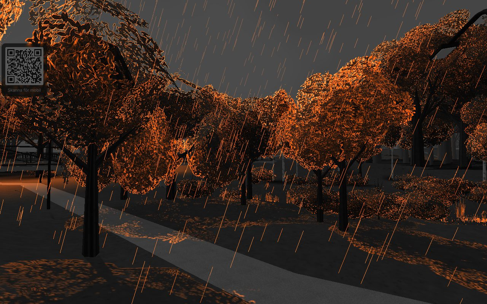
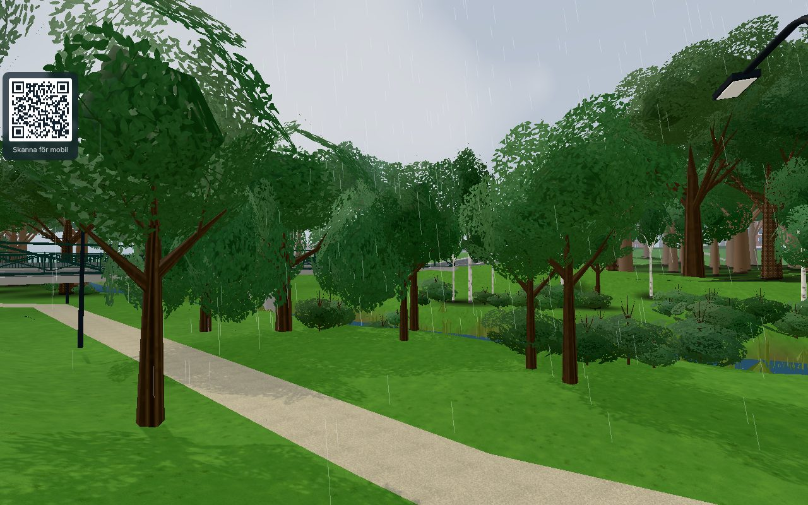
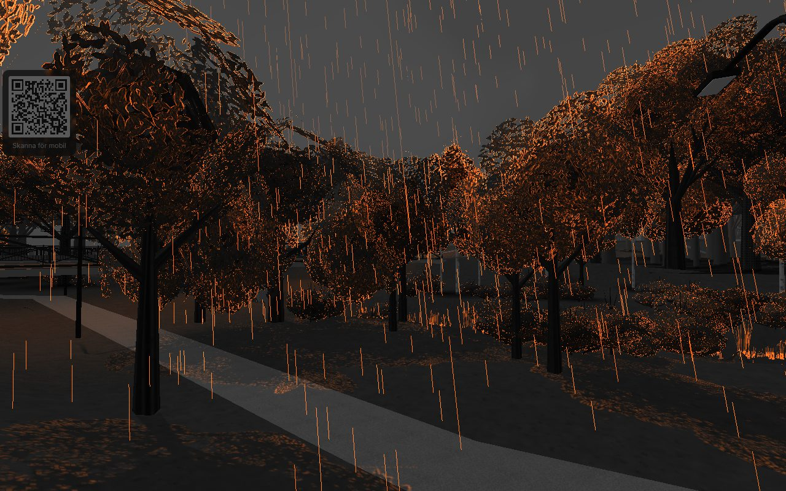
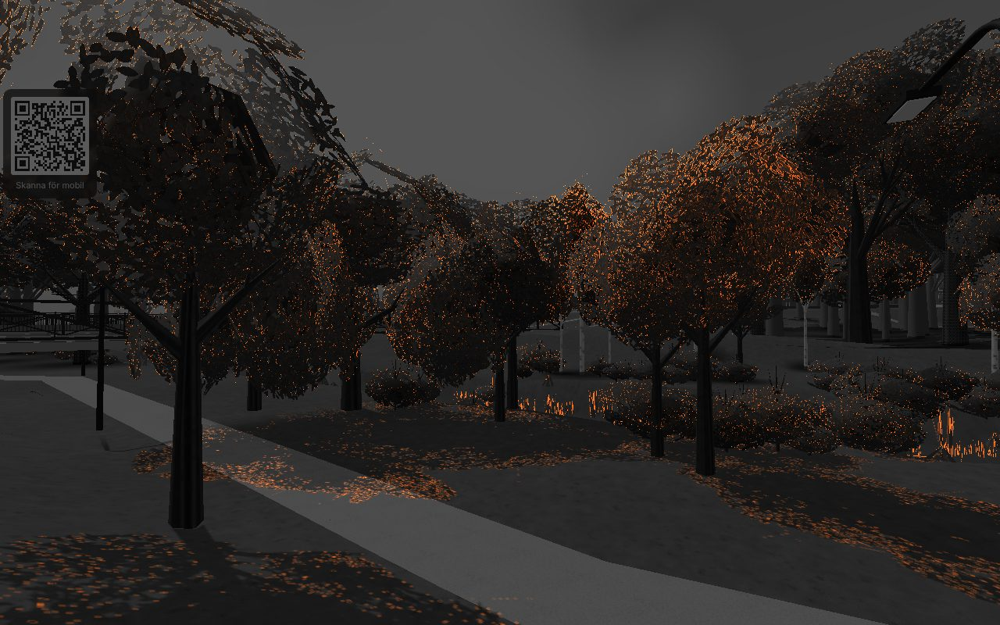
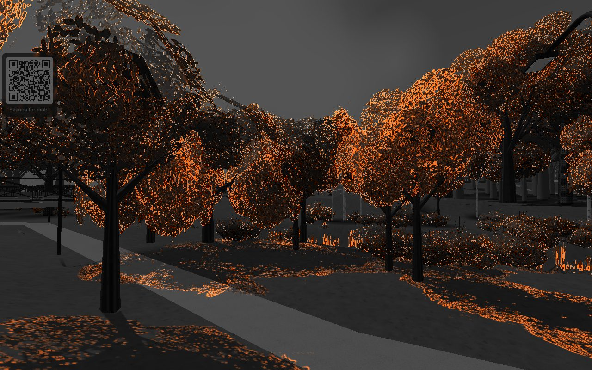
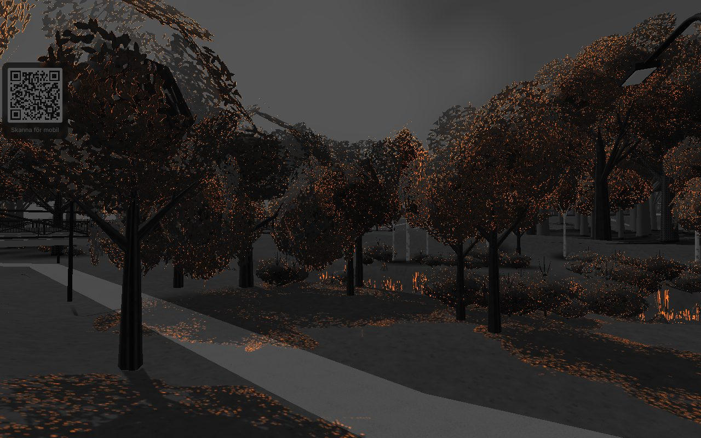

# #2117 — the wind follows the real weather

Baseline `8ea1e4a5` (the windy view re-shot against `dd9088d0`). `tools/wind2117browser.cjs` loads the real game twice (before = the baseline's `config.js`, `realweather.js`,
`weather.js`, `sitewind.js`, `cloudshadow.js`, `daycycle.js`; after = the working tree) with a hand-made Open-Meteo fixture for June 2024
(served as `&weatherapi=/tools/fixtures/wind2117-2024-06.json`, **not real data, no live request**) and shows the river-park trees at three
weathers: a windy hour (12 June 12:00, 12 m/s from 250°, light rain), a calm hour (5 June 12:00, 0.8 m/s from 90°) and a future day
(10 June 2027 12:00, no data: the seeded draw). Only the sway clock is held (`siteWind.hold`, two times 0.8 s and 2.3 s); power and
direction come from the weather. Images are native 1280 × 800 renders (JPEG). A motion image is the per-pixel difference of the two
clock times, amplified in orange over the dimmed frame (rain streaks are respawned at random, so they show in every rainy diff).

## Result

| condition | weather wind (after) | sway power before → after | sway direction before → after (x, z downwind) | rain slant after (m/m) | cloud drift after (m/s) | motion mean \|Δ\| / changed px before → after |
|---|---|---|---|---|---|---|
| windy (real) | 12.0 m/s from 250° | 0.39 → 0.76 | (0.71, −0.71) → (0.94, −0.34) | (0.34, −0.12) | (18.0, −6.6) | 3.21 / 5.6 % → 5.01 / 10.3 % |
| calm (real) | 0.8 m/s from 90° | 0.12 → 0.08 | (0.71, −0.71) → (−1, 0) | (−0.02, 0) | (−1.3, 0) | 1.17 / 2.0 % → 1.13 / 2.1 % |
| future (draw) | 3.6 m/s from 207° | 0.12 → 0.31 | (0.71, −0.71) → (0.46, −0.89) | (0.05, −0.10) | (2.6, −5.1) | 1.17 / 2.0 % → 3.78 / 7.9 % |

Before, the power came from cloud/rain (a rainy hour 0.39, any dry hour 0.12) and the direction was fixed; the rain slanted a fixed 0.12
towards −x and the cloud shadows drifted 5 m/s towards −x. After, all four follow the same weather wind. Zero page, console or shader
errors in both phases. Full numbers: [browser.json](browser.json).

Windy hour, after (rain slants downwind, east-north-east) and its motion image:

Before, same hour:  

Calm hour after / before:   ([frame](calm.jpg))

Future day (the draw) after / before:   ([frame](future.jpg))

Review fix: above power 0.6 `windPower` now saturates softly towards 0.8 (12 m/s: 0.93 → 0.76; ≤ ~7.5 m/s unchanged) and the
per-card flutter stops growing above power 0.6 (`SITE_WIND.crown.flutterCap`), so a gale reads as a strong gust. The windy view was
re-shot on `dd9088d0` with the same fixture. The streaked, edge-on-looking leaf cards at the top left of the nearest crown are **not
wind**: they are already in the before image (power 0.39) and in #2101's calm image ([park-calm.jpg](../2101/park-calm.jpg), near-zero sway) — a
pre-existing close-range leaf-card look, worth its own bug issue.

## Checks

- `node --test tools/windsimtest.mjs` — 8/8: Open-Meteo wind in parse / pack / unpack and km/h → m/s, a response without wind, a v1
  cache entry served at once and fetched once more for its wind (stored as v2, not fetched again), the vector blend between hours;
  the draw deterministic, 53 % from south-west–west (190–295°), 23 % easterly, monthly means 5.4 (Jan) … 3.3 (Aug) m/s, median 4.0,
  99 % 9.5 m/s, ≤ 0.6 m/s change per 6 min, + 2 m/s rain, + 6 m/s storm; the real ↔ draw fade over `WEATHER.climate.fade`; directions
  (west wind → +x, north wind → +z); rain streaks slant / snow drifts downwind and scale with the speed (4 m/s ≈ the old 0.12); the cloud
  pattern moves downwind at the expected speed and keeps its direction in a calm; SiteWind turns the short way, eases, `&wind=` pins power.
- `node --test tools/sitewindtest.mjs tools/cloudshadowtest.mjs tools/avatarwindtest.mjs tools/aerialhazetest.mjs` — all pass.
- `THREE_DIR=… BASE_REV=8ea1e4a5 node tools/wind2117browser.cjs (windy re-shot with CONDITIONS=windy BASE_REV=dd9088d0) http://127.0.0.1:8317 OUT` — the table above.
- `tools/weathertest.html` got the fixture's wind checks (m/s request, the windy/calm hours) but was not run (it is excluded from the
  routine runs, see verification.md).

## Cost and limits

`simWind` is about 1 µs per call in node (one call per frame); `at()` adds two array reads and a blend; the rain update rewrites the
streak bottoms it already touched; SiteWind's direction is the existing uniform vector. No new draw call, texture, uniform or request
(the same month request asks for two more variables; the cache entry grows by ~7 KB). Cloud shadows are off at the test quality level,
so their drift was verified in node only. The renderer counts in browser.json come from the previous lazy frame (0 on the first one).
**Not verified against the live Open-Meteo service** (no egress from the cloud session): the variable names and `wind_speed_unit=ms`
follow its documentation. The draw's climate numbers are *guesses* (`WIND` in config.js). Hail is not slanted.

Publicering: Pages/Worker success på `7430fd6`; före-bilder borttagna vid stängning och visas från den commiten.
