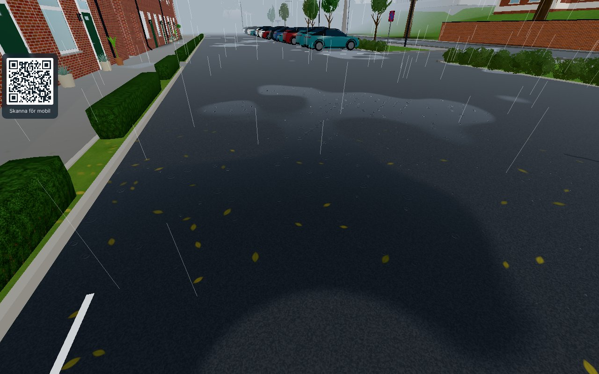
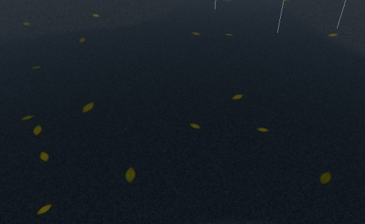
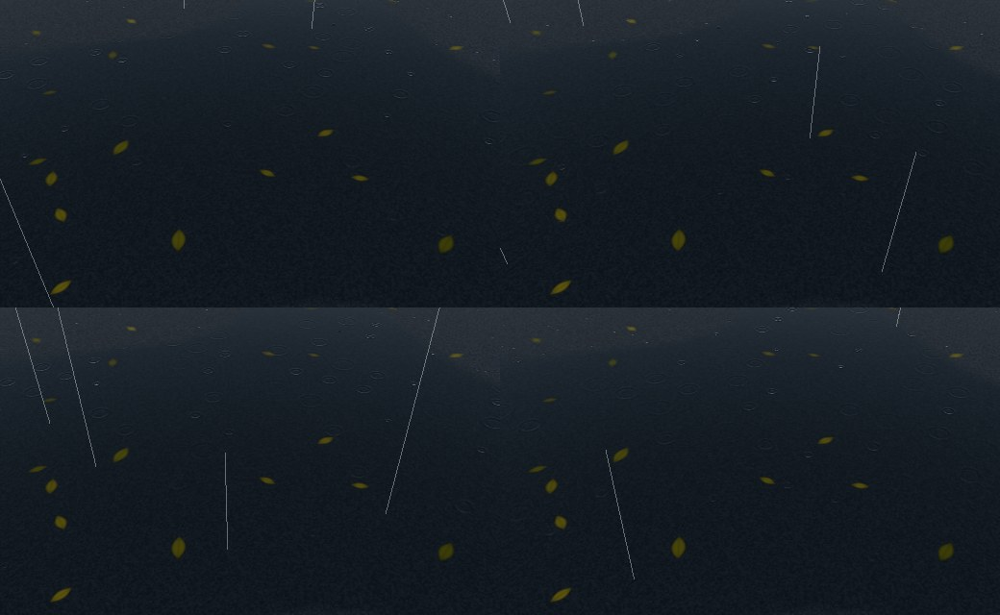
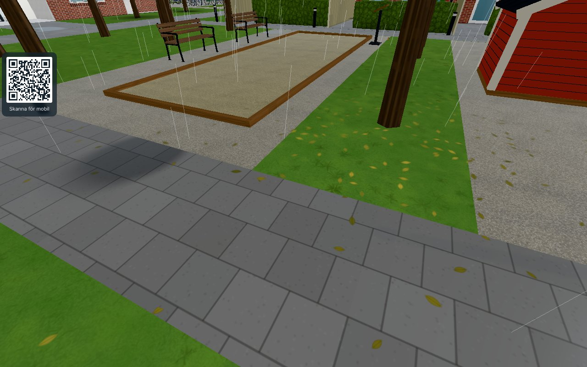
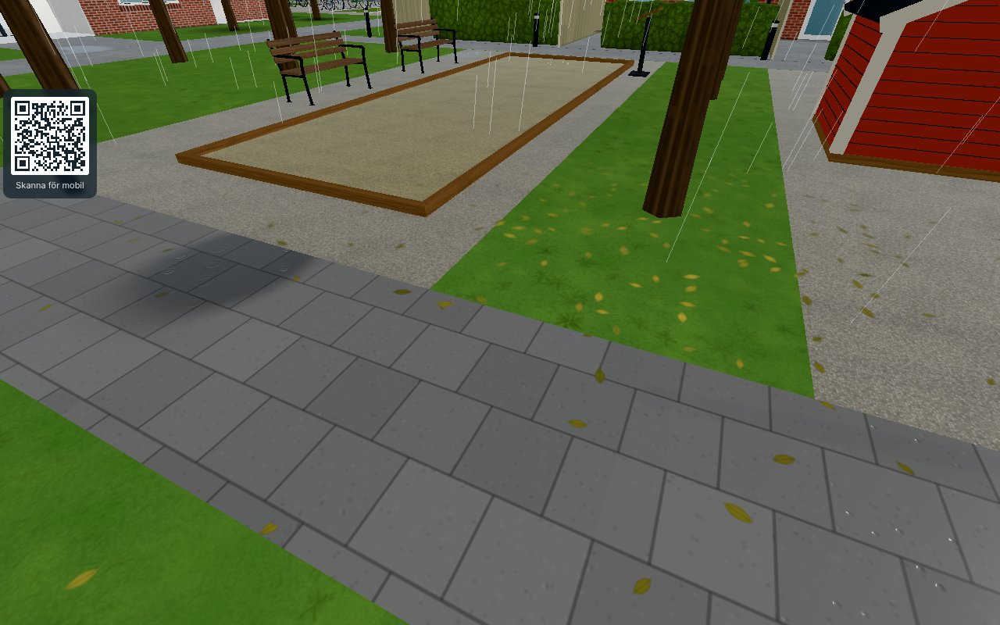
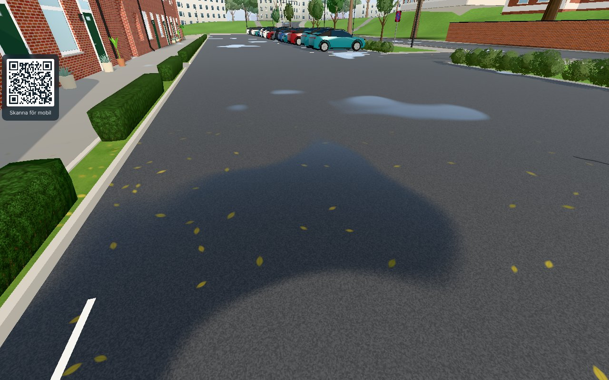

# #2119 – rain rings in the puddles and splash glitter on the wet ground: before/after

`src/wetground.js` (`rippleStep`, `rippleGLSL`, `RAIN_RIPPLES` in config.js, all *guess*): while it rains, `uGroundWet.z` carries the
live rain (eased, 0 after the shower) and the desktop ground shaders bend the normal with expanding drop rings in #2099's puddles and
a faint flash of small splashes on the wet asphalt/paving film, fading out with view distance. Not compiled into the phone profile's
`-lite` shaders (#2118); off with the `puddles` quality knob. Actual app, 1280×800, quality 3, SwiftShader:
`?shot&at=…&year=2026&month=9&day=25&time=10.5&freeze&weather=rain` (raining, after 6 s of real time) or without `&weather`
(after the seeded morning shower: puddles, no rain). Before = config/main/wetground from dd9088d0 served in place of the new ones
(`tools/rainripples2119browser.cjs`, `BEFORE_REV`).

| View | Before | After |
|---|---|---|
| Street near, raining |  |  |
| Puddle detail, raining (after: four frames ~0.6 s apart) |  |  |
| Courtyard near, raining (puddle left, splashes on the paving right) |  |  |
| Street near, after the rain (no rings) | – |  |

Sequence frames: [0](rain-street-0.jpg) · [1](rain-street-1.jpg) · [2](rain-street-2.jpg) · [3](rain-street-3.jpg).

Checks
- `node --test tools/rainripplestest.mjs`: 4/4 – `rippleStep` follows rain only (not hail/snow), eases in/out and reaches exactly 0
  after the shower, 0 at once with puddles off / snow month; `GroundWetness.update(dt)` writes z only while raining, keeps the
  puddles but zero rings after the rain, runs `uWetTime` on real seconds; GLSL: rings only weighted by the puddle mask, splashes
  only by (1 − puddle), everything behind `uGroundWet.z > 0 && wetW > 0`, no ring code in any `-lite` variant or in road paint,
  #2099's film/puddle/sky steps unchanged, desktop and lite keys unique per kind; ring profile bounded, inside its cell, flat
  before/after. Existing `wetgroundtest`, `phonegroundlite2118test`, `streetweartest`, `leaflittertest`: green (19/19 with the new file).
- Browser (`browser-before.json`, `browser-after.json`): no page or shader errors. Draw calls, triangles, textures and programs equal
  before/after in every view (street 197 calls / 99 programs raining, courtyard 170–171 / 89–90). After the rain (uGroundWet.z = 0)
  the ground is pixel-identical before/after; the only differing pixels are wind-swayed foliage and a car at the top of the frame.
- Cost: no new draws, textures, lights, passes or programs; one extra float uniform per frame. Per wet ground pixel while it rains
  and within 22 m: two ring cells (a few hashes, one exp/sin/cos) in puddles, one splash cell within 9 m on the film. Dry and after
  rain: one uniform branch. Phones: no code.

Limits: drop density and ring size are visual guesses; rings are faint at steep view angles (low Fresnel), as on real puddles. Rings
are per-cell (two grids), not physically overlapping waves. Not measured on the Surface Pro.

Publicering: Pages/Worker success på `e30ed6f`; före-bilder borttagna vid stängning och visas från den commiten.
