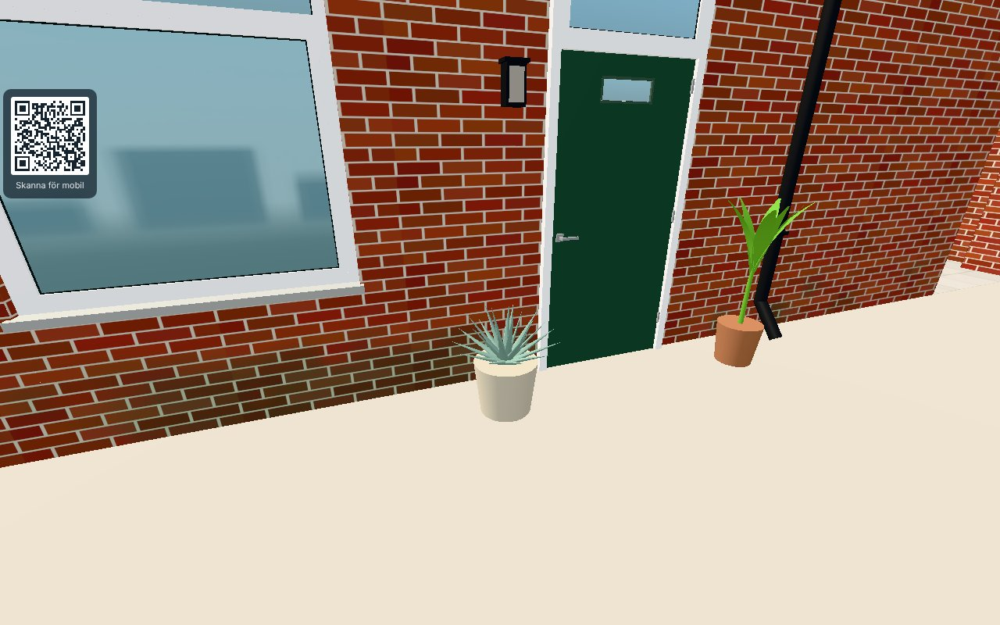
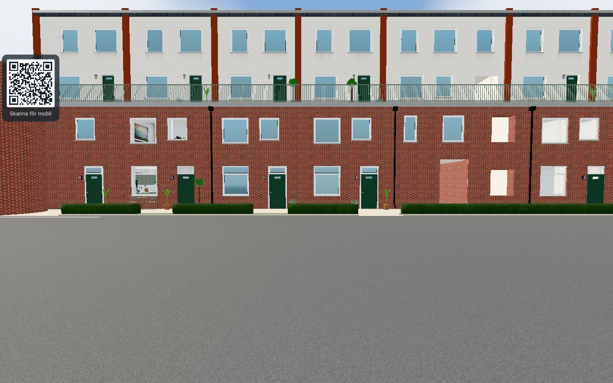
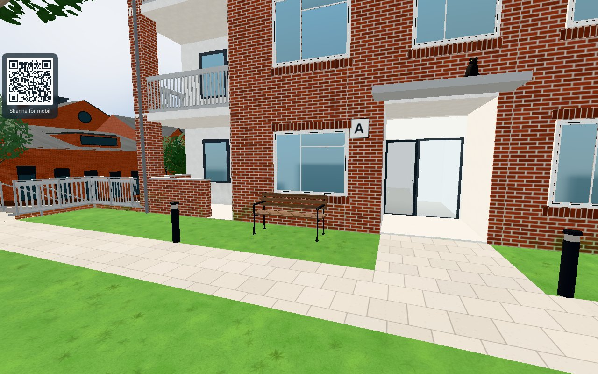
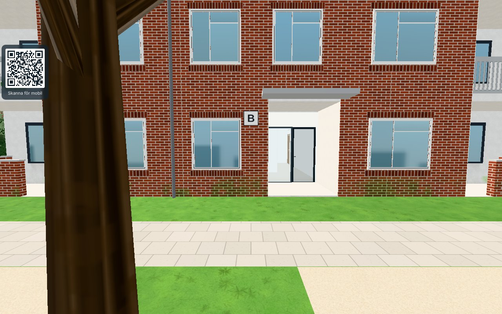
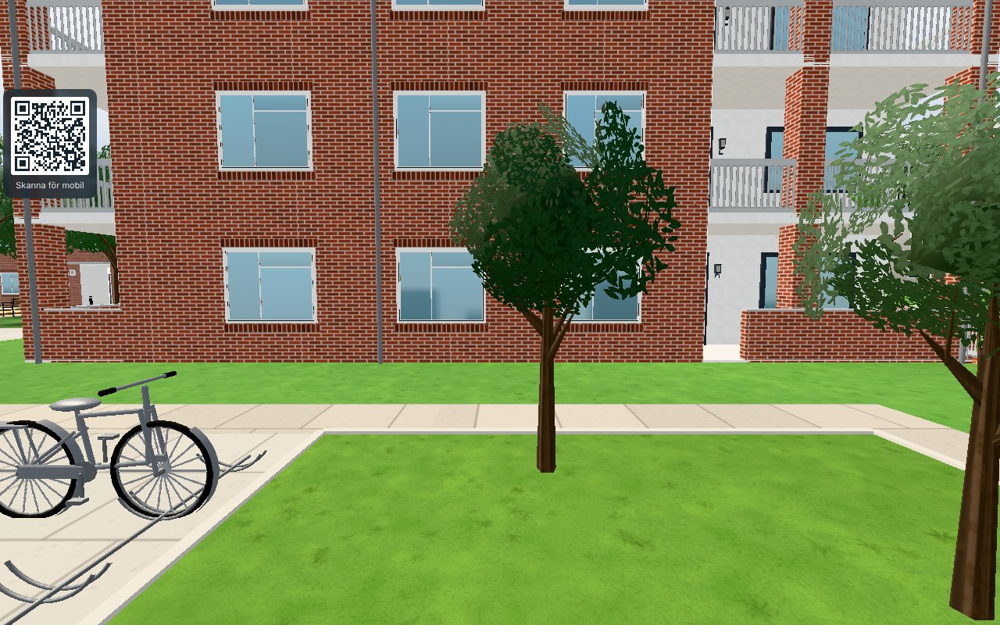

# #2122 — diskret mossa och alger nertill på skuggiga norrsidor

Bas `7dced376` (origin/main). "Före" serverar basens versioner av de ändrade modulerna (`config.js`, `exterior.js`,
`surroundings.js`); "efter" kör arbetskopian. Riktiga appen (`?test`, juli, klart väder, fryst klocka kl 13), samma kamera
före/efter, native 1280×800 (`kit.shot`), JPEG utan beskärning. Före-bilder i [before/](before/). Skript:
`tools/shademoss2122browser.cjs`, rådata: [browser.json](browser.json), telefon (`&lowmem`): [browser-phone.json](browser-phone.json).

## Resultat

`src/shademoss.js` (`SHADE_MOSS` i `config.js`, *guess*): en fragmentpatch kedjad på väggbatcharna styrd av världsnormalen
(norr = −z), höjd över marken framför ytan (ett bakat värde per vertex) och världsbrus: fläckvis grön ton i ett ojämnt band
upp till ~0,6 m och tunnare, mörkare grönt i fogarna upp till 1,3 m. Inget på syd-, öst- eller västsidor eller ovansidor.
Tonen följer ytans egen luminans, så medeltonen står kvar.

| Vy | Före | Efter |
|---|---|---|
| Hus L norrfasad nära (tegel, fogar) |  |  |
| Hus L från gatan (avstånd) |  |  |
| Hus A norrsida från gården |  |  |
| Hus B norrsida |  |  |
| Hus C norrsida |  |  |

Telefonprofil (`&lowmem`), Hus B: [husB-nord-telefon.jpg](husB-nord-telefon.jpg) — ingen mossa, inget nytt program.

Medelton i bild över fasadytan (RGB-summa, före → efter): Hus L nära −0,49 %, Hus A −0,08 %, Hus B −0,33 %, Hus C −0,28 %.

**Granskningsrättelse:** fogarna i mossbandet blev ljust limegröna i första versionen (ljust murbruk × mättad ton). Nu är
tonen en dämpad oliv-/gröngrå (`hue` med ungefär halverad mättnad) och fogarna mörkare än bandet (`joints.dark` 0,6,
`joints.amount` 0,4). Hus L nära och Hus B är omtagna efter rättelsen ([browser-retint.json](browser-retint.json): inga fel,
6 mossiga meshar efter att Hus L:s puts togs bort); Hus L gata, Hus A och Hus C visar den första, mer mättade tonen (på avstånd
knappt synlig).

## Kontroller

- `node --test tools/shademosstest.mjs` (6/6): bara norrvända, låga ytor (syd/öst/väst/ovansida/högt upp = 0); fläckvis, avtar
  uppåt, grönare i fogar; deterministiskt; medelton ±2 % för 3 m och 9 m tegelfasad och vit puts (plint ensam < 5 %); höjder
  bakas mot marken utanför ytan, positioner orörda; kedjan delegerar, en kopia, unik nyckel, fragmentregistrerad (ingen
  vertexförflyttning); telefon = no-op; inkopplad i rätt batcher.
- Browser båda faserna: inga sidfel; 5018 meshar båda; 7 mossiga meshar efter (Hus L tegel, Hus L puts, Å-husens tegel,
  vit puts, plintar, stödmurar, parktrappan). Program +3–4 per vy. Draws/trianglar/texturer +1/+1228/+1 i varje vy även
  där ingen ändrad mesh syns: inte från mossan (inga nya meshar/texturer); troligen tidsberoende scen (katt/vind skiljer sig
  mellan körningarna, se Hus C:s träd). Efter körningen togs Hus L:s puts bort ur patchen (alla dess vertexar ≥ 6,4 m över
  gatan, aldrig mossa) — ett program mindre än i browser.json.
- Telefon (`&lowmem`): 0 mossiga meshar, inga fel.

## Hus som kontrollerats

- **Hus L:** norrfasadens tegel (gatusidan) påverkas; putsen på övre våningarna ligger för högt — ej tillämpligt; syd/gård: inget.
- **Hus A, B, C:** de delade tegelfasaderna (samma batch), plintar och vit puts: norrsidorna får mossa nertill, övriga sidor inget.

## Begränsningar

Låga tak och bänkfundament ingår inte (ingen skugginformation; bara väggbatcherna ovan), inte heller vågräta plattkanter.
"Skugga" = norrläge, inte faktisk skuggning från grannhus. Ingen FPS-mätning.

Publicering: Pages/Worker success på `c609309`; före-bilder borttagna vid stängning och visas från den commiten.
