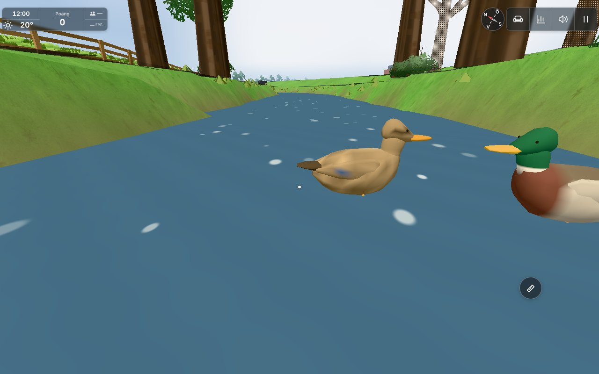
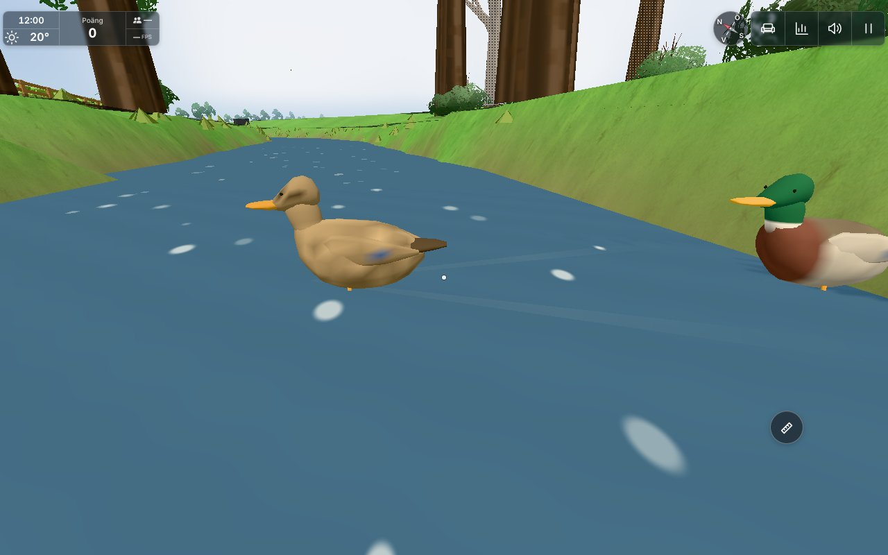
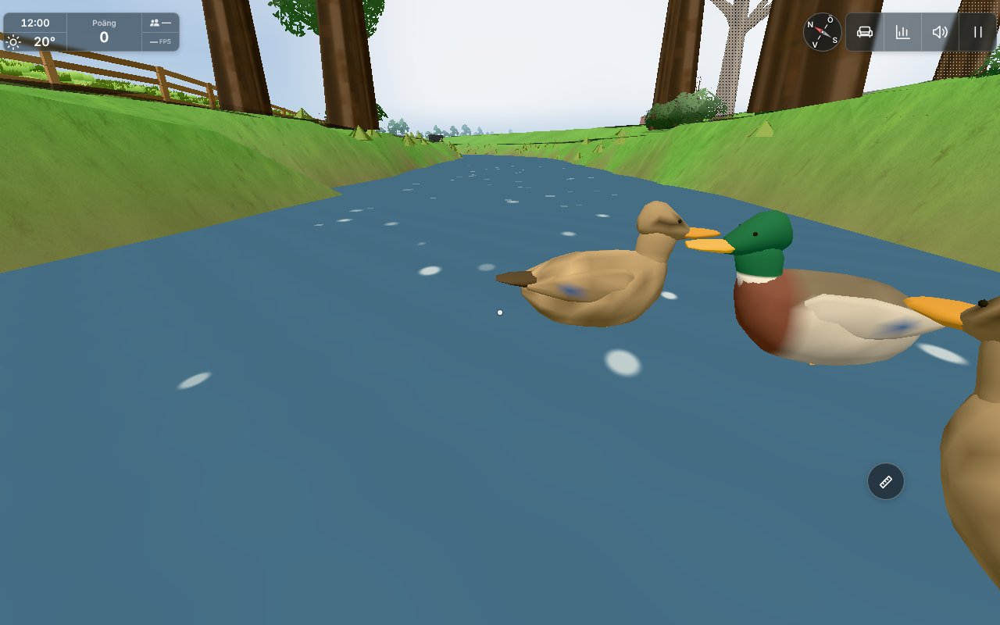
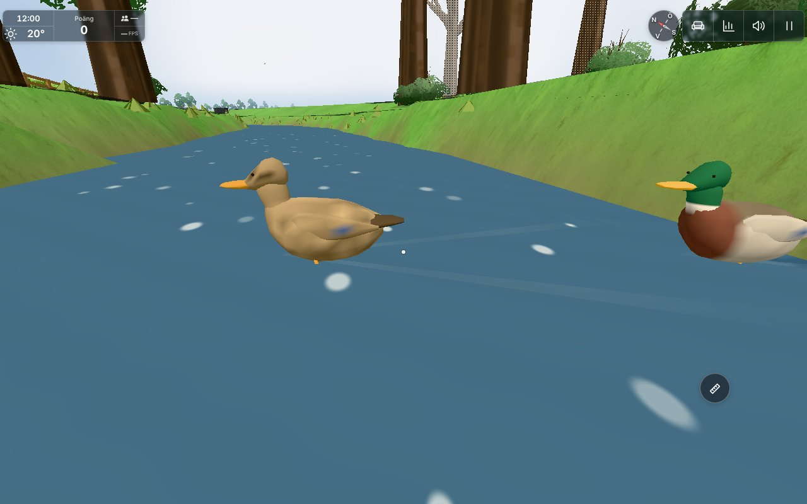
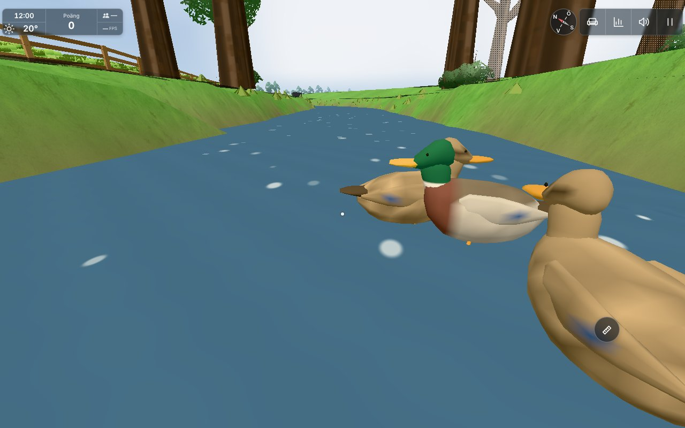
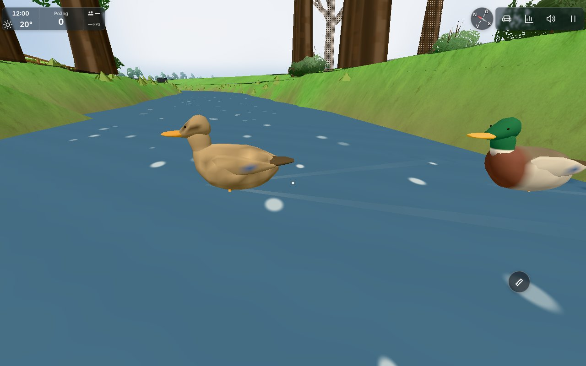
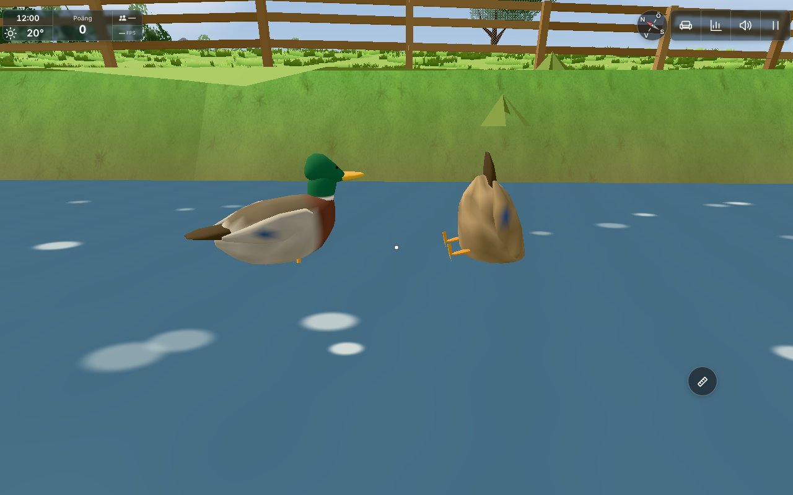
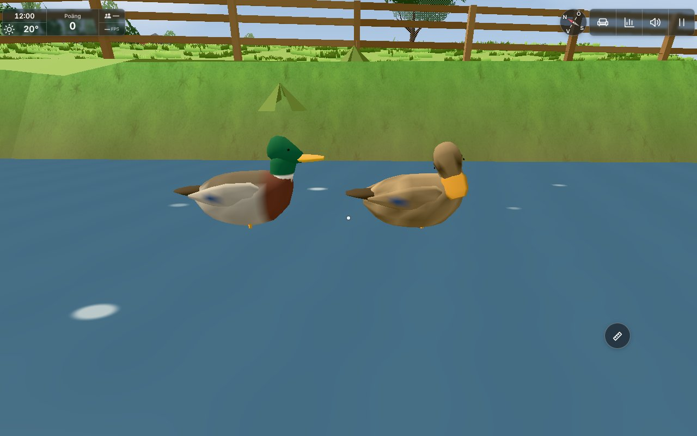
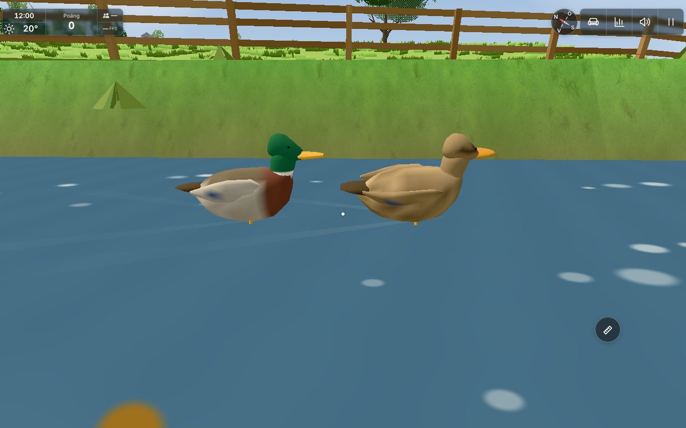
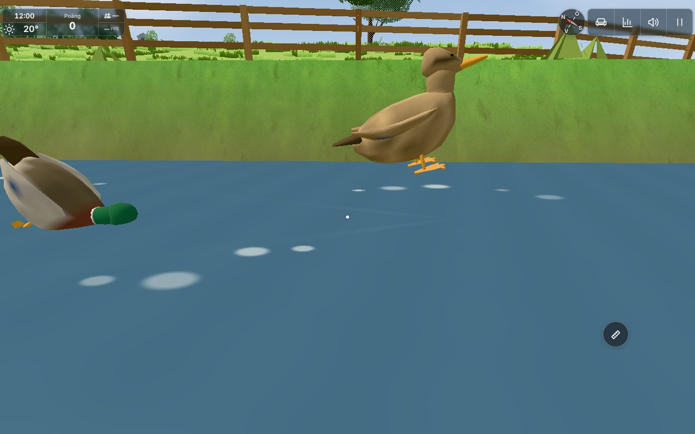

# #2126 — mallard swim strokes, dabbling, preening, shaking, take-off and V wake

Baseline `77796e26aa559e9b7c94ea3099687417a4ecb137`. The before phase serves that revision's `src/ducks.js` and
`src/duckbrain.js` in place of the working ones; everything else (scene, flock seed, habitat, rig, water) is the same
production code. Both phases run `tools/duckmotion2126browser.cjs` against the real app at the river
(`?life&month=6&day=2&time=12&freeze&weather=clear&test=lazy`), reseed the flock with `DuckFlock(seed 1839)`, and step
`Ducks.update` until female duck 0 swims forward within 1.2 m of the river centreline. The observer follows the bird
2.1 m to its water side. Images are native 1280×800 captures (JPEG q85). Raw data: [browser.json](browser.json),
[before/browser.json](https://github.com/solwation/lunden-3d-apartment/blob/361ad4fe8fc2b27ee8d318c9f401063b9a9cf8a2/docs/verification/2126/before/browser.json).

## Frame sequence

| | Before | After |
|---|---|---|
| Swim, frame 0 |  |  |
| Swim, +0.25 s |  |  |
| Swim, +0.5 s |  |  |

The before/after swim frames come from the same seeded route but at different flock times (989 vs 1555 steps,
because resting behaviours pause wandering), so the companions differ. The after frames show the faint V wake
trailing duck 0 and its mate; the head-bob/surge amplitudes (0.07 rad neck rotation, 1.8 cm surge) are deliberately small.

After only, forced on duck 0 (head turned toward the observer for preening):

| Dabbling (1.6 s) | Preening (1.8 s) |
|---|---|
|  |  |
| **Shaking (0.35 s)** | **Take-off (0.55 s)** |
|  |  |

Dabbling clearly shows tail up, head under the waterline. Preening turns the head back over the shoulder. A single
shake frame shows little (the roll oscillates at 9 Hz); take-off shows the bird lifted ~0.5 m, nose up, feet hanging;
the existing `flap` clip beats the wings but a side view shows them only modestly.

## Checks

1. `node tools/duckmotiontest.mjs` — PASS (6 groups): one simulated hour gives dabble/preen/shake 37/115/57 starts,
   80 % of time free (stub river is mostly shore, so dabbling is rarer than on the real river); dabbling only on water;
   no take-off without disturbance; seeded/repeatable; wake never rises unless the bird swims forward and is exactly
   zero when still, ashore, distance-paused or airborne; bread lure overrides `hold`; eating/lure/kiss cancel;
   kissing pose is neutral (DuckKiss bill contact unchanged); take-off cooldown; dabble bill below the waterline and
   tail up; V arms at the Kelvin half-angle, fading and clipped at the bank.
2. Existing duck tests unchanged and passing: `ducktest`, `duckkisstest`, `duckrangetest`, `duckrewardtest`,
   `riggedducktest`, `bestiarycatalogtest`.
3. Browser (above): zero page/console errors in both phases; with all ducks resting, the wake batch is hidden.

## Cost

- One shared wake mesh for all four birds: 112 vertices, 96 triangles, one transparent DoubleSide `MeshLambertMaterial`
  with vertex alpha. One extra draw only while some bird leaves a wake; zero textures; no new render pass or light.
- Programs: measured 37→39 at the first swim frame (39→41 later frames, 42 in both after behaviour frames);
  the wake adds one program variant, the remainder is lazy-compile timing between differently framed runs.
  The phone profile gets the same single variant (needed for the wake; no other program change).
- CPU: `Ducks.update` median 0.36 ms (before) vs 0.23 ms (after) per frame in SwiftShader — within noise. The bank mask
  costs ≤14 ground lookups per wake-leaving bird every 0.2 s.
- No network field; behaviours are local and seeded per bird. #2082 water geometry/shader untouched.

## Limits

Poses are additive bone rotations on the stylised rig; no new clips or GLB change. Take-off is a hop-flight in place
along the bird's existing route (it does not flee to a new territory). The wake is a static-shaped ribbon V, not a
simulated wave field, and has no foam texture. Houses A/B/C/L are not applicable (river animals only).

Publicering: Pages/Worker success på `361ad4f`; före-bilder borttagna vid stängning och visas från den commiten.
