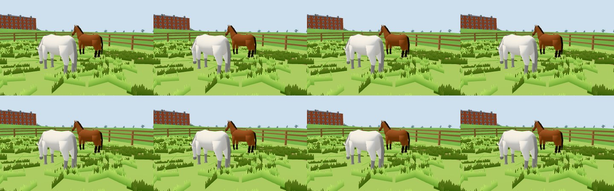
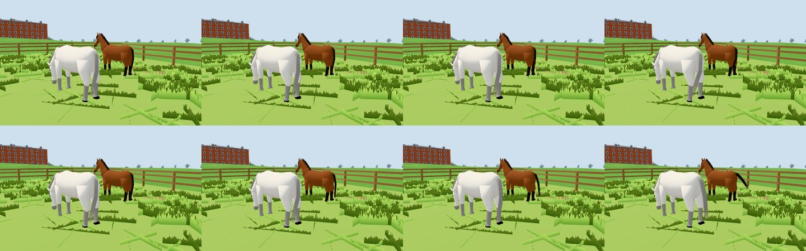
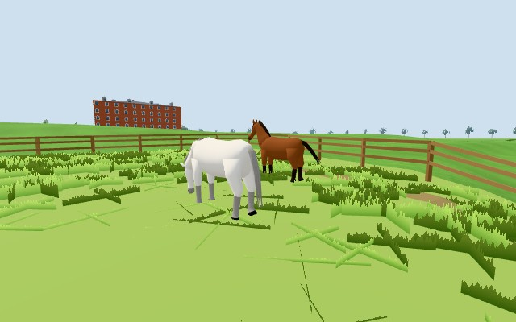

# #2127 — ponies: wind in mane and tail, weight shift, chewing, ears, flies, slow grazing steps

Original only (personal animal gameplay; the public paddock animals are separate, #235–#238).

## Frame sequence (actual paddock, July, clear, `&wind=0.75`, 0.4 s per frame, rear-left view)

Zoey grazes (front, white), Princess stands (behind, bay); the wind comes from their right.

Before (base `77796e26`, `src/paddock.js` of that revision served by the harness): only the idle clip's tail sway on the standing pony.

After: both tails blow left in the gusting site wind and lag as a chain, Princess swats a fly (frames 7–8), ears turn, the bodies
roll slightly as the weight shifts, Zoey chews with her head down.

Bone motion over the 8 frames (max rotation from frame 1, rad; `browser.json` / `before/browser.json`):

| | tail base (Z / P) | tail tip (Z / P) | left ear (Z / P) | head (Z) | body roll |
|---|---|---|---|---|---|
| before | 0 / 0.29 | 0 / 0 | 0 / 0 | 0.03 | 0 |
| after | 0.24 / 1.02 | 0.12 / 0.20 | 0.29 / 0.50 | 0.07 | −0.017 … −0.022 |

Graze step (harness, 5 s after the bite was cropped): 0.42 m moved in 45 stepping frames, neck stays 1.51 (head down), state `graze`.
The rug still shares the ponies' instance matrix (`rugShared` true in every frame), so it follows the roll.

## Checks

- `node --test tools/ponymotiontest.mjs` (7 tests): every motion bounded through all states, gales, flies and 0.1 s frames;
  wind drives mane and tail downwind in the pony frame (calm = idle sway only), `ponyWind` turns the real `siteWind` with the pony;
  the tail joints lag as a chain; flies only in June–August and dry weather (twitches and swats, none otherwise); weight alternates
  sides while standing and settles while walking; chewing only head down; ears forward while watching; graze-step timing/bounds;
  the shader patch's uniforms and shared program key.
- Unchanged existing tests: `tools/ponyblankettest.mjs`, `tools/riggedponytest.mjs`, `tools/paddocksurfacetest.mjs` pass.
- The grazetest crop contract (a pony grazing 20 s crops the grass at its muzzle below 0.4) simulated 40× in node with the real
  `Paddock` and varied step timing: 0 failures (steps happen only once the bite is cropped, 0.4–0.9 m).
- Browser (`tools/ponymotion2127browser.cjs`, before/after): zero page/shader errors; 29 draw calls and 23 programs in both phases
  (no new program variant or draw), 17 textures both. (Triangle totals differ by session-random scenery, not by this change.)

## Cost

CPU ≈0.4 µs per pony per frame for `stepPonyMotion` (node), plus ~20 quaternion multiplies per rigged pony; no buffers, textures,
lights, passes or draws added. Shader: a few ALU ops per pony vertex (2,652 triangles each); the shadow depth pass keeps the
unpatched shader (the mane's few cm of wind are not in the shadow). `src/ponymotion.js` 7.7 kB.

## Limits

- Skin twitch amplitude is 12 mm: visible close up only; not captured at the frame times above (covered by the helper test).
- The mane offset is in bind space, so with the neck down it partly turns into a vertical lift rather than sideways.
- The fallback instanced pony (shown only until the GLB loads) gets the roll and the tail wind/swat, not ears/chewing/mane.
- No real-device (phone) run; the phone profile gets the same single program.
