# #2128 — squirrels: fluffy tail with S-motion, eating with the front paws, seasonal caching, scanning

Original only (feeding/nuts are original gameplay; the public passive animals are a separate transfer decision).

## Frame sequences (actual park, October, noon, clear; `tools/squirrel2128browser.cjs`)

One real squirrel (animal 1, on the ground beside its tree; fixed clock so before and after stand at the same place) driven through the
production `Squirrels.pose()` — the consumer both the leader and a follower use. Six frames per row. Before = base `b040a13c`, its four
squirrel modules served by the harness (`before/`).

| | before | after |
|---|---|---|
| hopping (0.035 s/frame) | 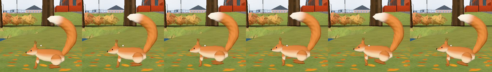 | 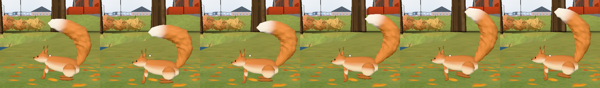 |
| leap (0.05 s/frame) | 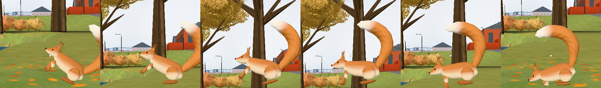 | 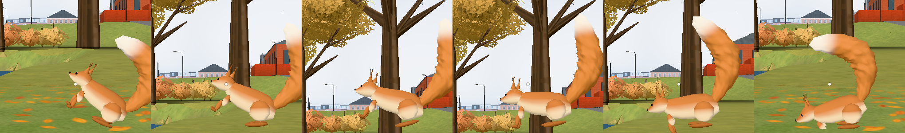 |
| scan (0.25 s/frame; before: `search`) | 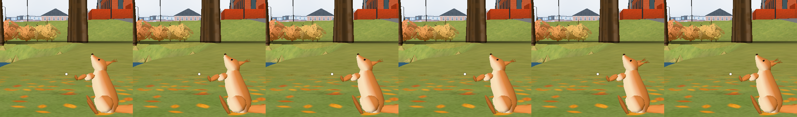 | 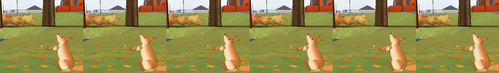 |
| eating (0.12 s/frame) | 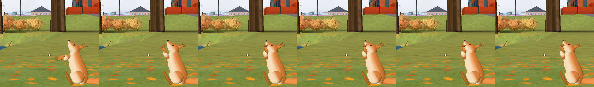 |  |
| digging (0.06 s/frame) | 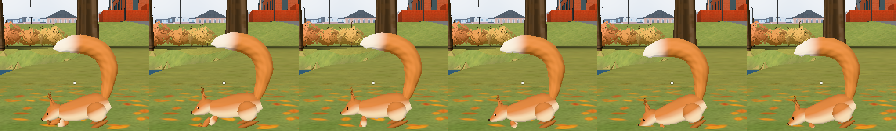 | 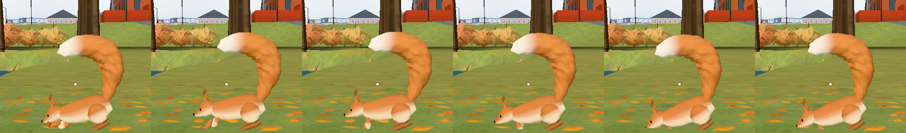 |

After: the tail swings in an S that counters each hop and opens out in the leap, curls tighter sitting up; the eating squirrel holds the
nut in its folded front paws at the mouth and turns it (before: paws raised, nut still on the ground, nothing in the paws); the scanning
head holds and snaps between looks. Tail joint changes over six frames (`browser.json`): after 6/6 distinct in every phase; before 5 hopping
(the run clip's Tail_1), 1 in every other phase.

## Close-ups (`tools/squirrelvisualtest.html`, three looks)

Fluffier plume (wider profile, ragged hair-lock outline, same vertices): 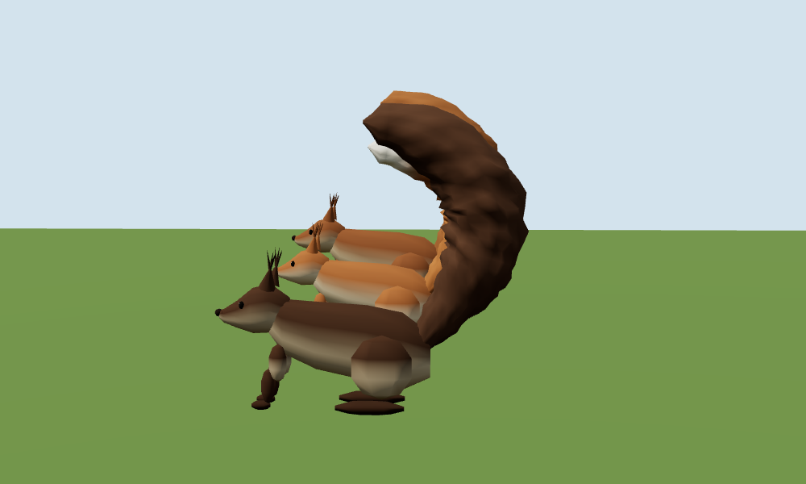 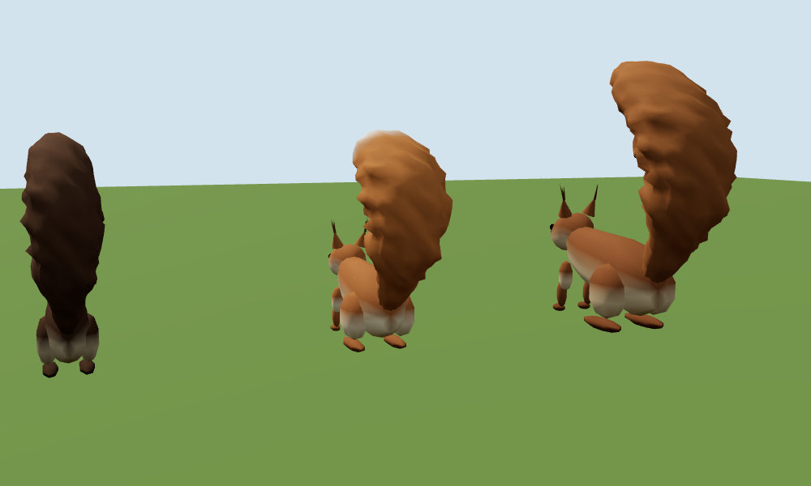
before: 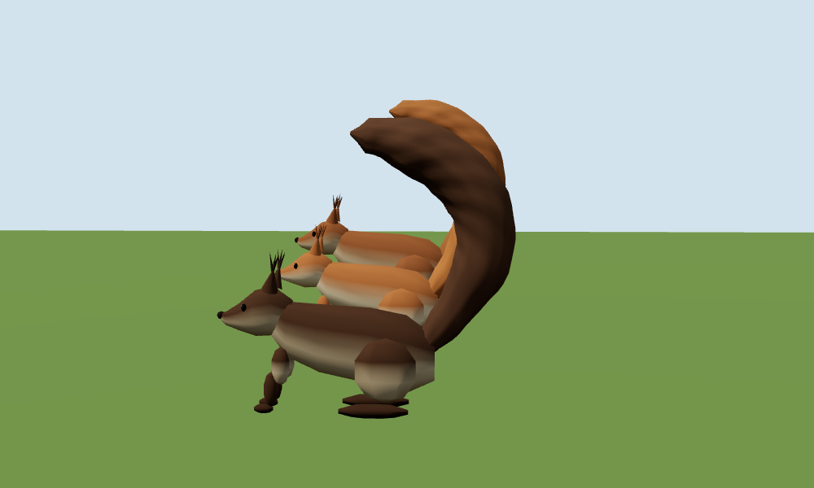

Eating: 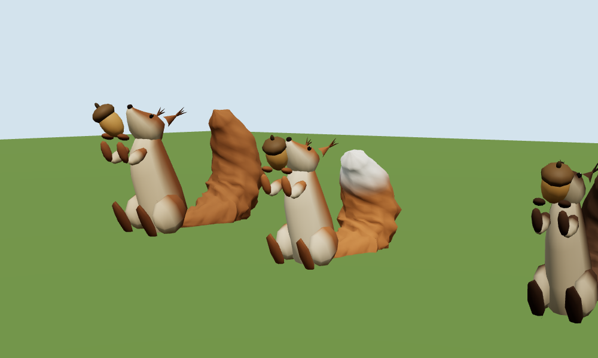 before: 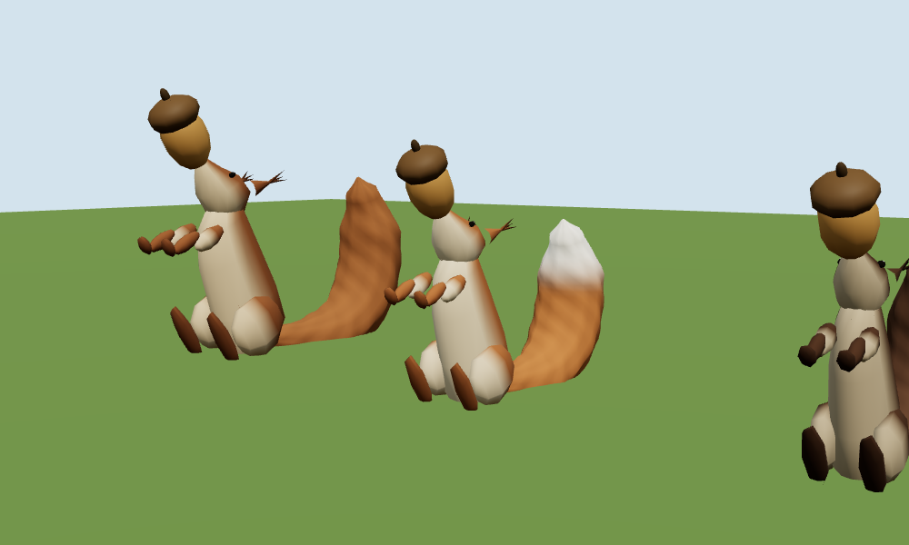

## Checks

- `node --test tools/squirrellifetest.mjs` (new, 6 tests): seasons (autumn buries most, summer = old 0.4, winter least; digs only
  winter/early spring); a brain over 30 simulated min per season with nuts: autumn > 0.6 of found nuts buried, winter < 0.25, winter digs
  up smelled caches and eats them, every season scans, scanning stays on the ground (cats' `prey()`), same seed = same log; scan sits up
  and resumes the forage trip, wire state `search`, still 12 states / 9 fields; an eaten nut is in the paws (`hasNut`) and gone from the
  ground; tail offsets within ± `SQUIRREL_LIFE.tail.max` over >10 000 samples, S-shaped, counter-swing negative, leap opens, sitting curls,
  deterministic; scan head mostly still holds with quick snaps, bounded; eating paws bounded.
- `node --test tools/squirrelbraintest.mjs tools/riggedsquirreltest.mjs`: green (one existing assertion now checks that the dug cache
  itself is gone, not that no other cache exists: with the nut leaving the ground at the start of eating it respawned and was buried again).
- Browser (harness above): October reaches the brains (`life().bury` 0.8); draw calls 344/345 after vs 345 before at the same view;
  131 programs both; all tail joints finite; zero page/shader errors.

## Cost

No new draw call, material, texture, program, pass or network field. Tail topology unchanged (near/far 3062/1228 triangles per squirrel).
Per visible rigged squirrel per frame: 12 bone quaternion resets + 7 tail multiplies (+4 while eating, plus one group matrix update for the
nut's place). The fallback (no GLB) morph squirrel keeps its old tail flick only.

## Limits

- Snow months still hide the squirrels (unchanged), so the visible "winter" digging is March (and lighter in April–May).
- Digging up a "smelled" cache is local: it yields a nut to eat without a NutField slot, like digging up an own cache always did.
- A found nut now leaves the ground when the squirrel starts eating it (it is in its paws), not 2 s later.
- A follower sees `scan` as `search` (same sitting pose and head jerks; its scan sequence differs from the leader's).
- Tree climbing (#2132): a new crown/trunk state joins the air states and gets a WIRE entry (header of `src/squirrelbrain.js`).
