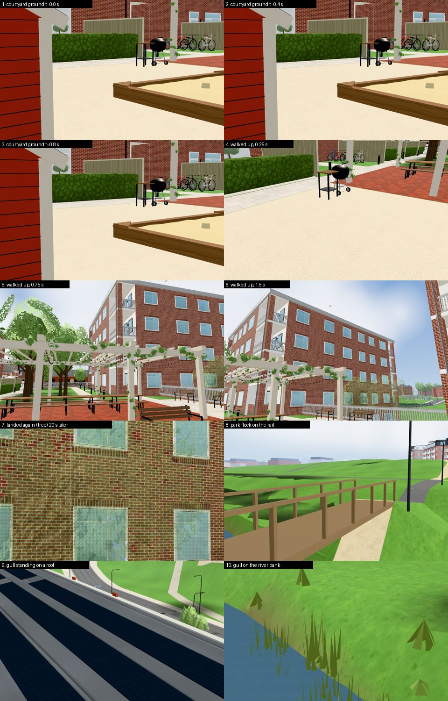
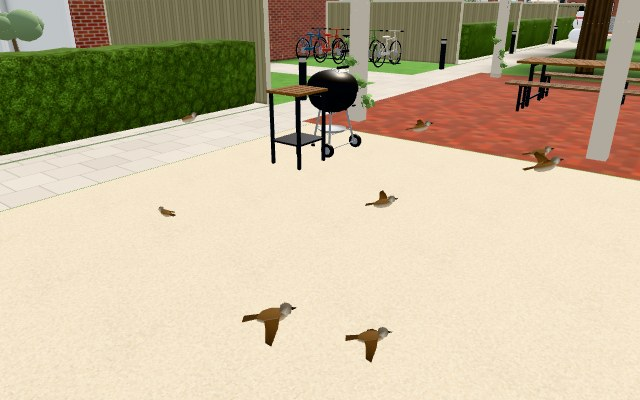

# #2129 — small birds in flocks, landing on real surfaces, and landing gulls

Original only (the public site has its own passive environment animals, #235–#238).

## Frame sequence (actual game, June, 11:00, clear; `tools/birds2129browser.cjs`)

Frames 1–3: the courtyard flock pecking and hopping on the playground gravel, seen from 9.3 m (zoomed, fov 24°: every bird
outside the 7 m flush distance). 4–6: the eye walks up to 3 m; 0.25 / 0.75 / 1.5 s later the flock is off (fov 45°) and heads
for a tree. 7: 20 s later, landed in a crown by Hus A (fov 14°). 8: the park flock on the timber bridge's handrail (fov 30°).
9: a gull standing on Hus L's roof by the solar panels; 10: a gull on the bank of Höje å (fov 20°). In the shots only the eye
counts as a threat (no roaming outdoor cat walking through).

Before (base `b040a13c`, the same camera poses): no small birds anywhere; the gulls only circle (none on the roof or bank).

After:

## Checks

- `node --test tools/birdflocktest.mjs` (8 tests): every perch lies on its source surface (roof spot on its roof at its height and
  the top surface there, nothing under a canopy; crown spot just inside the shell, not under a roof, not in/against a house; rail
  spot on the rail line; ground spot on gravel/grass and off paths/sandboxes/pergolas); gull spots on roof tops (near the ridge) and
  bank points inside the area; a 9-bird flock over 400 s moves between perches, stays together (spread < 25 m), never overlaps,
  turns smoothly (< 0.6 rad per frame) and sits exactly on its spots; ground birds hop and peck only inside the patch and are
  listed by `groundBirds`; a walker beyond the flush distance leaves them, one inside it flushes them up into a tree ≥ 14 m away
  within the reaction spread, where they stay; same seed + inputs → identical flight; gulls land, stand folded on their spot,
  rejoin the circle continuously and a walker within 9 m sends a standing gull up for the rest of that round; phone count lower.
- Unchanged existing tests: `tools/gullsurfacetest.mjs`, `tools/bestiarytest.mjs`, `tools/bestiarycatalogtest.mjs`,
  `tools/bestiarysight1851test.mjs`, `tools/bestiaryproptest.mjs` pass.
- Browser before/after (`browser.json`, `before/browser.json`): zero page/shader errors; 119 programs in both phases (no new
  program: the sparrows use the gulls' material); 40 → 42 draw calls in the gull-bank view (+1 small-bird batch, +1 because a
  landed gull now sits in the near gull batch); textures 134 both. 17 small-bird instances, 120 triangles each.
  Perches found: courtyard 8 crowns, 2 roof edges, 4 rails, 4 ground patches; park 8 crowns, 8 roof edges, 2 rails, 1 glade;
  gull spots 12 roof + 12 bank.

## Cost

`Birds.update` with both flocks awake and the gull roost: 0.015 ms per frame (browser, 300-frame mean, after the one-time perch
setup on the first shown frame). One extra draw (≈2 040 triangles for 17 birds) only while a flock is within `wake` m; phones fly
6 small birds (courtyard only) with the same single program. Geometry ≈14 kB (sparrow recipe) + ≈2 kB instance buffers; no
texture, light, shadow, pass or raycast target. No network fields: flocks are seeded and local per visitor.

## Limits

- Hus A–C's hip roofs are not walkable surfaces, so the small birds do not perch on their eaves (only on Hus L's terraces/roofs and
  the park-side roofs that are); gulls do land on Hus L and the other mapped roofs ≥ 8 m.
- Tree perches are points just inside the crown shell; a bird can be half hidden by dithered foliage or appear in front of a wall
  behind the crown (frame 7).
- No sound, no bestiary entry for the small birds (gulls keep theirs; a landed gull's sighting point is its real position).
- `groundBirds()` is only a hook; the outdoor cats do not stalk birds (#2125 may use it). Cats do flush them.
- Other players do not flush your birds (local, like before); no phone run on a real device.

Publicering: Pages/Worker success på `8f01374`; före-bilder borttagna vid stängning och visas från den commiten.
