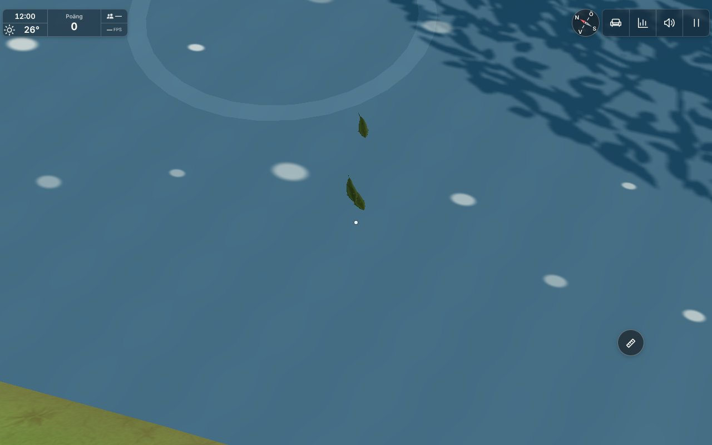
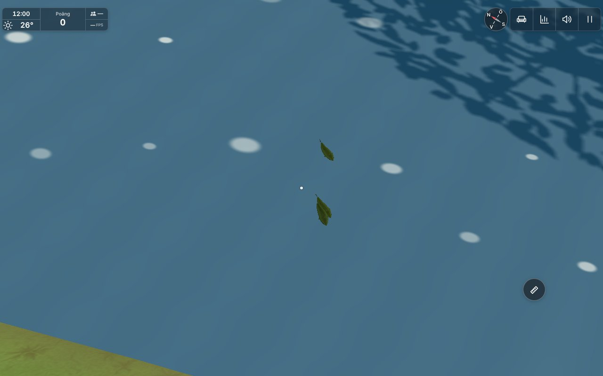
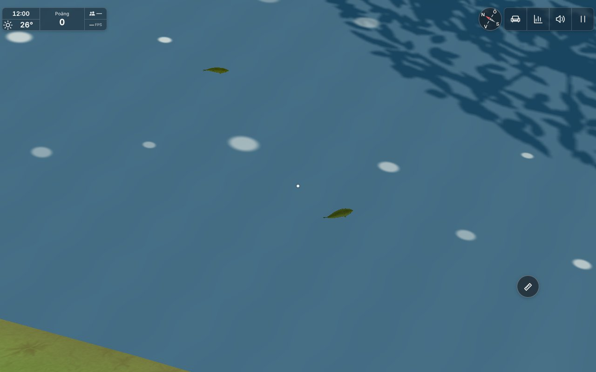
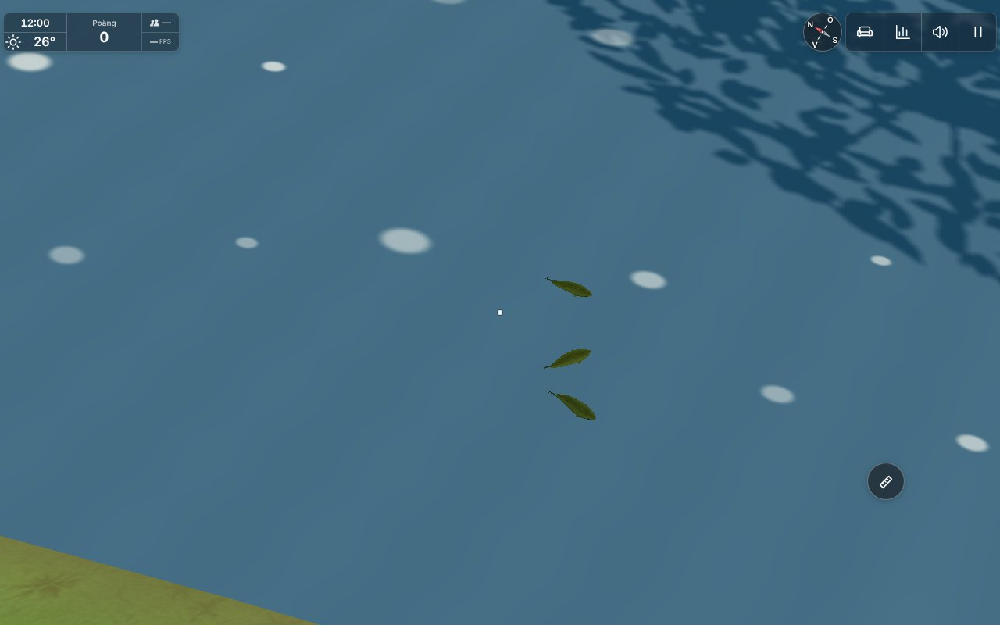
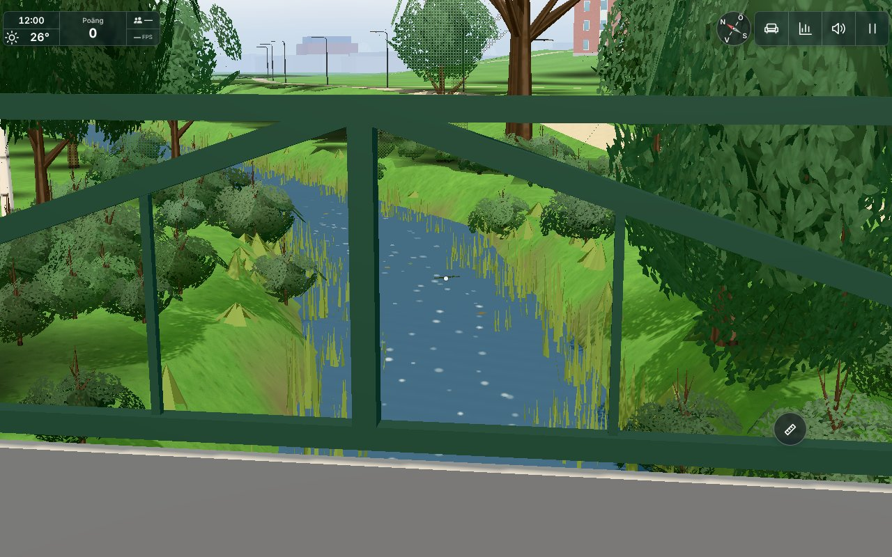
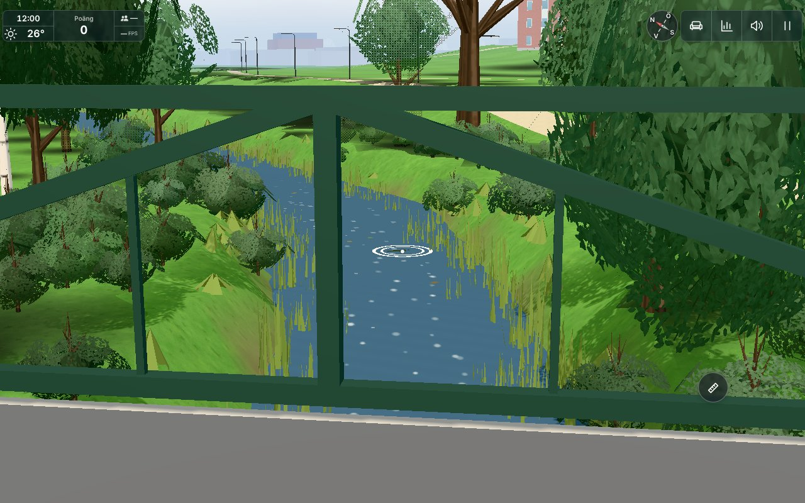
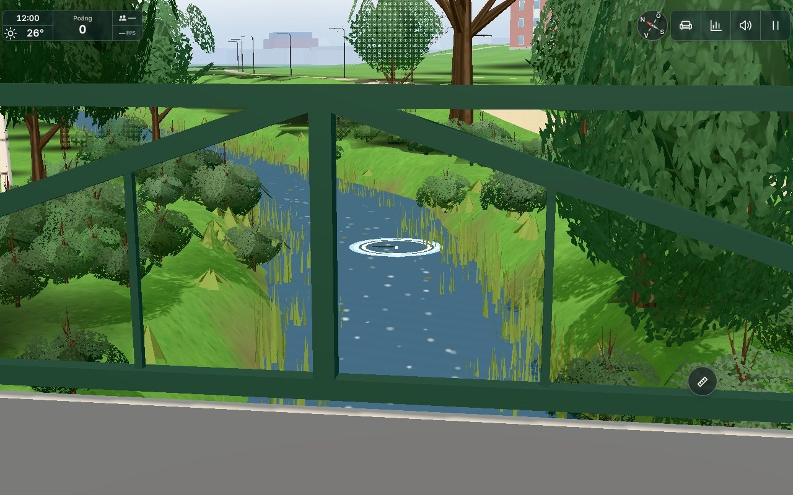
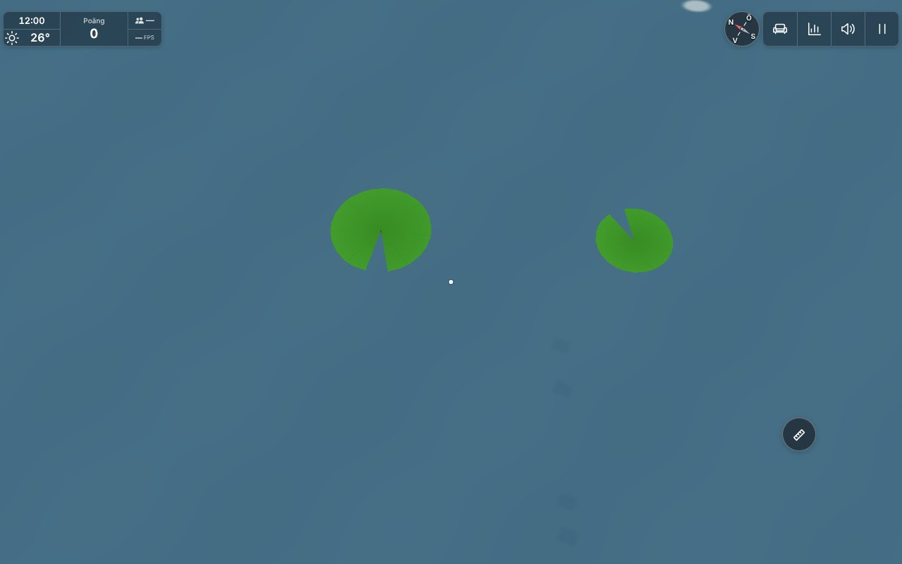
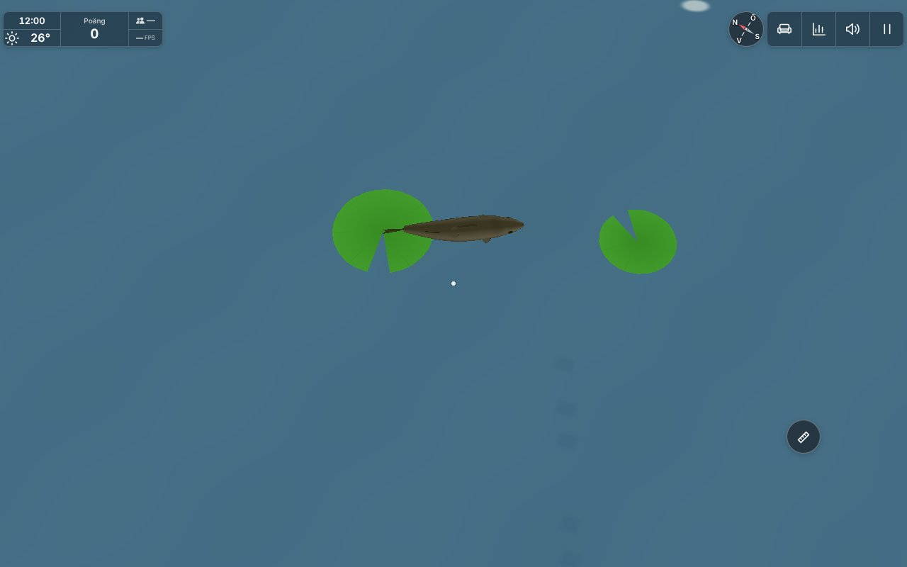

# #2130 — river fish in loose schools, still moments in cover and quick surface takes

Baseline `07213d5d` (`origin/main` when the work started). The before phase serves that revision's `src/riverfish.js` in
place of the working one; everything else (scene, flora, fish seed 1754, room clock) is the same production code. Both
phases run `tools/riverfishschool2130browser.cjs` against the real app (`?life&month=7&day=10&time=12&freeze&weather=clear&test=lazy`)
and set the fish clock to the same room times, found with `src/riverfishschool.js` from `T0 = 1700000` s: the perch school
(fish 0, 3, 10) while its leader turns more than 1 rad within 3 s; the first take within 40 m of the bridges; the first hold
in the lee of a lily patch. Images are native 1280×800 captures (JPEG q85). Raw data: [browser.json](browser.json),
[before/browser.json](https://raw.githubusercontent.com/solwation/lunden-3d-apartment/e2e28f35c0432d5235bab7745c36809ac601eb14/docs/verification/2130/before/browser.json).

## School from the bank (t = 1700046 s, +1.5 s, +3 s; eye 1.2 m beyond the bank edge, 40° view)

| | Before | After |
|---|---|---|
| 0 s |  |  |
| +1.5 s |  |  |
| +3 s |  |  |

Before, the three perch swim their own paths (two of them are off screen). After, they keep slots by the
leader and turn with it. The faint ring in the after frame at 0 s is an ordinary shared rise, now drawn where its fish was drawn.

## Take seen from the road bridge (pike 12, 25 m from the bridge; −0.15 s, +0.6 s, +1.6 s; 30° view)

| | Before | After |
|---|---|---|
| −0.15 s |  |  |
| +0.6 s |  |  |
| +1.6 s |  |  |

After, the take's rings (up to 1.9 m, brighter than an ordinary rise's) spread on the water and are clearly seen from the
deck through the railing; before, nothing happens at that moment.

## Hold in the lee of a lily patch (trout 8, t = 1700016 s; 28° view)

| Before | After |
|---|---|
|  |  |

After, the trout stands still just downstream of the pads, head against the current, near the surface; before it was
off screen on its own path.

## Checks

1. `node --test tools/riverfishschooltest.mjs` — PASS (5): schools only among roach/bream and perch of one stretch, lowest id
   leads, input order irrelevant; members in their slot heading together with the leader (> 80 % within 0.5 rad, clearly
   more than their shared paths); holds rare (2–15 % of the time; 6.6 % measured), still, facing upstream and in the lee
   of cover (> 80 %); takes rare (about 12 an hour per fish or school, ~1 per 5 min), deterministic across clients and
   build orders, the taker at the surface where its rings start; shared `fishAt`/`ringsAt` untouched, every drawn fish
   inside a swim stretch, inside the channel, between bed and surface and within 14.3 m of its shared place (the room's
   catch reach is 30 m).
2. Existing tests: `node --test src/riverfishfeed.test.mjs` (8), `tools/fishglbtest.mjs` (7), `tools/bestiarycatalogtest.mjs`
   (4), `src/riverflora.test.mjs` (6), `src/harpoonflight.test.mjs` (7) — PASS. `tools/sharedfishclient.test.mjs` fails 3 of 4
   identically on the baseline (unrelated to this change).
3. Browser (above): no page or shader errors in either phase; draw calls and programs identical before/after in every
   view (school 34/35, bridge 63–64/48, hold 29/49; the after bridge frames with rings add the existing ring batch's one
   draw); `RiverFish.update` near the school 0.10–0.12 ms vs 0.03 ms before (SwiftShader, median of 3 × 300).

## Limits

The fish are still the existing flattened shapes seen from above the water, so a school reads as a few small dark
shapes close together. With seed 1754 no school swims within 45 m of the bridges (the nearest is 100 m upstream); from
the bridges one sees the lone pike's takes and rises. Holds use RiverFlora's stones (seen only by a diver) and lily pads
(May–September); with `&noflora` a hold is in open water. The rod's bites keep counting the shared places, up to about
15 m from a drawn fish (usually a few metres).

Publicering: Pages/Worker success på `e2e28f3`; före-bilder borttagna vid stängning och visas från den commiten.
