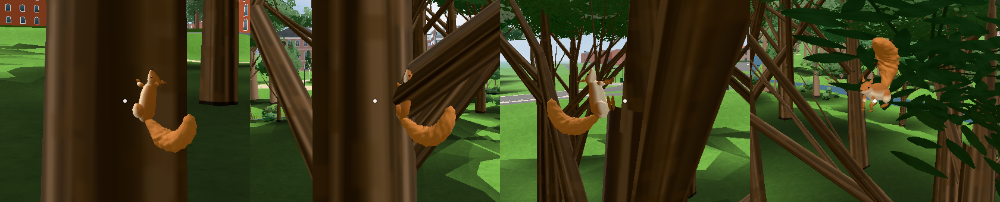
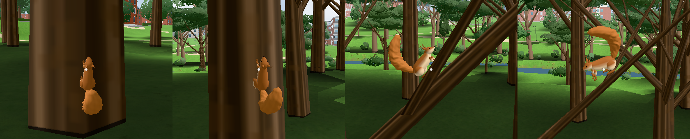
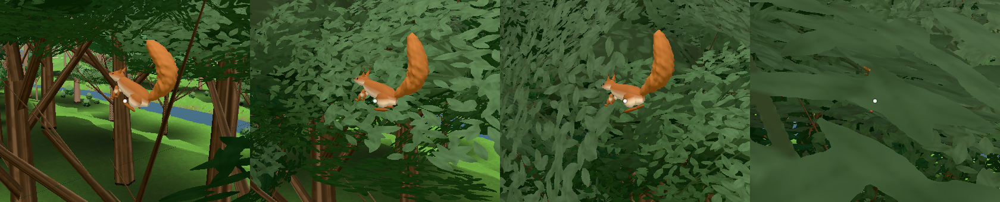
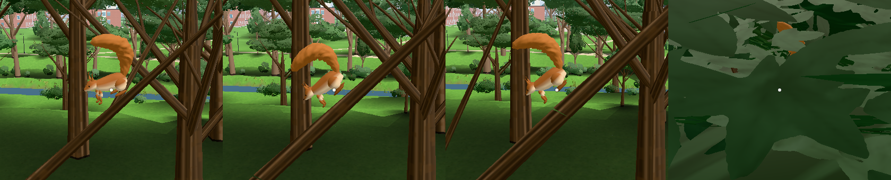
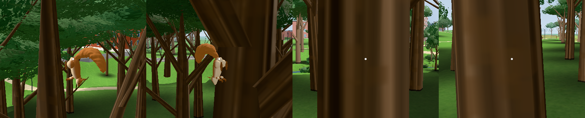
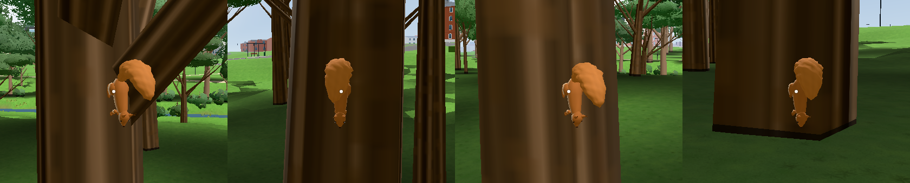

# #2132 — squirrels climb the trees' real trunks and limbs

Original only (the public transfer is registered as kvarteret-lunden#328).

## Frame sequences (actual river park, July, noon, clear, wind 0.5; `tools/squirrel2132browser.cjs`)

One real squirrel (animal 0) at the foot of the river-park maple nearest the park's centre that has a branch hop to a neighbour
(trunks 9.35 m apart, a big maple each), driven through the production `SquirrelBrain.update` and `Squirrels.pose` (the leader's
consumer), with the trees' near/far level updated for the frame's camera. Camera on the stem: outside it (the squirrel's back);
in the crown: beside the limb. Before = base `ab7b1953`, its config / squirrels / squirrelbrain / squirrelsync served by the harness
(`before/`, the same trees).

| | before | after |
|---|---|---|
| up the trunk, then a perch |  |  |
| crown: before a 9 m leap through the air between the crowns; after a run in along the limb and a jump of at most 2.6 m |  |  |
| down |  |  |

After: the squirrel climbs pressed to the bark with its belly to the stem and nose up, spirals round it to a main limb, runs out along
the limb and sits on it; to change crowns it runs back in and round to the limb nearest the neighbour and jumps to that one's branch;
it comes down head first with its back out. Before: it climbed sideways on a 0.3 m circle (inside the thick stems, hidden on the way down),
sat on the leaf surface and leapt crown to crown across up to 11 m.

## Checks

- `node --test tools/squirrelclimbtest.mjs` (6/6): climb routes measured against the drawn trunk geometry (foliage.js `trunkGeometry`
  under each tree's instance matrix; 85 % of points within 0.03 m of `cling`, the rest at crotches where a limb leaves the stem); spiral
  turns as configured, ending on the limb's side; trees linked as crown hops exactly when two branch points are within `hop`; 30 min of
  three brains: every jump <= 2.6 m and onto a limb, nose up on the way up, head first down (pitch < -1.3 on the stem), off the ground
  (> 0.15 m, the cats' `prey()` rule) once climbing; deterministic; `limb` goes over the wire as `up` (12 states, 9 numbers).
- Existing: `tools/squirrelbraintest.mjs` 30/30, `tools/squirrellifetest.mjs` 6/6, `tools/treeformtest.mjs` 6/6,
  `cloudflare/squirrels.test.mjs` 10/10, `tools/nutdropclient.test.mjs` 2/2, `tools/nutpathtest.mjs` 3/3.
- Browser (`browser.json`): no page or shader errors before or after; 339 of the 350 squirrel trees have a climbing frame; crown-hop
  links 519 → 230 (the rest are now ground runs), hop gaps 0.11–2.59 m; draw calls per frame unchanged (the squirrel is still one
  draw; the counts follow the camera's view).

Cost: no new draw, texture, material or program; per tree a plain frame (5 limbs, ~6 kB) built once at start (~40–60 ms for 350
trees in node, plus ~10–20 ms for the hop pairs); per frame only the path step of squirrels being simulated.
